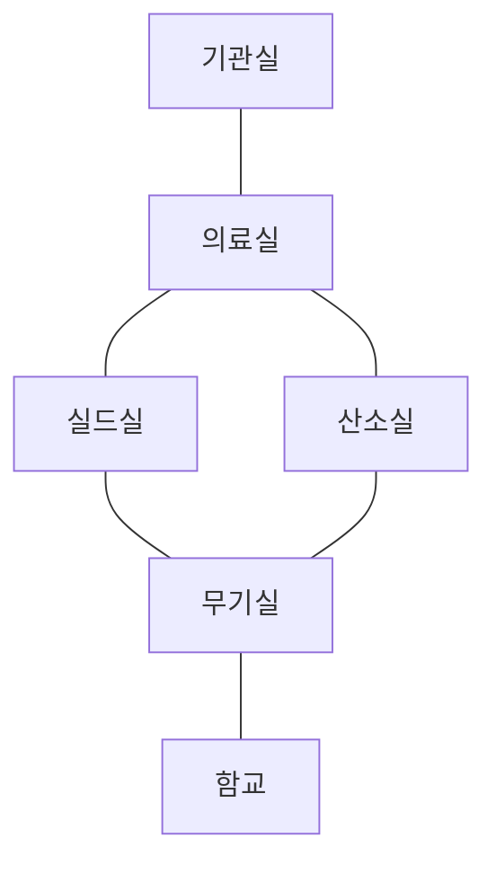

# STARWARD v5 — 함선별 실제 격실과 문 토폴로지

이 문서는 STARWARD의 실제 레이아웃 데이터와 전투 연결을 설명합니다. 원작 FTL의 내부 수치나 함선 도면을 복제한 자료가 아닙니다. v5는 기존 여섯 시스템 방을 유지하면서 **방의 위치·크기·문·에어록·연결 경로**를 함선별로 구분합니다. 별도의 빈 복도나 보조 시스템 방은 추가하지 않습니다.

근거: [data.js](../dist/data.js)의 `layouts`·`loadouts`, [campaign.js](../dist/campaign.js)의 적 레이아웃 지정, [engine.js](../dist/engine.js)의 `makeShip`·`getLayout`, [UI](../dist/app.js)의 함선 도면. 이동 규칙은 [v5 항법 명세](v5_navigation.md), 저장·시험은 [v5 검증 명세](v5_validation.md)를 함께 읽습니다.

## 1. 레이아웃과 장비 구성의 분리

`loadoutId`는 시작 선체·장비·종족·보급을 고르고, 각 함선의 `layoutId`는 실제 공간 구조를 고릅니다. 새 아르고·아틀라스·레이스는 해당 레이아웃으로 생성합니다. 적도 자기 레이아웃을 가지므로 플레이어와 적이 같은 방 좌표를 공유한다고 가정하지 않습니다.

이전 저장의 아틀라스나 레이스는 `loadoutId`를 유지하면서 `layoutId='legacy'`를 사용할 수 있습니다. 이는 구 항해의 도면·위치·경로를 보존하기 위한 정상 상태입니다. 새 항해를 시작하면 새 구조를 적용합니다.

| 레이아웃 ID | 용도 | 설계 의미 |
|---|---|---|
| `legacy` | v1~v4 항해 호환 | 당시의 여섯 방·문·좌표를 유지 |
| `argo` | 새 아르고 | 기존 균형형 구조를 기준으로 운용 |
| `atlas` | 새 아틀라스 | 밀집 배치와 중심 연결에 따른 수리·이동 판단 |
| `wraith` | 새 레이스 | 길게 이어지는 연결과 제한된 통로의 이동 부담 |
| `interceptor` | 일반 적 | 플레이어 구조와 다른 표적·빔 기하 |
| `flagship` | 기함 | 별도 방 구조에서 기존 세 단계 패턴 운용 |

기존 무기·전력·선체·보상·가격은 이 구조 변경과 분리합니다. 방 구조가 달라져 이동 거리·감압 경로·빔에 들어오는 방이 달라지는 것이 핵심입니다. 현재 데이터의 방 범위와 문 수는 다음과 같습니다.

| 구조 | 방 범위 | 내부 문 | 에어록 | 연결 특징 |
|---|---|---:|---:|---|
| legacy·아르고 | 7×4 | 8 | 2 | 상하 우회로, 기관·의료 외부문 |
| 아틀라스 | 6×4 | 7 | 2 | 중앙 무기·의료 연결, 후방 기관·산소 외부문 |
| 레이스 | 8×4 | 6 | 2 | 기관실·함교는 각각 단일 진입, 기관·산소 외부문 |
| 요격함 | 6×4 | 6 | 2 | 둘레 순환, 실드↔의료 직접 문 없음 |
| 중전투함·기함 | 8×4 | 7 | 2 | 기관실2×4, 함교는 무기실에서만 진입 |

### 실제 방 좌표

각 셀은 `(x,y; 너비×높이)`입니다. 좌상단 원점을 사용합니다. legacy의 방과 문은 아르고와 같은 기하이며 별도 ID로 저장합니다.

| 방 ID | 아르고·legacy | 아틀라스 | 레이스 | 요격함 | 중전투함·기함 |
|---|---|---|---|---|---|
| `engines` | (0,1;2×2) | (0,0;2×2) | (0,2;2×2) | (0,0;2×2) | (0,0;2×4) |
| `shields` | (2,0;2×2) | (4,0;2×2) | (2,0;2×2) | (2,0;2×2) | (2,0;2×2) |
| `weapons` | (4,0;2×2) | (2,0;2×2) | (4,0;2×2) | (4,2;2×2) | (4,0;2×2) |
| `bridge` | (6,1;1×2) | (4,2;2×2) | (6,0;2×2) | (4,0;2×2) | (6,0;2×2) |
| `oxygen` | (2,2;2×2) | (0,2;2×2) | (4,2;2×2) | (0,2;2×2) | (2,2;2×2) |
| `medbay` | (4,2;2×2) | (2,2;2×2) | (2,2;2×2) | (2,2;2×2) | (4,2;2×2) |

레이스의 실제 내부 문은 다음 구조입니다. 선은 양방향 통로를 뜻하며 방 중심 간 직선 이동을 뜻하지 않습니다.



기관실→무기실과 함교→의료실은 각각 세 문을 지나야 합니다. 화면에서 방이 접해 있어도 직접 문이 없는 연결은 통과할 수 없습니다. 요격함도 실드와 의료실이 벽을 공유하지만 문이 없으므로 둘레를 우회합니다.

## 2. 정규 데이터 형식

```js
{
  id, name, description, width, height,
  rooms: [{ id, name, x, y, w, h }],
  doors: [{ id, a, b, x, y, orientation, airlock }],
  outline: [[x, y], /* 선체 외곽의 격자 좌표 */]
}
```

좌표는 논리 격자 단위입니다. `width`·`height`는 화면 크기가 아니며, UI가 공통 SVG 영역에 맞춰 배율과 이동량을 구합니다. 방·문·승무원·효과·탄·빔·이동 경로는 해당 함선의 동일 변환을 사용해야 합니다. 장식 선체 외곽은 통로를 만들지 않습니다.

방 ID는 `engines`, `shields`, `weapons`, `bridge`, `oxygen`, `medbay` 여섯 개입니다. 주 시스템의 방 ID를 그대로 유지하므로 전력·무기 조준·승무원 담당·숙련의 의미는 바뀌지 않습니다. 드론은 무기실, 텔레포터는 의료실, 은폐는 엔진실을 공유합니다.

정규 구조의 조건은 다음과 같습니다.

- 각 방은 양의 너비·높이를 가진 사각형이고 다른 방의 내부와 겹치지 않습니다.
- 내부 문은 두 방이 실제로 공유하는 벽 위에 놓입니다. 두 방이 가까워 보여도 문이 없으면 연결되지 않습니다.
- 에어록은 한 방과 외부를 연결하며 `b=null`입니다. 다른 방 내부로 열리는 가짜 에어록을 허용하지 않습니다.
- 내부 문 그래프에서 모든 방이 연결됩니다. 문이 닫혔다는 사실과 그래프 연결의 존재는 구분합니다.
- 방과 문은 논리 방 범위 안에 들어갑니다. 장식 외곽은 이 범위 밖으로 조금 돌출할 수 있으므로 UI는 방과 외곽의 합집합을 계산해 맞춥니다. 방 배열과 문의 순서는 시스템 ID를 대신하지 않습니다.

## 3. 공간이 실제 전투에 미치는 영향

| 시스템 | 레이아웃 반영 |
|---|---|
| 승무원 이동 | 실제 문을 경유해 담당실·손상실·의료실로 이동 |
| 친선 문 통과 | 문 앞에서 자동 개방하고 기존 닫기 규칙 적용 |
| 침입자 | 상대 함선의 문 앞에서 파괴 시간을 지불 |
| 감압·산소 | 열린 연결과 해당 에어록을 따라 지역적으로 진행 |
| 화재·수리 | 실제 방에 도착한 인원과 그 방의 시스템에 적용 |
| 빔 | 목표 함선의 실제 방 사각형과 최대 길이 선분을 교차 |
| 승무원 배치 | 현재 함선의 유효 방 중심으로 복귀 |
| AI | 시스템의 의미는 유지하고 이동·표적 화면은 적 실제 구조를 사용 |

예를 들어 화면상 대각선으로 가까운 두 방도 문 연결이 우회하면 더 오래 걸립니다. 닫힌 문은 산소·화재·침입자 행동에 영향을 주지만 아군의 연결 탐색에서 통로 자체를 삭제하지 않습니다. 적선 침투조는 자기 함선의 편한 경로를 사용할 수 없습니다.

튜토리얼 적은 요격함 구조입니다. 일반 적 가운데 포격형은 중전투함 구조를 사용하고 나머지는 요격함입니다. 기함은 세 단계 모두 기함 구조를 유지합니다. 프로필·무기·특수 공격과 레이아웃은 별도 정보로 저장하며 같은 전술 이름이 반드시 같은 피해량을 의미하지 않습니다.

빔은 같은 `engines → weapons` 조준이라도 레이아웃별 방 위치가 다르므로 통과 방이 달라질 수 있습니다. 길이 제한은 그대로이며, 모든 방을 자동으로 연결하거나 장식 외곽을 타격 판정으로 쓰지 않습니다.

## 4. 호환과 범위

`DATA.rooms`, `DATA.doors`, `DATA.adjacency`는 이전 레이아웃 별칭으로 남습니다. 새 이동은 이 전역 연결 대신 실제 함선 문에서 경로를 구합니다. 저장은 정규 레이아웃 ID와 일치하는 기하를 요구하지만 문 개방·내구·산소·화재·승무원 상태는 해당 항해의 값을 보존합니다.

레이아웃 편집기·임의 사용자 도면·빈 방·칸별 인원 수 제한·개별 보조 시설실은 이번 버전에 없습니다. 신규 레이아웃 추가는 데이터만 넣는 것으로 끝나지 않으며, 정규 기하·문 연결·표시 범위·실제 완주 검증을 함께 만족해야 합니다.
