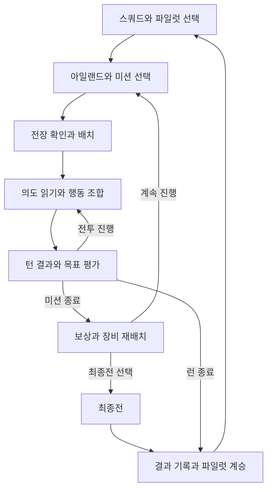

# 01. 게임 구조와 핵심 루프

> Into the Breach 시스템 역기획서 · PC + Advanced Edition 공개 규칙 · 조사 기준 2026-11-13  
> [전체 목차](00_README_문서안내.md) · [전투 규칙](03_턴구조_행동경제_되돌리기.md) · [미션과 전력망](10_미션_목표_전력망.md)

## 1. 문서의 관점

이 문서는 플레이어가 경험하는 규칙을 시스템 단위로 재구성한 문헌 기반 역기획서다. 원작 소스코드를 분석하거나 개발사의 내부 기획서를 재현한 문서가 아니다. **[확인]은 공개 자료에 근거한 설명, [분석]은 그 규칙을 연결한 설계 해석, [제안]은 유사 게임을 제작할 때 사용할 수 있는 명세**를 뜻한다.

핵심 해석은 다음과 같다.

**[분석] Into the Breach는 매 턴 공개된 피해 예정표를 제한된 행동으로 수정하고, 수정하지 못한 손실을 캠페인 전체에서 감당하는 전술 게임이다.** 공격력은 예정표를 수정하는 여러 수단 중 하나이며, 이동·밀기·행동 취소·공격 유도도 같은 목적에 기여한다.

## 2. 제품 범위와 사실 기준

| 항목 | 공개 자료로 확인되는 범위 | 문서 사용 방식 |
| --- | --- | --- |
| 개발·배급 | Subset Games | 게임 식별 정보 |
| 기본 출시 | 2018-02-27 | 최초판과 AE 자료 구분 기준 |
| 플레이 형식 | 싱글플레이 턴제 전술 | 네트워크 동기화는 역기획 대상 아님 |
| 핵심 보호 대상 | 민간 건물과 전력망 | 메크 생존과 별도 가치로 분석 |
| 전투 정보 | 적의 공격을 미리 표시 | 의도 예고와 결과 예측을 분리 |
| 반복 구조 | 매 시도마다 달라지는 도전, 시간선 재도전 | 런 상태와 영구 상태 분리 |

**[확인]** 위 제품 특성은 개발사가 게시한 [Steam 제품 설명(O01)](https://store.steampowered.com/app/590380/Into_the_Breach/)을 기준으로 한다. 확장 콘텐츠의 정확한 수량과 옵션 범위는 [20번 문서](20_Advanced_Edition_변경점.md)에 모았다.

## 3. 개발자가 공개한 설계 출발점

**[확인]** Matthew Davis의 GDC 회고는 읽기 쉬운 화면, 작은 수치, 짧은 전투를 설계 제약으로 설명한다. 적 공격 예고, 플레이어 턴에서의 확정적 전투 결과, 방어해야 할 건물, 제한 턴 승리 조건이 서로 연결되어 발전했다. 전력망 방어 확률은 그 확정성의 예외로 다뤄진다. [O05, 슬라이드 7–26](https://media.gdcvault.com/gdc2019/presentations/Into%20the%20Breach%20Postmortem%20Final.pdf)

**[확인]** Justin Ma는 도시의 부수 피해가 중요해야 한다는 목표, 상황에 따라 건물과 메크 중 무엇을 희생할지 선택하는 구조를 설명했다. [O07, 개발자 인터뷰](https://www.gamedeveloper.com/game-platforms/road-to-the-igf-subset-games-i-into-the-breach-i-)

아래 설계 원칙은 이 발표의 문장을 재현한 것이 아니라, 세부 시스템 문서를 연결해 도출한 독자적 분석이다.

## 4. 핵심 설계 원칙

### 4.1 알아야 할 것은 보여 주고, 해야 할 일은 남긴다

**[분석]** 적이 어디를 공격하는지 알아도, 그 공격을 모두 막을 자원이 충분하다는 보장은 없다. 따라서 정보 공개는 도전 제거가 아니라 도전의 위치를 바꾼다.

플레이어는 숨겨진 명중률을 추측하는 대신 다음 질문을 푼다.

- 이번 턴 실제로 발생할 손실은 무엇인가?
- 한 행동으로 둘 이상의 위협을 바꿀 수 있는가?
- 가장 강한 무기가 아니라, 먼저 사용해야 하는 무기는 무엇인가?
- 전부 지킬 수 없다면 어느 손실을 받아들일 것인가?
- 이번 턴의 해법이 다음 턴의 이동 통로를 막지는 않는가?

### 4.2 적의 생존과 위협의 생존을 분리한다

**[분석]** 살아 있는 적이라도 빈 공간을 공격한다면 현재 턴의 건물 위협은 제거된다. 반대로 적을 처치했더라도 다른 적의 사격을 막고 있던 몸체가 사라져 새 피해가 발생할 수 있다. 체력 감소량만으로 행동 가치를 평가하면 이 차이를 놓친다.

### 4.3 위치를 공격력과 동등한 자원으로 만든다

**[분석]** 한 칸 이동은 사거리, 이동 경로, 사격 차폐, 충돌, 지형 위험, 스폰 봉쇄를 동시에 바꾼다. 따라서 위치의 가치는 고정 수치가 아니라 주변 배치에 의해 결정된다. 같은 밀기 무기도 지형과 타깃 방향에 따라 가치가 달라진다.

### 4.4 단기 완벽함과 장기 생존을 구분한다

**[분석]** 한 미션에서 전력을 조금 잃더라도 핵심 파일럿과 성장 보상을 확보하는 선택이 장기적으로 유리할 수 있다. 반대로 남은 전력이 적다면 장비 보상보다 즉시 안전한 미션의 가치가 커진다. 우선순위는 자원의 잔량에 따라 변해야 한다.

### 4.5 설명 가능한 실패를 만든다

**[분석]** 중요한 실패는 “무엇을 몰랐는가”와 “무엇을 알았지만 해결하지 못했는가”로 나뉜다. 전자는 규칙·UI·튜토리얼의 과제이고, 후자는 난이도·선택·자원 배분의 과제다. 둘을 같은 실패율로만 측정하면 개선 방향을 잘못 잡는다.

## 5. 게임을 이루는 다섯 시간 단위

| 단위 | 시작 상태 | 주요 결정 | 확정되는 결과 | 다음 단위로 넘어가는 정보 |
| --- | --- | --- | --- | --- |
| 행동 | 선택한 메크와 현재 보드 | 이동·무기·수리·대기 | 위치·피해·상태·행동권 | 갱신된 보드와 공격 예고 |
| 턴 | 공개된 적 의도 | 행동 순서와 희생 선택 | 위협 실행·환경·스폰 | 다음 턴의 배치와 자원 |
| 미션 | 배치 전 전장과 목표 | 배치, 제한 턴 운영 | 목표 성패·전력 손실·보상 | 메크·파일럿·런 자원 |
| 아일랜드 | 지역 후보와 보상 | 경로·보스·상점 | 섬 확보 및 장비 재편 | 다음 섬 혹은 최종전 준비 |
| 시간선/런 | 스쿼드·파일럿·난이도 | 성장 계획·종료 시점 | 승리/실패·기록·계승 | 다음 시도 선택지 |

**[분석]** 위 표는 시스템 책임을 구분한 추상화다. 실제 저장 타이밍과 내부 상태 클래스가 이 구조라는 뜻은 아니다.

## 6. 핵심 루프

**[분석]** 이 다이어그램은 플레이어의 의사결정 흐름이다. `턴 결과`를 하나의 원자 이벤트로 구현하라는 의미는 아니며, 실제 전투 해석은 [03번](03_턴구조_행동경제_되돌리기.md)과 [04번](04_공격_피해_강제이동.md)의 하위 규칙을 따른다.

## 7. 승리 조건과 실패 조건을 분리하는 명세

| 조건 계층 | 판단 대상 | 잘못 섞으면 생기는 문제 | 상세 문서 |
| --- | --- | --- | --- |
| 행동 유효성 | 명령이 지금 실행 가능한가 | 불가능한 공격을 결과로 처리 | 02·03·07 |
| 전술 손실 | 메크·파일럿·건물 피해 | 메크 피해를 모두 런 피해로 계산 | 04·09·10 |
| 보너스 목표 | 특정 목표의 충족 여부 | 보너스 실패를 미션 패배로 오판 | 10 |
| 미션 종료 | 제한 턴 또는 특수 목표 | 모든 적을 죽여야 한다고 오해 | 10·11 |
| 아일랜드 결과 | 진행·보스·완벽 보상 | 지역 실패와 런 실패 혼동 | 11 |
| 런 종료 | 전력망 및 최종전 조건 | 일반 지역 전멸을 항상 런 종료로 오판 | 10·11 |

**[분석]** 결과를 `Win/Lose` 하나로만 표현하기보다 `미션 결과 + 목표별 결과 + 자원 변화 + 런 지속 가능 여부`로 나누면 원작의 희생 선택을 훨씬 정확하게 설명할 수 있다. 각 계층의 확정 규칙과 예외는 연결 문서의 근거를 우선한다.

## 8. 정보 공개의 경계

| 정보 | 판단 시점의 성격 | 기획상 의미 |
| --- | --- | --- |
| 현재 적의 예고 공격 | 플레이어가 개입할 대상 | 대응 계획의 입력 |
| 현재 행동의 일반적 결과 | 규칙으로 예측하는 대상 | 미리보기 신뢰의 핵심 |
| 전력망 저항 같은 확률 | 별도로 표시해야 할 불확실성 | 기대와 보장을 분리 |
| 다음 턴 적의 새 이동·타깃 | 현재 예고와 다름 | 다음 턴 대비 여유 필요 |
| 앞으로 나올 장비·미션 | 런 구성에 의존 | 전략적 적응의 재료 |

**[분석]** “공격 예고가 있다”를 “캠페인 미래 전체를 알 수 있다”로 확장하면 안 된다. 정보가 충분한 범위는 현재 턴의 규칙 적용이며, 이후 생성과 선택까지 모두 공개되는 것은 아니다. 세부 난수 경계는 [14번](14_난이도_절차생성_밸런스.md), 구현 제안은 [16번](16_데이터모델_판정파이프라인.md)을 참조한다.

## 9. 행동 가치를 보는 분석 모델

### 9.1 위협 집합 모델

**[제안]** 한 턴의 위협을 `T = {t1, t2, ...}`로 두고, 각 위협에 피해 대상·발동 순서·예상 손실을 기록한다. 명령 `a`의 가치는 단순 공격 피해가 아니라 `T`를 얼마나 유리하게 바꾸는지로 평가한다.

예를 들어 동일한 1회 행동이라도 다음 결과는 서로 다르다.

| 가상 행동 | 현재 위협 변화 | 이후 선택지 변화 |
| --- | --- | --- |
| 적 체력만 감소 | 공격이 남으면 위협 유지 | 다음 처치 기준점 접근 |
| 적을 빈 방향으로 밀기 | 공격 대상 이탈 | 적이 다음 턴 다시 활동 가능 |
| 적을 다른 적 앞에 놓기 | 아군 피해를 적 피해로 전환 | 후속 사격 순서에 의존 |
| 메크로 사격 막기 | 건물 손실을 메크 손실로 전환 | 생존·수리·파일럿 위험 발생 |
| 스폰 지점 차단 | 현재 공개 공격은 그대로일 수 있음 | 다음 턴 적 수를 제한 |

### 9.2 비용함수는 실제 AI 공식이 아니다

**[제안]** 프로토타입 평가에는 다음과 같은 추상 모델을 사용할 수 있다.

`J = wG × 예상 전력 손실 + wP × 파일럿 손실 + wO × 목표 손실 + wM × 다음 턴 기동 제약`

- `wG`는 남은 전력이 적을수록 크게 설정한다.
- `wP`는 성장한 핵심 파일럿과 일반 파일럿을 구분할 수 있다.
- `wO`는 목표 보상과 캠페인 단계에 의존한다.
- `wM`은 현재 피해를 막아도 다음 턴 대응 통로가 사라지는 문제를 표현한다.

이 식은 원작의 점수 공식, 적 AI 공식 또는 숨겨진 밸런스 식이 아니다. 자동 분석 도구나 플레이테스트 분류에 쓸 수 있는 설계 제안이다. 확률적 전력 저항도 생존 보장과 기대 손실을 별도 값으로 다루어야 한다.

## 10. 스쿼드가 바꾸는 문제 해결 방식

**[분석]** 스쿼드 차이는 높은 피해와 낮은 피해의 차이를 넘어, 어떤 종류의 보드 변환을 쉽게 만들 수 있는지에 있다.

| 기능 축 | 전술 질문 | 상호작용 |
| --- | --- | --- |
| 직접 피해 | 한 행동으로 누구를 제거할 수 있는가 | 체력 임계값·강화·산성 |
| 강제 이동 | 공격 방향과 점유를 어떻게 바꾸는가 | 물·구덩이·사격·스폰 |
| 행동 무효화 | 이번 공격을 멈출 수 있는가 | 연기·빙결·특수 상태 |
| 상태 지속 | 다음 턴까지 어떤 압력을 남기는가 | 화염·지형 생성·패시브 |
| 추가 유닛 | 행동 수와 몸체 수를 늘릴 수 있는가 | 소환·차폐·스폰 봉쇄 |
| 자가 손실 회수 | 비용을 언제 회복하는가 | 자해·흡수·수리·보호 |

스쿼드별 실제 조합은 [08번](08_스쿼드_시너지_전술.md)에서 다룬다. 위 분류는 스쿼드의 우열표가 아니라 콘텐츠 제작 시 기능 중복과 공백을 검토하는 분류다.

## 11. 작은 수치가 만드는 비선형 성장

**[분석]** 적 체력이 3이고 공격이 2인 가상 상황에서는 피해 +1이 처치에 필요한 행동을 2회에서 1회로 줄인다. 공격이 4에서 5로 올라가는 상황과 같은 +1이더라도 가치는 다르다.

이 차이는 다음 항목을 함께 바꾼다.

1. 다른 메크가 자유롭게 사용할 수 있는 행동 수.
2. 공격을 취소하기 위해 별도로 밀어야 하는 필요성.
3. 처치 이후 발동하는 효과의 확보 가능성.
4. 공격받던 건물이나 목표물의 안전 여부.
5. 다음 턴 적 수와 이동 가능 공간.

따라서 밸런스 표에는 평균 피해량만 두지 말고 **대표 적 체력별 처치 행동 수**를 함께 기록하는 것이 좋다. 원작의 실제 적 수치는 [06번](06_적_AI_의도예고_스폰.md), 무기 강화는 [07번](07_메크_무기_업그레이드.md)을 따른다.

## 12. 재구현에서 우선 보존할 경험

**[제안]** 유사 구조의 프로토타입은 다음 순서로 검증한다.

| 우선순위 | 구현 범위 | 통과 기준 |
| --- | --- | --- |
| P0 | 격자·공격 예고·밀기·건물 | 한 턴의 위협과 결과를 사용자가 설명 가능 |
| P0 | 행동 미리보기와 실제 판정 일치 | 동일 조건에서 표시와 결과 차이 없음 |
| P1 | 환경·스폰·턴 제한 | 처치하지 않고 해결하는 해법이 성립 |
| P1 | 전력망·메크·파일럿 손실 분리 | 희생 선택이 단일 정답으로 굳지 않음 |
| P2 | 스쿼드·장비·성장 | 같은 보드에 다른 해결 방식이 생김 |
| P2 | 캠페인·보상·재도전 | 한 전투의 손실이 다음 선택에 연결 |

콘텐츠 양을 늘리기 전에 `현재 판을 읽을 수 있는가`, `행동 순서가 의미를 갖는가`, `피해를 줄이는 여러 방식이 있는가`를 먼저 검증한다.

## 13. 기획 검토 질문

- 새 무기는 기존 무기보다 피해만 높은가, 아니면 새로운 보드 변환을 제공하는가?
- 새 적은 새로운 판단을 요구하는가, 아니면 같은 해법의 반복 횟수만 늘리는가?
- 경고 아이콘만으로 현재 공격과 미래 가능성을 구분할 수 있는가?
- 불가피한 손실이 발생할 때 선택 가능한 손실 종류가 두 가지 이상인가?
- 전력 회복 수단이 위험을 감수할 이유를 만들고 있는가?
- 장비 변경이 코어 배분과 역할 재구성으로 이어지는가?
- 다음 시도가 이전 시도의 무조건적인 상위 호환이 되어 선택을 좁히지는 않는가?

## 14. 출처와 연결 문서

| 근거 | 자료 | 사용 범위 |
| --- | --- | --- |
| O01 | [개발사 Steam 제품 설명](https://store.steampowered.com/app/590380/Into_the_Breach/) | 제품·도시 방어·의도 예고·시간선 구조 |
| O05 | [GDC 2019 디자인 회고 PDF](https://media.gdcvault.com/gdc2019/presentations/Into%20the%20Breach%20Postmortem%20Final.pdf) | 공개된 설계 제약과 전투 구조의 관계 |
| O07 | [Justin Ma 개발자 인터뷰](https://www.gamedeveloper.com/game-platforms/road-to-the-igf-subset-games-i-into-the-breach-i-) | 부수 피해와 희생 선택의 의도 |

세부 수치의 근거는 해당 시스템 파일을 우선한다. 전체 자료의 접근 상태와 버전 충돌은 [19번 출처 대장](19_출처_버전_근거대장.md)에 기록한다.
