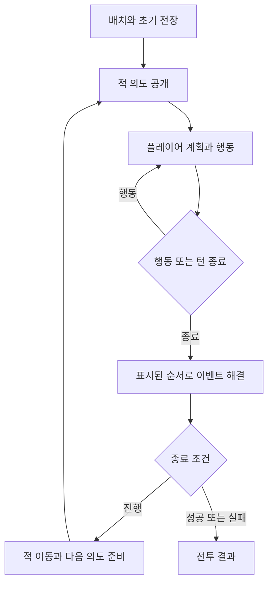

# 03. 턴 구조·행동 경제·이동 취소·턴 리셋

[전체 목차](00_README_문서안내.md)

> 대상: PC판 및 Advanced Edition 공개 규칙. 확인일: 2026-11-13.
> **[확인]** 공개 자료 확인 / **[분석]** 독자적 해석 / **[제안]** 재구현 설계 / **[미확인]** 직접 실행 확인 필요.

관련 문서: [이동](02_전장격자_이동_배치.md) · [공격 판정](04_공격_피해_강제이동.md) · [상태와 지형](05_상태이상_지형_환경.md) · [대표 사례](17_대표전투_턴별분석.md)

## 1. 턴 구조가 만드는 핵심 경험

**[분석]** 플레이어는 적이 무엇을 할지 전혀 모르는 상태에서 진형을 잡는 대신, 공개된 위협을 보고 이번 턴의 대응을 선택한다. 따라서 턴 구조의 핵심 자원은 순발력이 아니라 **행동 수·실행 순서·남겨 둘 위험**이다.

한 메크가 세 위협을 해결할 수도 있고, 세 메크가 한 적을 공격해도 건물을 지키지 못할 수 있다. 공격력의 합보다 “이번 적 행동 단계에 실제로 피해를 주는 공격이 몇 개 남는가”가 결과를 더 직접적으로 설명한다.

## 2. 확인되는 기본 행동 계약

**[확인]** 일반 메크는 자기 턴에 이동 후 무기 사용을 할 수 있고, 무기를 사용한 뒤에는 일반 이동을 할 수 없다. 플레이어는 적의 공격 예고와 Attack Order를 확인할 수 있다. [C01]

**[확인]** 일반 수리는 행동을 사용해 HP를 회복하는 선택지다. 공격·수리 같은 능력을 실행하기 전의 이동은 Undo Move로 되돌릴 수 있다. 공격 전체를 자유롭게 되돌리는 기능과는 다르다. [C04, C16]

**[확인]** Reset Turn은 기본적으로 전투당 한 번 현재 플레이어 턴 시작 상태로 되돌리는 기능이며, Isaac Jones는 추가 리셋 기회를 준다. Advanced Edition의 Adam은 리셋 후 별도 효과를 받는다. [C14]

### 2.1 기본 규칙과 예외를 분리하는 표

| 행동 | 기본 계약 | 반드시 별도 취급할 예외 |
| --- | --- | --- |
| 이동 | 유닛의 이동력과 통로를 사용 | 비행, 웹, 파일럿 능력 |
| 무기 사용 | 보통 해당 메크의 행동을 종료 | 추가 행동·행동 후 이동 능력 |
| 수리 | 공격 대신 선택하는 행동 | 수리 대체 능력, 수리 연동 패시브 |
| 일반 이동 취소 | 확정 능력 실행 전 이동 실험 | 장치·상태 부수효과와 취소 가능 범위 |
| 턴 리셋 | 현재 턴 시작으로 복원 | 횟수 증가, 리셋 직후 발동 능력 |
| End Turn | 현재 플레이어 행동을 확정 | 남은 행동이 있어도 종료 가능 여부·경고 |

**[분석]** 예외는 기본 규칙을 암묵적으로 수정하기보다 능력 정의에 명시하는 편이 읽기 쉽다. “모든 메크가 공격 후 움직인다”로 일반화하면 기본 퍼즐의 비용 구조가 사라진다.

## 3. 전투의 큰 위상

**[분석]** 다음 도식은 원작을 설명하기 위한 기능적 분해다. 원작 함수 호출 순서나 내부 클래스 구조를 주장하지 않는다.



도식의 “적 의도 준비”는 게임 규칙을 이해하기 위한 묶음이다. 적 이동·스폰·특수 효과가 엔진에서 정확히 몇 번의 내부 업데이트로 나뉘는지는 공개 자료만으로 확정하지 않는다.

## 4. End Turn 이후 순서: 확정 범위와 한계

### 4.1 공개 가이드가 제시하는 대표 순서

**[확인]** 커뮤니티 가이드는 대표적인 해결 순서를 환경 효과 → 화상·전기 연기 피해 → Vek 공격 → NPC 행동 → 새 Vek 출현으로 요약하며, 개별 Vek 공격 순서도 화면에서 확인할 수 있다고 설명한다. [C04]

**[자료 충돌]** 구판 GameFAQs 가이드는 화상 → 전기 연기 → 환경 → 재생 → 일부 NPC → 적 공격의 순서를 적는다. 환경과 지속 피해의 선후, NPC를 한 단계로 묶는 방식이 위 요약과 다르다. 어느 하나를 모든 임무에 적용되는 원작 확정 규칙으로 채택하지 않는다. [C16]

**[중요한 해석 제한]** 이 목록은 **모든 특수 임무·패시브·사망 효과의 내부 우선순위를 완전히 정의한 표가 아니다.** 본 문서에서는 실제 전장의 Attack Order 표시를 우선하는 판정 기준으로 둔다. [C01]

| 계층 | 확인할 내용 | 문서에서의 취급 |
| --- | --- | --- |
| 큰 위상 | 환경과 예고 공격의 선후 관계 | 공개 가이드의 대표 규칙 |
| 같은 단계 안 | 어느 유닛의 화상부터 처리하는가 | 실행 확인 필요 |
| 이벤트 중첩 | 사망·폭발·오라 제거가 즉시 이어지는가 | 효과 조합별 실행 확인 필요 |
| 임무 특수 처리 | 열차·컨베이어·로켓·특수 장치 | 개별 Attack Order와 임무 규칙 우선 |
| 다음 턴 준비 | 적 이동, 새 의도, 상태 갱신 | 하나의 임의 순서로 고정하지 않음 |

### 4.2 잘못된 단순화가 낳는 오류

**[분석]** “모든 적이 동시에 공격한다”는 모델은 앞선 적이 뒤의 적을 죽이는 해법을 설명하지 못한다. 반대로 “불 피해는 모든 종류의 환경보다 무조건 먼저다”라는 모델은 환경 이벤트와 상태 피해의 차이를 지운다.

**[제안]** 재구현할 때는 각 이벤트에 다음 메타데이터를 붙인다.

```yaml
ScheduledEvent:
  phase: enemyResolution
  displayOrder: 4
  sourceEntity: enemy_02
  eventKind: queuedAttack
  beforeExecute:
    requireSourceAlive: true
    requireIntentActive: true
  children:
    policy: resolveAccordingToEffectDefinition
```

`displayOrder`와 실제 실행 큐의 순서는 같은 데이터에서 산출해야 한다. 정렬 키만 같고 필터·취소 조건이 다르면 UI가 거짓 정보를 보여줄 수 있다.

### 4.3 소멸한 공격을 처리하는 원칙

**[제안]** 공격 직전에 유닛 존재 여부, 동결·연기·침수 등의 취소 여부, 현재 공격 기하를 다시 검사한다. 원래 큐에 등록되어 있었다는 이유만으로 사망한 유닛의 공격을 실행하지 않는다.

사망 시 폭발 등은 공격 큐와 다른 이벤트다. 공격을 취소했다는 사실이 모든 종류의 패시브·사망 효과를 자동 취소하는 조건이 되어서는 안 된다.

## 5. 행동 경제의 분석 단위

### 5.1 행동 하나의 가치를 계산하는 방법

**[분석]** 이 게임의 행동 가치는 피해량만으로 비교하기 어렵다. 독자적인 비교식을 쓰면 다음과 같다.

`행동가치 = 제거한 현재 위협 + 확보한 다음 턴 선택지 + 보상 기여 − 아군 손실 − 새로 만든 위험`

각 항의 단위가 다르므로 실제 게임의 점수 공식처럼 더하지 않는다. 우선순위를 검토하는 체크리스트로 사용한다.

| 행동 결과 | 즉시 이익 | 비용 또는 후속 위험 |
| --- | --- | --- |
| 적 처치 | 해당 예고 공격 제거 | 다른 적의 등장 여지를 늘릴 가능성 |
| 적 한 칸 밀기 | 사선·타격 위치 변경 | 다음 턴에도 적이 살아 있음 |
| 아군 밀기 | 사거리 확장·웹 탈출 | 아군 위치와 피해 변화 |
| 적을 출현 칸에 두기 | 기존 적을 출현 저지에 사용 | 현재 공격이 먼저 해결될 수 있음 |
| 공격 대신 수리 | 후속 피해를 버틸 HP 확보 | 위협을 직접 제거하지 않음 |
| 행동 보류 | 위험한 부수효과 회피 | 사용할 수 있었던 효과를 포기 |

### 5.2 순서 의존성

다음은 **[분석]**을 설명하는 일반 예다.

- A가 먼저 적을 밀어 사선을 열어야 B가 직사 공격을 할 수 있다.
- B가 먼저 장갑 오라 제공자를 제거해야 A의 피해가 충분해질 수 있다.
- C가 먼저 아군을 이동시키면 A의 충돌 피해를 안전하게 쓸 수 있다.
- 얼린 적을 다른 메크가 다시 때리는 행동은 그 적의 예고 공격 복원 여부까지 확인해야 한다.

정답은 메크별 독립 행동의 집합이 아니라 **상태를 계속 바꾸는 순서 있는 명령열**이다.

## 6. Undo Move의 설계

### 6.1 의도

**[분석]** 이동 취소는 공격 사거리와 위치 관계를 직접 확인하는 탐색 도구다. 이동을 시험하는 데 과도한 실수 비용이 들면 플레이어는 화면 밖에서 머릿속 좌표를 계산하거나 조작을 피하게 된다.

### 6.2 범위

**[확인]** 공개 가이드들은 무기·수리 같은 능력을 아직 실행하지 않은 연속 이동을 되돌릴 수 있으며, 공격을 실행한 뒤에는 일반 Undo로 그 공격을 취소할 수 없다고 설명한다. [C04, C16]

**[미확인]** 여러 메크의 이동을 섞은 뒤 특수 장치, 타임 포드, 산성 타일, 상태 변화를 밟았을 때 정확히 어떤 기록까지 복원하는지는 현재 빌드별 검증이 필요하다. “자기 메크가 공격하지 않았으니 언제든 아무 이동이나 취소 가능”이라고 확대 해석하지 않는다.

### 6.3 재구현용 취소 경계

**[제안]** 다음은 원작 복제 사실이 아니라 오류를 줄이기 위한 명시적 정책 예다.

| 명령 | 취소 기록 | 확정 경계 |
| --- | --- | --- |
| 선택·호버 | 기록 불필요 | 없음 |
| 일반 이동 | 위치·행동권·착지 이벤트 저장 | 취소 가능 |
| 연속 일반 이동 | 순서대로 스택에 기록 | 스택 역순 취소 |
| 무기·수리 확정 | 명령 실행 로그 작성 | 이전 이동 스택 확정 |
| End Turn | 턴 로그 확정 | 일반 Undo 종료 |
| 특수 장치의 비가역 보상 | 보상과 취소 관계를 명세 | 무조건 취소 가능으로 처리하지 않음 |

UI는 “이동 취소” 버튼의 활성 여부와 취소 대상 메크를 일관되게 보여준다. 실패 시 아무 변화 없이 버튼만 깜박이는 대신, 이미 능력이 실행되었다는 거부 이유를 표시한다.

## 7. Reset Turn의 설계

### 7.1 원작 규칙 요약

**[확인]** Reset Turn은 현재 턴을 되감아 유닛 위치와 행동 기회를 되돌린다. 기본 횟수는 전투당 1회이며 관련 파일럿이 이를 수정한다. [C14]

**[분석]** 제한된 리셋은 학습과 책임 사이의 절충이다. 한 번의 오해를 바로잡을 수 있지만 모든 공격을 무제한으로 실험하는 구조는 아니다.

### 7.2 스냅샷 요구사항

**[제안]** 일관된 재구현을 위한 턴 시작 스냅샷에는 다음 상태가 들어간다.

| 상태 | 포함 이유 |
| --- | --- |
| 유닛 위치·HP·상태 | 눈에 보이는 전장을 복원 |
| 이동권·행동권 | 다시 행동 가능해야 함 |
| 적 의도·공격 순서 | 같은 턴의 문제를 복원 |
| 지형과 구조물 상태 | 파괴·화재·균열을 복원 |
| 소환물·시체·스폰 표식 | 부수효과를 누락하지 않음 |
| 임무 목표 카운터 | 처치·피해·수리 등의 중복 집계 방지 |
| 제한 사용 무기 잔량 | 사용 횟수 복원 |
| 전력망과 보상 상태 | 공격 부수효과의 경제 영향 복원 |
| 난수 상태 | 리셋에 따른 무단 재추첨 방지 |

리셋 잔량은 복원 대상 스냅샷 밖에서 관리하거나, 스냅샷 복원 후 차감하도록 명세한다. 차감한 뒤 같은 스냅샷으로 잔량까지 복원하면 무한 리셋이 된다.

### 7.3 난수와 리셋

**[확인·커뮤니티 설명]** Isaac Jones 문서는 전력망 방어의 저항 결과가 시드와 순서에 연결되어, 리셋 후 같은 순서의 피해에 같은 저항 순서가 나올 수 있다고 설명한다. [C15]

**[미확인]** 이를 원작의 난수 생성기 종류, 전역 RNG 스트림 개수, 저장 포맷에 대한 증거로 사용하지 않는다. “리셋하면 매번 새 확률을 뽑는다”는 설계 가정도 두지 않는다.

## 8. 경계 조건과 실패 방지

| 상황 | 제품 차원의 요구 | 검증 방법 |
| --- | --- | --- |
| 이동 후 공격 미리보기 취소 | 실제 공격이 발생하지 않음 | HP·사용 횟수 불변 확인 |
| 턴 리셋 후 패시브 발동 | 중복 발동 또는 누락 방지 | 리셋 연계 능력 로그 비교 |
| 애니메이션 중 입력 | 명령 중복 실행 방지 | 실행 잠금·큐 처리 확인 |
| 마지막 적 사망 | 임무를 임의 조기 종료하지 않음 | 남은 턴·스폰·목표 조건 확인 |
| 환경이 공격자를 먼저 제거 | 취소된 공격이 발사되지 않음 | 공격 전 생존 조건 검사 |
| 출현 칸 위 유닛이 먼저 죽음 | 출현 시점의 실제 점유로 평가 | 단계별 점유 스냅샷 확인 |
| HP 0 메크가 회복됨 | 복구와 행동권을 규칙대로 처리 | 회복 소스별 테스트 |
| 턴 종료 후 리셋 입력 | 허용 단계 명확화 | 버튼 활성·명령 검사 일치 |

## 9. 재현 테스트

**[제안]** 정확한 수치를 넣기 전에도 아래 불변식은 검사할 수 있다.

1. 어떤 이벤트도 UI 표시 순서와 반대 순서로 실행되지 않는다.
2. 같은 상태와 같은 명령열은 같은 예고 변화와 결과를 만든다.
3. 일반 이동 취소는 제한 사용 무기의 잔량을 바꾸지 않는다.
4. 턴 리셋 후 이전 턴의 소환물이 중복 생성되지 않는다.
5. 리셋을 해도 사용 가능한 리셋 수가 증가하지 않는다.
6. 죽은 공격자의 예고는 공격 단계에서 실행되지 않는다.
7. 행동을 마친 메크를 밀었다고 행동권이 되살아나지 않는다.
8. 공격 취소와 사망 시 효과 취소는 서로 다른 조건이다.
9. 개별 예고의 변화는 전체 보드 프리뷰에도 즉시 반영된다.
10. 실행 빌드에서 확인되지 않은 미세 순서를 문서만으로 고정하지 않는다.

## 10. 출처

| ID | 자료 | 근거 범위 |
| --- | --- | --- |
| C01 | [How To Play Guide](https://intothebreach.fandom.com/wiki/How_To_Play_Guide_For_Into_The_Breach) | 행동 후 이동, Attack Order |
| C04 | [Tips and tricks](https://intothebreach.fandom.com/wiki/Tips_and_tricks) | 대표 해결 순서, 이동 취소 조건 |
| C14 | [Reset Turn](https://intothebreach.fandom.com/wiki/Reset_Turn) | 기본 1회, Isaac·Adam 예외 |
| C15 | [Isaac Jones](https://intothebreach.fandom.com/wiki/Isaac_Jones) | 리셋과 저항 난수의 커뮤니티 설명 |
| C16 | [GameFAQs — Game Mechanics](https://gamefaqs.gamespot.com/pc/205477-into-the-breach/faqs/76363/game-mechanics) | 이동·행동·수리의 보조 교차 확인; 구판 자료 |

공개 문서는 큰 위상과 플레이어 동작을 확인하는 근거다. 본 문서의 스냅샷 구조·이벤트 큐·불변식은 원작 내부 구현을 읽은 결과가 아닌 재구현 제안이다.
