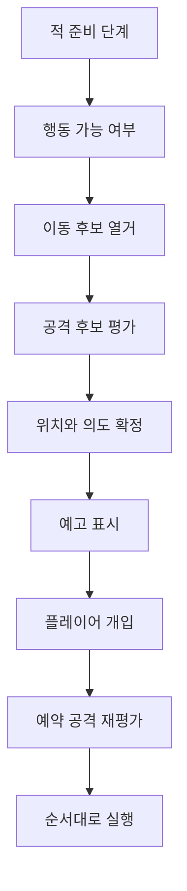

# 06. 적 AI·의도 예고·스폰 시스템

[전체 목차](00_README_문서안내.md)

> 기준: PC판 및 Advanced Edition 공개 규칙 / 조사일: 2026-11-13.
> [확인]은 출처에서 확인한 외부 동작, [분석]은 설계 해석, [제안]은 재구현 명세, [미확인]은 추가 관찰이 필요한 항목이다. 원작 실행 파일이나 AI 소스 코드를 분석한 문서는 아니다.

## 1. 시스템의 역할

[분석] 적은 다음 턴에 풀어야 할 문제를 만드는 장치다. 적의 위협은 체력과 공격력뿐 아니라 공격 위치, 공격 순서, 이동 방해, 다른 적과의 연결 관계에서 나온다. 따라서 AI를 역기획할 때에는 두 일을 분리해야 한다.

- **문제 생성:** 적이 이동하고 공격을 예약하여 플레이어에게 제시할 판을 만든다.
- **약속 이행:** 플레이어가 그 판을 조작한 뒤, 예약된 공격을 일관된 규칙으로 실행한다.

문제 생성에는 다양성이 필요하지만 약속 이행에는 예측 가능성이 필요하다. 예고 후 플레이어가 밀어낸 적이 새 표적을 다시 선정한다면, 위치 조작이라는 핵심 행동의 가치가 사라진다.

## 2. 확인된 외부 규칙

| 항목 | [확인] 공개 규칙의 요약 | 근거 |
| --- | --- | --- |
| 적 준비 | 활동 가능한 적이 먼저 이동하여 공격을 준비하고 플레이어가 대응한다. | E02 |
| 실행 | 준비된 공격은 적 처리 시점에 실행되며, 적 제거·공격 취소 등의 개입이 가능하다. | E02 |
| 적 구성 | 일반종·희귀종·Psion·소환된 소형 적·보스 등 역할이 구분된다. | E02 |
| 강화종 | Alpha는 기존 종의 강화형이며 체력·공격 등이 달라진다. | E02 |
| 출현 | 땅의 출현 예고 칸에서 등장하며, 그 칸을 점유하면 출현 저지와 피해가 연결된다. | E02 |
| 섬별 적 | 섬마다 등장 가능한 적의 구성이 다르다. | E02 |

표의 스폰 설명은 개념 요약이다. 출현 저지의 피해·막힌 구멍의 후속 처리 등 상세한 전투 판정은 [05 상태·지형](05_상태이상_지형_환경.md)을 따른다. 이 문서에서는 정확한 스폰 확률이나 내부 큐 구조를 확정하지 않는다.

## 3. 의도와 공격 범위의 구분

[분석] 화면에 보이는 공격 예고를 하나의 빨간 칸 목록으로만 저장하면 재현성이 깨진다. 빨간 칸을 만드는 **공격 규칙**과 현재 판에서 계산된 **결과 범위**를 구분하는 모델이 필요하다.

| 의미 | 설명 | 플레이어가 바꿀 수 있는 것 |
| --- | --- | --- |
| 공격자 | 예약 행동을 가진 유닛 | 제거, 위치, 상태 |
| 공격 형상 | 직선탄·근접·포격·범위 등의 모양 | 공격 방향 반전 등의 특수 효과 |
| 조준 기준 | 방향 또는 상대 오프셋 등 | 공격자 이동에 따른 결과 칸 |
| 영향 대상 | 현재 범위 안의 유닛·건물·지형 | 이동·밀기·당기기·교환 |
| 실행 가능성 | 공격자가 아직 실행할 수 있는가 | 연기·빙결·사망 등 |
| 처리 순서 | 어떤 효과보다 먼저 일어나는가 | 먼저 발생하는 제거·이동·상태 변화 |

**[확인] Firefly는 직선 투사체를 사용한다. 기존 표적을 치워도 그 뒤에 있는 다른 대상이 위험할 수 있다.** [E24]

**[확인] Scarab을 밀어 위치를 바꾸는 것은 공격 예고를 바꾸는 대응책이다.** [E25]

따라서 포격을 무조건 `worldTargetCell` 고정으로 일반화하거나, 모든 적이 특정 `targetUnitId`를 계속 추적한다고 모델링하면 안 된다. 무기별 조준 기준은 [04 공격·피해](04_공격_피해_강제이동.md)의 분류를 참조한다.

## 4. 대표 적을 통해 보는 위협의 종류

### 4.1 Scorpion: 행동 자유를 줄이는 적

[확인] 기본 Scorpion은 체력 3, 이동 3이며 인접 대상을 거미줄로 묶고 1 피해 공격을 준비한다. [E23]

[분석] 이 적의 가치는 1 피해보다 이동 봉쇄에 있다. 메크 A가 원래 두 건물을 보호할 수 있었더라도, 묶인 뒤에는 특정 방향으로만 공격할 수 있어 메크 B의 구조 행동이 필요해질 수 있다. 즉 하나의 적이 자기 공격 외에 **다른 위협을 해결할 선택지**도 줄인다.

재구현에서 측정할 변수는 `webbedMechCount`뿐 아니라 묶이기 전후의 합법 행동 수 차이다. 낮은 피해의 구속 적도 배치에 따라 높은 위협 점수를 가져야 한다.

### 4.2 Firefly: 사선을 만드는 적

[확인] 기본 Firefly는 체력 3, 이동 2, 직선 공격 피해 1을 가진다. [E24]

[분석] 이 적은 목표 하나를 공격하지만 실제로는 한 행이나 열에 장벽을 만든다. 플레이어가 피한 칸 뒤의 건물, 몸으로 막을 아군의 체력, 밀린 적이 대신 맞는 상황을 함께 보아야 한다. 직선 공격은 대상 선택보다 **최초 충돌체가 무엇이 되는가**가 중요하다.

### 4.3 포격형: 엄폐를 무시하는 위협

[분석] 포격의 설계 역할은 투사체를 몸으로 막는 해법을 제한하는 것이다. 같은 피해량이라도 직접 사선 차단이 불가능한 형태는 건물 보호에 더 많은 제어 수단을 요구한다. 이 차이는 체력 상승만으로는 만들기 어려운 적 구성의 다양성이다.

### 4.4 지원형: 계산식을 바꾸는 위협

[확인] Psion은 다른 Vek에 수동 보너스를 부여하는 지원형 적이며, 자신에게 같은 보너스를 적용하지 않는 것으로 정리되어 있다. [E02]

[분석] 지원형 적을 먼저 제거할지 판단하는 핵심은 그 제거가 몇 개의 공격 임계값을 바꾸는가이다. 지원체를 공격해 직접 건물을 구하지 못하더라도, 뒤따르는 아군 행동 두 개가 각각 적을 한 번에 제거할 수 있게 된다면 선행 투자 가치가 있다.

### 4.5 소환형: 행동 수와 공간을 늘리는 위협

[확인] Plasmodia는 포자를 생성하며, 포자는 공격에 사용되는 별도 유닛이다. Tumblebug는 피해를 받으면 폭발하는 바위를 만들어 추가 위험을 형성한다. [E36][E37]

[분석] 두 적을 같은 '소환'으로 묶으면 안 된다. 하나는 추가 공격 주체를, 다른 하나는 공격에 반응하는 폭발성 공간 제약을 만든다. 본체 제거 후 이미 생성한 객체가 어떻게 남는지도 별도의 수명 규칙으로 다룬다.

## 5. AI 행동 단계: 재구현 제안

다음은 **[제안] 원작 내부 알고리즘이 아닌 구현 가능한 구조**다.



1. 움직일 수 없는 상태, 이미 제거된 객체, 지원 전용 객체를 먼저 분기한다.
2. 이동 후보는 지형·점유·이동 특성으로 제한한다.
3. 각 이동 후보에서 합법 공격을 열거한다.
4. 가중치와 통제된 난수로 하나를 고른다.
5. 선택한 의도를 저장하고 예고한다.
6. 이후 플레이어 행동 때는 새 공격을 선택하지 않고 기존 의도의 결과를 다시 계산한다.
7. 실제 실행에서도 같은 계산기를 사용한다.

예고 계산과 실행 계산을 다르게 구현하면 밀기·빙결·지원 효과 제거 이후 불일치가 생기기 쉽다. 구현 대안의 전체 구조는 [16 데이터모델](16_데이터모델_판정파이프라인.md)에 연결한다.

## 6. 표적 평가 모델

### 6.1 확정할 수 없는 것

**[미확인]** 원작이 건물·메크·목표물에 부여하는 정확한 가중치, 동점 해소 규칙, 위험 칸 평가 순서, 난수 호출 순서는 이번 조사에서 확인하지 않았다. '항상 건물을 우선한다', '가까운 메크만 노린다', '플레이어 최적 수를 계산한다'는 표현을 원작 규칙으로 사용하지 않는다.

### 6.2 프로토타입용 점수식

아래는 **[제안] 예시 수식이며 원작 수치가 아니다.**

```text
Score(candidate) =
    wGrid * threatenedGrid
  + wObjective * threatenedObjective
  + wMech * threatenedMech
  + wControl * lostPlayerOptions
  + wCoverage * distinctThreatenedCells
  - wSelfRisk * expectedSelfLoss
  - wOverlap * redundantThreat
  + boundedTieNoise
```

`redundantThreat`를 무조건 페널티로 둘 필요는 없다. 이미 위험한 건물에 공격 두 개를 겹치면 실드 하나로 해결되지 않는 문제가 생긴다. 반대로 모든 적이 같은 칸만 공격하면 한 번의 이동으로 여러 공격을 무력화할 수 있다. 중복 위협의 효과는 해법 수와 함께 평가한다.

| 평가 질문 | 측정 후보 | 설계상 의미 |
| --- | --- | --- |
| 몇 곳을 위협하는가? | 서로 다른 보호 대상 수 | 행동 자원 분산 |
| 피할 수 있는가? | 이동 가능한 표적과 고정 표적 비율 | 대응의 성격 |
| 제어가 가능한가? | 밀기·연기·빙결 해법 수 | 무기 구성과 상성 |
| 다른 적과 연결되는가? | 적이 다른 적을 공격할 수 있는 수 | 역이용 여지 |
| 읽기 쉬운가? | 교차 사선·추가 객체 수 | 인지 부하 |
| 다음 턴도 위험한가? | 이동 공간·스폰 압박 | 지속 압력 |

## 7. 출현 예고와 전장 점유

[분석] 출현 칸은 다음 턴의 적을 막을 수 있는 장소이면서 아군 체력을 소비하는 목표다. 지금 건물을 보호하는 메크가 출현까지 막는다면, 한 번의 이동은 현재 피해와 미래 행동 부담을 동시에 줄인다. 반대로 적을 무조건 제거하면 전장이 비어 새 적이 들어올 여지도 커진다. 실제 출현 상한과 난이도 관계는 [14 난이도](14_난이도_절차생성_밸런스.md)를 참조한다.

### 7.1 스폰 요청과 실제 등장을 분리하는 모델

다음 표는 **[제안]**이다.

| 단계 | 입력 | 결과 | 확인해야 할 예외 |
| --- | --- | --- | --- |
| 예정량 결정 | 난이도·진행도·미션 | 출현 요청 수 | 소환 유닛을 포함하는지 |
| 종 선택 | 섬별 풀·희귀종 제한 | 종·강화형 후보 | 배타 조합 |
| 위치 선택 | 유효 지형·빈 칸·미션 제약 | 예고 칸 | 목표물·위험 칸 |
| 예고 유지 | 플레이어 행동 | 현재 점유 상태 | 지형 변경 |
| 등장 시도 | 해소된 전장 | 등장 또는 저지 | 비행·대형·얼음 |
| 후속 예약 | 남은 미션과 스폰 정책 | 다음 예고 | 마지막 턴 처리 |

위 모델에서 `spawnRequest`와 `enemyUnit`는 다르다. 구멍을 막았다는 이유로 아직 생성하지 않은 적을 사망 처리하면 처치 수, 경험치, 업적 조건이 잘못 증가할 수 있다.

### 7.2 공개 자료로 추정해서는 안 되는 상한

- **[미확인]** 일반 적·소형 적·보스가 모두 같은 전장 인원 상한을 사용하는지.
- **[미확인]** 막힌 출현 요청이 다음 턴에 유지·재배치·취소되는 모든 분기.
- **[미확인]** 환경이 출현 칸을 없앴을 때 종 추첨도 함께 취소되는지.
- **[미확인]** 난이도별 매 턴 정확한 등장 수와 내부 증가 공식.

이 항목은 플레이 동영상 몇 개로 단정할 수 없다. 동일 시드와 설정에서 반복 관찰하고, 마지막 턴·소환형 적·환경 변화가 있는 케이스를 따로 비교해야 한다.

## 8. 의도 데이터 구조

**[제안]** 예고 정보에 표시용 문자열만 저장하지 않고 해석 가능한 정보를 둔다.

```yaml
intent:
  ownerId: enemy_17
  abilityId: projectile_example
  aimMode: relative_direction
  direction: east
  relativeOffset: null
  executionOrder: 4
  createdAtPhase: enemy_planning
  cancellationPolicy: weapon_defined
  preparedEffects: []
  predictedCells: []  # 캐시이며 판정의 원천이 아님
```

`predictedCells`는 공격자·충돌체·상태가 바뀔 때 재생성한다. `executionOrder`는 유닛 삭제 뒤 다시 빽빽하게 번호를 매길지, 빈 번호를 남길지 UI 정책을 정하되 실제 순서와 일치시킨다. 무효화된 의도도 디버그 로그에는 취소 이유를 남긴다.

## 9. 밸런스 관찰 지표

다음 지표는 **[제안] 개발용 분석 항목**이다.

| 지표 | 계산 방법 | 해석 시 주의 |
| --- | --- | --- |
| 의도당 건물 위협률 | 건물 위협 의도 / 전체 유효 의도 | 높다고 항상 어려운 것은 아님 |
| 다중 위협 해결률 | 행동 하나로 2개 이상 의도를 무력화한 비율 | 무기와 전장 밀도의 영향 |
| 구속 손실 | 구속 전후 합법 행동 수 차이 | 단순 이동 거리와 다름 |
| 적 오사 활용률 | 적 공격으로 제거된 적 / 전체 제거 | 적 공격 순서의 영향 |
| 적 생존 누적 | 매 턴 살아 있는 적의 합 | 소환형 별도 집계 |
| 예고 불일치 | 표시 결과와 실제 결과의 차이 | 허용하지 않을 핵심 결함 |
| 의도 변경 수 | 플레이어 턴 중 새 표적 선정 횟수 | 정상 범위 변환과 구분 |

## 10. QA 시나리오

| ID | 조건 | 기대 검증점 |
| --- | --- | --- |
| EN-01 | 직선 공격자 옆으로 밀기 | 예고 사선과 실제 사선 일치 |
| EN-02 | 직선 표적 메크가 이동 | 뒤의 건물·유닛 위험 재계산 |
| EN-03 | 포격 공격자를 이동 | 무기별 상대 조준 규칙 적용 |
| EN-04 | 공격 전에 지원체 제거 | 지원 효과와 예고 수치 갱신 |
| EN-05 | 먼저 공격할 적이 뒤 적을 제거 | 제거된 적의 예약 공격 취소 |
| EN-06 | 소환 본체만 제거 | 이미 생성한 객체의 독립 수명 검증 |
| EN-07 | 구속자와 구속 대상 중 하나 이동 | 구속 해제 조건과 표시 일치 |
| EN-08 | 출현 칸을 아군·적·객체로 점유 | 각 대상의 저지 피해·등장 판정 |
| EN-09 | 스폰 예고 후 지형 붕괴 | 예고 제거와 후속 스폰 처리 |
| EN-10 | 연기·빙결과 해제가 같은 턴에 발생 | 취소된 의도가 복구되는 정확한 조건 |
| EN-11 | AI가 선택할 유효 공격 없음 | 비공격 상태 표시·정상 턴 진행 |
| EN-12 | 순서 표시 켜기/끄기 반복 | 게임 상태와 난수 불변 |

QA의 '기대 검증점'은 실제 결과를 확인할 항목이다. 미확인 원작 동작을 테스트의 예상값으로 미리 고정하지 않는다.

## 11. 연결 문서

- [03 턴과 행동 경제](03_턴구조_행동경제_되돌리기.md): 예약된 공격이 실행되는 시점.
- [04 공격·피해·강제 이동](04_공격_피해_강제이동.md): 의도가 현재 전장에서 해석되는 방식.
- [08 스쿼드](08_스쿼드_시너지_전술.md): 적의 의도를 조작하는 서로 다른 수단.
- [13 UI/UX](13_UI_UX_정보시각화.md): 공격 순서와 예고를 읽는 인터페이스.
- [14 난이도](14_난이도_절차생성_밸런스.md): 문제의 밀도와 해법 수 관리.

## 12. 출처

Fandom 자료는 커뮤니티 문서이며, 이번 조사에서는 검색 색인으로 제공된 본문을 확인했다. 원문 직접 열기가 제한된 페이지는 실기 검증을 대체하지 않는다.

| ID | 자료 | 사용 범위 |
| --- | --- | --- |
| E02 | [Vek](https://intothebreach.fandom.com/wiki/Vek) | 적의 준비·분류·섬별 구성 |
| E23 | [Scorpion](https://intothebreach.fandom.com/wiki/Scorpion) | 기본 수치·구속 공격 |
| E24 | [Firefly](https://intothebreach.fandom.com/wiki/Firefly) | 기본 수치·직선 공격 |
| E25 | [Scarab](https://intothebreach.fandom.com/wiki/Scarab) | 밀기로 예고 위치를 바꾸는 대응 |
| E36 | [Plasmodia](https://intothebreach.fandom.com/wiki/Plasmodia) | 별도 포자 생성 |
| E37 | [Tumblebug](https://intothebreach.fandom.com/wiki/Tumblebug) | 폭발성 바위 생성 |

정확한 AI 점수식·스폰 수식·데이터 구조는 위 자료가 공개한 내용이 아니며 이 문서의 재구현 제안이다.
