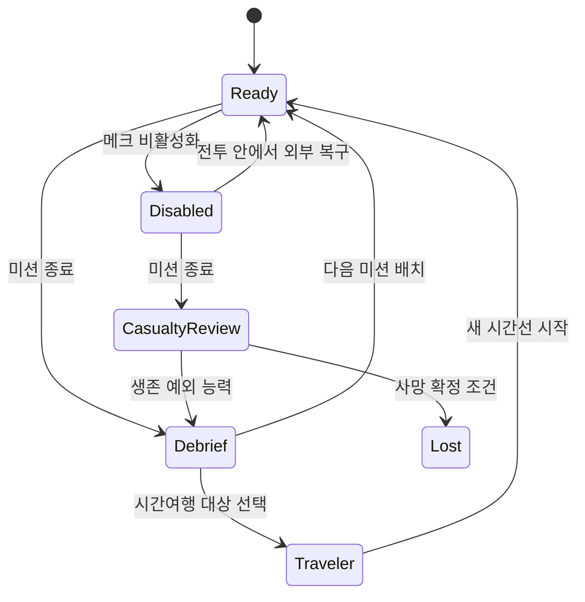

# 09. 파일럿·경험치·시간여행 역기획

[전체 목차](00_README_문서안내.md)

> 범위: PC판 및 Advanced Edition의 공개 규칙. 조사일: 2026-11-13. 실기 계측이나 원작 소스 분석 문서가 아니다.
> **[확인]** 문헌에서 확인한 규칙 / **[분석]** 그 규칙의 설계적 해석 / **[제안]** 재구현 명세 / **[미확인]** 버전·예외 검증이 필요한 항목.

## 1. 시스템의 역할

**[분석]** 파일럿은 동일한 메크에 다른 행동 가능성을 부여하고, 한 런의 선택에 다음 런까지 이어지는 의미를 만든다. 메크의 무기와 코어가 이번 전투의 도구라면, 파일럿은 그 도구를 다루는 조건을 바꾸는 성장 단위다.

플레이어가 보호할 대상은 세 층이다. 당장 필요한 행동을 제공하는 메크, 능력과 경험치를 가진 파일럿, 전체 런을 유지하는 전력망이다. 이들이 같은 체력 막대를 공유하지 않기 때문에 자신을 희생해 도시를 지키는 선택이 성립한다.

| 설계 목적 | 플레이에서 생기는 선택 | 다른 시스템과의 연결 |
| --- | --- | --- |
| 메크별 역할 변형 | 사격 후 이동, 생존 강화, 공격 조건 개선 | [07 메크·무기](07_메크_무기_업그레이드.md) |
| 국지적 성장 | 어느 메크로 적을 마무리할지 판단 | [04 피해 판정](04_공격_피해_강제이동.md) |
| 장기적 애착 | 숙련 파일럿을 살릴지 목표를 지킬지 선택 | [10 전력망](10_미션_목표_전력망.md) |
| 재도전의 연속성 | 다음 시간선으로 가져갈 경험 선택 | [15 메타진행](15_메타진행_업적_콘텐츠해금.md) |

## 2. 확인된 핵심 규칙

다음 표는 원문을 재현한 목록이 아니라 핵심 규칙의 짧은 요약이다.

| 항목 | 규칙 | 근거 |
| --- | --- | --- |
| 기본 AI | 고유 스킬·경험치 성장 없이 메크 조종 가능 | P02 |
| 성장형 파일럿 | 인간·고급 AI·Cyborg가 성장 대상 | P01 |
| 경험치 | 적 제거 시 통상 최대 HP에 대응하는 XP를 지급 | P01 |
| 직접 처치 | 처치한 파일럿에 귀속 | P01 |
| 환경 처치 | 직접 처치자가 없으면 분대에 분배 | P01 |
| 승급 | 25 XP, 이후 추가 50 XP에서 무작위 능력 획득 | P01 |
| 성장 상한 | 누적 75 XP, 추가 능력 두 개 | P01 |
| 시간여행 | 선택한 Last Traveler는 XP와 능력 유지 | P01 |
| 일반 획득 경로 | 타임 포드 또는 섬 완벽 보상의 파일럿 선택 | P01 |
| 비활성 메크 | 다른 아군·외부 효과의 수리로 전투 중 복구 가능 | P03 |

**[분석]** XP는 단순 공격 횟수 보상보다 처치 결과에 집중되어 있다. 따라서 안전하게 위협을 해결하는 전술과 특정 파일럿에게 막타를 배분하는 성장 전술이 일치하지 않을 수 있다. 후자를 위해 전력망을 위험에 노출하는 것은 별도 비용이다.

## 3. 파일럿과 메크의 분리

**[제안]** 재구현에서는 파일럿의 소유권, 메크 배치, 체력, 조종 가능 상태를 각각 보관한다. `MechHP == 0`만으로 파일럿 레코드를 삭제하면 전투 중 외부 수리와 회복 예외를 표현하기 어렵다.

| 개체 | 보관할 정보 | 보관하지 않을 정보 |
| --- | --- | --- |
| PilotDefinition | 이름, 고유 능력, 능력 조건, 성장 제한 태그 | 이번 전투의 HP |
| PilotInstance | 경험치, 획득 능력, 시간여행 이력, 현재 상태 | 메크에 설치된 영구 코어 |
| MechInstance | 메크 종류, HP, 장착 무기, 코어, 파일럿 참조 | 프로필 해금 상태 |
| SquadRoster | 탑승자·예비 인원, 현재 3기 구성 | 전장 좌표 |
| ProfileUnlocks | 시작 선택 가능한 파일럿 종류 | 이번 런의 임시 상태이상 |

이 표는 원작의 내부 클래스 구조를 주장하지 않는다. 원작에서 보이는 결과를 독립적으로 구현할 때 필요한 책임 분리다.

### 3.1 상태 전이 모델



**[제안]** 이 상태도는 논리 모델이다. 특히 `CasualtyReview`는 원작 UI나 내부 함수명이 아니다. 추락·대상 소실·최종전 탈출 불가를 일반 HP 고갈과 구분하는 검사 지점으로 사용한다.

### 3.2 사망과 회복의 구분

**[확인]** 같은 전투에서 외부 회복으로 메크와 파일럿이 돌아오는 사례가 보고되어 있다. 일반 AI가 다음 미션의 빈 메크를 대신 조종하는 것과 다른 현상이다. [P03, P25]

**[미확인]** 모든 종류의 죽음이 복구 가능한 것은 아니다. 맵에 비활성 기체가 남는 상황과 추락 등으로 기체가 사라진 상황을 분리해야 한다. 최종전 종료 시 비활성 파일럿의 탈출, `Invulnerable`과 특정 환경사망의 조합은 실기 확인 대상이다.

| 상황 | 문서에서 다룰 결과 | 구현 시 주의 |
| --- | --- | --- |
| 살아 있는 메크가 일반 미션 종료 | 다음 미션을 위한 정비와 진행 | 미션 HP와 영구 성장 혼동 금지 |
| 기체가 비활성이나 전투 중 회복 | 행동 가능한 상태로 복귀할 수 있음 | 행동 사용 여부를 별도로 판정 |
| 미션 종료까지 복구 못함 | 일반적으로 파일럿 손실 위험 | 생존 능력 예외를 먼저 평가 |
| 파일럿을 잃고 기체 정비 완료 | 기체의 재사용과 파일럿 유지가 다름 | 장비·코어와 파일럿 스킬 분리 |
| 최종전 페이즈 전환 | 미션 경계 규칙이 개입 | [11 최종전](11_아일랜드_캠페인_최종전.md) 참조 |

## 4. 경험치 정산 명세

### 4.1 경험치 지급 이벤트

**[제안]** 처치 이벤트에는 `victimId`, `creditedPilotId`, `damageSource`, `indirectCause`, `xpValue`, `resolutionId`를 남긴다. 이미 죽은 적이 연쇄 효과에 다시 포함되어도 같은 `resolutionId`로 두 번 지급하면 안 된다.

1. 피해와 사망 여부를 확정한다.
2. 직접 처치자·유도 처치자·환경 처치의 귀속을 판정한다.
3. 해당 규칙의 XP 값을 확정한다.
4. 수령 가능한 파일럿을 수집한다.
5. XP를 배분하고 승급 임계값을 검사한다.
6. 무작위 능력 결과를 저장한 뒤 UI를 갱신한다.

**[미확인]** 모든 간접 처치가 공용 XP는 아니다. 댐 파괴 후 익사처럼 최초 행동자에게 귀속되는 특수 사례가 있어, 단순히 `damageSource == Environment`만으로 분배하지 않는다. 적의 최대체력 버프, Psion 소멸, 소환 유닛, 미션 오브젝트는 별도 확인 항목이다.

### 4.2 승급 계산 예시

**[분석·가상 예시]** 파일럿 A가 누적 23 XP를 보유하고, XP 2인 적을 직접 제거했다면 25에 도달해 첫 승급을 처리한다. 이후 두 번째 승급까지 필요한 추가량은 50이다. 첫 임계값 25와 두 번째 누적 임계값 75를 혼동해 총 50에서 두 번째 능력을 지급하면 성장 속도가 달라진다.

| 전후 상태 | 계산 | 결과 |
| --- | --- | --- |
| 23 → 25 | 23 + 2 | 첫 승급 |
| 25 → 26 | 25 + 1 | 두 번째 승급까지 49 |
| 73 → 75 | 73 + 2 | 두 번째 승급 |
| 이미 75 | 상한 처리 | 능력 추가 없음 |

**[제안]** UI가 승급마다 막대를 0으로 돌리더라도 저장값은 누적 XP로 일관되게 유지한다. `25/25`와 `0/50`은 서로 다른 저장 포맷이 아니라 같은 상태의 표시 방식으로 처리할 수 있다.

### 4.3 무작위 성장의 설계 의미

**[분석]** 현재 턴 공격 판정의 불확실성이 낮더라도 런의 장기 성장에 변동성이 있으면 매번 다른 빌드를 고민하게 된다. 임계값을 두 번으로 제한하면 스킬 조합을 기억할 수 있으며, 한 파일럿의 성장 완성이 무한한 레벨 노가다로 바뀌지 않는다.

**[제안]** 획득 후보를 정할 때 중복 능력, 해당 파일럿에 의미 없는 능력, AE 토글에 맞지 않는 능력을 필터링한다. 실제 원작의 전체 금지 목록은 별도로 수집해야 하므로 이 문서의 예시 필터를 그대로 원작 수치표로 취급하지 않는다.

## 5. 고유 능력은 행동 규칙을 바꾼다

| 대표 사례 | 확인한 능력 요약 | 분석할 설계 축 | 근거 |
| --- | --- | --- | --- |
| Ralph Karlsson | 처치 시 추가 XP | 빠른 성장과 최종 효용의 교환 | P05 |
| Archimedes | 전력 1을 사용해 공격 후 다시 이동 | 공격 위치와 종료 위치의 분리 | P06 |
| Kai Miller | AE 파일럿, 온전한 체력과 Boost 활용 | 체력 유지에 공격 가치 부여 | P07, P29 |
| Camila Vera | 거미줄·연기의 행동 제한에 면역 | 행동 가능한 칸과 경로의 확대 | P30 |
| Isaac Jones | 전투당 Reset Turn 사용 기회 +1 | 계획 탐색·실수 교정 예산 | P31 |
| Chen Rong | 공격 후 1칸 이동, 별도 코어 비용 없음 | 공격 칸과 종료 칸의 국소적 분리 | P32 |
| Bethany Jones | 매 미션 시작 시 실드 부여 | 첫 피해의 방어 여유 | P33 |

**[분석]** Archimedes형 능력은 이동력을 단순히 더하는 것보다 영향이 크다. 공격을 하기 위해 접근한 뒤 스폰 지점으로 이동하거나, 취약한 칸에서 빠져나올 수 있기 때문이다. 동일한 무기와 사거리에서도 턴 종료 배치가 달라진다.

**[분석]** 체력 조건을 요구하는 능력은 메크 HP를 희생 가능한 자원으로 보는 기본 판단을 바꾼다. 파일럿을 배정할 때는 “가장 강한 메크”보다 능력의 발동 조건을 가장 안정적으로 만족시키는 메크를 찾게 된다.

**[분석]** Camila의 상태 면역은 직접 화력을 높이지 않지만, 다른 메크라면 공격하거나 이동할 수 없는 상태에서도 행동을 남길 수 있다. Isaac의 추가 되돌리기는 전장에 투입되는 공격 수보다 플레이어가 계획을 수정할 기회를 늘린다. 두 능력을 같은 “행동 보너스”로 묶지 않는다.

**[제안]** 능력의 발동 지점도 별도 데이터로 둔다. Bethany형은 `mission_start`, Chen형은 `after_action`, Camila형은 `status_permission_check`, Isaac형은 `reset_budget_initialization`에 해당하는 구현 모델을 사용할 수 있다. 이것은 원작 함수명이 아니라 같은 결과를 내기 위한 이벤트 분해다.

### 5.1 파일럿 배정 평가표 — 재구현·밸런스용

| 질문 | 체크할 데이터 | 위험 신호 |
| --- | --- | --- |
| 공격 후 위험을 피할 수 있는가? | 후속 이동, 비행, 사격 위치 | 능력을 발동해도 막힌 경로 |
| 생존 보정이 자해와 맞는가? | 피해 유형별 면역·경감 | 모든 피해를 막는다고 잘못 표시 |
| 코어가 필요한가? | 능력 활성 비용, 장비 사용량 | 주무기가 비활성화됨 |
| 승급 능력과 충돌하는가? | 체력 상한, 이동 제약 | 효과 없는 능력 지급 |
| 팀 전체에 기여하는가? | 아군 회복, 방어, 자원 보너스 | 개인 수치만 보고 평가 |

## 6. 시간여행과 해금은 다른 저장 상태다

**[분석]** “이 종류의 파일럿을 시작 화면에서 선택할 수 있음”과 “이전 런의 XP·능력 조합을 가진 파일럿을 이어받음”은 구분해야 한다. 첫 번째는 도감·해금의 문제이고 두 번째는 특정 인스턴스의 승계다.

**[제안]** 시간선 종료 시 아래 순서로 처리한다.

1. 이번 런의 결과와 통계를 확정한다.
2. 시간여행 가능 후보를 수집한다.
3. 선택 화면에 고유 능력·획득 능력·XP를 표시한다.
4. 한 후보의 인스턴스를 `LastTraveler`로 저장한다.
5. 새 런에서 무기·평판·전력망·섬 상태를 새로 생성한다.
6. 선택된 승계 파일럿만 지정 슬롯에 적용한다.

**[미확인]** 예비 파일럿, 생존 특수능력, 비밀 스쿼드의 Cyborg, 이전 Last Traveler의 복귀는 후보 집합의 예외다. Cyborg를 일반 파일럿처럼 다른 메크에 자유롭게 이동시키는 명세는 사용하지 않는다. [08 스쿼드](08_스쿼드_시너지_전술.md)에서 비밀 스쿼드 제약을 함께 확인한다.

## 7. 데이터 설계 예시

```yaml
# 제안: 원작 데이터 포맷이 아님
pilot_instance:
  instance_id: pilot_run_003
  definition_id: sample_pilot
  xp_total: 25
  acquired_skills: [sample_skill_a]
  mech_assignment: mech_02
  recovery_state: ready
  timeline_count: 2
  can_time_travel: true
  earned_xp_events: [kill_017]
```

**[제안]** 이벤트 ID는 저장·불러오기와 턴 되돌리기에서 중복 보상을 막는 데 유용하다. 전투 롤백 스냅샷에 경험치와 승급 추첨 상태도 포함한다. 어떤 항목까지 되돌리는지는 [03 턴 구조](03_턴구조_행동경제_되돌리기.md)의 정책과 통일한다.

## 8. UX 요구사항

| 위치 | 반드시 전달할 정보 | 이유 |
| --- | --- | --- |
| 파일럿 상세 | 고유 능력과 승급 능력 구분 | 능력의 출처와 승계 범위 이해 |
| 배정 화면 | 전력 소비·스탯 변화 미리보기 | 장비 비활성화 방지 |
| 전투 중 비활성 | 회복 대상 여부, 현재 행동 불가 | 사망 확정으로 오해하지 않게 함 |
| 미션 결과 | 파일럿 손실과 메크 정비를 분리 | 기체 복구를 파일럿 복구로 오인 방지 |
| 시간여행 | 유지·초기화 항목을 한 화면에 표시 | 다음 런의 시작 조건 이해 |

## 9. 검증 시나리오

| ID | 준비·입력 | 확인할 결과 |
| --- | --- | --- |
| PIL-01 | 누적 XP 24에서 XP 1 처치 | 승급 한 번만 발생 |
| PIL-02 | 누적 XP 74에서 연쇄 처치 | 75 상한·중복 추첨 없음 |
| PIL-03 | XP 1 환경 처치 여러 번 | 분배 순서·총량 보존 |
| PIL-04 | 기본 AI가 직접 처치 | XP 성장 대상 제외 |
| PIL-05 | 전투 중 메크 0 HP 후 외부 수리 | 메크·파일럿·행동권 복구 각각 확인 |
| PIL-06 | 메크 0 HP 상태로 미션 종료 | 생존 능력 유무별 차이 |
| PIL-07 | 코어 제공 파일럿 제거 | 장비 전력 부족을 일관되게 처리 |
| PIL-08 | 승급 후 Reset Turn | XP·능력·추첨 상태의 롤백 범위 |
| PIL-09 | 시간여행 후 새 런 | 선택한 인스턴스만 능력·XP 승계 |
| PIL-10 | 최종전 1페이즈에서 비활성 | 페이즈 전환 후 파일럿·장비 상태 |
| PIL-11 | Cyborg가 있는 런 종료 | 정상 파일럿과 다른 선택 후보 처리 |
| PIL-12 | AE 능력 비활성 상태의 시작 | 기존 승계 파일럿과 신규 추첨의 구분 |
| PIL-13 | Camila를 연기·거미줄 상황에 배치 | 상태별 이동·공격 허용 범위 |
| PIL-14 | Bethany의 시작 실드 소모 후 다음 턴 | 미션 시작 발동과 매 턴 재생의 구분 |
| PIL-15 | Chen으로 공격 후 후속 이동 | 1칸 한도·새 공격권 부여 여부 |
| PIL-16 | Isaac 탑승·비탑승 상태 비교 | 전투별 Reset Turn 예산 +1 |

## 10. 근거와 남은 확인

| ID | 자료 | 사용 범위 |
| --- | --- | --- |
| P01 | [Pilots — 커뮤니티 위키](https://intothebreach.fandom.com/wiki/Pilots) | XP·승급·분배·Last Traveler 핵심 규칙 |
| P02 | [Artificial Pilot — 커뮤니티 위키](https://intothebreach.fandom.com/wiki/Artificial_Pilot) | 기본 AI의 역할 |
| P03 | [Mechs — 커뮤니티 위키](https://intothebreach.fandom.com/wiki/Mechs) | 비활성 메크의 외부 복구 |
| P05 | [Ralph Karlsson — 커뮤니티 위키](https://intothebreach.fandom.com/wiki/Ralph_Karlsson) | 추가 XP 능력 |
| P06 | [Archimedes — 커뮤니티 위키](https://intothebreach.fandom.com/wiki/Archimedes) | 공격 후 이동·전력 비용 |
| P07 | [Kai Miller — 커뮤니티 위키](https://intothebreach.fandom.com/wiki/Kai_Miller) | AE 파일럿·Boost 조건 |
| P29 | [Cheat Codes의 파일럿 능력표 — 커뮤니티 위키](https://intothebreach.fandom.com/wiki/Cheat_Codes) | Kai의 무피해 상태 Boost 설명 교차확인 |
| P30 | [Camila Vera — 커뮤니티 위키](https://intothebreach.fandom.com/wiki/Camila_Vera) | 거미줄·연기 면역 |
| P31 | [Isaac Jones — 커뮤니티 위키](https://intothebreach.fandom.com/wiki/Isaac_Jones) | 전투당 추가 Reset Turn |
| P32 | [Chen Rong — 커뮤니티 위키](https://intothebreach.fandom.com/wiki/Chen_Rong) | 공격 후 1칸 이동·전력 비용 없음 |
| P33 | [Bethany Jones — 커뮤니티 위키](https://intothebreach.fandom.com/wiki/Bethany_Jones) | 미션 시작 실드 |
| P25 | [Rosie 외부 회복 사례 — 사용자 보고](https://www.reddit.com/r/IntoTheBreach/comments/15bjsg8) | 비활성 메크와 파일럿 회복 교차확인 |

위키 일부는 본문 직접 접근이 제한되어 검색 인덱스에 반환된 해당 문장을 확인했다. 원작 실행 검증을 대체하지 않으며, 사망·추락·최종전·되돌리기 조합은 [18 검증 문서](18_검증체크리스트_미확인항목.md)에 연결한다.
