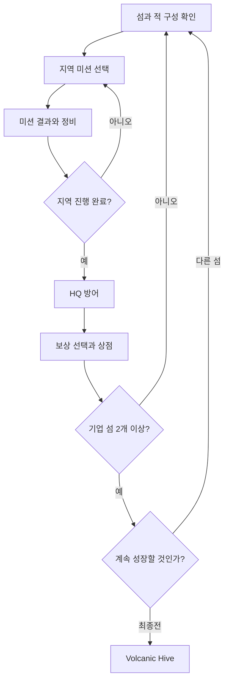

# 11. 아일랜드·캠페인·최종전 역기획

[전체 목차](00_README_문서안내.md)

> 범위: PC판 및 Advanced Edition 공개 규칙. 조사일: 2026-11-13.
> [확인] 문헌 규칙 / [분석] 설계 해석 / [제안] 재구현 모델 / [미확인] 충돌·예외 확인 필요.

## 1. 캠페인은 다음 퍼즐의 조건을 고르는 시스템이다

**[분석]** 섬 선택은 전투 사이의 이동 메뉴 이상의 역할을 한다. 플레이어는 자신이 가진 밀기·연기·동결·화력의 조합이 어느 지형과 적군 구성에 잘 맞는지 보고 다음 전투 묶음을 선택한다.

캠페인의 핵심 질문은 “더 강해질 때까지 계속 싸울 것인가, 지금 최종전에 들어갈 것인가”다. 성장 기회를 더 얻을수록 전력망·파일럿·실수 위험에도 더 오래 노출된다.

| 캠페인 요소 | 플레이어 입력 | 결과 |
| --- | --- | --- |
| 섬 선택 | 기업 섬과 적 구성 검토 | 지역·미션·지형 풀 선택 |
| 지역 선택 | 보상·목표·인접 경로 검토 | 다음 전장 결정 |
| HQ | 보스와 주요 시설 방어 | 섬 종료·상점 접근 |
| 정비 | 코어 배분·장비·파일럿 배치 | 다음 전투의 행동 가능성 변경 |
| 최종전 선택 | 2·3·4개 섬 후 진입 | 런 길이 확정 |
| 시간선 종료 | 승계 파일럿 선택 | 다음 런 준비 |

## 2. 확인된 캠페인 구조

**[확인]** 기업 섬은 Archive, R.S.T., Pinnacle, Detritus의 네 종류이며, 두 섬을 완료하면 Volcanic Hive가 열린다. 기업 섬 하나에서는 지역 미션 네 번 뒤 HQ 전투를 진행한다. [P16, P10]

**[확인]** 새 프로필의 섬 접근은 제한되어 있으며, 해금된 섬은 이후 다른 순서로 선택할 수 있다. Detritus는 앞선 기업 섬들의 완료를 통해 해금되는 구조다. [P15]



**[제안]** 이 흐름도는 정상 진행의 논리 요약이다. 지역 패배, 전력망 소진, 포기, 저장·복귀는 별도 상태로 붙인다. 섬 해금 여부와 이번 런의 섬 완료 여부를 하나의 플래그로 저장하지 않는다.

## 3. 네 섬의 시스템적 차이

| 섬 | 공개 자료에서 확인한 특징 | 전술적 해석 |
| --- | --- | --- |
| Archive | 댐·위성·열차 등 시설 관련 임무 [P12] | 보호할 길과 파괴할 지형이 동시에 존재 |
| R.S.T. | 지형 변화·산·시제품 폭탄·모래 환경 [P13] | 고정된 안전지대보다 다음 턴의 지형을 평가 |
| Pinnacle | 얼음·동결·보호해야 할 로봇 [P14] | 제거보다 상태 제어가 좋은 임무가 존재 |
| Detritus | A.C.I.D.·컨베이어·텔레포터 [P15] | 이동 경로와 강제이동의 결과가 자주 변함 |

오른쪽 열은 **[분석]**이다. 특정 섬을 항상 쉽거나 어렵다고 서열화하지 않는다. 같은 섬이라도 적 종, 목표, 스쿼드, 장비와 진행 순서에 따라 부담이 달라진다.

### 3.1 섬 진입 전 검토 순서

**[제안]** 캠페인 UI에서 다음 질문을 순서대로 해결하게 한다.

1. 이번 섬에 등장할 적의 공격 유형이 현재 스쿼드의 약점을 찌르는가?
2. 지형을 활용할 도구가 있는가?
3. 목표 오브젝트를 손상시키지 않고 방어할 수 있는가?
4. 다음 업그레이드 임계값까지 필요한 코어·평판이 얼마인가?
5. 현재 전력망으로 상점까지 버틸 여유가 있는가?

**[분석]** 이 순서가 중요한 이유는 코어 수익만 높아도 실제 전투에서 손실이 크면 성장 이익이 사라지기 때문이다. 미션 선택은 획득량 최대화가 아니라 수행 가능성을 포함한 경로 선택이다.

## 4. 지역 선택과 경로

**[분석]** 지역별 정보를 미리 보여 주면 전투 전 결정도 퍼즐의 일부가 된다. 즉시 안전한 임무를 선택해 낮은 전력을 회복할지, 어려운 임무를 거쳐 업그레이드를 앞당길지 비교할 수 있다.

**[제안]** 지역을 다음 데이터로 분리한다.

| 데이터 | 역할 | UI 표현 |
| --- | --- | --- |
| `regionId` | 선택한 미션의 안정적 식별자 | 지역 이름 |
| `neighbors` | 진입 가능한 인접 관계 | 연결선·강조 |
| `missionTemplate` | 목표·환경 기본 구성 | 목표 설명 |
| `rewardOffer` | 성공 시 보상 | 평판·전력·코어 아이콘 |
| `threatTags` | 특수 적·위협 표식 | 위험 표시 |
| `status` | 미선택·해결·상실·잠금 | 색과 기호 |

**[미확인]** 원작에서 지역 인접성, 진입 후보, 미션 조합이 정확히 어떤 알고리즘으로 생성되는지는 공개 UI만으로 확정할 수 없다. 위 필드와 생성 단계는 재구현을 위한 제안이다.

## 5. HQ와 섬 완벽 보상의 기능

**[확인]** 섬의 모든 보너스 목표를 만족하면 장비·파일럿·전력 중 보상을 선택할 수 있다. 타임 포드와 지역 손실도 완벽 완료 평가에 관련된다. [P10]

**[분석]** 완벽 보상은 각 미션 목표를 섬 전체의 묶음 과제로 만든다. 앞선 목표를 모두 성공한 상태에서는 마지막 하나를 지키는 추가가치가 커진다. 반대로 이미 하나를 놓쳤더라도 남은 평판·전력·코어는 독립적으로 획득할 가치가 있다.

**[제안]** 결과 화면은 다음 세 줄을 분리한다.

- 이번 HQ 미션에서 얻은 일반 보상.
- 이번 섬의 완벽 완료 자격과 선택 보상.
- 다음 섬으로 떠나기 전 사용할 평판 잔액.

한 줄의 “승리 보상”으로 합치면 목표 실패가 어떤 보상에 영향을 주었는지 이해하기 어렵다.

## 6. 2·3·4개 섬 완료 후 최종전 선택

**[분석]** 선택 가능한 런 길이는 플레이어가 성장과 위험의 균형점을 정하게 한다. 더 많은 섬을 거치는 것은 단순한 상위 호환이 아니다. 필요한 장비를 이미 확보했거나 전력망이 취약하면 추가 성장의 기대이익과 추가 전투의 실패 위험을 비교해야 한다.

| 진입 판단 | 짧은 런에 유리한 상황 | 추가 섬에 유리한 상황 |
| --- | --- | --- |
| 전투 도구 | 위협 제어와 이동 도구가 이미 충분 | 부족한 역할을 새 장비로 보완해야 함 |
| 코어 | 필수 업그레이드 임계값 충족 | 적은 투자로 큰 개선 가능 |
| 전력망 | 회복 기회보다 추가 손실 위험이 큼 | 회복할 경로를 안정적으로 수행 가능 |
| 파일럿 | 핵심 능력이 완성됨 | 승급으로 선택지 증가 가능 |
| 플레이 목표 | 현재 스쿼드 승리 기록 확보 | 다른 길이 승리·업적 시도 |

**[제안]** 최종전 버튼에는 현재 배치, 전력망, 사용 가능한 무기, 활성 능력을 다시 확인할 짧은 준비 화면을 둔다. 실제 게임과 동일한 경고 문구라는 의미는 아니다.

## 7. 최종전의 확인된 특수 규칙

**[확인]** Volcanic Hive는 지상과 지하의 두 페이즈로 구성된다. 지상에서는 화산 환경이 개입하고, 지하에서는 Renfield Bomb을 지킨다. 전력 파일런은 민간 건물과 같은 전력 보호 대상이 된다. [P17]

| 항목 | 핵심 규칙 | 근거 |
| --- | --- | --- |
| 지하 배치 | 메크와 폭탄이 2×2 묶음으로 자동 배치 | P17 |
| 페이즈 전환 | 제한 사용 무기·아이템 사용량과 비활성 메크 복구에 미션 경계 적용 | P17 |
| 파일럿 | 앞 페이즈에서 확정된 파일럿 사망은 별도 처리 | P17 |
| 폭탄 HP | 최종전 폭탄은 HP 4 | P17 |
| 폭탄 파괴 | 대체 폭탄 투입, 남은 턴 +2 | P17 |
| 승리 | 최종 공격 구간을 폭탄이 생존해야 함 | P17 |

**[미확인]** 자료는 기본 진행 길이를 5턴으로 설명하기도 하고, 환경 발동을 4개 턴 주기로 설명하기도 한다. 초기 카운터·플레이어 행동 턴·환경 발동 횟수를 혼동할 수 있으므로 이 문서는 정확한 초기 표시값을 확정하지 않는다. 검증 시 UI 카운터와 실제 입력 가능 횟수를 함께 기록한다. [P17, P28]

**[미확인]** 보스 풀·출현 수는 난이도와 완료 섬 수의 영향을 받는다. 구버전 분석의 적 수를 AE 또는 Unfair에 그대로 옮기지 않는다.

## 8. 최종전이 요구하는 다른 판단

**[분석]** 최종전의 목적은 체력이 큰 보스를 죽이는 일 하나로 수렴하지 않는다. 적 공격, 지형 파괴, 파일런, 폭탄, 제한 사용 장비가 동시에 작동한다. 기존에 배운 위치 조작과 예고 해석이 종합적으로 시험된다.

### 8.1 폭탄 손실과 전력 손실의 비교

**[분석·가상 예시]** 전력 1에서 파일런의 확정 피해를 막을 수 있는 행동이 하나뿐이고, 그 행동을 쓰면 폭탄이 파괴된다고 가정하자. 폭탄 손실은 전투 연장을 만들지만, 전력망 소진은 런을 끝낸다. 따라서 두 피해를 같은 “보호 목표 실패”로 계산하면 잘못된 의사결정이 나온다.

이 예시는 폭탄을 항상 희생하라는 공략이 아니다. 연장된 턴을 감당할 전력·기체·지형이 있는지도 봐야 한다. 최종전의 실패 비용은 현재 턴뿐 아니라 대체 폭탄 이후의 전투 비용까지 포함한다.

### 8.2 페이즈 사이의 자원 경계

**[분석]** 제한 사용량이 페이즈 경계에서 새로 주어진다면, 지상에서 남겨 둔 사용 횟수가 그대로 지하의 추가 자원이 되는 것은 아니다. 반면 전력망과 파일럿 손실은 계속 영향을 미친다. 이 차이가 소모품을 적극적으로 사용할 근거가 된다.

**[제안]** 페이즈 전환 UI는 복구된 항목과 유지된 손실을 구분해 표시한다. 기체가 다시 서 있어도 파일럿 능력과 전력 배분이 이전과 같다고 가정하지 않도록 한다.

## 9. 캠페인 상태 모델

```yaml
# 제안: 원작 저장 포맷이 아님
campaign:
  timeline_id: timeline_001
  completed_islands: [archive, rst]
  current_island: null
  final_island_available: true
  grid_state_ref: grid_001
  squad_state_ref: squad_001
  region_results: []
  perfect_island_eligible: true
  phase: island_selection
  content_flags:
    advanced_enemies: true
    advanced_equipment: true
```

**[제안]** 프로필의 `unlockedIslands`는 여기에 포함하지 않는다. 런 저장을 삭제해도 이미 배운 섬 선택지가 사라지지 않게 별도 저장한다. 반대로 새 런을 시작할 때 이전의 `completed_islands`가 남아 있으면 최종전이 잘못 열릴 수 있다.

## 10. 경계 조건과 실패 처리

| 경계 | 잘못 구현하기 쉬운 방식 | 필요한 구분 |
| --- | --- | --- |
| 지역 패배 | 곧바로 런 종료 | 전력망과 미션 결과의 독립성 |
| 섬 완료 | 평판 자동 보존 | 섬 떠나기 전 상점 정산 |
| 완벽 보상 | 건물 무피해만 검사 | 개별 보너스 목표 이력 |
| 지하 진입 | 모든 파일럿 자동 부활 | 기체 복구와 파일럿 상태 |
| 폭탄 파괴 | 즉시 실패 화면 | 대체 투입·턴 연장 |
| 최종 턴 | 스폰을 무조건 마지막에 처리 | 승리 판정과 후속 이벤트 순서 |
| 저장 복귀 | 페이즈 진입 보상 재지급 | 전환 트랜잭션 ID |

**[제안]** 최종 턴 판정은 `CheckVictory`와 `ProcessSpawn`의 위치를 명시한 규칙표로 검증한다. 전투 규칙의 세부 순서는 [03 턴 구조](03_턴구조_행동경제_되돌리기.md)와 맞춘다.

## 11. 검증 체크리스트

| ID | 시나리오 | 확인할 결과 |
| --- | --- | --- |
| CAM-01 | 새 프로필과 기존 프로필 시작 | 섬 해금과 런 완료의 분리 |
| CAM-02 | 첫 기업 섬 종료 | 최종전 미개방 |
| CAM-03 | 두 번째 기업 섬 종료 | 최종전 또는 다음 섬 선택 |
| CAM-04 | 네 번째 기업 섬 종료 | 더 갈 기업 섬 없음·최종전 진입 |
| CAM-05 | 마지막 보너스 목표 하나 실패 | 일반 보상과 완벽 보상 분리 |
| CAM-06 | 타임 포드를 놓친 섬 | 완벽 자격·포드 보상 확인 |
| CAM-07 | 사용 제한 무기를 지상에서 소진 | 지하 진입 시 사용량 갱신 |
| CAM-08 | 지상에서 파일럿 손실 | 기체 복구·파일럿·전력 재계산 |
| CAM-09 | 지하 폭탄을 파괴 | 대체 투입·남은 턴 +2 |
| CAM-10 | 폭탄 파괴와 전력 0 동시 발생 | 종료 우선순위 명확화 |
| CAM-11 | 마지막 턴 폭탄이 스폰을 막음 | 승리와 스폰 피해의 순서 |
| CAM-12 | 페이즈 전환 직후 저장·복귀 | 배치·보상·사용량 중복 적용 없음 |

## 12. 출처

| ID | 자료 | 사용 범위 |
| --- | --- | --- |
| P10 | [Missions — 커뮤니티 위키](https://intothebreach.fandom.com/wiki/Missions) | 지역·HQ·완벽 보상 구조 |
| P12 | [Archive, Inc. — 커뮤니티 위키](https://intothebreach.fandom.com/wiki/Archive%2C_Inc.) | 기업 섬의 임무 특징 |
| P13 | [R.S.T. Corporation — 커뮤니티 위키](https://intothebreach.fandom.com/wiki/R.S.T._Corporation) | 지형·시제품 폭탄 임무 |
| P14 | [Pinnacle Robotics — 커뮤니티 위키](https://intothebreach.fandom.com/wiki/Pinnacle_Robotics) | 얼음·로봇 보호 |
| P15 | [Detritus Disposal — 커뮤니티 위키](https://intothebreach.fandom.com/wiki/Detritus_Disposal) | 섬 해금·산업 지형 |
| P16 | [Islands — 커뮤니티 위키](https://intothebreach.fandom.com/wiki/Islands) | 기업 섬·최종전 개방 |
| P17 | [Volcanic Hive — 커뮤니티 위키](https://intothebreach.fandom.com/wiki/Volcanic_Hive) | 두 페이즈·폭탄·전환 규칙 |
| P28 | [최종전 환경 분석 — 2019 사용자 분석](https://www.reddit.com/r/IntoTheBreach/comments/dhxkzv) | 턴 수 표현의 차이 확인용 |

위키 일부는 검색 인덱스에 반환된 문장으로 확인했다. 상세 스폰 알고리즘·확률·최신 빌드 수치를 원작 내부 구현으로 확정하지 않았다.
