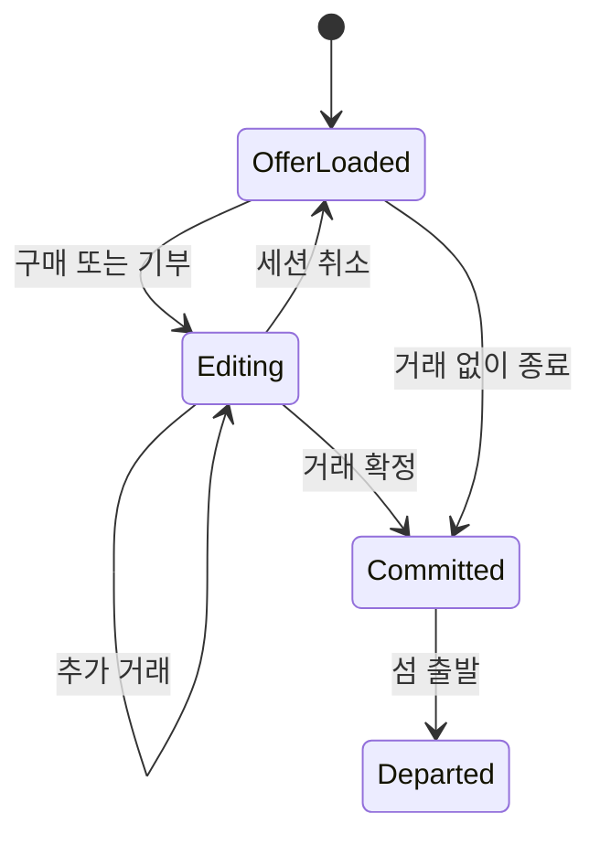

# 12. 경제·보상·상점 역기획

[전체 목차](00_README_문서안내.md)

> 범위: PC판 및 Advanced Edition 공개 규칙. 조사일: 2026-11-13.
> [확인] 문헌 규칙 / [분석] 설계 해석 / [제안] 재구현 명세 / [미확인] 버전·예외 확인 필요.

## 1. 경제의 핵심은 서로 다른 시간 단위다

**[분석]** Into the Breach의 자원은 역할과 소멸 시점이 다르다. 전력망은 생존 여유, 평판은 섬 종료 시의 교환권, 코어는 이번 런의 전술 확장, 코인은 프로필의 스쿼드 해금 수단이다. 이들을 같은 돈으로 합치면 각 단계의 선택이 사라진다.

| 자원 | 사용 목적 | 주된 판단 시점 | 관련 문서 |
| --- | --- | --- | --- |
| Grid Power | 런 생존·건물 피해 흡수 | 매 턴·미션 선택 | [10 전력망](10_미션_목표_전력망.md) |
| Corporate Reputation | 무기·코어·전력 교환 | 섬 종료 상점 | 본 문서 |
| Reactor Core | 무기·스탯·능력의 전력 배분 | 출격 전 정비 | [07 장비](07_메크_무기_업그레이드.md) |
| 장비 | 공격·보조·패시브 도구 | 획득·교환·배치 | [07 장비](07_메크_무기_업그레이드.md) |
| 파일럿 | 능력·경험·승계 | 배정·생존·시간여행 | [09 파일럿](09_파일럿_경험치_시간여행.md) |
| Coin | 추가 스쿼드 선택지 | 프로필 해금 | [15 메타진행](15_메타진행_업적_콘텐츠해금.md) |

**[제안]** `CurrencyAmount` 하나에 자원 종류를 문자열로만 붙이는 것보다, 유효 기간과 사용 가능한 화면을 명시한 자원 정의가 안전하다. 특히 평판을 다음 섬으로 가져갈 수 있는 일반 소지금으로 구현하지 않는다.

## 2. 상점의 확인된 교환 규칙

아래는 조사 시점의 AE 계열 커뮤니티 자료를 기준으로 한 요약이다. 오래된 공략의 무기 가격·파일럿 환산값과 섞지 않는다.

| 거래 | 평판 변화 | 결과 | 근거 |
| --- | --- | --- | --- |
| 무기 구매 | -2 | 장비 1개 획득 | P18 |
| Reactor Core 구매 | -3 | 코어 1개 획득 | P18 |
| Grid Power 구매 | -1 | 전력 회복 또는 초과 방어 증가 | P18 |
| 무기 기부 | +1 | 장비 제거 | P18 |
| 파일럿 기부 | 기본 +1 | 해당 파일럿 제거 | P18 |
| Popular Hero 파일럿 | +4 | 능력에 따른 높은 기부 가치 | P18 |
| 섬 이동 | 잔여 평판 이월 불가 | 현재 섬 거래 마감 | P18 |

**[확인]** 상점은 기업 섬의 Hive Leader 전투 이후 이용한다. 장비 판매 목록은 제한되어 있다. [P18]

**[미확인]** 모든 플랫폼·빌드에서 품목 수와 기부 예외가 완전히 동일한지는 검증하지 않았다. 실제 데이터 입력 시 실행 빌드의 가격표를 다시 확인한다. 무기 가격을 1로 적은 구형 자료를 AE 규칙의 근거로 사용하지 않는다.

## 3. 보상 획득 경로

| 경로 | 확인된 보상 성격 | 경제적 기능 |
| --- | --- | --- |
| 미션 목표 | 평판·전력·코어 [P10] | 위험과 성장의 직접 교환 |
| 타임 포드 | 코어와 추가 장비·파일럿 가능성 [P11] | 계획에 없는 기회 제공 |
| 섬 완벽 보상 | 장비·파일럿·전력 선택 [P10] | 여러 미션 성과를 묶어서 보상 |
| 상점 | 평판으로 장비·코어·전력 선택 [P18] | 부족한 역할 보완 |
| 업적 | 코인 [15 문서] | 다음 런의 선택지 확대 |

**[분석]** 포드와 상점의 무작위성은 즉시 공격 성공 여부보다 장기 빌드에 작용한다. 전투 판정의 예측 가능성을 유지하면서도 다음 보상에서 무엇을 얻을지 모르는 변화를 만들 수 있다.

**[제안]** 보상은 `Offer`와 `Grant`를 분리한다. 포드를 살렸다는 이벤트, 포드 내용을 결정하는 이벤트, 플레이어 인벤토리에 실제 지급하는 이벤트가 동일하지 않기 때문이다. 저장·복귀 때 같은 보상이 두 번 들어가는지 검사해야 한다.

## 4. 코어 설치와 전력 배분

**[확인]** 코어는 메크에 추가 전력을 제공하며, 스탯·무기·업그레이드·패시브·특수 파일럿 능력에 사용할 수 있다. [P19]

**[확인·커뮤니티 가이드]** 설치 후 출격한 코어는 다른 메크로 자유롭게 옮기는 자원이 아니다. 반면 그 메크 안에서 어떤 기능에 전력을 배분할지는 구분되는 문제다. [P20]

| 단계 | 플레이어의 결정 | 지속 범위 |
| --- | --- | --- |
| 미설치 코어 보유 | 어느 메크에 투자할지 | 분대 공용 여유 |
| 코어 설치 준비 | 새 코어의 귀속 메크 | 출격 전 취소 가능 여부 확인 |
| 출격 후 설치 확정 | 장기 성장 편중 | 이번 런의 메크 성장 |
| 기능별 전력 배분 | 화력·이동·체력·보조 기능 선택 | 정비 화면에서 조정 |
| 파일럿 변경 | 능력 전력·보너스 전력 변화 | 파일럿 종속 |

**[미확인]** 기본 전력, 설치 코어, 파일럿 추가 전력을 포함한 최종 상한은 표기 방식이 자료마다 다르다. 이 문서는 특정 “최대 9/10/11”을 하나의 총량으로 단정하지 않는다. 상한 테스트는 각 전력 출처를 따로 세어 수행한다.

### 4.1 설치와 활성화가 다른 이유

**[분석]** 코어를 어느 메크에 넣는지는 분대 내 자원 분배다. 넣은 전력을 어느 업그레이드에 연결하는지는 같은 메크의 역할 조정이다. 전자는 되돌리기 어려운 성장 결정을, 후자는 다음 미션에 대응하는 유연성을 제공한다.

**[제안]** UI는 `미설치 코어`, `기체에 귀속된 전력`, `현재 사용 중인 전력`을 별도 숫자로 보여 준다. 이미 코어를 설치했는데 사용하지 않은 전력이 있다고 해서 그 코어가 공용 인벤토리로 돌아온 것은 아니다.

## 5. 행동 가능성을 사는 경제

**[분석]** 피해 +1의 가치는 적 체력과 공격 패턴에 따라 달라진다. 2피해가 3피해가 되면서 적을 한 번에 제거할 수 있다면 다음 행동 하나를 절약한다. 반대로 처치 임계값을 넘지 못하면 사거리·이동·밀기 방향을 늘리는 투자가 더 많은 위협을 해결할 수 있다.

| 투자 유형 | 가치가 커지는 조건 | 평가 시 놓치기 쉬운 비용 |
| --- | --- | --- |
| 피해 증가 | 한 행동으로 처치 가능한 적이 늘어남 | 부수 피해·자해 증가 |
| 이동 증가 | 필요한 공격 칸에 도달 가능 | 도달 후 안전한 종료 위치 |
| 사거리 증가 | 원거리 위협을 처리할 수 있음 | 가까운 적 공격 불가 예외 |
| 아군·건물 보호 | 위험한 광역기를 안전하게 사용 | 면역 대상의 정확한 범위 |
| 사용 횟수 증가 | 핵심 무기를 여러 턴 사용 | 미션 경계 리셋 방식 |
| 새 장비 | 기존 스쿼드에 없는 해법 확보 | 전력·슬롯·행동권 경쟁 |

**[제안]** 밸런스 평가에서는 “평균 피해/코어” 외에 `새로 해결 가능한 위협 유형 수`와 `공격 가능한 위치 수`를 측정한다. 독특한 이동 도구의 가치를 피해 수치만으로 0으로 평가하면 장비 다양성이 줄어든다.

## 6. 상점 계산 예시

다음은 원작 플레이 기록이 아니라 거래 비용을 설명하기 위한 가상 예산이다. 기본 난이도이며, 전력은 5/7, 보유 평판은 8이라고 가정한다.

| 선택안 | 사용 내역 | 합계 | 설계 해석 |
| --- | --- | --- | --- |
| A | 코어 2개 + 전력 2 | 3+3+1+1=8 | 성장과 생존을 동시에 확보 |
| B | 무기 1개 + 코어 2개 | 2+3+3=8 | 신규 도구와 활성 전력 확보 |
| C | 무기 2개 + 코어 1개 + 전력 1 | 2+2+3+1=8 | 유연성은 늘지만 기능 중복 주의 |
| D | 코어 1개 + 전력 5 | 3+5=8 | 7/7 이후 일부는 방어로 전환 |

**[분석]** 네 안의 합계는 같지만 가치가 동일하지 않다. 현재 무기가 이미 충분한데 B를 고르면 전력망 회복을 놓칠 수 있다. 반대로 새로운 무기가 기존 스쿼드가 처리 못하던 공격 유형을 막아 준다면 전력을 직접 사는 것보다 미래 손실을 더 줄일 수 있다.

**[제안]** 상점 미리보기는 구매 직후 수치뿐 아니라 전력 부족으로 새 장비가 활성화되지 않는지도 보여 준다. 무기를 구매했는데 출격 후 쓸 수 없는 상태는 플레이어가 확인 가능한 선택 결과여야 한다.

## 7. 거래 세션과 되돌리기

**[제안]** 다음은 원작의 내부 코드가 아닌 상점 재구현용 트랜잭션 설계다.

1. 상점 입장 시 기준 인벤토리·평판·전력·코어 배분을 저장한다.
2. 구매·기부·설치를 임시 거래 로그에 적용한다.
3. UI에서 예상 최종 상태를 계산한다.
4. 취소 요청은 거래 단위 또는 세션 기준으로 되돌린다.
5. 상점을 떠날 때 확정하고 남은 평판 정책을 적용한다.
6. 다음 섬 생성 전에 저장한다.

**[제안]** 구매한 코어를 설치한 뒤 구매를 취소한다면 설치된 코어까지 함께 되돌릴지, 취소를 제한할지 명확해야 한다. 가격만 환급하고 코어가 남으면 자원 복제가 발생한다. 실제 관련 수정 이력은 [18 검증 문서](18_검증체크리스트_미확인항목.md)의 공식 패치 근거를 참고한다.



## 8. 경제 데이터 구조 예시

```yaml
# 제안: 원작 형식이 아님
trade_session:
  island_id: archive
  transaction_id: shop_001
  reputation_start: 8
  offers:
    - item_id: sample_weapon
      cost: 2
      stock: 1
  operations:
    - kind: buy_core
      count: 2
      cost: 6
    - kind: buy_grid
      count: 2
      cost: 2
  committed: false
```

**[제안]** 원장에는 `sourceRewardId`와 `transactionId`를 사용한다. 전투 결과 지급과 상점 구매는 다른 원천 이벤트이므로 인벤토리 총량만 저장하는 것보다 오류 복구와 리플레이 검증이 쉽다.

## 9. 밸런스 평가 지표

| 지표 | 해석 | 조정할 요소 |
| --- | --- | --- |
| 섬별 코어 획득 분포 | 업그레이드 속도 | 보상 조합·상점 비용 |
| 장비 구매 후 활성화율 | 장비를 실제 쓸 수 있는가 | 기본 전력 비용·코어 공급 |
| 전력 구매 비율 | 생존 압박과 성장 여유 | 미션 피해·보상 배율 |
| 장비 기부율 | 드롭이 빌드에 적합한가 | 장비 풀·기본 성능 |
| 특정 메크 코어 집중률 | 분대의 역할 불균형 | 업그레이드 단계별 효용 |
| 상점 후 잔액 포기율 | 이월 규칙이 전달되는가 | 출발 경고·가격 단위 |
| 새 장비로 해결한 위협 | 수치 이외의 도구 가치 | 사거리·밀기·상태 효과 |

위 지표는 **[제안]**이며 실제 게임의 운영 지표나 개발팀 측정값이 아니다.

## 10. 검증 시나리오

| ID | 준비·입력 | 확인 사항 |
| --- | --- | --- |
| ECO-01 | 평판 2로 무기 구매 | 평판 0·장비 1개·중복 지급 없음 |
| ECO-02 | 평판 부족 구매 시도 | 인벤토리와 평판 모두 변화 없음 |
| ECO-03 | 기본 파일럿과 Popular Hero 기부 | 각각의 환산값·장착 해제 처리 |
| ECO-04 | 남은 평판을 가진 채 섬 이동 | 이월 금지와 UI 경고 |
| ECO-05 | 코어 구매→설치→취소 | 환불·설치·공용 재고 일관성 |
| ECO-06 | 출격 확정 후 코어 이동 시도 | 기체 귀속 규칙 확인 |
| ECO-07 | 전력 상한 상태에서 구매 | 초과 방어·상한·구매 취소 |
| ECO-08 | 코어 보너스 파일럿 기부 | 무기·능력의 전력 부족 재계산 |
| ECO-09 | 포드 회수 직후 저장·복귀 | 보상 지급 한 번 |
| ECO-10 | 상점 확정 직후 저장·복귀 | 구매·기부·잔액 정산 중복 없음 |
| ECO-11 | Unfair의 전력 구매 | 비용과 실제 회복 배율 구분 |
| ECO-12 | AE 추가 장비 비활성 | 신규 제시 장비 풀 정책 확인 |

## 11. 출처

| ID | 자료 | 사용 범위 |
| --- | --- | --- |
| P10 | [Missions — 커뮤니티 위키](https://intothebreach.fandom.com/wiki/Missions) | 보상 유형 |
| P11 | [Time Pod — 커뮤니티 위키](https://intothebreach.fandom.com/wiki/Time_Pod) | 포드 보상 |
| P18 | [Corporate Reputation — 커뮤니티 위키](https://intothebreach.fandom.com/wiki/Corporate_Reputation) | 상점 가격·기부·평판 이월 |
| P19 | [Reactor Core — 커뮤니티 위키](https://intothebreach.fandom.com/wiki/Reactor_Core) | 코어의 기능 |
| P20 | [Beginners Guide & Advice — 2021 사용자 가이드](https://steamcommunity.com/sharedfiles/filedetails/?id=2618873050) | 출격 후 설치 코어 귀속 |

일부 위키는 검색 인덱스 문장으로 확인했다. 상점 기본 가격은 AE 자료를 우선했고, 구형 가이드에서는 설치·배분 개념만 사용했다. 현재 실행 파일의 세부 가격·품목 수·전력 상한은 별도 검증 항목이다.
