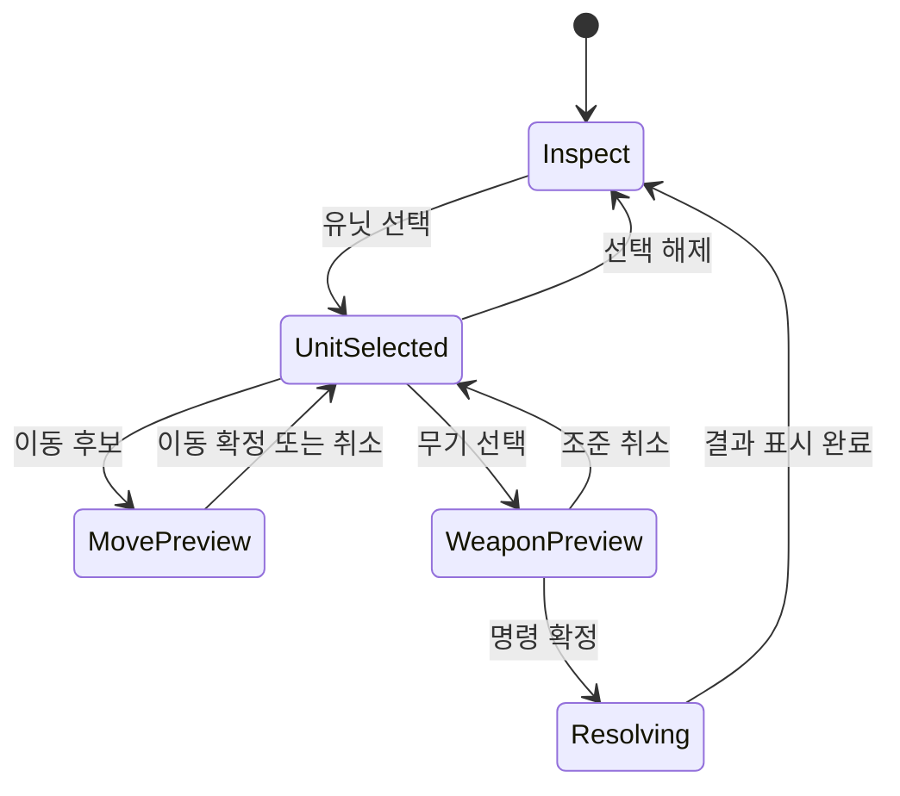
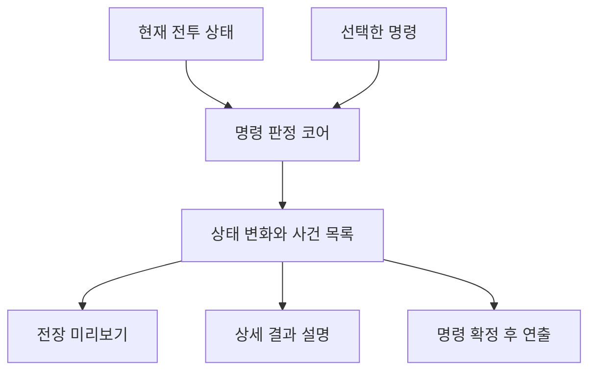

# 13. UI·UX와 정보 시각화

> [전체 목차](00_README_문서안내.md) · [의도 예고](06_적_AI_의도예고_스폰.md) · [판정 파이프라인](16_데이터모델_판정파이프라인.md)  
> 기준: PC + Advanced Edition 공개 자료. 아래 상세 정보 구조와 UI 수용 기준은 별도 표시가 없는 한 **[분석/제안]**이다.

## 1. 시스템 목적

플레이어가 규칙을 알고 있다는 전제만으로는 충분하지 않다. 현재 판에서 어떤 규칙이 적용되고 있는지를 즉시 확인할 수 있어야 한다. 이 게임의 UI는 명령을 입력하는 창이면서, 명령의 결과를 읽는 전술 도구다.

**[확인]** GDC 회고는 타깃과 공격 종류를 표현하는 과정에서 근접·직사·포격의 구분, 직교 방향 공격, 일관된 적 특성이 중요한 제약이 되었다고 설명한다. [O05, 슬라이드 28–36](https://media.gdcvault.com/gdc2019/presentations/Into%20the%20Breach%20Postmortem%20Final.pdf)

**[분석]** 규칙이 복잡해지는 속도보다 화면의 설명력이 빠르게 증가해야 한다. 상태 아이콘을 하나 추가했는데 그 상태의 위치·지속·피해 시점·해제 조건을 읽을 수 없다면, 실제로는 규칙 추가 비용을 UI에 전가한 것이다.

## 2. 사용자의 판단 순서

1. **현재 실패 위험 확인:** 남은 전력, 보호 목표, 남은 턴을 본다.
2. **위협 확인:** 적의 타깃·공격 종류·공격 순서를 읽는다.
3. **행동 후보 탐색:** 이동 가능 칸과 무기 범위를 확인한다.
4. **결과 비교:** 피해·밀기·충돌·상태·지형 변화를 미리 본다.
5. **확정 후 재평가:** 바뀐 보드에서 남은 위협을 다시 읽는다.
6. **턴 종료 검토:** 미사용 행동보다 해결되지 않은 피해를 확인한다.

이 순서는 튜토리얼, 툴팁, 키보드 포커스와 경고 메시지의 우선순위를 정하는 기준으로 사용할 수 있다.

## 3. 화면을 기능으로 나눈 정보 구조

| 영역 | 반드시 전달할 정보 | 주된 사용 시점 | 설계 위험 |
| --- | --- | --- | --- |
| 전장 | 점유·지형·사거리·예고·환경 | 계속 | 아이콘 중첩으로 정보 소실 |
| 전력·미션 | 런 생존 자원·남은 턴·목표 상태 | 턴 시작/종료 | 미션 HP와 런 HP 혼동 |
| 선택 유닛 | HP·이동·상태·파일럿·행동권 | 유닛 선택 | 기본값과 현재값 혼동 |
| 무기 | 범위·피해·부가효과·제한 횟수 | 후보 탐색 | 설명은 맞지만 현재 적용이 안 보임 |
| 실행 순서 | 어떤 사건이 먼저 일어나는가 | 순서 의존 상황 | 공격하지 않는 객체에 가짜 순서 부여 |
| 결과 피드백 | 실제 피해·저항·사망·보상 | 명령 확정 후 | 여러 효과가 한 번에 사라져 원인 추적 불가 |

원작의 정확한 화면 픽셀 배치나 플랫폼별 버튼 위치를 복제한 표가 아니다. 해상도와 입력 방식이 달라도 보존해야 할 정보의 책임을 정리했다.

## 4. 세 종류의 예측을 분리한다

### 4.1 현재 보드의 위협 표시

`지금 아무것도 바꾸지 않고 턴을 끝냈을 때 어떤 공격이 예정되어 있는가?`

보드의 현 상태와 적 의도에서 계산한다. 플레이어가 적을 밀거나 사격 경로를 바꾸면 즉시 갱신해야 한다.

### 4.2 단일 명령의 결과 표시

`이 명령 하나를 확정하면 무엇이 달라지는가?`

아군 공격 미리보기의 범위다. 피해만 표시하면 밀기 이후 지형 사망, 충돌, 방어 상태 소모를 놓치므로 연쇄 결과까지 포함하는 것이 좋다.

### 4.3 이후 턴의 전략적 예상

`다음 턴에는 어느 칸이 안전할 가능성이 있는가?`

아직 확정되지 않은 적 선택까지 포함한다. 이 값을 확정 미리보기와 같은 스타일로 보여 주면 안 된다. 재구현 시 추정 기능을 넣더라도 점선·범위·설명으로 구분해야 한다.

## 5. 공격 의도 표시 명세

| 필드 | 의미 | 표현 제안 | 갱신 사유 |
| --- | --- | --- | --- |
| `source` | 공격 주체 | 선택 강조와 연결선 | 유닛 이동·사망 |
| `attackKind` | 근접·직사·포격 등 | 형태가 다른 아이콘 | 무기/상태 변경 |
| `origin` | 공격 시작 위치 | 유닛 또는 발사 지점 | 밀기·교환·이동 |
| `direction/offset` | 공격 방향·상대 위치 | 방향 화살표 또는 범위 | 강제 이동 이후 재계산 |
| `impactTiles` | 현재 맞을 타일 | 칸별 위험 표시 | 차폐·지형·점유 변경 |
| `order` | 실행 순서 | 숫자와 연결 강조 | 실행 주체 제거·취소 |
| `cancelReason` | 실행되지 않는 이유 | 취소 아이콘과 원인 | 연기·빙결·사망 등 |

**[제안]** 위 이름은 설계용 필드이며 원작의 실제 변수명이 아니다. 특히 타깃을 항상 세계 좌표 하나로 저장하면 강제 이동 후 예고 갱신이 틀릴 수 있다. 공격별 타깃 모델은 [04번](04_공격_피해_강제이동.md)의 검증 범위를 따른다.

## 6. 공격 미리보기의 출력 계약

**[제안]** 미리보기 하나를 다음과 같이 정의한다.

| 출력 | 정상 표시 | 모호하면 생기는 오해 |
| --- | --- | --- |
| HP 변화 | 대상별 변화량과 예상 잔량 | 방어 상태가 흡수했는지 알 수 없음 |
| 강제 이동 | 도착 칸 또는 충돌 지점 | 이동 성공과 이동 시도 혼동 |
| 지형 변화 | 화염·연기·균열·구덩이 등의 결과 | 남은 유닛의 생존 판정 누락 |
| 보호 상태 | 방패·빙결 소모 여부 | 피해 0이 영구 면역처럼 보임 |
| 행동 가능성 | 공격 취소·활성화 여부 | 적이 해동 후 곧바로 공격한다고 오해 |
| 목표 변화 | 보호/파괴 목표의 예상 성패 | 전투 성공과 보너스 성공 혼동 |
| 확률 결과 | 보장 결과와 확률 분리 | 전력 저항을 확정 방어로 오인 |
| 연쇄 효과 | 후속 사건의 원인 연결 | 추가 피해가 버그처럼 보임 |

모든 세부 아이콘을 동시에 보여 줄 필요는 없다. 기본 화면은 중요 변화만, 상세 열람은 전체 이벤트를 제공하는 단계적 표현이 적절하다.

## 7. 선택·조준·확정의 입력 상태

**[제안]** 상태별 계약은 다음과 같다.

- `Inspect`: 정보를 보는 입력이 실제 명령을 실행하지 않는다.
- `MovePreview`: 유효 경로와 도착 칸을 구분한다.
- `WeaponPreview`: 대상 선택이 피해 적용을 일으키지 않는다.
- `Resolving`: 중복 입력을 차단하거나 다음 명령으로 명확히 큐잉한다.
- 취소는 화면 선택 취소, 이동 취소, 턴 되돌리기를 서로 다른 의미로 다룬다.

원작의 이동 취소와 Reset Turn 제약은 [03번](03_턴구조_행동경제_되돌리기.md)을 따른다. 위 상태도만 보고 무제한 행동 취소가 가능하다고 해석하면 안 된다.

## 8. 턴 종료 UX

### 8.1 경고를 분류하는 기준

| 경고 종류 | 예시 | 권장 처리 |
| --- | --- | --- |
| 잘못 누를 가능성 | 아직 조준 중인데 종료 입력 | 선택 취소 후 별도 확정 |
| 놓친 행동 | 행동 가능한 메크가 남음 | 짧은 확인 가능 |
| 현재 손실 | 건물·목표물이 공격받을 예정 | 대상 강조와 원인 표시 |
| 의도적 희생 | 메크가 사격을 막도록 배치 | 경고는 하되 행동을 금지하지 않음 |
| 불확실 결과 | 전력 저항이 필요함 | 확률을 생존 보장과 구분 |

**[분석]** 모든 피해에 반복 팝업을 띄우면 게임의 핵심인 의도적 희생이 방해받는다. 경고는 판단을 대신하는 장치가 아니라 누락된 정보를 찾는 장치여야 한다.

### 8.2 종료 직전 요약 제안

`예정된 건물 피해`, `위험한 보호 목표`, `활동 가능한 메크`, `환경 위험`, `스폰 저지 피해`를 별도 항목으로 정리한다. 숫자를 하나로 합친 “위험도 82”보다 어떤 손실이 발생하는지 설명하는 것이 이 게임의 학습 구조에 맞는다.

## 9. 상태·지형 아이콘 중첩

하나의 칸에는 지형 상태, 유닛 상태, 적 의도, 스폰, 목표 표시가 동시에 존재할 수 있다.

**[제안] 표시 우선순위**

1. 지금 확인하려는 명령의 직접 결과.
2. 턴 종료 시 유닛이나 목표를 파괴하는 위험.
3. 공격 취소·방패·빙결 등 행동을 바꾸는 상태.
4. 기본 지형과 지속 상태.
5. 장식·일반 애니메이션.

우선순위가 낮은 정보를 삭제해서는 안 된다. 기본 화면에서 줄였더라도 칸 상세 패널에서 확인 가능해야 한다.

**[확인]** 공식 1.2.88 패치는 화염에 가려졌던 컨베이어·균열 지형 아이콘, 일부 Alpha 식별 아이콘, 공격 순서 표시와 무기 미리보기 일관성을 수정했다고 명시한다. 이는 해당 문제가 실제 품질 관리 대상이었음을 보여 준다. [O06, 2023-01-23 공지](https://steamcommunity.com/app/590380/allnews/)

## 10. 색각·입력 방식·현지화

**[제안]** 색상은 의미의 유일한 전달 수단이 되어서는 안 된다.

| 문제 | 권장 표현 | 확인 방법 |
| --- | --- | --- |
| 적 일반/강화형 구분 | 실루엣·배지·숫자 병행 | 흑백 화면에서도 식별 |
| 아군/적군 구분 | 테두리·소속 아이콘 | 중첩 이펙트 상태 검사 |
| 위험/안전 범위 | 패턴·방향·윤곽 | 색각 조건별 대비 검사 |
| 무효 대상 | 금지 아이콘과 이유 | 단순 회색화만으로 끝내지 않음 |
| 긴 한국어 툴팁 | 제목·효과·예외 분리 | 글자 확대와 줄바꿈 검사 |

**[확인]** 공식 AE 안내는 모바일에서 작은 터치 화면을 위해 인터페이스를 다시 설계했다고 설명한다. [O02](https://new.subsetgames.com/itb_ae.html) 본 문서는 특정 모바일 버튼 크기를 추정하지 않는다.

**[제안] 입력별 규칙**

- 마우스: 호버 정보와 클릭 확정을 구분한다.
- 게임패드: 칸 포커스와 유닛 포커스를 잃지 않게 한다.
- 터치: 손가락이 목표 칸을 가리므로 확인 패널을 별도 영역에 둔다.
- 모든 방식: 동일한 명령과 동일한 보드를 만들면 동일한 결과가 나와야 한다.

## 11. 튜토리얼의 학습 단계

| 단계 | 학습 목표 | 예제 구성 제안 | 다음 단계 진입 조건 |
| --- | --- | --- | --- |
| 1 | 적 예고 읽기 | 공격 1개·건물 1개 | 피해 대상을 말할 수 있음 |
| 2 | 밀기로 공격 빗나가게 하기 | 적을 한 칸 옮길 공간 | 처치 없이 방어 성공 |
| 3 | 몸으로 막기 | 직사와 아군 메크 | 건물 피해와 메크 피해 구분 |
| 4 | 순서의 중요성 | 두 메크의 조합 | 먼저 행동할 유닛 선택 |
| 5 | 지형 이용 | 물/연기 등 한 종류 | 환경으로 위협 제거 |
| 6 | 희생 선택 | 모두 지킬 수 없는 가상 판 | 손실 이유를 설명 |

원작 튜토리얼을 그대로 전사한 목록이 아니라, 전투 규칙의 학습 의존관계에서 도출한 제안이다.

## 12. UI 데이터 계약

**[제안]** UI가 전투 규칙을 별도로 재구현하지 않도록 한다.

예를 들어 충돌 피해를 UI 코드가 `항상 1`로 직접 그리지 않는다. 방패·방어·지형을 포함한 코어의 결과를 받아 그린다. 실제 판정은 맞고 표시만 틀리는 오류도 플레이어에게는 규칙의 배신으로 느껴진다.

## 13. UI 검증 시나리오

| ID | 시나리오 | 합격 기준 |
| --- | --- | --- |
| UX-01 | 적을 밀어 포격 위치가 달라짐 | 새 실제 타깃과 예고 일치 |
| UX-02 | 여러 유닛을 한꺼번에 밀기 | 적용 순서와 충돌 결과 설명 가능 |
| UX-03 | 방패에 피해와 밀기를 함께 적용 | 방패 소모와 위치 변화 따로 표시 |
| UX-04 | 불·균열·유닛·스폰 중첩 | 상세 정보에 누락 없음 |
| UX-05 | 공격 취소 후 같은 턴 상태 해제 | 예고가 임의로 살아나지 않음 |
| UX-06 | 건물 저항 확률 존재 | 확률적 방어를 확정 생존처럼 표현하지 않음 |
| UX-07 | 색상 정보를 제거 | 적 등급·소속·위험 구분 가능 |
| UX-08 | 입력 확정 직전 취소 반복 | 상태 변이·횟수 소모·난수 소비 없음 |
| UX-09 | 빠른 연출 설정 | 최종 상태와 표시 사건 동일 |
| UX-10 | 행동 가능 메크가 남은 채 종료 | 사용자의 의도에 따라 진행 가능 |
| UX-11 | 한국어 장문 무기 설명 | 효과·제한·예외가 잘리지 않음 |
| UX-12 | 저장 복구 직후 툴팁 열기 | 현재 상태 기준으로 즉시 표시 |

검증 표는 제안된 수용 기준이다. 실제 게임을 실행해 이 시나리오를 테스트했다는 의미가 아니다.

## 14. 출처

| 근거 | 자료 | 근거 범위 |
| --- | --- | --- |
| O05 | [GDC 회고](https://media.gdcvault.com/gdc2019/presentations/Into%20the%20Breach%20Postmortem%20Final.pdf) | UI가 공격 종류·규칙 제약에 미친 영향 |
| O06 | [공식 Steam 패치 공지](https://steamcommunity.com/app/590380/allnews/) | 지형·공격 순서·예측 UI 수정 사례 |
| O02 | [공식 AE 안내](https://new.subsetgames.com/itb_ae.html) | 모바일 터치 인터페이스 설명 |

전투 관련 사례의 세부 규칙은 [03번](03_턴구조_행동경제_되돌리기.md)·[04번](04_공격_피해_강제이동.md)·[05번](05_상태이상_지형_환경.md)을 함께 확인한다.
