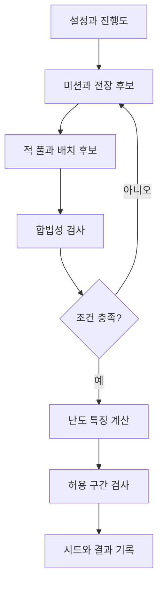

# 14. 난이도·절차 생성·밸런스 시스템

[전체 목차](00_README_문서안내.md)

> 기준: PC판 + Advanced Edition / 조사일: 2026-11-13.
> [확인]은 공개 규칙, [분석]은 설계 해석, [제안]은 재구현·평가 방법, [미확인]은 원작의 비공개 또는 미검증 값이다. 아래 생성 파이프라인과 수식은 원작 코드의 복원 결과가 아니다.

## 1. 난이도의 대상

[분석] Into the Breach의 난이도는 한 번의 공격이 얼마나 강한가보다 **제한된 행동으로 동시에 해결해야 하는 문제가 얼마나 많은가**에 크게 좌우된다. 적 한 기가 늘어나도 모든 공격이 한 칸에 겹치면 쉬울 수 있고, 낮은 피해의 적 세 기가 서로 다른 건물을 겨냥하면 어려울 수 있다.

난이도를 다음 세 층으로 나누어 읽는다.

| 층 | 변화시키는 요소 | 플레이어가 사용하는 능력 |
| --- | --- | --- |
| 판독 난도 | 공격 범위·순서·상태·예외 | 정보 해석 |
| 전술 난도 | 위협 수·위치·도달성·처치 임계값 | 행동 순서와 제어 |
| 운영 난도 | 전력망·보상·성장·섬 선택 | 손실 배분과 장기 계획 |

수치만 올리면 전술 난도가 높아지기보다 특정 기능만 정답이 되는 경우가 생길 수 있다. 다양한 제어 수단이 계속 의미를 갖는지를 함께 확인해야 한다.

## 2. 공개 난이도 구분

아래는 **[확인·커뮤니티 정리]**다. 정확한 스폰 수치표를 뜻하지 않는다. [E03]

| 난이도 | 공개 자료에서 구분되는 특징 | 4개 기업 섬 완전 방어 기준 점수 상한 |
| --- | --- | ---: |
| Easy | 적 수가 적고 초반 Alpha 등장에 제약이 있다. | 10,000 |
| Normal | 진행에 따라 Alpha·희귀종 압력이 커진다. | 20,000 |
| Hard | 첫 섬부터 Alpha가 일반 미션에 등장할 수 있다. | 30,000 |
| Unfair | 더 많은 적과 Alpha, 시작 Grid Defense 0, 후반 보스 압력. | 40,000 |

**[확인]** Unfair의 전력 획득 증가와 손실을 감수하는 운용은 공식 AE 발표에서 별도로 설명된다. 정확한 발표 요약은 [20 AE 변경점](20_Advanced_Edition_변경점.md)에 모았다.

**[분석]** 점수 상한은 난이도 비교용 보상 표식이지 생존 확률이나 실력 배수를 뜻하지 않는다. Easy에서 10,000점을 얻는 것과 Hard에서 10,000점을 얻는 것은 같은 방어 성과로 단순 비교하면 안 된다.

## 3. 고정된 룰과 달라지는 압력

[분석] 난이도 변경을 '모든 적 피해 ×배수'로 단순화하면 적 종류와 Alpha 변형이 만드는 의미가 사라진다. 설계 비교에서는 어떤 규칙을 유지하고 어떤 입력을 바꾸는지 구분해야 한다.

| 비교 축 | 분석 질문 | 잘못된 해석의 예 |
| --- | --- | --- |
| 적 종류 | 다른 공격 형상이 등장하는가? | 공격력이 모두 올랐다고만 해석 |
| 강화형 비중 | 한 행동 처치가 어려워졌는가? | 메크가 약해졌다고만 해석 |
| 적 수 | 동시에 지켜야 하는 대상이 늘었는가? | HP 합계로만 평가 |
| 지원 효과 | 계산식이 바뀌었는가? | 추가 적 한 기로만 평가 |
| 지형·목표 | 안전하게 밀 수 있는 방향이 줄었는가? | 무기 수치 문제로만 평가 |
| 회복 기회 | 손실 이후 회복 가능성이 달라졌는가? | 단일 전투 피해만으로 평가 |

## 4. 불가피한 손실과 실패의 구분

[분석] 손실 없는 해법이 없는 판과 캠페인을 계속할 수 없는 판은 다르다. 전력망 한 칸, 파일럿, 보너스 목표 중 무엇을 포기할지 선택하게 하는 상황은 운영 판단을 만든다. 다만 손실이 불가피한 이유를 플레이어가 읽을 수 있어야 한다.

### 4.1 손실 벡터

다음은 **[제안] 평가용 표현**이다.

```text
Loss = (
  gridLoss,
  objectiveFailure,
  pilotLoss,
  mechDisable,
  futureThreat,
  rewardLoss
)
```

이 벡터를 항상 하나의 고정 점수로 합치지 않는다. 전력망이 거의 바닥이면 작은 전력 손실도 치명적이고, 마지막 전투에서는 미래 보상의 가치가 낮다. 상황에 따라 우선순위가 달라지는 것이 운영 층의 판단이다.

### 4.2 설계 검토에서의 분류

| 분류 | 설명 | 대응 |
| --- | --- | --- |
| 완전 방어 가능 | 모든 보호 목표를 지키는 해법 존재 | 해법 다양성과 읽기 난도 평가 |
| 제한 손실 필요 | 최소 한 종류의 손실이 필요 | 손실 선택이 의미 있는지 평가 |
| 캠페인 유지 가능 | 손실 후에도 회복·성장 여지 존재 | 연속 미션의 자원 흐름 평가 |
| 회복 불가능 | 현 상태에서 패배를 피할 수 없음 | 이전 선택의 책임과 생성 실패 구분 |
| 규칙 오해 유발 | 표시로 예상하기 어려운 결과 | 난이도 문제가 아니라 정보 결함 |

## 5. 절차 생성에서 확인할 수 있는 범위

**[확인]** 섬마다 등장 가능한 적 구성이 다르며, 진행도·난이도에 따라 강화형과 희귀종의 등장 양상이 달라진다. [E02·E03]

**[미확인]** 실제 맵 템플릿 수, 템플릿 선택 확률, 지형 랜덤화 순서, 임무 조합 가중치, 전체 판의 해법 존재를 검사하는지 여부는 이번 조사에서 확인하지 않았다. '모든 판이 완전 방어 가능하도록 솔버가 보장한다'는 가정을 두지 않는다.

### 5.1 생성 요소의 분리

다음은 **[분석] 외부 결과를 설명하기 위한 구분**이다.

- 섬 단위: 적 풀, 임무 선택지, 보상 배치.
- 미션 단위: 보호 목표, 특수 환경, 전장 형태, 배치 가능 구역.
- 전투 시작: 초기 적·주요 객체의 위치와 상태.
- 턴 단위: 적의 다음 의도, 출현 예고, 환경 예고.
- 성장 단위: 보상·장비·파일럿 선택지가 이후 전투에 미치는 변화.

이 목록은 생성이 반드시 위 순서로 실행된다는 의미가 아니다. 재현·저장·통계 수집을 위해 무엇이 달라질 수 있는지 분리한 것이다.

## 6. 재구현용 생성 파이프라인

**[제안]** 먼저 읽을 수 있는 전장을 만들고, 그 위에 제한 조건을 만족하는 적·임무·보상을 조합한다.



### 6.1 합법성과 공정성을 분리

| 검사 단계 | [제안] 검사 항목 | 실패 시 처리 |
| --- | --- | --- |
| 데이터 합법성 | 존재하는 적·무기·미션 ID | 데이터 오류로 중단 |
| 배치 합법성 | 중복 점유·미지원 지형·지도 밖 좌표 | 후보 재생성 |
| 이동 가능성 | 필요한 조작 대상이 완전히 고립되는지 | 템플릿 수정 또는 재생성 |
| 임무 호환성 | 조건상 수행 불가능한 목표 조합 | 조합 제외 |
| 정보 가독성 | 겹친 예고·가려진 필수 정보 | 표시 방식 또는 배치 수정 |
| 난이도 적합성 | 위협 밀도·해법 수·예상 손실 | 허용 범위별 선택 |

합법한 맵이 반드시 쉬운 맵은 아니며, 어려운 맵이 반드시 잘못 생성된 맵도 아니다. 어떤 실패를 버그로 취급할지 먼저 정의해야 한다.

### 6.2 배타 규칙을 데이터로 관리

[확인] 커뮤니티 Plasmodia 문서에는 다른 소환형 적들과의 동시 출현 제한이, Tumblebug 문서에는 폭발 지뢰 미션과의 제한이 기록되어 있다. [E36·E37]

[분석] 이러한 제한은 단순한 적 강도 조절 외에 객체 폭증·연쇄 폭발·인지 부담을 관리하는 역할을 할 수 있다. 이것이 실제 개발자의 의도였다고 단정하지는 않는다.

**[제안]** 배타 조건은 코드 곳곳의 예외문보다 `incompatibleTags`와 미션 요구 조건으로 기록한다. 어떤 조합이 제외됐는지 생성 로그에 남겨 디버깅할 수 있게 한다.

## 7. 난도 특징량

다음은 **[제안]**이다.

| 특징량 | 계산 개념 | 놓치기 쉬운 점 |
| --- | --- | --- |
| 보호 대상 위협 수 | 서로 다른 건물·목표를 향한 유효 공격 수 | 같은 건물 중복 공격도 중요 |
| 행동 부족도 | 해결에 필요한 최소 추정 행동 − 가용 행동 | 추정기가 최적 해법을 놓칠 수 있음 |
| 제어 여유 | 유효한 밀기·교환·취소 후보 수 | 적별 면역·대형 특성 |
| 도달성 | 메크별 유효 공격 위치 수 | 단순 이동 가능 칸과 다름 |
| 처치 임계값 | 1행동·2행동에 제거 가능한 적 비율 | 지속 피해·적 오사 포함 여부 |
| 공간 혼잡 | 이동·밀기 목적지로 쓸 수 없는 칸 비율 | 비행 메크와 지상 메크 차이 |
| 연쇄 복잡도 | 행동 하나가 만드는 후속 사건 수 | 재미와 읽기 부담의 동반 증가 |
| 상태 의존도 | 특정 수동 장비가 없을 때 해법 감소 | 팀 핵심 장비의 취약성 |

### 7.1 예시: 적 네 기가 적 다섯 기보다 어려울 수 있다

**[분석·가상 사례]** 판 A에는 적 다섯 기가 있지만 세 기가 한 줄로 모여 범위 공격 하나에 함께 밀린다. 판 B에는 적 네 기가 서로 다른 건물을 노리며 한 메크가 구속되어 있다. 전투력 합계나 인원수만으로는 B의 행동 부족을 설명하지 못한다.

이 비교는 실제 특정 시드의 승리 가능성을 계산한 결과가 아니다. 생성 결과를 평가할 때 **해결 가능한 묶음의 수**를 봐야 한다는 설명이다.

## 8. 성장 곡선과 적 구성

[분석] 메크 성장은 두 종류로 나뉜다. 첫째는 같은 문제를 더 적은 행동으로 해결하는 수치 성장이고, 둘째는 이전에 없던 해법을 추가하는 기능 성장이다. 적 구성도 이에 대응하여 달라져야 한다.

| 플레이어 변화 | 새로 가능한 해법 | 대응하여 관찰할 압력 |
| --- | --- | --- |
| 피해 증가 | 높은 HP를 한 번에 제거 | 체력만 높은 적의 의미 감소 |
| 이동·범위 증가 | 더 넓은 보호 영역 | 분산된 위협의 난도 감소 |
| 공격 취소 확보 | HP와 무관한 통제 | 매 턴의 제어 수요 |
| 소환 확보 | 추가 점유·행동 수단 | 공간 혼잡과 후속 제어 |
| 회복·실드 확보 | 자해·저지 비용 완화 | 지속 가능한 위험 감수 |

무작위 보상이 강한 조합을 만들 수 있으므로, 밸런스 평가는 초기 상태·평균적인 성장 상태·강한 조합 상태를 나누어야 한다. 최대 성장 상태만 맞춰 적을 설계하면 평균적인 런이 지나치게 어려워진다.

## 9. 재현 가능한 평가 실험

**[제안]** 개발 중 비교는 다음 조건을 고정한다.

1. 룰 버전과 AE 옵션.
2. 미션·맵·적 구성의 시드 또는 확정 스냅샷.
3. 스쿼드·파일럿·장비·활성 업그레이드.
4. 턴 시작 상태와 공격 순서.
5. 평가 정책: 완전 방어, 생존 우선, 특정 목표 우선 등.

플레이어의 해법 탐색 능력이 결과를 크게 바꾸므로 자동 정책의 실패를 곧바로 원작의 불가능한 판으로 판정하지 않는다. 가능하면 여러 정책과 사람의 검토를 사용하고, 발견된 해법은 상태 스냅샷과 함께 보존한다.

## 10. 밸런스 변경의 영향 추적

| 변경 | [분석] 직접 영향 | 함께 검토할 간접 영향 |
| --- | --- | --- |
| 무기 피해 +1 | 처치 가능한 적 증가 | KO 생성·회복·균열 효과 증가 |
| 이동 +1 | 공격 위치 확대 | 구속 회피·출현 저지 가능성 |
| 전력 비용 감소 | 기능 활성화 시점 앞당김 | 상점 가치·파일럿 선택 |
| 적 스폰 증가 | 현재 위협 증가 | 적 오사·범위 공격 가치도 증가 |
| 지원 적 증가 | 판 전체 계산 변화 | 정보 표시 복잡도 |
| 위험 지형 증가 | 강제 이동 처치 증가 | 아군 통로 감소 |
| 회복 보상 증가 | 손실 수용 폭 증가 | 완전 방어를 고집할 유인 감소 |

## 11. QA 및 미확인 항목

| ID | 검증 항목 | 기대 기준 |
| --- | --- | --- |
| BAL-01 | 동일 상태·명령의 결과 | 판정과 미리보기 재현 가능 |
| BAL-02 | 금지된 적·미션 조합 | 생성되지 않거나 명확한 예외 규칙 |
| BAL-03 | 마지막 턴 스폰 | 종료 조건과 순서 일관성 |
| BAL-04 | Unfair 보상 | 전력 증가·초기 방어 수치가 설정과 일치 |
| BAL-05 | 난이도별 점수 | 획득·피해·최종 집계 일관성 |
| BAL-06 | AE 옵션별 생성 | 비활성 풀의 항목이 무작위로 들어오지 않음 |
| BAL-07 | 스쿼드 변경 비교 | 초기 능력 차이를 통계에서 구분 |
| BAL-08 | 미션 조건 조합 | 목표가 서로 논리적으로 충돌하지 않음 |

**[미확인] 원작 추가 조사 목록:** 스폰 상한의 정확한 값과 범주, 희귀종 선택 공식, 보상 추첨 가중치, 적 표적 동점 처리, 맵 템플릿 구성, 완전 방어 가능성 검사 유무. 이 항목은 추정 숫자를 넣지 않고 별도 실험의 대상으로 남긴다.

## 12. 연결 문서 및 출처

- [06 적 AI](06_적_AI_의도예고_스폰.md): 적 준비·의도·스폰의 외부 동작.
- [08 스쿼드](08_스쿼드_시너지_전술.md): 동일 전장의 다른 해법 집합.
- [11 캠페인](11_아일랜드_캠페인_최종전.md): 섬 선택과 진행 길이.
- [18 검증](18_검증체크리스트_미확인항목.md): 판정 오류와 설계 난도 구분.
- [20 AE](20_Advanced_Edition_변경점.md): 공식 변경 사항의 시간 경계.

| ID | 자료 | 사용 범위 |
| --- | --- | --- |
| E02 | [Vek](https://intothebreach.fandom.com/wiki/Vek) | 섬별 적과 강화형 구성 |
| E03 | [Difficulty](https://intothebreach.fandom.com/wiki/Difficulty) | 네 난이도·점수 상한·대표 차이 |
| E36 | [Plasmodia](https://intothebreach.fandom.com/wiki/Plasmodia) | 소환형 조합 제한 |
| E37 | [Tumblebug](https://intothebreach.fandom.com/wiki/Tumblebug) | 폭발 지뢰 미션 제한 |

자료는 커뮤니티 정리이며 AI 코드와 생성기 구현 자체의 증거가 아니다. 본문에서 이를 넘어서는 모델은 모두 분석 또는 제안으로 표시했다.
