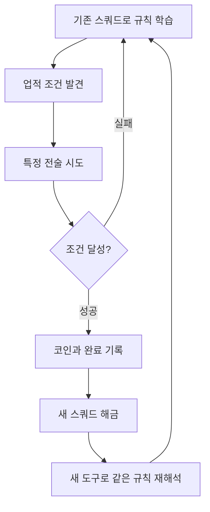

# 15. 메타진행·업적·콘텐츠 해금 역기획

[전체 목차](00_README_문서안내.md)

> 범위: PC판 및 Advanced Edition 공개 규칙. 조사일: 2026-11-13.
> [확인] 문헌 규칙 / [분석] 설계 해석 / [제안] 재구현 명세 / [미확인] 버전·경계 확인 필요.

## 1. 메타진행은 다음 런의 선택지를 확장한다

**[분석]** 이 게임의 장기 진행은 무제한 능력치 누적보다 새로운 스쿼드와 파일럿 조합을 배우는 방향에 가깝다. 같은 규칙을 다른 도구로 풀게 만들면 전투 시스템 전체를 다시 학습하면서도 기본 지식은 유지된다.

프로필 진행과 런 진행을 구분하는 것이 역기획의 출발점이다. 코어를 많이 모은 이번 분대가 끝났다고 해서 해금한 스쿼드가 사라지는 것은 아니며, 스쿼드를 해금했다고 다음 전투의 전력망이 자동으로 늘어나는 것도 아니다.

| 지속 범위 | 포함할 상태 | 설계적 의미 |
| --- | --- | --- |
| 현재 전투 | 좌표·HP·목표·턴 | 즉시 퍼즐 상태 |
| 현재 런 | 전력망·장비·설치 코어·섬 결과 | 성장과 손실의 누적 |
| 다음 시간선 승계 | 선택된 Last Traveler | 인물·경험의 연속성 |
| 프로필 | 업적·코인·해금·기록 | 선택지와 숙련 목표 |

표는 **[분석]**이며 원작 저장 파일의 실제 레이아웃이 아니다. 파일럿 인스턴스의 승계는 [09 파일럿](09_파일럿_경험치_시간여행.md), 이번 런의 자원은 [12 경제](12_경제_보상_상점.md)에서 상세히 다룬다.

## 2. 업적과 코인의 확인된 구조

**[확인]** AE를 포함한 업적은 70개로, 기본 게임 55개에 AE의 15개가 추가된 구성이다. 업적 하나를 해금하면 코인 하나를 얻고, 코인은 스쿼드 해금에 사용한다. AE 이후에는 모든 코인을 모아야만 모든 스쿼드를 열 수 있는 구조가 아니다. [P21]

| 항목 | 기능 | 구현 시 구분 |
| --- | --- | --- |
| 업적 달성 | 조건을 만족했다는 영구 기록 | 진행도와 완료 여부 |
| 코인 지급 | 최초 달성의 해금 자원 | 보상 지급 여부 |
| 코인 소비 | 스쿼드 접근권 구매 | 런의 평판과 분리 |
| 스쿼드 해금 | 이후 시작 선택 가능 | 현재 런 장비 지급과 분리 |
| 승리 기록 | 스쿼드·길이·난이도별 성과 | 해금 조건과 다른 표시 |

**[분석]** 업적과 구매 가능한 선택지를 연결하면 플레이어는 단순 반복 플레이 외에 특정 전술을 시도할 이유를 얻는다. 동시에 원하는 스쿼드를 먼저 열 수 있어 완전한 선형 해금 순서에 갇히지 않는다.

## 3. 업적의 역할별 분류

다음은 전수 목록이 아니라 시스템 제작에 사용할 수 있는 **[분석] 분류**다. 실제 이름과 조건은 P21 및 개별 스쿼드 문서를 기준으로 확인한다.

| 계열 | 대표 과제 성격 | 가르치는 것 | 실패해도 남는 가치 |
| --- | --- | --- | --- |
| 첫 성취 | 승리·새 스쿼드 해금 | 게임의 큰 구조 | 다음 목표 이해 |
| 승리 다양화 | 여러 스쿼드·런 길이로 승리 | 도구 교체와 적응 | 반복 플레이의 방향 |
| 누적 행동 | 여러 런의 차단·구조·소비 | 핵심 행동 반복 | 부분 진행도 |
| 섬 도전 | 목표 완수·건물 무피해 | 실수 관리와 경로 선택 | 전술 숙련 |
| 단일 전투 | 특별한 연쇄·동시 처리 | 규칙 조합 발견 | 새로운 해법 |
| 스쿼드 고유 | 연기·밀기·동결 등 특화 | 스쿼드 정체성 학습 | 다른 팀으로 전이 가능한 지식 |
| 비밀 발견 | 특수 포드·인물 발견 | 보드의 작은 정보 관찰 | 수집 동기 |

**[분석]** 좋은 업적은 수치 목표와 학습 목표를 함께 가진다. 예를 들어 “많이 플레이하라”만 요구하는 업적보다 특정 상태와 강제이동을 결합하게 하는 업적이 전술 도구의 의미를 더 잘 드러낼 수 있다.

### 3.1 목표와 업적은 분리해야 한다

| 비교 | 미션 목표 | 프로필 업적 |
| --- | --- | --- |
| 유효 기간 | 특정 전투·섬 | 여러 런 또는 영구 |
| 보상 | 평판·전력·코어·특수 보상 | 코인·완료 기록 |
| 실패 | 해당 미션의 기회 상실 | 다음 시도 가능 |
| 카운터 | 미션 시작에서 초기화 가능 | 조건별 누적 정책 |
| 되돌리기 | 전투 상태와 연결 | 완료·보상 기록 정책 별도 검토 |

**[제안]** `ObjectiveCompleted` 이벤트를 모든 업적에 직접 연결하지 않는다. 목표의 문구가 비슷해도 누적 기간과 피해 집계 방식이 다를 수 있다.

## 4. 스쿼드 해금의 학습 순환

**[분석]** 새로운 스쿼드는 단순한 더 높은 등급의 메크 세트가 아니라 다른 해법의 묶음이다. 새 팀을 선택하면 익숙한 적과 지형을 다시 해석하게 된다.



**[제안]** 스쿼드 선택 화면에는 정체성과 부담을 먼저 보여 준다. “고화력”, “이동 조작”, “지속 피해”, “상태 제어” 같은 설명은 초보자가 자신에게 맞는 다음 학습 과제를 고르는 데 도움이 된다. 이는 공식 스쿼드 분류명이 아니라 설명 방식 제안이다.

### 4.1 일반·커스텀·랜덤·비밀 스쿼드

세부 구성과 확인된 비용은 [08 스쿼드·시너지](08_스쿼드_시너지_전술.md)에 모았다.

| 유형 | 메타진행에서의 역할 | 주의할 점 |
| --- | --- | --- |
| 이름 있는 일반 스쿼드 | 의도된 3기 조합 학습 | 해금과 승리 기록 구분 |
| Custom Squad | 습득한 메크를 재조합 | 반복 메크·허용 목록의 별도 규칙 |
| Random Squad | 익숙하지 않은 조합 수용 | 무작위 모드·해금 범위 구분 |
| Secret Squad | 특수 규칙의 추가 도전 | Cyborg와 일반 파일럿 차이 |

**[미확인]** 비밀 스쿼드의 전체 선행 조건은 구형 공략과 AE 설명을 혼용하면 오류가 생긴다. “모든 70개 업적 필수”로 단정하지 않으며, 현재 프로필 화면의 잠금 설명과 비용을 검증한다.

## 5. 파일럿 발견과 비밀 포드

**[분석]** 일반 보상 목록에서 인물을 얻는 방식과 전장의 단서를 찾아 특수 인물을 발견하는 방식은 서로 다른 수집 경험을 만든다. 전자는 런 반복의 기대감을, 후자는 보드 관찰과 행동 배분의 보상을 제공한다.

**[확인]** 일부 산·얼음 타일에는 특별한 표식이 나타난다. 해당 지형을 열고 비콘을 회수하면 특수 포드와 비밀 파일럿 획득 과정으로 이어진다. [P22, P23]

| 발견 단계 | 플레이어가 판단할 것 | 재구현 데이터 제안 |
| --- | --- | --- |
| 표식 관찰 | 일반 균열과 특별한 단서를 구분 | `discoveryMarker` |
| 지형 파괴 | 행동을 써도 방어가 가능한가 | `beaconRevealed` |
| 비콘 접근 | 이동 가능한 유닛과 경로 | `beaconCollected` |
| 포드 등장 | 새 보호·회수 부담 | `specialPodPending` |
| 보상 획득 | 이번 런 사용과 프로필 해금 | `pilotUnlockGranted` |

**[미확인]** 정확한 등장 확률, 섬별 확률 변화, 마지막 턴 회수의 이벤트 시점, 모든 아군 개체의 회수 가능 여부는 실기 확인 대상이다. 숫자가 다른 커뮤니티 공략을 평균 내어 원작 확률로 만들지 않는다.

**[제안]** 비밀 조건의 데이터는 일반 보상 RNG와 분리해 관리하되, 실제 구현 방식은 원작이 공개한 것으로 취급하지 않는다. 재현 가능한 테스트용 시드는 발견 가능한 보드를 강제로 생성할 수 있어야 한다.

## 6. 업적 판정 이벤트 구조

**[제안]** 업적을 프레임마다 전체 상태를 훑는 방식으로 구현하기보다 의미 있는 게임 이벤트로 진행도를 갱신한다. 이 제안은 게임 규칙을 기록 가능한 사실로 변환하는 모델이다.

| 이벤트 | 필요한 필드 | 사용할 수 있는 조건 |
| --- | --- | --- |
| `VekKilled` | 적 태그·원인·행동 ID | 한 행동 다중 처치 |
| `SpawnBlocked` | 차단자·위치·턴 | 누적 스폰 차단 |
| `BuildingDamaged` | 피해량·타일·공격자 | 섬 무피해 |
| `MechDamaged` | 직접·충돌·자해 구분 | 기체 피해 도전 |
| `MissionFinished` | 목표 결과·기체 상태 | 전투 단위 도전 |
| `IslandFinished` | 지역 결과·완벽 여부 | 섬 완료 누적 |
| `RunFinished` | 스쿼드·난이도·섬 수 | 승리 다양화 |
| `DiscoveryCollected` | 비콘·포드·파일럿 종류 | 비밀 발견 |

**[제안]** 이벤트에는 중복 판정을 막는 ID를 둔다. 같은 저장 지점을 다시 불러왔을 때 업적 코인이 반복 지급되면 프로필 경제가 깨진다. 이미 완료된 업적은 화면 알림과 보상 지급을 다시 수행하지 않는다.

## 7. 업적 정의 예시

```yaml
# 제안용 가상 업적: 원작 업적 이름이나 조건이 아님
achievement:
  id: sample_push_mastery
  scope: single_action
  eligible_squads: [sample_squad]
  event: enemy_repositioned
  condition:
    minimum_unique_targets: 3
    exclude_summoned_minor_units: true
  reward:
    coin: 1
  grant_once: true
```

**[제안]** `scope`는 `action`, `turn`, `mission`, `island`, `run`, `profile`처럼 명시한다. “한 번에”가 한 발인지 한 행동의 전체 연쇄인지 모호한 업적 문구는 이벤트 경계에 맞게 고친다.

## 8. 저장과 되돌리기 정책

**[미확인]** 원작의 모든 업적이 턴 되돌리기·상점 취소·실패 후에도 동일한 시점에 확정되는지는 이 조사에서 일괄 검증하지 않았다. 특정 과거 버전에서 가능했던 획득 방식은 이후 패치에서 막혔을 수 있다.

**[제안]** 재구현에서는 다음 정책을 명시적으로 정한다.

1. 전투 중 진행도는 전투 스냅샷의 일부로 저장한다.
2. 영구 달성은 지정된 확정 지점에서 한 번만 처리한다.
3. 업적 보상 코인은 완료 레코드와 같은 트랜잭션으로 지급한다.
4. 스쿼드 구매는 코인 차감과 해금을 원자적으로 저장한다.
5. 런 결과 기록은 현재 플레이 설정과 함께 보관한다.
6. 데이터 패치 후 조건 ID가 바뀌어도 기존 달성을 보존한다.

**[분석]** “언제 확정되는가”는 단순 구현 문제가 아니다. 실패한 런에서도 전술 과제를 달성했다는 만족을 남길지, 미션 생존까지 요구할지에 따라 플레이어가 위험을 감수하는 방식이 달라진다.

## 9. 메타진행의 밸런스 위험

| 위험 | 발생 원인 | 설계 검토 방향 |
| --- | --- | --- |
| 다음 스쿼드를 못 여는 정체 | 남은 업적이 지나치게 어려움 | 서로 다른 난도의 획득 경로 |
| 특정 스쿼드 구매 강요 | 코인 조건과 해금 선행 조건 충돌 | 남은 코인 수급 가능성 분석 |
| 승리보다 업적 파밍만 유리 | 보상 목적이 과도하게 분리 | 숙련 행동과 정상 플레이 연결 |
| 새 스쿼드의 무조건 상위 호환 | 해금이 순수 성능 증가 | 역할·제약·해법 차별화 |
| 영구 성장으로 전투 무력화 | 반복 횟수가 숙련을 대체 | 상한·선택형 승계 |
| 설명과 판정 불일치 | 이벤트 경계·대상 필터 혼동 | 문구와 데이터의 공동 검증 |

위 항목은 **[분석·제안]**이며 원작의 결함 목록을 뜻하지 않는다. 같은 구조를 만드는 프로젝트에서 예방할 위험들이다.

## 10. 검증 시나리오

| ID | 준비·입력 | 확인 사항 |
| --- | --- | --- |
| META-01 | 업적 최초 달성 | 완료 기록과 코인 +1 |
| META-02 | 완료한 업적 재달성 | 코인 중복 지급 없음 |
| META-03 | 코인 부족 구매 | 코인·해금 상태 변화 없음 |
| META-04 | 구매 직후 강제 재시작 | 차감과 해금의 일관성 |
| META-05 | 같은 행동의 연쇄 처치 | 행동 단위 업적 집계 |
| META-06 | 다른 두 턴에서 조건 절반씩 | 턴 단위·누적 단위 구분 |
| META-07 | 피해 후 수리 | 무피해 업적과 손상량 목표의 차이 |
| META-08 | 조건 달성 후 Reset Turn | 정해진 확정 정책 적용 |
| META-09 | AE 비활성 새 런 | 잠긴 신규 풀과 기존 해금의 관계 |
| META-10 | 비콘을 마지막 행동에 획득 | 포드 등장·회수 시점 |
| META-11 | 새 런 생성 | 프로필 해금 유지·런 자원 초기화 |
| META-12 | 패치로 업적 조건 변경 | 기존 달성·코인 총량 보존 |

## 11. 출처

| ID | 자료 | 사용 범위 |
| --- | --- | --- |
| P21 | [Achievements — 커뮤니티 위키](https://intothebreach.fandom.com/wiki/Achievements) | 70개 구성·업적당 코인·해금 구조 |
| P22 | [Marked tile — 커뮤니티 위키](https://intothebreach.fandom.com/wiki/Marked_tile) | 산·얼음의 특별한 표식 |
| P23 | [Kazaaakpleth — 커뮤니티 위키](https://intothebreach.fandom.com/wiki/Kazaaakpleth) | 비콘 접근과 비밀 파일럿 경로 |

일부 위키는 검색 인덱스 문장으로 확인했다. 스쿼드 구성은 [08 스쿼드](08_스쿼드_시너지_전술.md)에 정리했다. 개별 업적의 정식 문구·정확한 해금 비용은 현재 게임과 해당 개별 자료로 확인하며, 원작의 내부 이벤트·세이브 형식을 공개 사실로 주장하지 않는다.
