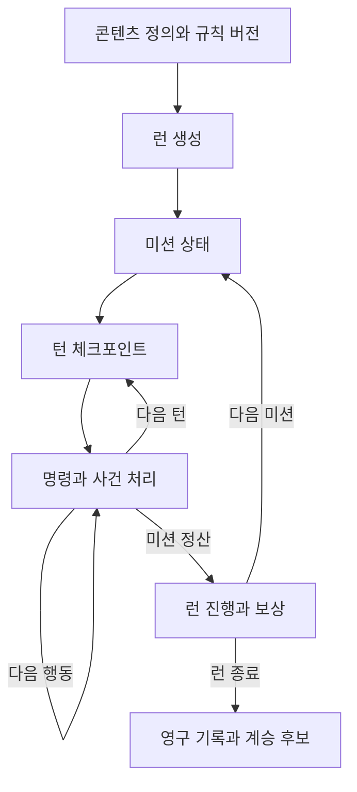
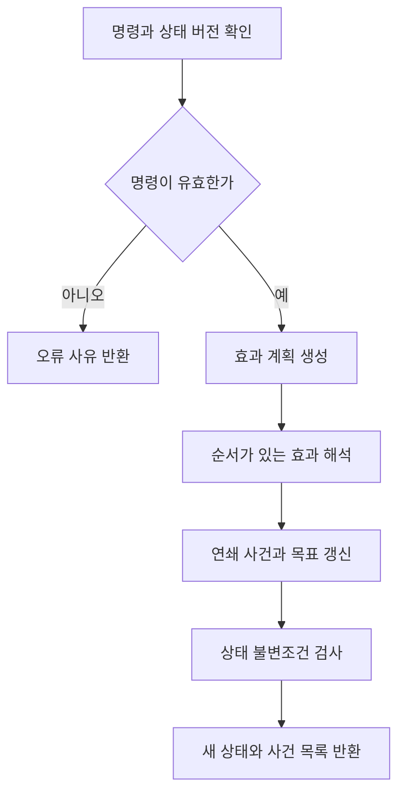

# 16. 데이터 모델·판정 파이프라인·저장 구조

> [전체 목차](00_README_문서안내.md) · [전투 판정](04_공격_피해_강제이동.md) · [검증 계획](18_검증체크리스트_미확인항목.md)

## 1. 이 문서가 제안하는 범위

**이 문서의 자료구조, 함수명, 이벤트 큐, 난수 분리, 저장 방식은 모두 [제안]이다. 원작 내부 구현을 확인한 결과가 아니다.** 공개 규칙을 일관되게 재현하기 위한 설계 초안으로 읽는다.

**[확인]** 2018년 Justin Ma의 인터뷰에는 C++와 Lua, 오디오 구현에 FMOD를 사용했다는 설명이 있다. 이것만으로 현재 버전의 클래스 구조, 저장 형식, 판정 순서를 알 수는 없다. [O07](https://www.gamedeveloper.com/game-platforms/road-to-the-igf-subset-games-i-into-the-breach-i-)

재구현의 기술 목표는 다음 네 가지다.

1. 같은 상태와 같은 명령에서 같은 규칙 결과를 만든다.
2. 명령 미리보기와 실제 실행이 같은 판정기를 사용한다.
3. 강제 이동·상태·사망·보상의 연쇄를 추적할 수 있다.
4. 이동 취소·턴 복원·저장 복구의 범위가 명확하다.

## 2. 규칙 상태와 연출 상태를 분리한다

| 계층 | 보유 데이터 | 변경 권한 | 두면 안 되는 책임 |
| --- | --- | --- | --- |
| 규칙 코어 | 좌표·HP·상태·행동권·의도 | 검증된 명령 처리 | 화면 프레임 시간에 의한 피해 |
| 콘텐츠 정의 | 무기·유닛·지형·목표 규칙 | 버전별 데이터 로드 | 실행 중 임의 변경 |
| 표현 계층 | 스프라이트·카메라·음향·보간 | 코어 사건 구독 | 충돌 결과 재계산 |
| UI | 선택·툴팁·미리보기 표시 | 명령 후보 생성 | 별도 피해 공식 |
| 저장·진행 | 체크포인트·런·해금 기록 | 명시적 커밋 | 연출 종료 여부를 게임 결과로 사용 |

물리 엔진의 접촉 결과로 밀기 성공 여부를 결정할 필요가 없다. 논리 격자에서 도착 칸과 충돌을 먼저 확정한 뒤, 표현 계층이 그 결과를 애니메이션으로 보여 주는 구조가 적합하다.

## 3. 데이터 생명주기



턴 체크포인트는 실행 중 보드와 별도로 보존한다. 미리보기는 체크포인트를 수정하지 않고 현재 실행 상태의 사본에서 계산한다.

## 4. 핵심 엔터티

### 4.1 `GameRuleset`

| 필드 | 의미 | 제약 |
| --- | --- | --- |
| `rulesetId` | 판정 규칙 묶음 ID | 저장·리플레이와 함께 보존 |
| `contentRevision` | 콘텐츠 정의 버전 | 장비 수치 변경 추적 |
| `advancedFlags` | AE 계열 콘텐츠 포함 여부 | 콘텐츠 필터와 밸런스 버전 구분 |
| `difficultyId` | 난이도 | 스폰·보상 등 관련 규칙 참조 |
| `phaseScheduleId` | 턴 처리 순서 정의 | 버전 검증 후 고정 |

AE 옵션을 끄는 것을 구버전 수치로 되돌리는 동작과 동일하게 만들면 안 된다. 실제 원작의 옵션 경계는 [20번](20_Advanced_Edition_변경점.md)에 정리했다.

### 4.2 `RunState`

| 필드 | 설명 | 저장 단위 |
| --- | --- | --- |
| `runId` | 한 시간선의 식별자 | 런 전체 |
| `squadLoadout` | 메크·장비·파일럿 배정 | 변경마다 |
| `gridPower` | 현재 전력 | 전력 사건마다 |
| `gridDefense` | 전력 방어 관련 값 | 변경마다 |
| `reputation` | 섬 내 소비 자원 | 획득·상점 거래 |
| `completedIslands` | 완료한 아일랜드 | 섬 정산 |
| `currentIslandState` | 지역·보스·상점 상태 | 캠페인 진행 |
| `rngStreams` | 제안된 난수 스트림 상태 | 체크포인트 |
| `pendingRewards` | 아직 커밋되지 않은 보상 | 정산 경계 |

전력과 평판은 단위가 다르므로 같은 정수 변수에 다른 의미를 부여하지 않는다. 상점에서 장비를 코어로 착각해 소모하는 종류의 오류는 자료형과 거래 검증으로 막는다.

### 4.3 `BattleState`

| 필드 | 설명 |
| --- | --- |
| `board[64]` | 논리 8×8 타일. 배열 선택은 재구현 제안 |
| `units` | ID로 조회하는 메크·적·NPC·임시 유닛 |
| `turnIndex` | 미션 내 턴 식별자 |
| `phase` | 현재 처리 단계 |
| `remainingTurns` | 표시용 카운터와 규칙용 종료 조건의 연계 |
| `enemyIntents` | 현재 예약된 적 공격 |
| `spawnMarkers` | 다음 출현 후보와 봉쇄 상태 |
| `environmentEvents` | 미션 환경 사건 |
| `objectiveState` | 목표별 진행·실패·완료 상태 |
| `commandHistory` | 확정된 명령 기록 |
| `stateRevision` | 캐시와 명령 유효성 검증용 증가값 |

보드 크기를 자료형에 넣는 것은 이 게임을 재현하는 프로젝트의 선택이다. 일반화된 엔진을 만들 때는 너비·높이를 정의로 분리할 수 있다.

### 4.4 `TileState`

| 그룹 | 예시 필드 | 분리 이유 |
| --- | --- | --- |
| 기초 지형 | ground / water / chasm | 유닛의 생존 가능성과 연결 |
| 파괴 상태 | durabilityStage / cracked | HP 피해와 타격 횟수 구분 |
| 지속 효과 | fire / smoke / acid | 상태의 공존·제거 규칙 표현 |
| 구조물 | buildingId / mountain | 유닛 점유와 별도 책임 |
| 임무 표식 | spawn / objective / hazard | 전장 표현과 승패 연결 |
| 점유 | occupantUnitId | 두 유닛의 같은 칸 점유 방지 |

`TileFlags` 하나에 모든 의미를 넣으면 “불이 있으므로 다른 지형은 보이지 않는다” 같은 렌더링 결합이 생기기 쉽다. 표시와 규칙은 같은 데이터를 읽되, 정보 레이어는 분리한다.

### 4.5 `UnitState`

| 필드 | 예시 | 주의점 |
| --- | --- | --- |
| identity | id / definitionId / team | 일반 적과 소형 소환체 분류 분리 |
| position | x / y / presenceState | 비활성·지중·제거 상태와 좌표 구분 |
| health | current / maximum | 0HP와 완전 제거를 동일 이벤트로 만들지 않음 |
| movement | base / modifiers / movementType | 비행과 상태에 따른 이동 변화 |
| statuses | frozen / shielded / acid / fire / web | 제거·중첩·면역 규칙 참조 |
| action | canMove / canAct / spentFlags | 특수 파일럿 효과 확장 가능 |
| pilot | pilotId | 기체 상태와 인물 생존 분리 |
| equipment | slot entries / power allocation | 장착·가동·강화 상태 분리 |
| intent | intentId | 현재 공격 예약의 존재 여부 |

`alive`, `active`, `present`, `hasIntent`를 하나의 불리언으로 묶지 않는다. 공격을 취소한 살아 있는 적과 제거된 적은 다른 상태다.

## 5. 공격 의도는 실행 명령과 구분한다

### 5.1 `AttackIntent`

```text
AttackIntent
  actorId
  attackDefinitionId
  targetModel
  directionOrOffset
  resolvedPreviewTiles
  executionOrder
  cancelState
  cancelReason
```

`targetModel`은 예를 들어 방향, 공격자 상대 오프셋, 세계 좌표 고정, 명시적 유닛 참조를 지원할 수 있다. **모든 적이 이 네 종류를 실제로 사용한다는 뜻은 아니다.** 원작의 각 공격을 검증해 필요한 모델에 배정해야 한다.

미리 계산한 `resolvedPreviewTiles`를 공격의 진짜 타깃으로 영구 저장하면, 밀기 후에도 낡은 공격 위치를 사용할 수 있다. 원본 의도와 표시 결과를 분리하고 보드 변경 시 다시 해석한다.

### 5.2 취소된 의도

의도 취소는 상태 이상 여부와 별도의 사건으로 기록하는 것이 좋다. 상태가 해제되었다는 이유만으로 취소된 공격을 자동 복구하지 않는다. 특정 원작 사례의 실제 결과는 [05번](05_상태이상_지형_환경.md)을 따른다.

## 6. 명령·효과·사건의 구분

| 개념 | 예시 | 역할 |
| --- | --- | --- |
| Command | 메크 A가 무기 W를 칸 Q에 사용 | 플레이어의 의도 |
| Effect | 피해·밀기·상태 적용 목록 | 무기 규칙의 계획 |
| Event | 실제 방패 소모·충돌·사망 | 처리 후 발생한 사실 |

명령 하나가 여러 효과를 만들고, 효과 하나가 여러 사건을 만들 수 있다. 무기 애니메이션의 프레임 수를 사건 개수로 사용해서는 안 된다.

## 7. 판정 파이프라인



이 순서도는 원작의 불·환경·적 공격 처리 순서를 뜻하지 않는다. `효과 해석` 내부의 위상 순서는 별도 `PhaseSchedule`과 무기별 규칙으로 정한다.

## 8. 효과 순서는 데이터로 명시한다

다음과 같은 배열을 정의할 수 있다.

```text
WeaponEffectPlan (illustrative)
  1. ResolveImpact(target)
  2. ApplyUnitDamage(target, DamageSpec)
  3. ApplyTileInteraction(target, TileHitSpec)
  4. TryDisplace(target, direction, DisplacementPolicy)
  5. ResolveTriggeredEffects(causeId)
```

**주의:** 이 예시는 모든 원작 무기의 공통 순서가 아니다. 피해와 밀기, 지형 변화와 처치 효과의 순서는 콘텐츠별로 검증해야 한다. 사망한 유닛의 위치·시체·후속 밀기 처리도 버전과 효과에 따라 별도 규칙으로 둔다.

넓은 범위 밀기에서는 “모두 동시에 이동”과 “순서대로 이동”의 결과가 다를 수 있다. 명시적 순서를 저장하고 미리보기와 실제 실행에서 동일하게 사용한다. `좌표 정렬`을 임의로 채택한 뒤 원작과 같다고 선언하지 않는다.

## 9. 피해는 종류와 원인을 함께 전달한다

```text
DamageSpec
  amount
  category
  sourceUnitId
  sourceWeaponId
  causeEventId
  hitsTile
  triggersOnKill
  attributionPolicy
```

| 구분할 사건 | 구분해야 하는 이유 |
| --- | --- |
| 일반 무기 피해 | 강화·장갑·산성 등 적용 |
| 충돌 피해 | 두 대상과 건물에 영향 가능 |
| 상태 지속 피해 | 적용 시점과 원인 귀속 차이 |
| 스폰 저지 피해 | 스폰·행동 순서와 연결 |
| 즉사 지형 | HP 감소와 다른 생존 판정 |
| 지형 타격 | 산·얼음·균열의 변화 조건 |
| 자해 | 처치·회복·파일럿 생존과 연결 |

`finalDamage = baseDamage × multiplier` 하나로 모든 사건을 통합하면 지형 즉사, 보호막 소모, 타격 횟수 판정이 잘못된다. 무엇이 어떤 방어를 무시하는지는 [04번](04_공격_피해_강제이동.md)과 [05번](05_상태이상_지형_환경.md)의 규칙표에서 가져온다.

## 10. 연쇄 사건과 귀속

**[제안]** 모든 사건에 `eventId`, `parentEventId`, `rootCommandId`를 붙인다.

예: 밀기 명령 → 충돌 → HP0 → 처치 후 효과 → 새 지형 → 다른 유닛 사망.

이 연결은 다음 문제를 해결한다.

- 누가 처치 경험치를 받아야 하는가?
- 환경 처치가 특정 무기의 KO 효과를 발동시키는가?
- 목표가 요구하는 처치와 일반 처치 카운트가 같은가?
- 하나의 대상을 두 번 사망 처리하지 않았는가?
- 취소하거나 복구할 때 어느 보상까지 되돌려야 하는가?

원작의 경험치와 KO 인정 범위는 콘텐츠마다 확인해야 한다. 사건 연결 구조는 판정을 설명하기 위한 수단이지 인정 범위 자체를 대신하지 않는다.

## 11. 미리보기와 실행을 공유하는 API 제안

```text
Preview(state, command):
    simulation = clone(state)
    rng = clone(state.rng)
    result = Resolve(simulation, command, rng, PREVIEW)
    return Diff(state, result.state), result.events

Commit(state, command, expectedRevision):
    require state.revision == expectedRevision
    result = Resolve(state, command, state.rng, COMMIT)
    PersistOrQueue(result)
    return result
```

`PREVIEW`와 `COMMIT`이 규칙 분기까지 서로 달라지지 않게 한다. 차이는 저장·실적 반영·연출 실행 같은 외부 부수 효과에 두는 것이 좋다.

전력 방어 같은 확률적 결과를 미리보기에서 실제 난수로 확정해 보여 줄지는 별도 정책이 필요하다. 원작의 숨겨진 난수 상태를 노출한다고 가정하지 말고, 보장 결과와 확률 결과를 분리해 표현한다.

## 12. 난수 스트림 제안

| 스트림 | 용도 | 분리 이유 |
| --- | --- | --- |
| campaign | 섬·미션 후보 | UI 열람으로 캠페인 변화 방지 |
| rewards | 장비·파일럿 보상 | 전투 연출과 독립 |
| enemyPlanning | 다음 이동·공격 결정 | 현재 턴 미리보기와 독립 |
| gridDefense | 확률적 전력 방어 | 결과 재현과 디버깅 |
| cosmetic | 파편·음향 변형 | 규칙 결과에 영향 금지 |

원작이 실제로 다섯 난수 스트림을 쓰는지는 확인되지 않았다. 어떤 방식을 택하든 저장 복구와 턴 되돌리기에서 난수 상태가 누락되지 않도록 설계해야 한다.

## 13. 취소와 되돌리기의 범위

| 기능 | 복원 대상 | 복원하지 않는 범위 | 설계 요구 |
| --- | --- | --- | --- |
| 조준 취소 | UI 선택만 | 게임 상태 전체 | 미리보기 무부작용 |
| 이동 취소 | 허용된 이동 및 파생 상태 | 이미 확정된 다른 비가역 행동 | 허용 조건 명시 |
| 턴 복원 | 턴 시작 체크포인트 | 이전 턴·이전 미션 | 사용 횟수 규칙 별도 |
| 저장 복구 | 마지막 유효 저장 | 이미 영구 확정된 결과 | 원자적 커밋 |

**[제안]** 복원 허용 범위를 커맨드마다 `undoClass`로 기록한다. 이동 취소가 수리·아이템·업적 획득을 반복해서 복제하지 않는지 검증한다. 원작의 실제 허용 조건을 넓히는 제안이 아니다.

## 14. 목표 평가와 보상 거래

`ObjectiveState`는 목표마다 현재값, 실패 여부, 마감 시점, 보상 ID를 가진다. `적 처치 수`, `건물 보존`, `스폰 봉쇄`, `특수 유닛 보호`를 하나의 공통 카운터로 묶지 않는다.

보상 정산은 다음과 같은 원자적 거래로 구성할 수 있다.

1. 확정된 미션 결과에서 목표별 보상을 계산한다.
2. 이번 정산의 고유 ID를 만든다.
3. 아직 지급하지 않은 ID인지 확인한다.
4. 런 자원과 진행 상태를 함께 저장한다.
5. 저장 성공 후 보상 연출을 표시한다.

정산 도중 종료되어 재실행되더라도 보상이 두 번 지급되지 않아야 한다. 상점 거래도 장비 이동·평판 변화·되돌리기 기록을 하나의 거래로 묶는다.

## 15. 저장 파일 제안

| 섹션 | 내용 |
| --- | --- |
| header | schemaVersion / rulesetId / contentRevision |
| profile | 해금·설정·영구 기록 |
| run | 현재 시간선·자원·로드아웃 |
| battle | 현재 미션과 명령 경계 상태 |
| checkpoint | 턴 복원용 상태와 사용 가능 횟수 |
| journal | 정산·구매·실적 커밋 ID |
| integrity | 검증용 길이·체크섬·백업 참조 |

연출 중 저장을 허용한다면 이미 확정한 논리 상태와 아직 재생하지 않은 연출을 구분한다. 연출을 다시 재생하면서 피해나 보상을 두 번 적용해서는 안 된다.

## 16. 핵심 불변조건

- 유효한 좌표의 한 칸에는 규칙상 허용된 수의 유닛만 존재한다.
- 제거된 유닛은 일반 이동·공격의 주체가 될 수 없다.
- 같은 사건의 사망·목표·경험치 처리가 중복되지 않는다.
- 미리보기는 실제 상태, 난수, 해금·보상 기록을 변경하지 않는다.
- 장착하지 않았거나 가동 조건을 충족하지 않은 무기는 사용할 수 없다.
- 행동 사용 횟수는 행동권을 새로 부여하는 명시적 규칙으로만 늘어난다.
- 목표 보상은 미션 정산 ID당 한 번만 지급된다.
- 빠른 연출과 느린 연출은 최종 규칙 상태가 같다.
- 저장 복구 후 콘텐츠 버전을 모르면 조용히 최신 수치로 재해석하지 않는다.

## 17. 개발 순서와 완료 조건

| 단계 | 범위 | 완료 조건 |
| --- | --- | --- |
| 1 | 격자·유닛·이동·직사·밀기 | 작은 고정 보드의 결과 재현 |
| 2 | 의도·미리보기·턴 처리 | 예고와 실행 결과의 일치 |
| 3 | 상태·지형·연쇄 | 대표 상호작용의 사건 로그 일치 |
| 4 | 목표·전력·파일럿 | 손실 계층이 정확히 분리 |
| 5 | 장비·코어·상점 | 변경·취소·정산의 중복 없음 |
| 6 | 캠페인·생성·해금 | 완결된 한 런과 복구 가능 |
| 7 | 콘텐츠 확장 | 새 정의 추가 시 기존 결과 유지 |

개발 기간·인원·처리 성능은 실제 프로토타입 측정 없이 수치화하지 않았다. 상세 회귀 시나리오는 [18번](18_검증체크리스트_미확인항목.md)을 참조한다.

## 18. 참고 근거

| 근거 | 자료 | 사용 범위 |
| --- | --- | --- |
| O07 | [개발자 인터뷰](https://www.gamedeveloper.com/game-platforms/road-to-the-igf-subset-games-i-into-the-breach-i-) | 2018년 공개 개발 도구만 확인 |
| O06 | [공식 패치 기록](https://steamcommunity.com/app/590380/allnews/) | 예측·거래·사건 일관성이 검증 대상이라는 배경 |

실제 전투 규칙의 출처는 02–07번, 캠페인 규칙은 09–12번에 있다. 본 문서의 코드·데이터 이름과 구조는 독자적인 제안이며 원작 API가 아니다.
