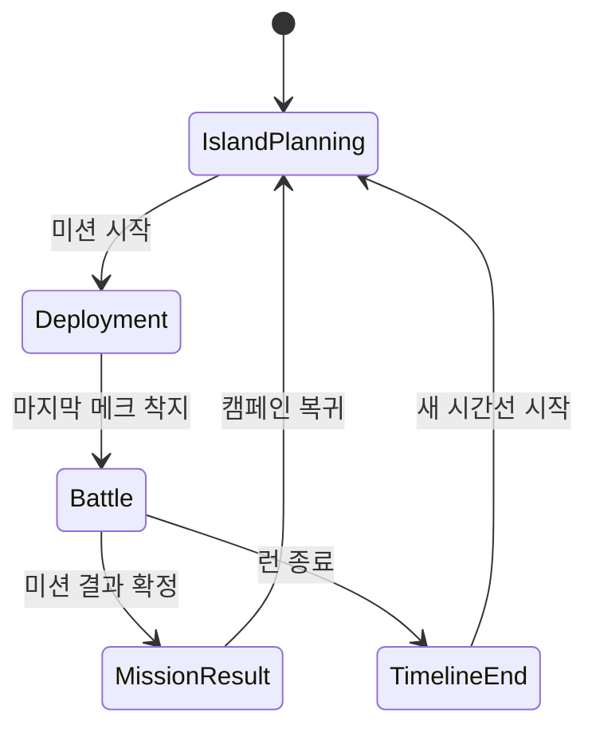

# 21. 오디오·전투 연출·서사 전달

> [전체 목차](00_README_문서안내.md) · [UI와 정보 시각화](13_UI_UX_정보시각화.md) · [파일럿과 시간여행](09_파일럿_경험치_시간여행.md)

## 1. 시스템 목적

**[분석]** 전투가 작은 수치와 격자 위에서 진행되어도, 플레이어가 지키는 대상은 사람과 도시다. 연출은 판정을 감추지 않으면서 선택의 무게를 전달해야 한다. 음악은 생각할 시간을 지탱하고, 효과음은 사건을 구분하며, 짧은 대사는 결과에 인물의 관점을 부여한다.

이 문서는 공식 참여자 설명으로 확인되는 부분과 독자적으로 제안하는 연출 명세를 구분한다. 원작 사운드 뱅크, 음량 곡선, 대사 조건표를 추출하지 않았다.

## 2. 확인된 제작 정보

| 항목 | 확인 내용 | 근거 |
| --- | --- | --- |
| 음악 | Ben Prunty | O09·O12 |
| 오디오 제작 | Power Up Audio 참여 | O07 |
| 서사 참여 | Chris Avellone, AE의 Alison Waller | O12 |
| 음악 접근 | 어쿠스틱 성격과 리듬 기타 활용, 일부 인터랙티브 구간 | O11 |

**[확인]** 제작 참여는 [개발사 크레딧 성격의 연락처 페이지(O12)](https://subsetgames.com/contact.html), [Justin Ma 인터뷰(O07)](https://www.gamedeveloper.com/game-platforms/road-to-the-igf-subset-games-i-into-the-breach-i-), [작곡가 인터뷰(O11)](https://www.husson.edu/news/2018/02/nescom-alumni-ben-prunty)를 근거로 한다. 각 참여자의 정확한 작업 분량은 추정하지 않는다.

## 3. 배치와 전투 음악의 시작

**[확인]** Ben Prunty가 직접 쓴 제작기는 미션을 선택하면 메뉴 음악을 줄이고, 메크 배치 중에는 환경음을 들려주며, 마지막 메크가 착지할 때 전투 음악을 시작하도록 바꾸었다고 설명한다. 끊임없이 음악을 재생하는 방식에서 벗어나 배치 단계와 전투 개시 사이에 긴장을 만들기 위한 선택이었다. [O08](https://www.pcgamer.com/how-i-made-into-the-breachs-soundtrack/)

**[분석]** 이 구조는 음악이 플레이어의 행동 완료에 반응한다는 점에서 중요하다. 배치에 5초가 걸리든 1분이 걸리든, 음악의 강한 진입은 플레이어가 결정을 마친 순간과 정렬된다. 정해진 타이머로 음악을 시작하면 그 연결이 약해질 수 있다.

## 4. 오디오 상태 머신 제안



**[제안]** 원작의 세부 오디오 상태 이름이 아니라 재구현을 위한 구조다. 무조건 다음 BGM으로 크로스페이드하는 대신, 필요한 구간에서는 음악이 없는 상태를 유지한다.

| 상태 | 음악 역할 | 효과음 역할 | 전이 조건 |
| --- | --- | --- | --- |
| 아일랜드 계획 | 장기 선택의 분위기 | 지역·장비 선택 확인 | 미션 시작 확정 |
| 배치 | 환경 소리의 공간 확보 | 메크 위치 선택·낙하 | 배치 완료와 착지 |
| 전투 판단 | 반복 청취를 견디는 긴장 | 툴팁·선택·경고 식별 | 명령/턴 종료 |
| 전투 실행 | 리듬 유지 | 피해·밀기·빙결·저항 강조 | 사건 완료 |
| 미션 정산 | 긴장 해소·결과 확인 | 목표·보상 구분 | 확인 입력 |
| 시간선 종료 | 손실·계승의 의미 | 파일럿 선택·기록 | 새 시도 |

## 5. 판정 사건과 연출 사건을 분리한다

**[제안]** 규칙 코어가 확정한 사건을 표현 계층이 순서대로 재생한다.

| 규칙 사건 | 시각 표현의 목적 | 청각 표현의 목적 |
| --- | --- | --- |
| 피해 적용 | 대상과 잔여 HP 확인 | 타격 발생 인지 |
| 강제 이동 | 출발·도착·방향 인지 | 이동과 충돌 구분 |
| 방패 소모 | HP 방어와 상태 소모 구분 | 보호 성공 피드백 |
| 빙결/해동 | 행동 상태의 변화 전달 | 공격 취소와 피해를 구분 |
| 지형 변화 | 다음 행동에 영향을 주는 칸 표시 | 표면 변화 인지 |
| 전력 손실 | 런 위험도 증가 표시 | 일반 메크 피해보다 높은 중요도 |
| 처치 후 효과 | 원인과 후속 결과 연결 | 추가 사건 시작을 알림 |

피해 숫자가 나오기도 전에 연쇄 폭발로 다른 대상이 사라지면 인과관계가 불명확해진다. 속도를 높이더라도 원인 순서를 알아볼 최소한의 구분은 필요하다.

## 6. 카메라·화면 흔들림·효과 우선순위

**[제안]** 전술 정보가 항상 남아 있어야 한다.

- 큰 폭발도 타일 경계와 피해 대상을 완전히 가리지 않는다.
- 흔들림은 위협의 중요도를 전달하되 선택 커서를 다른 칸처럼 보이게 만들지 않는다.
- 연기·불·균열·스폰 표시가 겹치면 장식 입자보다 규칙 아이콘을 우선한다.
- 공격이 여러 칸에 영향을 주면 모든 결과를 확인한 뒤 선택 입력으로 돌아간다.
- 빠른 연출 설정에서도 숫자·보호 상태·사망 판정의 순서는 보존한다.
- 원치 않는 감각 부담을 줄이도록 흔들림과 강한 섬광을 조절할 수 있게 한다.

이 목록은 원작 옵션의 전체 목록이 아니라 유사 게임 제작 시의 수용 기준이다.

## 7. 대사와 전술 판단의 관계

**[분석]** 짧은 대사는 같은 숫자 손실을 서로 다른 상황으로 읽게 만든다. 건물 피해에 대한 시민의 반응, 파일럿의 성격, 기업 대표의 목표 설명은 보드의 사건에 맥락을 준다. 하지만 긴 대사가 이동 가능 칸이나 공격 예고를 가리면 전술 루프를 방해한다.

**[제안]** 대사 이벤트는 다음 조건으로 분류할 수 있다.

| 대사 계층 | 트리거 예시 | 우선순위 | 반복 제어 |
| --- | --- | --- | --- |
| 필수 설명 | 특수 미션 목표 공개 | 높음 | 미션당 한 번 |
| 결과 반응 | 건물 손실·목표 실패 | 중간 | 사건별 중복 방지 |
| 파일럿 성격 | 처치·위험·성장 | 중간 | 화자별 쿨다운 |
| 세계관 | 기업·지역 설명 | 낮음 | 런 내 변형 |
| 분위기 | 일반 전투 반응 | 낮음 | 연속 발생 제한 |

이 트리거 목록은 실제 원작 스크립트의 조건표가 아니다. 원작의 서사 기능을 재현하기 위한 콘텐츠 설계안이다.

## 8. 대사 데이터 구조 제안

```text
DialogueRule
  id
  speakerPool
  triggerEvent
  requiredTags
  forbiddenTags
  priority
  cooldownScope
  maxUsesPerMission
  localizedTextId
```

### 적용 원칙

1. 결과가 확정된 사건만 대사 트리거로 사용한다.
2. 미리보기 단계에서 실제 사망·목표 실패 대사를 재생하지 않는다.
3. 턴 복원 직후에는 이전 결과 대사가 겹쳐 남지 않게 한다.
4. 동일 사건에 대사 후보가 여럿이면 우선순위로 선택한다.
5. 번역 문자열에 규칙 수치를 직접 복제할 경우 버전 동기화를 검사한다.

## 9. 세계관과 반복 플레이의 결합

**[분석]** 시간여행은 런 반복을 설명하고, 파일럿 계승은 이전 실패의 경험을 인물에 연결한다. 이때 메타진행이 모든 장비를 누적하는 구조가 되면 새 시도의 판단이 축소될 수 있다. 계승 범위를 제한하는 규칙은 서사적 연속성과 새로운 시작의 긴장을 동시에 유지한다.

실제 계승 대상·파일럿 사망 예외·스쿼드 해금은 [09번](09_파일럿_경험치_시간여행.md)과 [15번](15_메타진행_업적_콘텐츠해금.md)의 규칙을 따른다. 이 문서는 별도 세계관 설정이나 원작에 없는 인물 관계를 만들어 넣지 않는다.

## 10. 음악 자료를 해석할 때의 버전 주의

**[확인]** 기본 사운드트랙의 작곡가 페이지는 앨범 형태에 맞춰 일부 곡을 조정했다고 밝힌다. 따라서 앨범 파일과 게임 내 루프 구간이 동일하다고 추정하면 안 된다. [O09](https://benprunty.bandcamp.com/album/into-the-breach-soundtrack)

**[확인]** AE의 작곡가 앨범 설명은 앞의 네 트랙이 각 아일랜드에 추가된 게임 수록곡이며, 뒤에는 초기 콘셉트와 리믹스가 포함된다고 설명한다. [O10](https://benprunty.bandcamp.com/album/into-the-breach-advanced-edition-soundtrack)

**[미확인]** [20번 문서](20_Advanced_Edition_변경점.md)의 출시 공지 수량과 작곡가의 이후 앨범 설명은 집계가 다르다. 문서에서는 각각의 자료가 말하는 시점과 대상을 유지하며, 현행 게임의 오디오 자산 총수나 변경 이유를 임의로 확정하지 않는다.

## 11. 연출 검증 시나리오

| ID | 장면 | 확인 기준 |
| --- | --- | --- |
| AV-01 | 배치를 오래 고민 | 음악 시작이 판단 시간에 끌려가지 않음 |
| AV-02 | 마지막 메크 착지 | 전투 시작 피드백이 한 번만 발생 |
| AV-03 | 연쇄 충돌·처치 | 원인과 후속 결과 순서가 읽힘 |
| AV-04 | 건물 저항 발생 | 일반 무피해와 다른 결과 설명 |
| AV-05 | 화염 위 지형 아이콘 | 전술 상태를 가리지 않음 |
| AV-06 | 빠른 전투 속도 | 최종 상태·대사·보상 중복 없음 |
| AV-07 | 턴 복원 | 이전 결과 연출·대사 큐 제거 |
| AV-08 | 저장 복구 | 음악은 복구되지만 규칙 사건 재적용 없음 |
| AV-09 | 음소거 | 핵심 결과를 시각적으로 모두 이해 가능 |
| AV-10 | 한국어 대사 확대 | 공격 예고·목표 UI 가리지 않음 |

이 표는 실행 테스트의 결과가 아니라 제작·QA 단계에서 사용할 검토 목록이다.

## 12. 출처

| ID | 자료 | 성격 |
| --- | --- | --- |
| O07 | [Justin Ma 개발자 인터뷰](https://www.gamedeveloper.com/game-platforms/road-to-the-igf-subset-games-i-into-the-breach-i-) | 개발자 직접 발언 |
| O08 | [Ben Prunty의 음악 제작기](https://www.pcgamer.com/how-i-made-into-the-breachs-soundtrack/) | 작곡가 직접 작성 |
| O09 | [기본 사운드트랙](https://benprunty.bandcamp.com/album/into-the-breach-soundtrack) | 작곡가 배포 페이지 |
| O10 | [AE 사운드트랙](https://benprunty.bandcamp.com/album/into-the-breach-advanced-edition-soundtrack) | 작곡가 배포 페이지 |
| O11 | [Ben Prunty 인터뷰](https://www.husson.edu/news/2018/02/nescom-alumni-ben-prunty) | 당사자 인터뷰 |
| O12 | [Subset Games 참여자 정보](https://subsetgames.com/contact.html) | 개발사 공식 페이지·검색 색인 확인 |
