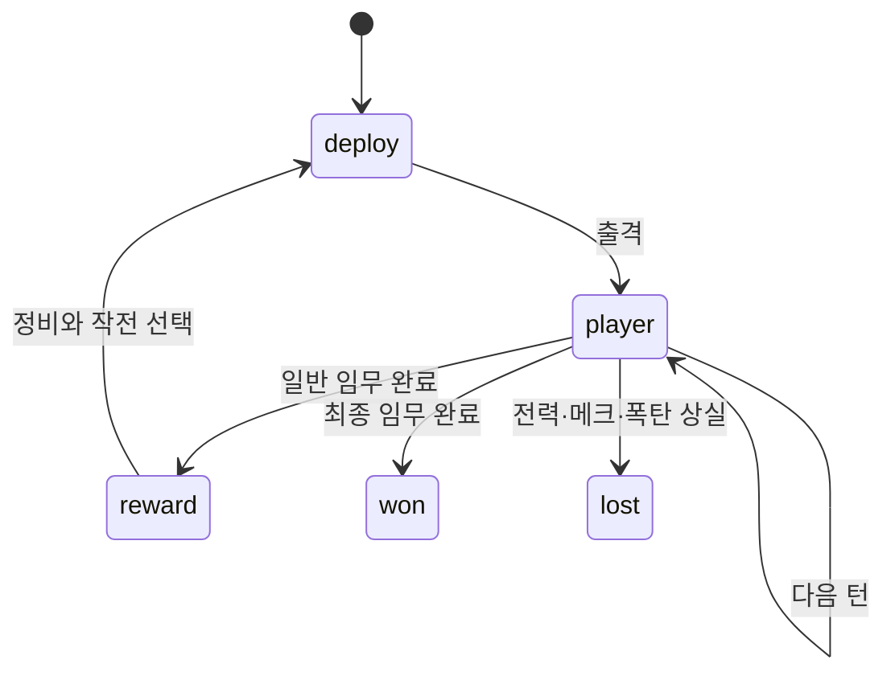

# Breach Command V2 · 코어 게임플레이 구현 명세

## 1. 문서 기준과 책임 경계

이 문서는 저장소에 구현된 JavaScript 동작을 설명하는 유지보수 문서입니다. 원작 Into the Breach의 내부 사양이나 모든 규칙을 재현했다는 주장이 아닙니다. 수치·예외·저장 형식의 기준은 아래 소스입니다.

| 소스 | 규칙의 책임 |
| --- | --- |
| [campaign.js](../dist/campaign.js) | 작전·파일럿·보조 장비 정의, 보조 목표 평가, 보상 견적, 환경 예고 위치 |
| [engine.js](../dist/engine.js) | 이동·무기·상태·적 AI·턴 처리·정산·성장·캠페인 전이·상태 검증 |
| [art.js](../dist/art.js) | SVG 전장과 유닛, 이동 경로·공격·위험·변화 예상의 시각 표현 |
| [app.js](../dist/app.js) | 입력, 모드·선택, 미리보기, 턴 재생, 정비, 저장, 프로필, 점수 |
| [style.css](../dist/style.css) | 반응형 레이아웃, 확대 보기, 상태와 연출 표현 |
| [build-offline.mjs](../scripts/build-offline.mjs) | 동일 소스를 단일 HTML로 묶는 배포 과정 |

브라우저는 `campaign → engine → art → app` 순서로 로드합니다. 캠페인과 엔진은 DOM을 사용하지 않으며 CommonJS로도 불러올 수 있습니다. 엔진의 공개 전이 함수는 입력 상태를 복제한 뒤 결과를 반환합니다. 앱은 반환된 새 상태를 채택하고 저장·렌더링합니다.

**캠페인 모듈은 상태를 변경하거나 코어를 지급하지 않습니다.** `quoteReward()`는 계산 결과이고, 실제 지급은 엔진의 임무 완료 처리 한 곳에서 수행합니다. 그림과 애니메이션도 규칙의 결과를 수정하지 않습니다.

## 2. 캠페인 상태와 승패

### 2.1 단계

| `phase` | 허용되는 핵심 동작 | 다음 상태 |
| --- | --- | --- |
| `deploy` | 메크 재배치, 출격 | `player` |
| `player` | 이동·주무기·보조 장비·수리·대기, 턴 종료 | 다음 `player`, `reward`, `won`, `lost` |
| `reward` | 메크 강화, 장비 교체, 다음 작전 선택 | 다음 임무의 `deploy` |
| `won` | 최종 결과, 생존 파일럿 보존, 새 캠페인 준비 | 새 상태를 만들어 `deploy` |
| `lost` | 종료 결과, 생존 파일럿 보존, 새 캠페인 준비 | 새 상태를 만들어 `deploy` |



새 캠페인은 전력 7/7, 코어 0, 메크 3기로 시작합니다. `missionIndex`는 전투 순서 0~4입니다. 처음 네 전투는 각각 4턴, 마지막 전투는 5턴이므로 완주 경로의 실제 전투는 5회·21턴입니다.

### 2.2 필수 목표와 실패

일반 임무는 정해진 마지막 적 공세까지 전력망과 최소 한 메크를 유지하면 완료합니다. 최종전은 여기에 열핵 폭탄의 생존이 추가됩니다. 적 전멸과 보조 목표 달성은 공통 필수 조건이 아닙니다.

다음 조건을 검사해 `lost`로 전이합니다.

1. 공용 전력 `grid <= 0`.
2. 살아 있는 플레이어 메크가 0기.
3. 폭탄 임무에서 폭탄 HP가 0.

이 구현에서는 메크 전멸이 즉시 캠페인 실패 조건입니다. 일부 메크만 파괴된 채 임무를 완료하면 다음 임무에 모든 메크를 복구합니다. 최종 폭탄은 HP 5의 중립 유닛이며, 보호막·빙결·밀치기의 대상이 될 수 있습니다.

임무 완료와 실패 시 `history`에 해당 전투의 선택 작전·보조 목표·통계·턴 수를 기록합니다. 실패한 전투의 보상 보고서는 `null`, 파일럿 XP 증가는 0입니다.

구현: `createRun()`, `checkLoss()`, `completeMission()`, `nextMission()`.

## 3. 편대, 배치, 기본 능력치

### 3.1 세 편대

화면의 편대명과 엔진 ID는 다음과 같습니다. `SQUADS`에는 규칙용 편대 정의가 있고 앱은 표시명을 별도로 매핑합니다.

| 화면 이름 | ID | 1번 메크 | 2번 메크 | 3번 메크 |
| --- | --- | --- | --- | --- |
| 강습 방어 편대 | `rift` | `combat` | `cannon` | `artillery` |
| 기상 제어 편대 | `control` | `combat` | `smoke` | `cryo` |
| 중력 타격 편대 | `gravity` | `combat` | `pull` | `laser` |

| 메크 종류 | 표준 기본 HP | 기본 이동 | 기본 주무기 피해 | 비행 | 초기 보조 장비 |
| --- | ---: | ---: | ---: | --- | --- |
| `combat` | 3 | 3 | 2 | 아니오 | `repulse` |
| `cannon` | 3 | 3 | 1 | 아니오 | `acid` |
| `artillery` | 2 | 3 | 1 | 아니오 | `shield` |
| `smoke` | 2 | 3 | 1 | 예 | `shield` |
| `cryo` | 3 | 3 | 0 | 아니오 | `repulse` |
| `pull` | 3 | 3 | 0 | 아니오 | `acid` |
| `laser` | 2 | 3 | 1 | 아니오 | `shield` |

안정 난이도 `easy`는 시작 메크 HP와 최대 HP에 1을 더합니다. 적의 기본 능력치를 낮추는 방식은 아닙니다. 임무 사이 전력 회복량도 표준 1에서 안정 2로 늘어납니다.

### 3.2 배치

좌표는 `x,y = 0..7`이며 `tiles[y * 8 + x]`로 접근합니다. 화면에는 A1~H8로 표시합니다. 기본 메크 위치는 `(2,6)`, `(4,6)`, `(6,6)`입니다.

배치는 하단 세 행 `y >= 5`의 안전한 빈 칸만 허용합니다. 건물·산·물·구덩이·화염·연막 칸을 제외하고, 다른 살아 있는 유닛과 겹칠 수 없습니다. 비행 메크도 배치 안전 조건은 같습니다. 적의 최초 공격 예고는 배치 전에 생성하며, 출격 버튼을 눌러도 예고를 다시 뽑지 않습니다.

구현: `makeUnit()`, `DEFAULT_GEAR`, `walkable()`, `getDeploymentTiles()`, `deploy()`, `beginBattle()`.

## 4. 행동 경제와 이동 경로

### 4.1 이동 1회와 행동 1회

메크의 `moved`, `acted`가 현재 턴의 사용 여부를 나타냅니다.

| 명령 | 전제 | 소비와 결과 |
| --- | --- | --- |
| `move` | 생존, 미이동, 미행동, 비빙결, 비속박 | `moved = true`. 이후 행동 가능 |
| `attack`, 주무기 | 생존, 미행동, 공격 가능 상태, 유효한 목표 | `moved = acted = true` |
| `attack`, 보조 장비 | 주무기 조건에 더해 남은 충전 1 | 행동을 종료하고 충전 1 감소 |
| `repair` | 생존, 미행동 | 회복·상태 해제 후 이동과 행동 종료 |
| `wait` | 생존, 미행동 | 이동과 행동 종료 |

이동 전에 무기나 수리를 사용하면 남은 이동도 끝납니다. 주무기와 보조 장비를 같은 턴에 각각 한 번씩 쓸 수 있는 구조가 아닙니다. 다른 메크의 행동 사이에 선택을 바꿀 수 있으며, 미행동 메크가 있어도 턴을 종료할 수 있습니다.

빙결·연막·물 안의 지상 메크는 주무기와 보조 장비 모두 사용할 수 없습니다. 빙결 메크는 수리로 해동할 수 있습니다. 속박은 자발적 이동만 막으므로, 공격이나 수리를 사용할 수 있으며 다른 유닛이 밀어낼 수도 있습니다.

### 4.2 경로 선택과 통과 판정

이동은 상하좌우 한 칸씩 탐색합니다. 최단 거리 경로를 우선하고 같은 거리에서는 지형 위험이 작은 경로를 선택합니다. 위험 비교에는 화염·산성·물·연막이 사용되며, 이동 비용 자체는 칸마다 1입니다.

- 지상 메크는 다른 아군 메크를 통과할 수 있지만 그 칸에서 멈출 수 없습니다.
- 지상 메크는 건물·산·적·중립 유닛·구덩이를 통과하지 못합니다. 물에는 들어갈 수 있습니다.
- 비행 메크는 유닛과 건물·산 위를 지나갈 수 있지만 점유된 칸이나 건물·산에서 이동을 끝낼 수 없습니다.
- `getMovePath()`는 시작 칸과 도착 칸을 모두 포함한 좌표 배열을 반환합니다. 유효하지 않은 목적지는 빈 배열입니다.
- 실제 이동은 경로의 각 다음 칸에 `applySurface()`를 적용합니다. 중간의 화염·산성·연막·포드도 판정합니다.

표시된 경로와 실제 판정을 같은 함수에서 계산하므로, 통과 중 포드를 얻거나 불이 붙는 결과도 미리보기에 포함됩니다. 적이 다음 턴 공격 위치로 이동할 때도 경로의 지형 효과를 처리합니다.

구현: `reachable()`, `getMoves()`, `getMovePath()`, `command()`.

## 5. 주무기와 보조 장비

### 5.1 주무기

| 무기 ID | 목표와 효과 | 주요 예외 |
| --- | --- | --- |
| `fist` | 인접 한 칸 피해 후 대상 1칸 밀기 | 피해로 제거된 대상은 더 밀리지 않음 |
| `cannon` | 직선 첫 차폐 대상에 피해 후 밀기 | 유닛·건물·산이 사선을 막음 |
| `artillery` | 같은 행·열의 2칸 이상 목표에 피해, 목표의 인접 유닛을 바깥으로 밀기 | 중심 유닛에는 직접 밀치기가 없음 |
| `smoke` | 같은 행·열의 2칸 이상 목표에 피해, 중심과 상하좌우 연막 | 연막은 아군 공격도 막음 |
| `cryo` | 같은 행·열의 2칸 이상 목표와 자신을 빙결 | 강화 피해가 있으면 먼저 직접 피해, 이후 빙결. 포드를 겨냥하면 파괴 |
| `pull` | 2칸 이상 떨어진 직선 첫 유닛을 자신 쪽으로 1칸 당기기 | 첫 차폐 대상이 건물·산이거나 인접 유닛이면 유효한 견인 방향이 아님 |
| `laser` | 선택 방향 끝까지 모든 유닛·건물에 피해 | 산에 피해를 준 뒤 정지. 그 산이 부서져도 해당 발사는 거기서 끝남 |

포·레이저처럼 방향을 선택하는 무기는 클릭한 칸이 유효해도 실제 피격 대상이 그 칸과 다를 수 있습니다. 사선을 계산한 결과를 확인해야 합니다. 레이저는 아군과 도시도 관통하므로 같은 방향의 모든 대상을 예측합니다.

### 5.2 보조 장비

메크마다 보조 슬롯은 하나이고 초기 장비가 지급됩니다. 모든 보조 장비는 `maxCharges = 1`이며 새 임무 준비 때 충전됩니다. 정비 단계에서 코어 2개로 다른 장비로 교체합니다. 같은 장비 재구매는 거부하고, 이전 장비를 인벤토리에 보관하거나 환불하지 않습니다.

| ID | UI 이름 | 목표와 판정 |
| --- | --- | --- |
| `repulse` | 충격파 발생기 | 자기 칸을 선택. 자신의 상하좌우 유닛을 바깥으로 한 칸 밀기 |
| `shield` | 보호막 투사기 | 맨해튼 거리 3 이내 메크·중립 폭탄·건물. 다음 피해 한 번을 흡수 |
| `acid` | 산성 투사기 | 직선 첫 유닛·건물·산과 그 칸에 산성 부여. 차폐 대상이 없으면 클릭한 칸에 산성 지면 생성 |

보조 장비의 직접 피해는 0이며 화력 강화가 보조 장비에 피해를 추가하지 않습니다. 충격파는 충돌·지형을 통해 간접 피해를 낼 수 있습니다. 보호막은 자신에게도 사용할 수 있고 중첩되지 않습니다. 이미 보호막이 있어도 유효 목표이므로 사용하면 충전과 행동을 소비합니다.

산성은 유닛의 일반 피해 배율과 산성 지면을 만듭니다. 건물·산에 산성 지면을 만들었다고 구조물 피해가 2배가 되지는 않습니다. 산성 투사기를 포드 칸에 사용하면 직접 피해가 0이어도 포드를 파괴합니다.

구현: `WEAPONS`, `getWeapon()`, `getTargets()`, `command()`, `equipSecondary()`.

## 6. 피해, 밀치기, 지형과 상태

### 6.1 피해 우선순위

양의 유닛 피해는 다음 순서로 처리합니다.

1. 빙결이 있으면 빙결을 해제하고 피해를 흡수합니다.
2. 보호막이 있으면 보호막을 해제하고 피해를 흡수합니다.
3. 일반 피해이면 산성 배율을 적용하고 장갑을 차감합니다.
4. 남은 HP까지만 실제 피해를 기록하고, HP가 0이면 제거합니다.

```text
일반 유닛 피해 = min(현재 HP, max(0, 원래 피해 × 산성 배율 − 장갑))
산성 배율 = 산성일 때 2, 그 외 1
```

충돌·화염·출현 차단은 고정 피해 경로를 사용하므로 산성 배율과 장갑을 적용하지 않습니다. 이 고정 피해에도 빙결과 보호막의 흡수는 먼저 작동합니다. 공습·폭풍·폭발은 일반 피해 경로를 사용합니다.

건물·산은 유닛과 별도 내구도로 판정하며 초기 HP는 2입니다. 건물의 실제 내구도 손실만큼 전력을 감소시키고, 내구도가 0이면 평지로 바꿉니다. 방어 확률은 없습니다. 빙결·보호막은 구조물 피해도 한 번 막습니다.

### 6.2 밀치기와 연쇄 효과

이동할 다음 칸이 전장 밖, 건물, 산, 다른 유닛이면 밀리지 않고 충돌합니다. 밀린 유닛은 피해 1을 받고, 막고 있는 유닛이나 구조물도 피해 1을 받습니다. 외곽에서는 밀린 유닛만 피해를 받습니다.

빈 칸으로 밀리면 이동 후 지형 효과를 적용합니다. 구덩이 추락, 적의 침수, 포드 회수·파괴, 화염·산성 부여가 발생할 수 있습니다. 파괴된 유닛은 좌표를 `(-1,-1)`로 옮겨 후속 공격과 점유 검사에서 제외합니다.

### 6.3 지형·상태 표

| 항목 | 현재 구현 |
| --- | --- |
| 숲 | 양의 공격 피해를 받으면 평지와 화염으로 전환 |
| 모래 | 양의 공격 피해를 받으면 평지와 연막으로 전환 |
| 얼음 | 초기 HP 1. 피해로 부서지면 물로 바꾸고 위 유닛의 지형 효과 처리 |
| 물 | 불을 끔. 지상 적은 제거, 지상 메크는 생존하되 공격 불가 |
| 구덩이 | 유효 비행 상태가 아닌 유닛 제거 |
| 화염 | 턴 종료의 첫 단계에서 해당 유닛에 고정 피해 1 |
| 연막 | 칸의 불과 유닛의 불을 끄고 공격을 막음. 적의 현재 예고를 취소 |
| 빙결 | 자발적 이동·공격 불가, 다음 피해 흡수. 수리로 해제 가능 |
| 보호막 | 다음 양의 피해를 흡수하며 중첩되지 않음 |
| 산성 | 일반 유닛 피해 배율 2. 지상 유닛은 산성 지면에 들어가면 산성 상태 |
| 장갑 | 일반 피해에서 장갑 수치 차감. 보호 사이온 생존 시 다른 적에게 1 |

유닛의 보호막·빙결이 피해를 막아도 해당 공격의 지형 변형까지 모두 취소하는 것은 아닙니다. 얼음이 깨지거나 숲에 불이 붙는 결과를 함께 확인해야 합니다. 비행 유닛이 얼면 지형 판정에서 비행 보호를 잃습니다.

수리는 HP를 기본 1, 숙련 정비 파일럿이면 2 회복하고 유닛의 화염·빙결·산성을 해제합니다. 현재 칸의 화염도 끕니다. 연막, 산성 지면, 거미의 속박은 수리로 제거하지 않습니다. 전투 불능 메크는 수리 명령을 사용할 수 없습니다.

취소된 공격은 같은 턴에 해동되거나 연막 밖으로 나와도 다시 활성화되지 않습니다. 보호 사이온의 장갑 효과는 생존 여부에 따른 수동 효과이므로, 사이온이 얼거나 연막 안에 있어도 유지됩니다. 사이온이 여러 기여도 이 보너스를 중복 합산하지 않습니다.

구현: `damageUnit()`, `damageStructure()`, `push()`, `applySurface()`, `weaponTerrain()`, `freezeAt()`.

## 7. 적, 공격 예고와 증원

### 7.1 적 종류

| 종류 | 기본 HP / 이동 / 피해 | 행동 |
| --- | --- | --- |
| `scorpion` | 2 / 2 / 1 | 인접 공격 |
| `firefly` | 2 / 2 / 1 | 직선 첫 대상 공격 |
| `scarab` | 2 / 2 / 1 | 예고한 상대 위치에 곡사 공격 |
| `psion` | 2 / 1 / 0 | 다른 적 장갑 +1, 직접 공격 없음 |
| `spider` | 2 / 3 / 1 | 인접 메크 속박과 근접 공격 |
| `volatile` | 2 / 2 / 1 | 근접 공격, 제거될 때 상하좌우 피해 1 |
| `leader` | 5 / 2 / 2 | 전방 직선 두 칸을 순서대로 공격 |

알파 개체는 HP +1, 피해 +1을 받습니다. 지휘 개체는 알파여도 피해를 추가하지 않습니다. 빙하 단계 이후의 기본 증원에는 알파 확률 0.2가 적용되며, 작전 데이터의 `alphaChance`가 있으면 그 값으로 대체합니다.

거미 속박은 공격을 예고한 거미와 당시 목표 메크의 관계입니다. 거미가 실제로 밀려나면 그 예고의 속박을 해제하고, 같은 턴 원위치로 돌아와도 다시 걸지 않습니다. 거미의 제거·빙결·연막도 속박을 무효화합니다.

폭발체는 먼저 죽은 상태로 표시하고 `exploded`를 설정한 뒤 주변 피해를 처리합니다. 인접 폭발체가 연쇄적으로 제거되어도 각 개체는 한 번만 폭발합니다. 지휘 개체가 첫 칸을 공격하다 연쇄 폭발로 죽으면 두 번째 칸의 공격은 실행하지 않습니다.

### 7.2 예고와 공격 순서

적은 순서 번호에 따라 공격합니다. 공격 예고에는 방식, 상대 방향·거리, 피해, 취소 여부가 저장됩니다. 적을 밀면 현재 위치를 기준으로 공격 지점이 달라집니다. 직선 공격은 실제 발사 시점의 첫 차폐 대상을 다시 계산합니다.

`threats()`는 현재 예고를 정리하고, `resolvedThreats()`는 실제 턴 종료 예측을 바탕으로 공격 전에 죽는 적, 앞선 공격 때문에 바뀐 사선, 취소 이유를 반영합니다. 화면에는 이 해석 결과를 사용해 다음 상태의 위험을 표시합니다.

AI는 공격 가치, 목표와의 거리, 이동 거리, 경로 위험을 비교하며 작은 시드 기반 동률 보정을 사용합니다. 적 예고를 다시 생성하는 시점에만 공유 RNG가 진행됩니다. 공격 명중률을 별도로 굴리는 구조는 없습니다.

### 7.3 증원

마지막 턴에는 다음 증원을 예약하지 않습니다. 그 외 턴은 기본 1기이며 빙하·최종 단계의 짝수 턴에는 기본 2기입니다. 현재 생존 적 수와 6기 상한을 고려해 예약 수를 제한합니다.

상단 다섯 행의 비점유 평지·숲·모래·얼음 중 불이 없는 칸에 출현을 예고합니다. 표식에는 적 종류와 알파 여부가 이미 저장됩니다.

- 출현 시 유닛이 표식을 점유하면 출현을 막고 그 유닛에 고정 피해 1을 가합니다. 아군·적 모두 가능하며 `blocks`에 1을 기록합니다.
- 물·구덩이 등 부적합 지형으로 바뀌면 적이 나오지 않지만 유닛 차단 통계에는 더하지 않습니다.
- 점유 유닛이 피해로 죽더라도 그 출현은 막힌 상태로 끝납니다.
- 새 적도 등장 직후 칸의 상태를 적용하며, 이후 다음 턴의 이동과 공격 예고를 생성합니다.

`firefly`의 무기 이름에 산성이 들어가더라도 현재 공격 코드는 일반 직선 피해를 처리하며 자동 산성 부여를 하지 않습니다.

구현: `planEnemies()`, `webLinks()`, `resolveEnemyAttack()`, `kill()`, `spawnKind()`, `scheduleSpawns()`, `resolveSpawns()`.

## 8. 환경 위험과 턴 종료 순서

### 8.1 환경 예고

| `hazardKind` | 턴당 표식 | 효과 |
| --- | ---: | --- |
| `airstrike` | 2칸 | 각 칸에 일반 피해 2 |
| `tide` | 2칸 | 예고된 지면을 물로 전환 |
| `storm` | 3칸 | 각 칸에 일반 피해 1 |
| `null` | 없음 | 환경 위험 없음 |

환경 표식은 별도의 결정적 셔플을 사용합니다. 순서의 입력은 시드·전투 순서·턴이며, 공유 `state.rng`를 소비하지 않습니다. 처음부터 건물·산·물·구덩이·포드 칸과 폭탄이 있는 칸을 제외합니다. 침수는 현재 평지만 선택합니다. 유효한 칸이 부족하면 그 수만큼만 생성합니다.

엔진은 턴 시작에 예고 결과를 `state.hazards`에 저장합니다. 플레이어가 움직일 때 다시 뽑지 않으므로 그 칸으로 적을 유도할 수 있습니다. 예고 후 폭탄을 위험 칸으로 밀었다면 실제 위험을 받습니다. 최초 선정에서 제외되었다는 사실이 이후 무적을 보장하지 않습니다.

### 8.2 실제 처리 순서

1. 살아 있는 유닛의 화염 피해를 처리하고 실패를 검사합니다.
2. 저장된 환경 표식을 순서대로 해결하며 실패를 검사합니다.
3. 적의 공격 순서를 고정하고, 각 개체의 공격 후 실패를 검사합니다.
4. 마지막 턴이면 임무를 완료하고 정산합니다. 이때 증원은 처리하지 않습니다.
5. 마지막 턴이 아니면 출현·차단을 해결하고 실패를 검사합니다.
6. 턴을 증가시키고 살아 있는 메크의 이동·행동을 다시 준비합니다.
7. 적 이동·다음 공격 예고를 생성하고 다음 출현·환경 표식을 예약합니다.

침수는 실제 발동 시 지면·숲·모래·얼음을 물로 바꿀 수 있습니다. 최초 예약은 평지에서 하지만, 예약 뒤 같은 칸의 지형이 바뀌는 경우도 처리하기 위한 조건입니다. 공습과 폭풍은 `hit()`를 사용하므로 산성·장갑·빙결·보호막·지형 변형이 함께 작동합니다.

구현: `campaign.hazardPlan()`, `scheduleHazards()`, `resolveEnvironment()`, `endTurn()`.

## 9. 작전 선택과 보조 목표

### 9.1 세 식별자를 구분하기

- `missionIndex`: 이번 캠페인의 몇 번째 전투인지 나타내는 0~4 순번.
- `mission.operationId`: 선택한 작전 정의의 ID.
- `OPS[id].mapIndex`: 지형과 기본 적 배치를 가져오는 지도 번호.

`mission.id`는 기반 임무 템플릿에서 온 값일 수 있으므로 분기 선택의 기준으로 사용하지 않습니다. 현재는 같은 단계의 두 작전이 같은 `mapIndex`를 사용하지만, 목표와 추가 데이터는 `operationId`로 구분합니다.

### 9.2 작전 데이터

| 순번 | 작전 ID | 보조 목표 | 위험·추가 요소 | 기본 + 위험 코어 |
| --- | --- | --- | --- | ---: |
| 0 | `coast` | 전력 손실 1 이하 | 없음 | 2 |
| 1 | `forest_relay` | `(2,3)` 송전소 생존 | 없음 | 2 |
| 1 | `forest_salvage` | 포드 1개 회수 | 침수, 포드 `(4,2)`, 추가 적 | 3 |
| 2 | `desert_containment` | 유닛으로 출현 2회 차단 | 없음 | 2 |
| 2 | `desert_airstrike` | 적 5기 제거 | 공습, 추가 적 | 3 |
| 3 | `ice_shelter` | `(3,4)` 대피소 생존 | 추가 얼음 지형 | 2 |
| 3 | `ice_extraction` | 포드 1개 회수 | 폭풍, 포드 `(4,2)`, 알파 적, 얼음 | 3 |
| 4 | `hive` | 지휘 개체 1기 제거 | 지휘 개체 `(4,0)`, 폭탄 방어 | 2 |

출발과 최종전은 고정이고 중간 세 단계가 각각 두 갈래이므로 8개 경로 조합을 만들 수 있습니다. `getMissionChoices()`는 다음 순번의 작전을 조회하고, 실제 진입은 `nextMission()`에서 `reward` 단계와 허용된 ID인지 검사합니다. API에서 ID를 생략하면 그 단계의 기본 작전을 사용하지만 UI는 분기 작전을 명시적으로 선택하게 합니다.

### 9.3 목표 평가

| 목표 `type` | `current` | `target` 의미 | 완료·실패 시점 |
| --- | --- | --- | --- |
| `kills` | `stats.kills` | 필요한 제거 수 | 달성 즉시 완료, 미달은 종료 시 실패 |
| `blocks` | `stats.blocks` | 유닛 차단 횟수 | 달성 즉시 완료, 지형 차단은 미포함 |
| `pod` | `stats.pods` | 회수 포드 수 | 달성 즉시 완료 |
| `leader` | `stats.leaderKills` | 제거한 지휘 개체 수 | 달성 즉시 완료 |
| `grid` | `stats.gridLost` | 허용 전력 손실의 상한 | 상한 초과 즉시 실패, 종료 때 성공 확정 |
| `protect` | 생존한 지정 건물 수 | 지켜야 할 건물 수 | 부족하면 즉시 실패, 종료 때 성공 확정 |

보호 건물은 `type === 'building' && hp > 0`이면 생존입니다. 일부 피해는 허용합니다. 전력 목표의 `current/target`은 달성량이 아니라 손실/허용량이므로, 값이 작을수록 좋습니다.

`evaluateObjectives()`는 `{ id, type, name, description, reward, current, target, status, success }` 배열을 반환합니다. `status`는 `active`, `complete`, `failed`입니다. 마지막 플레이어 턴이 시작되었다는 이유로 보호·전력 목표를 완료하지 않습니다. 마지막 환경과 적 공격까지 끝난 뒤 `mission.completed = true`를 설정해야 합니다.

## 10. 포드와 보상 정산

### 10.1 포드 상태

포드는 타일의 `item: 'pod'`입니다. 플레이어 메크가 그 칸을 밟으면 제거하고 `stats.pods`와 `runStats.pods`를 증가시킵니다. 비행 메크의 통과, 다른 유닛이 메크를 밀어 그 칸에 놓는 경우도 회수 경로에 포함됩니다.

적이나 중립 유닛이 포드 칸에 들어가면 파괴합니다. 양의 피격, 빙결 투사기의 직접 목표, 산성 투사기의 도착 지점도 포드를 파괴할 수 있습니다. 파괴 시 `podsLost`를 기록합니다. 회수와 파괴는 모두 `item`을 비우므로 같은 포드가 중복 처리되지 않습니다.

포드를 회수해도 그 순간 `cores`는 변하지 않습니다. 작전 성공 시 회수 수를 보상에 포함합니다. 그 전투에서 패배하면 정산하지 않습니다.

### 10.2 보상 구조

```text
base       = 작전 기본 보상 2
perfect    = 전력 손실 0이면 1, 아니면 0
bonus      = 작전의 bonusCores (0 또는 1)
objectives = 성공한 보조 목표의 reward 합
pods       = 해당 작전의 회수 포드 수
total      = base + perfect + bonus + objectives + pods
```

포드 목표의 `reward`는 0으로 설정하고 수집 항목에서 1을 주므로, 목표와 포드 항목에 같은 코어를 두 번 더하지 않습니다. 현재 일반 작전의 최대 보상은 4, 위험 작전은 5입니다. 실패 상태의 견적은 지급 코어 0과 전력 회복 0을 반환합니다.

일반 임무의 전력 회복은 `min(7 - 현재 전력, 표준 1 또는 안정 2)`입니다. 최종전은 회복량이 0입니다. 보상 보고서의 `details`는 양의 코어 항목만 담으며 합계는 `total`과 같습니다.

### 10.3 한 번만 정산하기

엔진 완료 처리의 순서는 다음과 같습니다.

1. `mission.rewardClaimed`가 이미 참이면 종료합니다.
2. 출현과 환경 표식을 비우고 임무 완료 통계와 `mission.completed`를 갱신합니다.
3. 캠페인 모듈에서 보상 보고서를 계산합니다.
4. 코어와 전력을 실제로 더합니다.
5. `rewardClaimed = true`, `reward`, `perfect`, `rewardBreakdown`, `rewardReport`를 저장합니다.
6. 파일럿 XP와 `history`를 갱신하고 `reward` 또는 `won`으로 전이합니다.

정비 UI는 저장된 보상 보고서를 표시합니다. 회복 후 상태에서 다시 견적을 계산한 값으로 재지급하지 않습니다. 보상 이후에는 `endTurn()`도 단계 검사로 거부됩니다. 미리보기·예측이 완료 상태를 계산하더라도 복제본에만 적용하며 실제 진행에 자동 반영하지 않습니다.

구현: `podAt()`, `quoteReward()`, `completeMission()`, 앱 `hangarModal()`.

## 11. 정비와 파일럿 성장

### 11.1 직접 강화

| 강화 키 | 비용 | 적용 | 메크별 상한 |
| --- | ---: | --- | ---: |
| `damage` | 2 | 주무기 피해 +1 | 2회 |
| `move` | 1 | 이동력 +1 | 2회 |
| `hp` | 1 | 최대 HP +2 | 2회 |

비용은 단계에 따라 오르지 않습니다. 살아 있는 메크의 내구 강화는 현재 HP도 최대 2 회복합니다. 전투 불능 메크는 최대 HP만 늘리고 다음 임무 준비 때 복구합니다. 빙결·견인처럼 기본 피해 0인 주무기에도 피해 강화가 적용됩니다.

코어는 강화와 장비 교체에 공통으로 사용하고 남은 양은 캠페인 안에서 유지합니다. 원작식 무기별 전력 배분, 반응로 슬롯, 평판 상점은 이 구현의 시스템이 아닙니다.

### 11.2 파일럿 XP와 적용 시점

기본 파일럿 순서는 하린 `vanguard`, 태오 `engineer`, 서윤 `scout`입니다.

| XP | 계급 | 효과 |
| --- | ---: | --- |
| 0~1 | 0 | 고유 특성 없음 |
| 2~3 | 1 | 하린: 임무 시작 보호막 / 태오: 수리량 2 / 서윤: 이동 +1 |
| 4 이상 | 2 | 고유 특성 유지 + 최대 HP 1 |

완료한 임무마다 세 파일럿이 각각 XP 1을 얻습니다. 그 임무에서 전투 불능이 된 메크도 포함합니다. 보조 목표 성적과 처치 수는 XP 지급량을 바꾸지 않습니다. XP는 4에서 멈추지 않지만 계급은 2가 최대입니다.

승급을 기록한 뒤 실제 능력치와 시작 보호막은 **다음 임무 준비 시점**에 적용합니다. `pilot.applied.scoutMove`, `pilot.applied.rankHp`를 사용해 이동력과 HP가 다음 임무마다 중복해서 늘지 않도록 합니다. 하린의 보호막은 매 임무 시작 때 새로 부여합니다.

현재 구현은 파일럿 영구 사망과 전투 중 외부 수리 부활을 모델링하지 않습니다. 개별 메크의 전투 불능은 그 전투의 행동 가능 여부를 결정하고, 다음 임무에서는 메크와 기존 파일럿을 함께 복구합니다.

### 11.3 베테랑

종료 화면에서 현재 생존한 메크의 파일럿 한 명을 고르면 프로필에 `{ id, xp, runId }`를 저장합니다. XP는 0~4로 제한합니다. 새 캠페인의 베테랑 사용 옵션을 켜면 해당 파일럿을 첫 번째 메크에 놓고, 남은 두 종류를 중복 없이 배치합니다.

다음 캠페인으로 이어지는 것은 파일럿 종류와 경험입니다. 강화·보조 장비 교체·코어·손상은 이월하지 않습니다. 보존한 베테랑은 새 캠페인을 시작했다고 삭제되지 않습니다. 종료 시 새 생존자를 고르면 기존 보존 파일럿을 교체합니다.

구현: `pilotRank()`, `applyPilot()`, `createRun()`, `completeMission()`, 앱 `carry-pilot`·`startNew()`.

## 12. 미리보기, 재생, 되돌리기

### 12.1 동일한 규칙으로 예측

`preview`는 `command`와 같은 함수를 사용합니다. 입력 상태를 변경하지 않고 명령 이후의 상태와 이벤트를 계산합니다. `forecast()`는 같은 `endTurn()`을 실행하고 실제 전력 피해, 메크 피해, 중립 유닛 피해, 적 제거 수와 건물 피격 좌표를 요약합니다.

앱은 행동 미리보기 상태에 다시 턴 종료 예측을 적용해 **이 행동 후 턴을 끝냈을 때**의 결과를 보여줍니다. 동일한 상태·입력이면 예측과 실제 실행이 같은 규칙을 따릅니다. 비교에는 같은 편대·난이도·베테랑·작전 경로도 포함해야 하며, 시드 하나만 같다고 모든 플레이 조건이 같아지는 것은 아닙니다.

### 12.2 턴 재생

`endTurn(state, { trace: true })`는 일반 결과에 `frames`를 더합니다. 각 프레임은 `{ label, state, events }`입니다. 화염, 환경, 각 적의 행동, 증원, 다음 예고 또는 임무 완료를 순서대로 보여줍니다.

UI는 먼저 최종 결과 상태를 저장한 뒤 프레임을 재생합니다. 따라서 재생 중 새로고침하면 중간 애니메이션 상태가 아닌 해결된 턴으로 복구합니다. 빠른 재생·건너뛰기·동작 줄이기는 프레임 표시 시간을 바꾸고 규칙 계산은 바꾸지 않습니다. 재생 중 전투 입력은 잠급니다.

이 재생은 방금 종료한 턴의 판정 과정입니다. 전체 캠페인의 과거 명령을 재실행하는 리플레이 파일이나 자유로운 타임라인 탐색 기능은 제공하지 않습니다.

### 12.3 이동 취소와 턴 초기화

| 기능 | 기준과 범위 |
| --- | --- |
| 마지막 이동 취소 | 마지막으로 수락한 이동 직전의 전체 상태 한 개. 공격·수리·턴 종료 후에는 제거 |
| 턴 초기화 | 현재 플레이어 턴 시작 스냅샷. 임무당 1회 |
| 새 임무 | 초기화 횟수를 1로 복구하고 이전 스냅샷 제거 |

스냅샷에는 RNG·피해·포드·통계·장비 충전도 포함되므로 이동 취소가 포드 수집까지 함께 되돌릴 수 있습니다. UI의 선택·호버·무기 모드는 복구 후 초기화합니다. 이미 해결한 이전 턴으로 돌아가는 기능은 아닙니다.

구현: 앱 `calculatePreview()`, `projectedThreats()`, `endTurn()`, `undoMove()`, `resetTurn()`.

## 13. 저장, 이전, JSON 이동과 프로필

### 13.1 저장 단위

| 키 | 내용 |
| --- | --- |
| `breach_command_save_v1` | 이름은 호환성을 위해 유지하며 현재 내용은 schema 2 저장 봉투 |
| `breach_command_prefs_v1` | 사운드·힌트·빠른 재생·확대·마우스 확정 설정 |
| `breach_command_profile_v2` | 베테랑과 최근 종료 기록 |
| `breach_command_legacy_backup` | 자동 이전 시 원래 V1 저장 사본 |
| `breach_command_recovery` | 자동 복원이 실패한 원문 사본 |

현재 진행 저장 봉투에는 `state`, `turnSnapshot`, `undoMoveSnapshot`, `resetsLeft`, `selectedId`, `savedAt`이 있습니다. 상태는 엔진이 검증하고, 되돌리기 스냅샷은 같은 시드·편대·임무 순서·작전 ID·턴의 플레이어 상태인지 추가 확인합니다. 불일치하는 스냅샷은 버리고 현재 진행을 유지합니다.

자동 저장 실패는 UI에 저장 불가 상태로 표시하며 현재 메모리의 플레이는 계속합니다. 브라우저 프로필과 주소가 다르면 자동 저장을 공유하지 않습니다. 기기·주소·오프라인 파일을 옮길 때는 JSON 내보내기와 가져오기를 사용합니다.

### 13.2 V1에서 V2로

`migrateState()`는 먼저 구 버전의 구조를 검사하고 복제본에서 이전합니다.

- 현재 전장·유닛 위치·HP·턴·RNG·전력·코어·강화를 보존합니다.
- 새 통계, 타일 보호막·아이템, 유닛 알파·폭발 여부 등 누락 필드를 보완합니다.
- 메크별 기본 보조 장비 1회를 추가하고 파일럿은 XP 0부터 부여합니다.
- 진행 중인 구 전투에 새 적·지형·위험을 다시 배치하지 않습니다.
- 구 전투의 보조 목표와 보호 타일 목록은 비우고 환경 위험은 끕니다.
- 이미 정비·승리 상태라면 완료·보상 수령 표시를 세워 기존 보상을 중복 지급하지 않습니다.
- 이전 뒤 다시 검증합니다. 다음 임무부터 정상 V2 작전을 선택합니다.

기존 전투를 `prepareMission()`으로 재생성하지 않는 것이 핵심입니다. V1에서 이미 얻었던 파일럿 XP라는 개념은 없으므로 지난 임무 수만큼 경험을 소급 지급하지 않습니다.

### 13.3 내보내기와 불러오기

내보내는 JSON에는 `format: 'breach-command'`, `version: 2`, 저장 봉투와 `profile`이 있습니다. 플레이 설정은 포함하지 않습니다.

불러오기는 최대 2,000,000바이트의 파일을 읽고 JSON과 선택적 형식 식별자, 엔진 상태를 검사합니다. 유효한 상태가 확인된 뒤 현재 진행을 교체합니다. 제공된 프로필은 파일럿 ID·경험 범위·기록 종류와 길이를 정리해 적용하며, 프로필이 없으면 기존 프로필을 유지합니다.

새로 불러온 플레이어 상태에 유효한 턴 시작 스냅샷이 없으면, 불러온 현재 상태를 초기화 기준점으로 사용합니다. 이때 과거의 진짜 턴 시작 상태를 재구성하지 않습니다. 손상된 본문 상태는 거부하고 현재 플레이를 유지합니다.

### 13.4 점수와 기록

```text
score = runStats.missions × 1000
      + grid × 100
      + runStats.kills × 25
      + runStats.pods × 150
      + cores × 20
```

난이도 배수는 없습니다. 사용하지 않은 코어가 점수에 반영됩니다. 결과는 `won` 또는 `lost`에서 기록하며 최대 30개를 최신순으로 유지합니다. 중복 키는 `seed-squad-difficulty`입니다. 경로·베테랑·재도전 횟수는 키에 없으므로 동일 키의 후속 플레이를 별도 결과로 더하지 않습니다.

점수와 프로필 기록은 앱의 책임입니다. 엔진 상태는 필요한 누적 통계와 임무별 `history`를 제공하고 별도의 점수 필드는 저장하지 않습니다.

구현: 엔진 `validateState()`, `migrateState()`; 앱 `restoreEnvelope()`, `persist()`, `exportSave()`, `importSave()`, `recordOutcome()`.

## 14. 직렬화 데이터 구조

아래는 코드의 주요 필드를 읽기 쉽게 정리한 타입 표기입니다. 프로젝트에 TypeScript 빌드나 별도의 스키마 라이브러리를 요구하는 선언은 아닙니다.

```ts
type Phase = 'deploy' | 'player' | 'reward' | 'won' | 'lost';
type Point = { x: number; y: number };
type Stats = {
  kills: number; blocks: number; gridLost: number;
  damageDealt: number; damageTaken: number; missions: number;
  pods: number; podsLost: number; leaderKills: number;
};
type Objective = {
  id: string; type: 'kills' | 'blocks' | 'grid' | 'protect' | 'pod' | 'leader';
  name: string; description: string; target: number; reward: number;
};
type RewardReport = {
  base: number; perfect: number; bonus: number;
  objectives: number; pods: number; total: number; gridRepair: number;
  details: { label: string; cores: number }[];
};
type Mission = {
  id: string; operationId: string; name: string; subtitle: string;
  goal: 'survive' | 'bomb'; turnLimit: number; briefing: string;
  objectives: Objective[]; protectedTiles: Point[];
  completed: boolean; rewardClaimed: boolean;
  hazardKind?: null | 'airstrike' | 'tide' | 'storm';
  enemyPool?: string[]; alphaChance?: number;
  reward?: number; perfect?: boolean;
  rewardReport?: RewardReport; rewardBreakdown?: RewardReport;
};
```

```ts
type Tile = {
  type: 'ground' | 'forest' | 'sand' | 'water' | 'mountain' | 'building' | 'chasm' | 'ice';
  hp: number; maxHp: number;
  fire: boolean; smoke: boolean; acid: boolean;
  objective: boolean; frozen: boolean; shield: boolean;
  item: null | 'pod';
};
type Pilot = {
  id: 'vanguard' | 'engineer' | 'scout'; xp: number; rank: 0 | 1 | 2;
  applied: { scoutMove?: boolean; rankHp?: boolean };
};
type Unit = Point & {
  id: string; team: 'player' | 'enemy' | 'neutral'; kind: string; name: string;
  weapon: string | null; hp: number; maxHp: number; move: number; damage: number;
  moved: boolean; acted: boolean; flying: boolean; armor: number | boolean;
  fire: boolean; frozen: boolean; shield: boolean; acid: boolean;
  order: number; alpha: boolean; exploded: boolean;
  upgrades: { damage: number; move: number; hp: number };
  secondary: null | { id: 'repulse' | 'shield' | 'acid'; charges: number; maxCharges: 1 };
  pilot: Pilot | null;
  intent: null | {
    attackKind: 'melee' | 'projectile' | 'artillery' | 'line2';
    dx: number; dy: number; damage: number; canceled: boolean;
    cancelReason?: string; webX?: number; webY?: number;
    webTargetId?: string | null; webReleased?: boolean;
  };
};
```

```ts
type GameState = {
  schema: 2; seed: number | string; rng: number;
  phase: Phase; squad: 'rift' | 'control' | 'gravity'; difficulty: 'normal' | 'easy';
  missionIndex: number; turn: number; turnLimit: number;
  grid: number; maxGrid: 7; cores: number;
  mission: Mission; tiles: Tile[]; units: Unit[];
  spawn: (Point & { kind: string; alpha?: boolean })[];
  hazards: (Point & { kind: 'airstrike' | 'tide' | 'storm'; damage: number; label: string })[];
  stats: Stats; runStats: Stats; enemySerial: number; log: string[];
  history: {
    missionIndex: number; operationId: string; name: string; success: boolean;
    objectives: unknown[]; report: RewardReport | null; stats: Stats;
    turns: number; pilotXP: number;
  }[];
};
```

`stats`는 현재 임무에서 초기화하고 `runStats`는 캠페인 전체에서 유지합니다. `log`는 최근 이벤트 문장 12개를 보관하는 표시용 기록입니다. 유닛과 타일은 JSON으로 복제 가능한 값만 사용합니다. 파괴된 유닛은 HP 0과 좌표 `(-1,-1)`을 함께 사용합니다.

작전 정의 `OPS[id]`에는 위 임무 정보 외에 `index`, `mapIndex`, `baseReward`, `bonusCores`, `pod`, `extraEnemies`, `tileEdits`가 있습니다. `OPS`, `PILOTS`, `GEAR`는 동결된 데이터이며 조회 함수는 외부 수정이 원본에 전파되지 않는 복제본을 반환합니다.

## 15. 공개 엔진 API

`const E = require('../dist/engine.js')` 또는 브라우저의 `window.BreachEngine`으로 접근합니다. 오류가 있는 전이도 원래 입력을 변경하지 않으며 `{ state, events: [], error }`를 반환합니다. 조회 함수는 해당 목록·객체를 반환합니다.

| API | 반환과 용도 |
| --- | --- |
| `createRun({ squad, difficulty, seed, veteran? })` | 새 `GameState`. 베테랑은 `{ id, xp }`, 첫 메크에 적용 |
| `getDeploymentTiles(state, unitId)` | 합법 배치 좌표 |
| `deploy(state, unitId, x, y)` | 배치 전이 결과 |
| `beginBattle(state)` | 배치 검증 후 플레이어 턴으로 전이 |
| `getMoves(state, unitId)` | 합법 이동 목적지 |
| `getMovePath(state, unitId, x, y)` | 시작·목적지를 포함한 실제 선택 경로 |
| `getWeapon(state, unitId, slot?)` | 장비 ID·설명·피해·충전. 슬롯은 `primary` 또는 `secondary` |
| `getTargets(state, unitId, slot?)` | 해당 슬롯의 합법 목표 좌표 |
| `command(state, action)` | 이동·공격·수리·대기의 실제 결과 |
| `preview(state, action)` | `command`와 같은 구현으로 계산한 복제본 결과 |
| `endTurn(state, { trace? })` | 턴 결과. 추적 옵션이면 `frames` 포함 |
| `forecast(state)` | 턴 결과와 전력·메크·중립 피해, 적 제거, 건물 피격 요약 |
| `threats(state)` | 현재 적의 예고 목록 |
| `resolvedThreats(state)` | 실제 순서상 발동·취소와 최종 피격 지점까지 반영한 예고 |
| `webLinks(state)` | 거미와 속박 대상의 연결 정보 |
| `getWebbedBy(state, unitId)` | 해당 메크를 속박한 적 ID 목록 |
| `getEnvironmentalThreats(state)` | 이미 확정된 환경 표식의 복제본 |
| `getObjectives(state)` | 보조 목표의 현재 평가 배열 |
| `getMissionChoices(state)` | 다음 순번의 작전 정의 배열 |
| `getUpgradeCost(state, unitId, stat)` | 현재 강화 비용 또는 상한·잘못된 항목이면 `null` |
| `upgrade(state, unitId, stat)` | 정비 단계에서 코어 소비와 능력치 강화 |
| `equipSecondary(state, unitId, gearId)` | 정비 단계에서 코어 2를 소비해 장비 교체 |
| `nextMission(state, operationId?)` | 허용된 다음 작전을 준비. 메크 복구·장비 충전 |
| `validateState(raw)` | `{ valid, errors }`. 지원 버전·범위·좌표·겹침·구조 검사 |
| `migrateState(raw)` | `{ state, error }`. 검증 후 V1 이전 또는 V2 복제 |

`SCHEMA`, `SIZE`, `UNIT_DEFS`, `SQUADS`, `MISSIONS`, `WEAPONS`, `upgradeCosts`, `upgradeLimits`도 공개합니다. 캠페인 데이터와 달리 이 메타데이터의 복제 여부에 의존해 직접 수정하는 방식으로 게임 상태를 갱신하지 않습니다.

명령 객체는 다음 형식입니다.

```js
{ type: 'move', unitId: 'mech-1', x: 2, y: 5 }
{ type: 'attack', slot: 'primary', unitId: 'mech-1', x: 2, y: 4 }
{ type: 'attack', slot: 'secondary', unitId: 'mech-1', x: 2, y: 5 }
{ type: 'repair', unitId: 'mech-1' }
{ type: 'wait', unitId: 'mech-1' }
```

공격 슬롯 생략 시 주무기를 사용합니다. 미리보기·실행·AI 외부 정책은 모두 이 공개 API의 합법 좌표와 반환 오류를 기준으로 처리해야 합니다. 저장 검증은 가져오기 경계에서 수행하며, 일반 전이 함수에 손상된 임의 객체를 넘기는 방식은 지원하지 않습니다.

### 캠페인 모듈 API

| API | 결과 |
| --- | --- |
| `getOperation(id)` | 작전 복제본 또는 `null` |
| `defaultOperation(index)` | 해당 단계 기본 작전 복제본 또는 `null` |
| `getChoices(state)` | 다음 전투 순번의 작전 복제본 배열 |
| `evaluateObjectives(state)` | 성공 여부를 포함한 목표 평가 배열 |
| `quoteReward(state)` | 코어 항목·합계·전력 회복 견적. `objectives`는 배열이 아닌 코어 합계 |
| `hazardPlan(state)` | 결정적으로 선정한 환경 표식 배열. 원본 RNG 변경 없음 |

## 16. UI·모바일 입력과 접근성

앱의 무기 모드는 주무기와 보조 슬롯을 구분합니다. 새 메크를 선택하거나 다음 턴·임무로 넘어가면 기본 주무기 선택으로 돌아갑니다. 보조 슬롯 잔여 충전과 비활성 사유를 표시하고, 유효한 목표가 없으면 무기 모드를 사용할 수 없습니다.

터치에서는 첫 목표 선택이 미리보기이고 같은 칸을 다시 누르거나 공격 확정 버튼을 눌러 실행합니다. 마우스는 기본 즉시 실행이며 저장 관리에서 같은 확정 방식을 켤 수 있습니다. 이동 취소 기능은 공격 확정 뒤 남기지 않습니다.

작은 화면은 확대 시 전장 폭을 늘리고 가로 스크롤을 허용합니다. 일반 화면에서는 표식을 키워 작은 칸에서도 예고를 구분할 수 있게 합니다. 키보드로 메크 선택, 모드 전환, 방향키 칸 선택, Enter 실행을 지원합니다. 모달은 Tab 순환과 Esc 닫기를 처리하고 상태 변화는 알림 영역에도 전달합니다.

화면의 색·화살표·상태 아이콘은 엔진 데이터에서 계산합니다. 적 공격 선을 숨기더라도 규칙이 바뀌지 않으며, 화염·환경·사망·연쇄 폭발·취소 이유는 예측과 전투 기록에서 확인할 수 있습니다.

## 17. 검증과 변경 시 확인할 경계

프로젝트 루트에서 다음 명령을 사용합니다.

```sh
node --test tests/*.test.cjs
node scripts/build-offline.mjs --check
```

| 검증 파일 | 책임 |
| --- | --- |
| `tests/engine.test.cjs` | 기본 규칙, 불변성, 결정성, 피해·지형·진행 |
| `tests/campaign.test.cjs` | 작전 분기·좌표, 목표 평가, 보상 견적, 환경 예고 |
| `tests/v2.test.cjs` | V2 장비·파일럿·적·환경·이전 등 통합된 엔진 계약 |
| `tests/app.test.cjs` | 최소 DOM 모형에서 실제 앱 제어·가져오기·저장·재생 원자성 |
| `tests/playthrough-v2.cjs` | 합법 API 명령으로 실제 경로를 진행하는 정책 기반 점검 |

다음 경계는 기능을 수정할 때 함께 확인합니다.

1. 행동·미리보기·턴 예측이 입력과 공유 RNG를 변경하지 않는가.
2. 이동 경로를 지나며 받은 상태·포드·통계가 미리보기와 일치하는가.
3. 보조 장비가 행동과 충전을 각각 정확히 한 번 소비하는가.
4. 거미가 밀렸다 돌아와도 같은 예고의 속박이 다시 걸리지 않는가.
5. 폭발체 연쇄에서 각 개체가 한 번만 폭발하고 유닛 점유가 중복되지 않는가.
6. 빙결·보호막·산성·장갑의 순서와 고정 피해 예외가 유지되는가.
7. 환경 예고가 이동마다 바뀌지 않으며 실제 순서에 반영되는가.
8. 마지막 턴은 화염·환경·공격을 끝까지 처리한 뒤 목표를 확정하는가.
9. 지형 차단을 유닛 차단 보조 목표로 잘못 세지 않는가.
10. 포드 회수·파괴·보상 지급이 중복되지 않는가.
11. 정산 재진입, 예측, 재생 중 새로고침으로 코어·XP를 다시 지급하지 않는가.
12. 파일럿 이동·HP 증가가 다음 임무마다 누적되지 않는가.
13. 제시되지 않은 작전 ID를 선택하거나 정비 외 단계에서 장비를 교체할 수 없는가.
14. V1 이전이 현재 전투와 RNG를 재생성하지 않는가.
15. 잘못된 JSON은 현재 진행을 유지하며, 유효하지 않은 스냅샷만 분리해서 버리는가.
16. 터치의 첫 공격 입력이 실행되지 않고 확정을 기다리는가.
17. 오프라인 빌드가 네 JavaScript 모듈을 올바른 순서로 포함하는가.

정책 기반 완주 점검은 아래처럼 실행합니다. 결과는 해당 시드·경로·탐색 정책의 관측이며 모든 전략의 난이도를 대표하지 않습니다.

```sh
node tests/playthrough-v2.cjs --squads=rift,control,gravity --routes=safe,risk --difficulty=normal --seed=20261114
```

UI·모바일·다운로드·저장 파일 선택·오프라인 실행은 브라우저에서도 확인합니다. 배포 전에는 소스 변경 후 오프라인 HTML을 다시 만들고, 소스 ZIP에는 현재 README와 이 문서를 함께 포함합니다.

실제 수행한 테스트와 재현 가능한 완주 결과, 브라우저 검증 제한은 [QA_V2.md](QA_V2.md)를 참고하세요.
