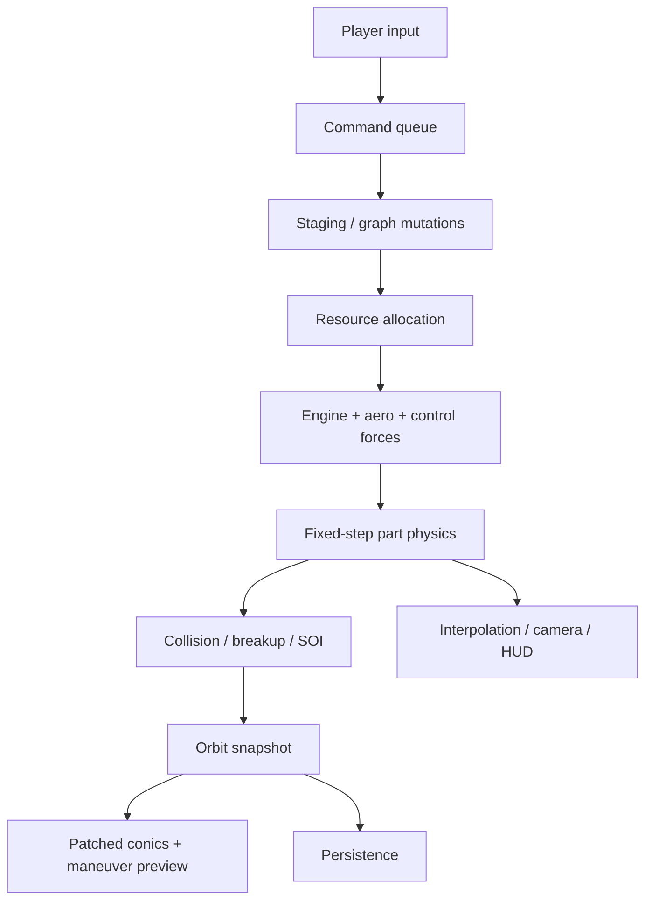

# 전체 시뮬레이션 아키텍처

> KSP 1 (1.12.x) 관찰 기반 역설계 + 독립 재구현 기술 제안. 아래 코드/내부 자료구조는 원작 소스의 복원이 아니다. SI 단위 사용(별도 표기 제외).

## 1. 핵심 설계 원칙
- **Vessel**: 여러 Part의 연결 그래프와 자원 네트워크를 소유하는 논리 단위. 분리 시 그래프의 연결 컴포넌트마다 새 Vessel을 생성한다.
- **Loaded / Unloaded**: 플레이어 주변 활성 기체는 Part별 강체/조인트를 계산하고, 멀리 떨어진 기체는 궤도 상태벡터로 전파한다. 실제 KSP 내부 임계값 및 세부 전환 로직은 버전·상황별 검증 필요.
- **Flight state**: 고정된 좌표 프레임과 시간 원점을 명시한다. 렌더 카메라 기준 상대좌표는 시뮬레이션 정밀도와 독립적이다.
- **Prediction ≠ Simulation**: 궤도선·기동노드 예측은 현재 비행 상태를 복사한 순수 계산으로 생성하고 실제 기체를 움직이지 않는다.



## 2. 데이터 소유권
| 영역 | 권위 상태 | 캐시 / 파생 데이터 |
|---|---|---|
| Part | 정의 ID, 인스턴스 ID, 질량, 리소스, 모듈 상태 | 월드 변환, AABB |
| Vessel | Part ID 집합, 루트, 제어 대상 | 총질량, COM, 관성텐서, delta-v |
| CelestialBody | μ, 반지름, 자전, SOI, 궤도요소 | 현재 위치·속도 |
| Orbit | 중심천체 ID, epoch, 상대 위치·속도 | apoapsis, periapsis, 미래 곡선 |
| Flight | UT, warp mode, loaded set | 화면 좌표, UI 패널 |

## 3. 고정 스텝 파이프라인
```ts
function fixedStep(dt: number) {
  drainValidatedCommands();           // 스테이징/도킹 등 topology 변경은 경계에서
  updateCelestialEphemerides(universalTime);
  updateControllers(dt);              // SAS/PID, throttle, actuator targets
  allocateResources(dt);              // 엔진 요구량/우선순위
  accumulateExternalForces(dt);       // 중력/추력/공력/조종
  integrateRigidBodiesAndConstraints(dt);
  detectContactsAndBreakage();
  commitTopologyChanges();            // 분리/파괴의 원자적 반영
  refreshVesselOrbitSnapshots();
  universalTime += dt;
}
```
`allocateResources`와 엔진 힘 계산 사이에는 실제 공급량 확정이 필요하다. 공급량이 부족하면 추력을 제한한다. Fixed dt의 크기는 설정 가능하며, 구현 검증 없이 원작과 같다고 가정하지 않는다.

## 4. 수치 좌표계
- 천체 중심 궤도: 64-bit float, 중심천체 기준 관성 좌표(BCI).
- 근거리 물리: vessel-local 또는 floating origin에서 float/double 혼합 사용 가능.
- 월드 위치 `R_body + r_relative` 계산 시 큰 수와 작은 수를 반복 가감하지 말고 상대 프레임을 유지한다.
- 방향 quaternion 정규화, 좌표 프레임 변환 시 회전·각속도·자전항을 명시한다.

## 5. 통합 불변식
1. 모든 Part는 정확히 하나의 Vessel에 소속된다.
2. 연결 그래프가 분할되면 소유권, 속도, 자원은 보존된다(폭발·배출 등 명시된 손실 제외).
3. 저장·복원 후 동일 epoch의 궤도 상태는 허용오차 내 동일하다.
4. 예측 모듈은 실제 시뮬레이션 상태를 변경하지 않는다.
5. 물리 단위와 좌표 프레임이 타입/필드명에 드러난다.

## 6. MVP 구현 순서
(1) 천체/좌표계 → (2) Part 그래프 → (3) 질량·추력·연료 → (4) 2D/3D 비행 적분 → (5) 스테이징 → (6) 궤도 예측 → (7) 편집기 → (8) SAS/공력/착륙 → (9) 저장·시간가속.
