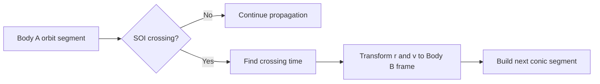

# 궤도역학·케플러 전파·SOI

> KSP 1 (1.12.x) 관찰 기반 역설계 + 독립 재구현 기술 제안. 아래 코드/내부 자료구조는 원작 소스의 복원이 아니다. SI 단위 사용(별도 표기 제외).

## 1. 2체 궤도 모델
중심천체 μ=GM, 상대 위치 `r`, 상대 속도 `v`. 가속도 `a=-μr/|r|³`. 상태벡터에서
- 비에너지 `ε=|v|²/2-μ/|r|`
- 각운동량 `h=r×v`
- 이심률 벡터 `e_vec=(v×h)/μ-r/|r|`
- `e=|e_vec|`, `a=-μ/(2ε)` (포물선 ε≈0 제외)
- 궤도 경사 `i=acos(h_z/|h|)` (기준면 좌표계 명시)
- `rp=|h|²/[μ(1+e)]`, 타원일 때 `ra=|h|²/[μ(1-e)]`.

## 2. 타원 궤도 시간 전파
`n=sqrt(μ/a³)`, `M(t)=M0+n(t-t0)`; `M=E-e sin E`.
```ts
function solveE(M:number,e:number):number {
  M = ((M+Math.PI)%(2*Math.PI)+2*Math.PI)%(2*Math.PI)-Math.PI;
  let E = e < 0.8 ? M : Math.PI*Math.sign(M||1);
  for(let k=0;k<30;k++) {
    const f=E-e*Math.sin(E)-M, fp=1-e*Math.cos(E);
    const d=f/fp; E-=d;
    if(Math.abs(d)<1e-12) return E;
  }
  throw Error('Kepler solver did not converge');
}
```
궤도면 좌표: `x=a(cos E-e)`, `y=a sqrt(1-e²) sin E`. 속도는 `dE/dt=n/(1-e cos E)`를 곱해 미분. 궤도면→관성좌표는 Ω,i,ω 회전 행렬 적용.

## 3. 쌍곡선 궤도
`M_h=e sinh H-H`, `n_h=sqrt(μ/(-a)³)`. Newton 또는 안전한 bracket solver로 H를 구한다. e≈1 근방은 별도 포물선/범용변수(universal variable) solver 권장. 궤도 유형을 `e`만으로 분기할 때 수치 허용오차를 설정한다.

## 4. Patched Conics
1. 현 중심천체를 기준으로 궤도 segment 생성.
2. 예측 궤도와 다른 천체 SOI 경계 `|r_ship(t)-r_body(t)|-R_SOI=0`의 부호 변화 탐색.
3. 시간 구간을 이분법/Brent로 좁혀 이벤트 시각 찾기.
4. 이벤트 시각에 절대 위치·속도 보존, 새 중심천체 위치·속도 차감해 상대 상태벡터 변환.
5. 새 segment 생성; 최대 패치 수, 예측 시간 범위, 반복 진입 방지 hysteresis 적용.



## 5. SOI 경계 처리 주의
중심천체 전환 순간 **절대 속도**가 불연속적으로 바뀌면 안 된다. `v_B_rel = (v_A_rel + v_A_abs) - v_B_abs`. SOI는 현실의 중력장 합산이 아니라 근사적인 영향권 분할이며, 원작과 같은 근사 방식을 목표로 할 때 N-body 중력을 무심코 섞지 않는다.

## 6. 테스트 벡터
- 원형 궤도: `r=700000 m`, `μ=3.5316e12 m³/s²`이면 `v≈2246.14 m/s`.
- 반주기 후 위치는 반대편, 에너지와 각운동량 일정.
- e=0.2 타원 궤도에서 `rp=a(1-e)`, `ra=a(1+e)`.
- 탈출 경계 `v_escape=sqrt(2μ/r)`.
- SOI 전환 직전/직후 절대 r,v의 오차 허용범위 검사.
