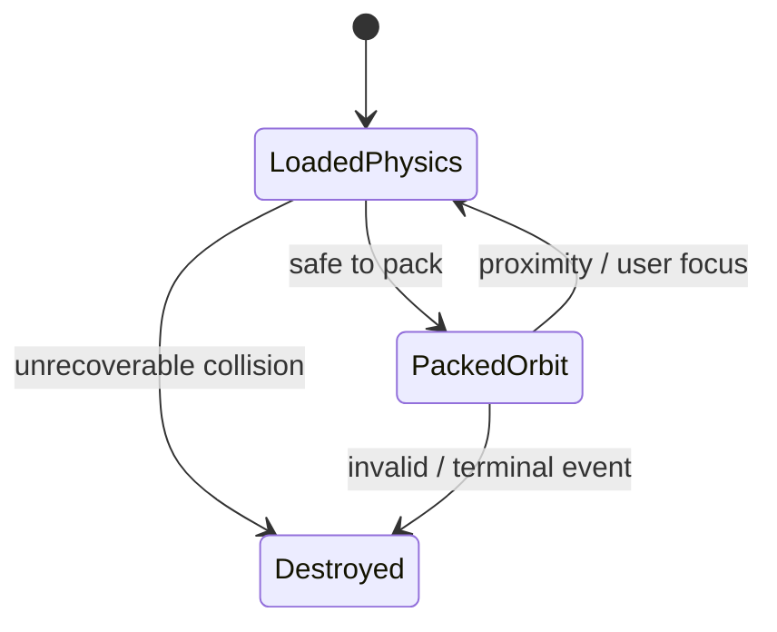

# 시간가속·온레일/오프레일·저장

> KSP 1 (1.12.x) 관찰 기반 역설계 + 독립 재구현 기술 제안. 아래 코드/내부 자료구조는 원작 소스의 복원이 아니다. SI 단위 사용(별도 표기 제외).

## 1. 시간가속의 두 모드
- **Physics warp**: 제한된 배수에서 물리 고정스텝을 더 빠르게 실행하거나 별도 안정화 정책을 사용. 큰 dt로 단순 확대하면 조인트가 불안정해진다.
- **On-rails warp**: 부품별 물리/충돌 대신 천체·기체 궤도 상태를 UT 기준으로 직접 전파. 추진·대기·근거리 충돌 등 활성 조건에서는 전환 제한.

## 2. 상태 전환

패킹 전: Part별 상태를 저장하고 Vessel COM 위치·속도, 질량, 자세, 각속도, 자원 스냅샷을 기록. 언패킹 시: 궤도에서 얻은 COM 상태와 저장된 상대 Part pose를 이용해 강체 상태 재구성. 각 Part의 속도는 `v_part=v_COM+ω×r_part`로 복원.

## 3. 안전한 Warp 제한
- 예측 충돌/대기 진입/근접 SOI 이벤트 이전 자동 정지.
- 활성 추력, 미해결 조인트, 충돌 접촉 중에는 on-rails 금지.
- 이벤트 검출은 단순 샘플링이 아니라 경계 교차 시각을 root-finding으로 계산.

## 4. 저장 스키마
```json
{
  "schemaVersion": 1,
  "universalTimeSeconds": 12345.0,
  "activeVesselId": "v-01",
  "vessels": [{
    "id":"v-01", "mode":"packed", "referenceBodyId":"Kerbin",
    "epoch":12345.0,
    "positionMeters":[700000,0,0],
    "velocityMetersPerSecond":[0,2246.14,0],
    "parts":[]
  }]
}
```
저장시 프레임 중간 상태를 직렬화하지 않는다. Fixed-step 경계에서 immutable snapshot 생성 후 비동기 파일 쓰기. JSON 숫자 정밀도와 스키마 마이그레이션 정책 정의.

## 5. 테스트
- warp x1→x1000→x1 전후 에너지/위치 일관성
- 패킹/언패킹 100회 후 COM, 운동량 드리프트
- 저장→재시작→복원 후 동일 궤도 예측
- SOI 경계에서 warp 자동 종료
- 스키마 버전 업그레이드 시 기본값과 누락 필드 처리
