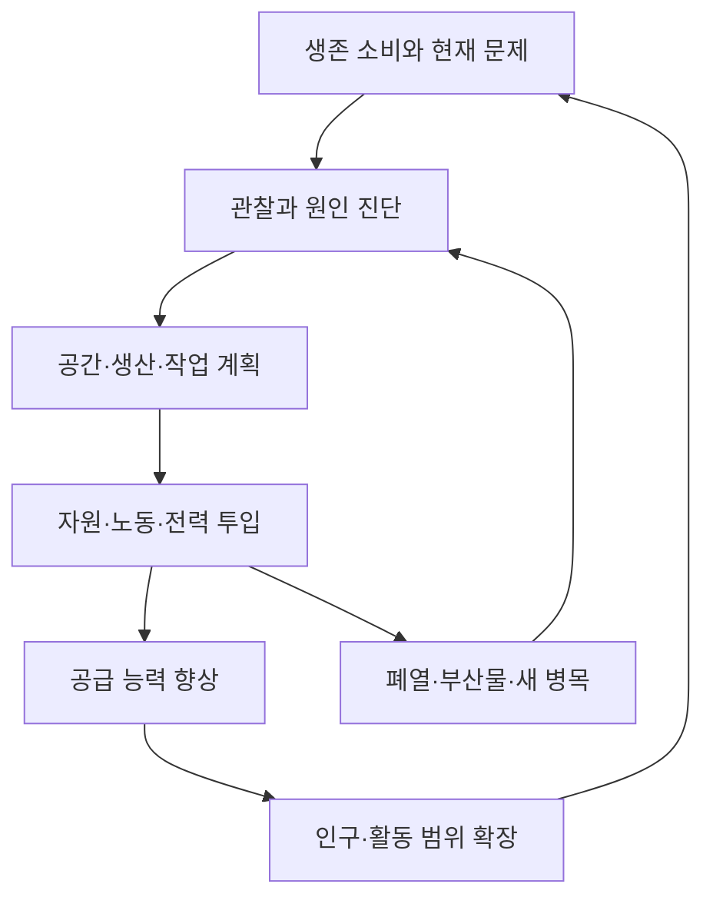
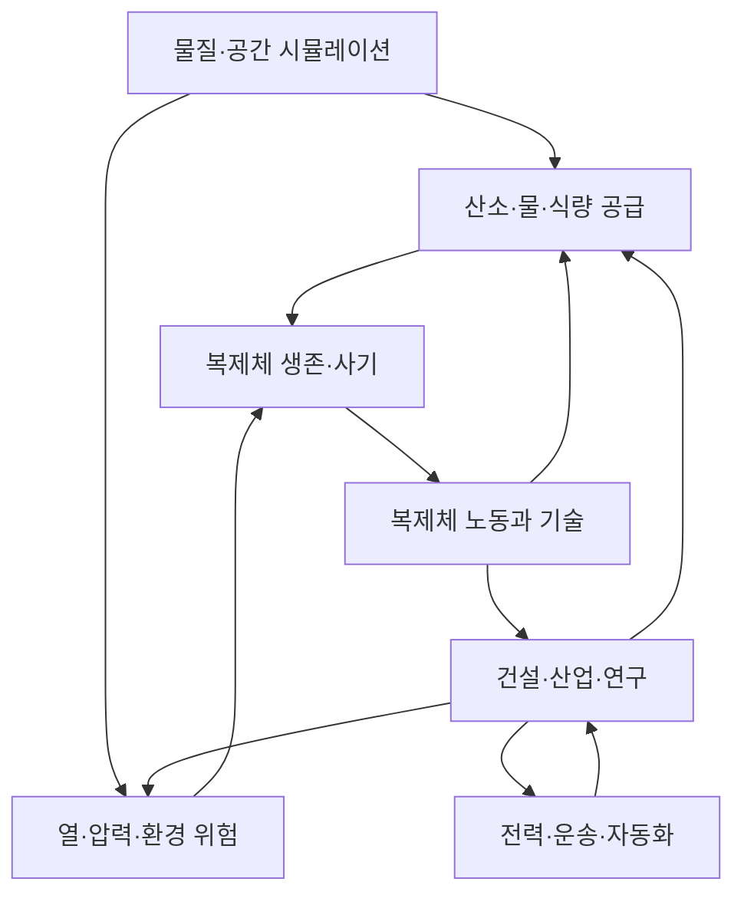

# 01. 게임 개요와 핵심 플레이 구조

> **프로젝트:** Oxygen Not Included 시스템별 역기획서  
> **조사 기준일:** 2026-11-13 · **범위:** 기본 게임의 공통 구조, 확장팩 차이는 별도 표기  
> **문서 성격:** 공개 자료 기반의 기능 역기획 및 독자적 설계 분석. 원본 소스 코드 분석 문서가 아니다.  
> [전체 목차](00_README.md) · [버전·근거 관리](27_sources_version_notes.md)

## 1. 한 문장으로 정의하는 게임

**[해석] Oxygen Not Included는 제한된 공간에서 복제체의 생존을 유지하기 위해 물질·에너지·노동의 흐름을 설계하고, 그 설계가 만들어 낸 새로운 병목을 다시 해결하는 식민지 시뮬레이션이다.**

**[확인]** Klei가 공개한 기본 게임 소개는 산소·열·식량의 생존 위협, 기지 건설, 복제체의 스트레스, 기체와 액체 운송, 전력망, 자원 재활용, 절차적 월드 생성을 핵심 요소로 제시한다.[^overview] 본 문서는 이 개별 기능들이 어떤 의사결정 구조를 만드는지 역으로 분석한다.

## 2. 설계의 중심축

| 중심축 | 플레이어가 반복해서 묻는 질문 | 시스템적으로 발생하는 선택 | 역기획상 의미 |
|---|---|---|---|
| 생존 수지 | 공급이 소비를 따라가는가? | 인원 증가, 생산 증설, 소비 억제 | 단순 자원 보유량보다 지속 가능한 처리량이 중요 |
| 공간 설계 | 생산물을 필요한 곳까지 보낼 수 있는가? | 배관, 동선, 단열, 출입 통제 | 건물 성능이 같아도 배치에 따라 결과가 달라짐 |
| 부작용 처리 | 이 해결책이 무엇을 새로 배출하는가? | 폐열·오염·부산물의 저장과 재사용 | 업그레이드가 새 문제를 여는 구조 |
| 노동 배분 | 누가 언제 이 작업을 수행하는가? | 전문화, 우선순위, 운반 자동화 | 인구가 생산력인 동시에 지속 소비원 |
| 관찰과 진단 | 고장의 원인이 어느 계층에 있는가? | 오버레이, 상태 설명, 수지 관찰 | 정보 접근성 자체가 난이도 조절 장치 |
| 장기 확장 | 다음 확장 후에도 기존 기지가 버티는가? | 완충 저장, 예비 전력, 원격 생산 | 성장의 조건은 새 시설보다 기존 기반의 안정성 |

위 표는 공식 개발 의도를 인용한 것이 아니라 관찰 가능한 기능들의 관계에서 도출한 **[해석]**이다.

## 3. 플레이어와 복제체의 역할 분리

플레이어의 기본 조작 단위는 개별 캐릭터의 매 프레임 행동보다 **공간·작업·정책**이다. 채굴할 영역, 건설할 설비, 생산할 품목, 접근 가능한 구역, 작업 우선순위, 일정을 지정하고, 복제체는 조건을 충족하는 작업을 수행한다. 구체적인 작업 선택 순서와 긴급 행동의 예외는 [작업 시스템](04_tasks_priorities_schedules.md)에서 다룬다.

| 플레이어 명령 | 즉시 바뀌는 것 | 실제 완료에 추가로 필요한 것 |
|---|---|---|
| 채굴 지시 | 작업 후보가 생성됨 | 도달 가능성, 작업 능력, 가용 노동 |
| 건설 청사진 | 예정 건물과 자재 요구가 생성됨 | 자재 공급, 유효한 설치 조건, 건설 작업 |
| 생산 작업 설정 | 레시피 요구가 생김 | 입력 자원, 전력, 작업자, 출력 여유 |
| 우선순위 변경 | 작업 간 상대적 중요도가 바뀜 | 수행 불가능 조건이 해결되어야 함 |
| 배관 연결 | 운송 경로가 바뀜 | 내용물, 연결 방향, 수용 가능 출력 |
| 자동화 설정 | 제어 조건이 바뀜 | 센서의 관측 위치와 실제 설비 상태가 일치해야 함 |

**[해석]** 명령과 실행 사이에 지연이 존재하므로 플레이어는 현재 상태만 보고 결정할 수 없다. 산소가 부족해진 뒤 산소 생산기를 지정해도 자재 운반·전력 확보·공사 완료까지 기다려야 한다. 이 지연이 비축과 선행 투자의 가치를 만든다.

## 4. 시간 규모별 루프

| 시간 규모 | 입력 정보 | 대표 행동 | 성공의 징후 | 실패의 징후 |
|---|---|---|---|---|
| 순간적 대응 | 질식·고립·침수·설비 정지 | 일시정지, 작업 변경, 우회로 확보 | 피해 확대가 멈춤 | 구조 인력까지 위험에 노출 |
| 생활 주기 | 식사·휴식·위생·작업 소요 | 일정과 동선 조정 | 필수 생활과 생산이 반복 가능 | 생활시설 대기와 이동이 노동을 잠식 |
| 생산 주기 | 재고·입출력·가동률 | 병목 증설, 저장 완충, 자동화 | 소비량 이상의 안정 공급 | 출력 정체, 입력 고갈, 폐열 누적 |
| 기술 단계 | 새로운 재료와 연구 | 산업·냉각·우주 인프라 구축 | 새로운 환경을 안전하게 이용 | 기술만 열고 운용 기반은 부족 |
| 월드 규모 | 자원 분포·장기 목표 | 새 구역·소행성 개척 | 시스템을 복제·연결할 수 있음 | 원격 기지의 문제가 본거지까지 전파 |

기간은 플레이 방식과 월드에 따라 달라지므로 특정 사이클 수를 필수 진행 순서로 고정하지 않는다.

## 5. 자원을 읽는 여섯 관점

**[설계 분석]** 모든 문제를 단일 재고 숫자로 다루면 원인을 놓치기 쉽다.

1. **재고:** 지금 보유한 질량·열량·저장 전기에너지. 순간적인 버팀목이다.
2. **처리량:** 단위 시간의 생산·소비·운송 능력. 장기 유지 가능성을 결정한다.
3. **품질:** 온도, 병원균, 음식 품질, 재료 특성. 같은 양이라도 사용 가능성이 다르다.
4. **접근성:** 자원이 있어도 노동자나 운송망이 도달해야 쓸 수 있다.
5. **시간 분포:** 평균 공급이 충분해도 휴면기나 피크 수요를 버틸 저장 공간이 필요하다.
6. **운영 비용:** 노동·전력·열·유지 자재 등 공급을 유지하기 위한 추가 부담이다.

예를 들어 물 10t이 있다는 사실만으로 산소 공급이 안전하다고 볼 수 없다. 물이 고온이거나 펌프에 연결되지 않았거나, 펌프 전력이 끊겼거나, 산소 생산 시설의 출력이 막혔다면 실제 호흡 가능한 공급은 제한된다. 이 예시는 수치에 의존하지 않는 시스템 결합의 설명이다.

## 6. 핵심 시스템 간 의존 관계

의존 관계는 게임 코드의 호출 순서가 아니다. 기획적으로 어떤 시스템의 공급과 위험이 다른 시스템의 입력이 되는지 보여 준다.

## 7. 성장 단계의 역기획

| 단계 | 해결해야 할 질문 | 확장 보상 | 함께 커지는 비용 |
|---|---|---|---|
| 초기 확보 | 다음 생활 주기까지 버틸 수 있는가? | 기본 이동·식사·위생·호흡 | 쉽게 얻는 자원의 고갈 |
| 기초 안정 | 반복 작업을 유지할 수 있는가? | 예측 가능한 생산과 노동 | 시설 증가에 따른 운반과 전력 |
| 산업화 | 새로운 재료를 감당할 수 있는가? | 고성능 재료와 설비 | 폐열·냉각·부산물·복합 배관 |
| 지속 가능화 | 유한 자원 없이 얼마나 오래 유지되는가? | 긴 운영 시간과 자동화 | 간헐 공급의 완충, 복잡한 제어 |
| 우주·확장 | 고립된 환경에 기지를 이식할 수 있는가? | 희귀 자원과 장기 목표 | 생명유지·물류·여러 거점 관리 |

이 단계는 권장 분석 순서이며 게임이 강제하는 고정 퀘스트 순서가 아니다. 시작 월드와 확장팩에 따라 우주 개발의 시점과 의존성이 달라진다. 특히 **Spaced Out!의 다중 월드·모듈식 로켓 구조**는 별도 진행 모델을 가진다.[^spaced]

## 8. 재미를 만드는 구조

### 8.1 해결책의 부산물

**[해석]** 좋은 해결책도 다른 시스템의 부담을 늘린다. 연료를 태워 전력을 확보하면 연료 보급과 배출·열 처리가 필요하고, 식량 품질을 높이면 사기를 확보하는 대신 조리·보존·재료 생산이 필요하다. 따라서 정답 설비 하나보다 여러 비용을 함께 낮추는 배치가 의미를 갖는다.

### 8.2 실패 원인의 추적 가능성

갑작스러운 붕괴처럼 보여도 대개 재고 감소, 가동률 저하, 온도 상승, 작업 대기 같은 선행 신호로 설명할 수 있는 구조가 중요하다. 플레이어가 실패를 재현하고 수정할 수 있어야 시뮬레이션의 복잡성이 학습으로 연결된다. [UI 문서](23_ui_ux_information.md)는 정보 가시성의 역할을 분석한다.

### 8.3 설계 재사용과 변형

한 번 안정화한 방·생산 라인·냉각 계통을 다른 구역에 재사용하되 재료·온도·거리·공급원이 달라질 때 수정한다. 월드 생성의 변동성은 설계를 무효화하기보다는 조건에 맞춰 적용하는 문제를 만든다.

## 9. 역기획에서 분리해야 할 범주

| 범주 | 문서에 넣을 내용 | 주의점 |
|---|---|---|
| 제품 규칙 | 사용자가 관찰 가능한 기능과 제약 | 출처와 적용 버전 명시 |
| 기획적 해석 | 기능이 만들어 내는 선택과 긴장 | 개발자가 직접 밝힌 의도처럼 쓰지 않음 |
| 분석 모델 | 수지·저장·가동률 계산 | 실제 게임의 숨은 구현식과 구별 |
| 재구현 제안 | 엔티티·이벤트·작업 상태 모델 | Klei의 실제 클래스명·갱신 순서로 단정하지 않음 |
| 미확인 데이터 | 최신 상수·희귀 예외·일부 DLC 상호작용 | 확인 방법과 영향을 함께 적음 |

## 10. 품질 판단 기준

역기획 결과를 검토할 때는 다음을 확인한다.

- 건물 목록만 읽어도 되는 설명을 넘어, **왜 특정 설계를 선택하는지** 설명하는가?
- 같은 자원에 대해 생산·운송·소비·부산물·열이 연결되는가?
- 우선순위로 해결되는 문제와 도달 불가·능력 부족처럼 선행 조건을 고쳐야 하는 문제가 구별되는가?
- 기본 게임과 Spaced Out!, 추가 콘텐츠 팩의 규칙이 섞이지 않는가?
- 계산에 사용한 값이 원작 확인값인지 예시 가정인지 명확한가?
- 실제 플레이 검증을 하지 않은 부분을 검증 완료라고 쓰지 않는가?

## 11. 관련 문서

- 시작 조건: [월드·바이옴·탐사](02_world_biomes_exploration.md)
- 운영 주체: [복제체](03_duplicants_attributes_skills.md), [작업](04_tasks_priorities_schedules.md)
- 통합 분석: [수지와 실패 시나리오](24_balance_failure_scenarios.md)
- 구현 관점: [데이터 모델](25_data_model_reconstruction.md), [검증 계획](26_validation_rebuild_plan.md)

## 12. 근거와 한계

[^overview]: Klei 공식 Steam 제품 소개, [Oxygen Not Included](https://store.steampowered.com/app/457140/Oxygen_Not_Included/). 제품이 제시하는 주요 시스템 범위를 확인하는 자료다. 이 문서의 단계 구분·평가 틀·인과 분석은 독자적 해석이다.
[^spaced]: Klei 지원 문서, [What is Oxygen Not Included – Spaced Out?](https://support.klei.com/hc/en-us/articles/360053456331-What-is-Oxygen-Not-Included-Spaced-Out). 다중 거점 관리, 행성 간 자원 운송, 개편된 로켓과 성도 구조를 확인한다.
