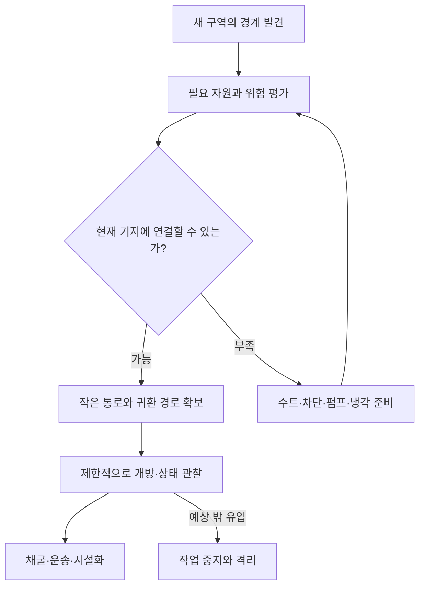

# 02. 월드 생성·바이옴·탐사 시스템

> **조사 기준일:** 2026-11-13 · **범위:** 기본 게임 공통 원리, Spaced Out!의 월드 클러스터와 DLC 시작 환경 구분  
> **표기:** [확인] 공개 1차 자료로 확인 · [해석] 기획 분석 · [설계 제안] 재구현 모델 · [검증 필요] 실제 빌드 확인 대상  
> [전체 목차](00_README.md)

## 1. 시스템의 목적

**[해석]** 월드는 배경 이미지가 아니라 자원·위험·이동 비용·기술 경로를 동시에 결정하는 시작 조건이다. 탐사는 단순히 보상을 드러내는 행동이 아니라, 닫힌 경계 밖의 유체와 열을 기존 기지에 연결할지 결정하는 행위가 된다.

**[확인]** 공식 제품 설명은 절차적으로 생성되는 월드를 제시한다. 개발자 기록에서는 월드 특성이 생성 결과를 바꾸고, Story Trait이 탐사 가능한 상호작용 POI를 추가한다고 설명한다.[^world][^traits][^story]

## 2. 입력과 출력

| 구분 | 내용 | 플레이상 영향 |
|---|---|---|
| 생성 입력 | 게임 규칙 모드, 시작 소행성, 시드, 월드 특성, 스토리 특성, 활성 DLC | 접근 가능한 자원과 탐사 과제의 분포 |
| 환경 출력 | 지형·물질·온도·기체·액체·생물·간헐천·POI | 처음 사용할 생산 방법과 위험 |
| 정보 출력 | 초기 공개 구역, 미탐사 영역, 발견한 자원 위치 | 계획에 사용할 수 있는 정보의 범위 |
| 장기 출력 | 지표·심층·외부 천체로 향하는 확장 여지 | 후반 기술과 자원 확보 방식 |

**[설계 제안]** 재현 가능한 사례를 기록할 때는 시드 하나 대신 다음 조합을 저장한다.

```text
WorldReproductionKey = {
  gameBuild,
  ruleset: Base | SpacedOut,
  activeContentPacks,
  asteroidOrClusterPreset,
  worldSeed,
  worldTraits,
  storyTraits,
  difficultyOptions,
  mods
}
```

이는 원본 세이브 포맷이 아니다. 생성 규칙이 달라진 빌드에서 같은 숫자 시드만으로 동일한 결과를 보장할 수 없다는 검증상의 문제를 피하기 위한 기록 형식이다.

## 3. 공간을 이루는 기능 계층

다음 표는 화면상 기능을 분해한 **[설계 제안]**이며 원작의 메모리 레이아웃을 뜻하지 않는다.

| 계층 | 주요 데이터 | 상호작용 |
|---|---|---|
| 셀 환경 | 물질, 질량, 온도, 환경 상태 | 굴착, 유체 이동, 열 전달, 상변화 |
| 고체 지형·건설 타일 | 점유, 경계, 재료 | 이동 경로와 기체·액체 경계 변경 |
| 건물 | 설치 조건, 포트, 작동 상태 | 자원 변환과 노동 요청 |
| 배관·운송 | 연결 관계, 흐름, 저장 내용 | 분산된 생산과 소비 연결 |
| 전력·자동화 | 회로 연결, 부하, 신호 | 설비 가동 조건 제어 |
| 생명체·잔해 | 위치, 이동, 소비·산출 | 환경을 이용하거나 변형 |
| 정보 | 가시성, 오버레이, 발견 기록 | 플레이어가 원인을 이해할 수 있게 함 |

같은 위치에 있다고 해서 모든 계층이 동일한 규칙으로 충돌하거나 열을 주고받는다고 가정하면 안 된다. 상세 상호작용은 [건설](05_construction_rooms_access.md), [열](08_temperature_phase_change.md), [배관](07_liquids_plumbing_sanitation.md)에서 별도로 검증한다.

## 4. 바이옴을 자원과 위험으로 분해하기

아래는 바이옴의 기획적 역할을 정리한 것이다. 정확한 광물·생물 조합과 포함 여부는 월드 및 콘텐츠 설정에 따라 달라지며, 모든 맵에 등장하는 고정 구성표가 아니다.

| 환경 유형 | 플레이어가 기대하는 가치 | 진입 시 점검할 위험 | 필요한 연결 시스템 |
|---|---|---|---|
| 온화한 시작 구역 | 초기 작업 공간, 가까운 자원 | 쉽게 얻는 자원 고갈 | 기초 산소·식량·위생 |
| 오염된 습지 계열 | 물·생물·유기 자원 | 비호흡 기체, 병원균 관련 노출, 액체 유출 | 정화·수처리·출입 정책 |
| 고온·비호흡 기체 구역 | 특수 광물·산업 입력 | 기체 혼입과 열 유입 | 격리·수트·배출 경로 |
| 냉대 구역 | 차가운 물질과 열 완충 | 농작물 조건, 유체 동결, 체온 영향 | 단열·해동·온도 제어 |
| 원유·심층 산업 구역 | 연료·고급 산업 자원 | 고온 작업과 복합 부산물 | 정유·냉각·물류 |
| 마그마·화산 인접 구역 | 열원과 갱신 자원 | 대량 열 유입, 용융 물질 | 고온 재료·열교환·차단 |
| 우주 노출 구역 | 우주 설비 공간 | 대기 보존, 천체·환경별 외부 위험 | 수트·차폐·로켓 |
| DLC 특수 구역 | 새로운 식량·재료·생물 순환 | 기존 생존 설계의 전제가 바뀜 | [콘텐츠 팩별 차이](22_dlc_content_matrix.md) |

**[해석]** 중요한 설계 변수가 바이옴 이름 자체는 아니다. 플레이어는 결국 물질의 종류, 온도, 접근 거리, 생물 조건, 갱신 가능 여부를 읽고 자신의 생산망과 연결한다.

## 5. 탐사의 의사결정 절차



### 5.1 경계 개방의 비용

벽을 한 칸 제거하는 행위는 이동 경로를 만들면서 유체와 열의 경계도 바꿀 수 있다. 따라서 탐사 명령의 완료 조건은 “목표 칸이 보였다”보다 넓게 잡아야 한다. 귀환 동선, 산소 접근, 유체 유출 방향, 임시 자재 운반까지 포함해서 평가한다.

### 5.2 채굴과 운반의 분리

채굴된 자원이 생겼다고 즉시 생산 시설의 재고가 되는 것은 아니다. 접근 가능한 물품, 운반 대상, 저장 정책, 작업 우선순위가 연결되어야 한다. 채굴 능력을 늘려도 운반이 병목이면 작업 공간에 잔해가 쌓일 수 있다.

### 5.3 정보 가치

한 구역을 먼저 조사하는 목적이 즉시 채굴이 아닐 수 있다. 장기 수원·열원·희귀 자원의 위치를 파악하면 주요 산업 구역과 통로를 어디에 둘지 결정할 수 있다. 이것이 탐사와 건축 계획을 연결하는 보상이다.

## 6. 월드 특성과 스토리 특성의 차이

| 구분 | 핵심 역할 | 분석할 질문 |
|---|---|---|
| 월드 특성 | 생성 환경의 자원·지형 조건을 변형 | 기존 생산망에 어떤 유리·불리 조건이 생기는가? |
| 스토리 특성 | 발견하고 상호작용하는 특정 POI와 과제 | 자원·노동을 투입했을 때 무엇을 얻는가? |
| DLC 시작 환경 | 새로운 물질·생물·규칙 조합을 제공 | 기본 생존 우선순위가 어떻게 바뀌는가? |
| 클러스터 구성 | 여러 천체에 자원과 목표를 분산 | 어느 거점을 어떤 기능으로 운영할 것인가? |

**[확인]** Story Trait 도입 당시 개발자 공지는 월드 생성 좌표에 해당 설정이 별도 구간으로 추가된다고 설명한다.[^story] **[검증 필요]** 현재 모든 특성의 배치 알고리즘, 상호 배제 조합, 생성 실패 재시도 횟수는 이 조사에서 확보하지 않았다. 과거 공지의 순서를 현행 내부 실행 순서로 일반화하지 않는다.

## 7. Spaced Out!에서 바뀌는 탐사의 의미

**[확인]** Spaced Out!은 여러 월드를 실시간으로 관리하고 행성 간 자원을 운송하는 구조를 추가한다.[^spaced] **[해석]** 따라서 “기존 기지에서 멀리 파 내려가기”에 더해 “독립 생명유지계를 갖춘 새 거점을 시작하기”가 탐사 비용에 포함된다.

| 기본적으로 고려할 것 | 다중 거점에서 추가되는 것 |
|---|---|
| 도달 가능한 작업 경로 | 귀환·수송 수단과 이동 시간 |
| 현재 구역의 산소·식량 | 출발·체류·비상 복귀분의 보급 |
| 현지 자원 회수 | 수입·수출 품목과 장기 물류 수지 |
| 주변 위험의 차단 | 다른 월드를 보는 동안의 무인 안정성 |
| 기존 인력의 전문성 | 인원을 떼어 보낸 본거지의 노동 감소 |

로켓·방사선·다중 거점의 자세한 규칙은 [19](19_space_rocketry_base.md), [20](20_radiation_nuclear_spaced_out.md), [21](21_multicolony_spaced_out.md)에서 각각 분리한다.

## 8. 실패 사례와 예외

| 사례 | 겉으로 보이는 증상 | 근본 원인 | 기획적 학습 |
|---|---|---|---|
| 저수지 아래를 먼저 채굴 | 침수·작업 중단 | 연결 후 유출 경로를 고려하지 않음 | 채굴 순서도 설계의 일부 |
| 고온 구역을 넓게 개방 | 시간이 지나 농업·생활 구역 문제 | 통로를 통한 열 유입 | 즉시 안전과 장기 안전을 구분 |
| 긴 외곽 통로 확장 | 작업 시간 감소·귀환 지연 | 이동 비용의 누적 | 시설 수보다 접근성이 중요 |
| 단일 사다리 경로 제거 | 작업자 고립 | 작업 완료가 뒤 작업의 경로를 차단 | 중간 공사 상태도 검토 |
| 발견한 수원에 즉시 의존 | 일정 시점부터 공급 정지 | 온도·휴면·출력 처리를 미검토 | 발견과 안정 공급은 별도 단계 |
| 다른 월드에 과잉 파견 | 본거지 유지 작업 정체 | 노동 예산의 이동 | 탐사 비용을 양쪽 거점에서 계산 |

수영, 젖음, 수트, 액체 경계의 자세한 예외는 콘텐츠 팩과 빌드에 영향을 받는다. 특히 2026년 11월 공개테스트의 수영 공통화를 안정판의 보편 규칙으로 가정하지 않는다.

## 9. 재구현 데이터 계약

**[설계 제안]** 지형 생성 단계와 플레이 중 상태를 분리한다.

| 데이터 | 최소 필드 | 필요한 이유 |
|---|---|---|
| WorldPreset | id, ruleset, allowedContent, dimensions | 생성 가능 조합과 공간 크기 관리 |
| BiomeDefinition | resourceWeights, temperatureProfile, spawnRules | 자원과 위험의 분포를 데이터로 조절 |
| WorldModifier | eligibility, parameterChanges, exclusions | 특성 중복과 충돌을 검증 |
| POITemplate | footprint, accessRequirements, rewards | 탐사 과제와 보상 연결 |
| DiscoveryState | worldId, revealedCells, discoveredPOIs | 월드 상태와 플레이어 지식을 분리 |
| ExplorationOrder | targetArea, accessPolicy, hazardPolicy | 명령과 실제 실행 조건 분리 |

원작의 생성 함수를 복원한 스키마가 아니라 유사한 경험을 만들기 위한 최소 데이터 분해다.

## 10. 검증 시나리오

1. 동일 빌드·규칙 모드·콘텐츠·시드에서 생성 결과를 비교하고, 다른 빌드에서는 동일성을 별도로 측정한다.
2. 액체 옆의 벽을 단계적으로 제거해 유출 경로와 작업자 귀환 가능 여부를 기록한다.
3. 작업 도중 발판을 제거하는 명령을 섞어 중간 상태의 도달 불가 처리가 가능한지 확인한다.
4. 고온 구역 연결 전후 생활 구역의 시간별 온도를 비교해 지연 위험을 관찰한다.
5. 새 월드 개척에 인력을 보냈을 때 본거지 필수 작업의 가동률이 유지되는지 확인한다.
6. 새로운 DLC를 활성화한 생성 설정에서 기존 월드 템플릿과 스토리 특성의 조합을 기록한다.

위 항목은 **계획**이며 본 문서 제작 과정에서 실제 게임을 실행해 통과시킨 시험 결과는 아니다.

## 11. 근거

[^world]: [공식 Steam 제품 소개](https://store.steampowered.com/app/457140/Oxygen_Not_Included/). 절차적 월드와 탐사·건설의 제품 범위 확인.
[^traits]: Klei 개발자 업데이트 [481350 – Unexplained Traits](https://kleiforums.com/game-updates/oni-alpha/481350-r1677/). Spaced Out!의 월드 특성이 생성 결과를 바꾼다는 근거.
[^story]: Klei 개발자 업데이트 [525812 – Sweet Dreams / Story Traits](https://kleiforums.com/forums/topic/143553-game-update-525812/). 상호작용 POI 기반 스토리 특성과 생성 설정 확장 확인.
[^spaced]: [Klei의 Spaced Out! 설명](https://support.klei.com/hc/en-us/articles/360053456331-What-is-Oxygen-Not-Included-Spaced-Out). 다중 월드·자원 운송 확인.
