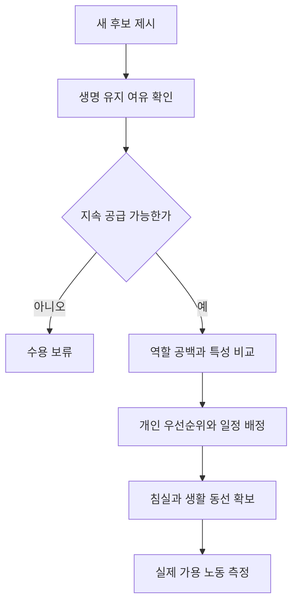

# 03. 복제체 · 능력치 · 특성 · 기술

[전체 목차](00_README.md) · [작업 배정](04_tasks_priorities_schedules.md) · [사기와 스트레스](14_morale_stress_decor.md)

- 조사 기준일: 2026-11-13
- 적용 범위: 기본 게임의 일반 복제체를 중심으로 설명하며, 바이오닉 복제체는 별도 규칙으로 구분한다.
- 근거 구분: **[확인]** 공개 1차 자료에서 확인한 규칙, **[해석]** 기획 구조에 대한 분석, **[설계 제안]** 동일한 경험을 재현하기 위한 모델, **[검증 필요]** 실행 빌드에서 확인할 항목.
- 한계: 실제 게임 실행 파일·세이브·내부 데이터 테이블을 제공받지 않았다. 아래 데이터 이름과 계산식은 원본 코드가 아니다.

## 1. 시스템의 역할 [해석]

복제체는 노동력을 제공하면서 동시에 기지의 산소·식량·거주 공간·의료·사기를 소비하는 주체다. 인원 증가는 생산량만 늘리는 버튼이 아니라 **생산 능력과 유지비를 함께 증가시키는 투자 결정**이다. 같은 인원이라도 이동 거리, 숙련도, 특성, 기술, 생활시설 접근성이 달라지면 실제 가용 노동량이 크게 달라진다.

이 시스템이 만드는 핵심 선택은 세 가지다. 첫째, 지금 새 인원을 받을 수 있는가. 둘째, 전문 인력을 키울 것인가, 여러 일을 할 수 있는 인력을 키울 것인가. 셋째, 기술 확장을 감당할 생활 수준이 있는가. 복제체의 얼굴과 이름은 이 수치 결정을 개별 인물의 이야기로 받아들이게 만든다.

| 설계 축 | 플레이어가 바꾸는 것 | 즉시 효과 | 지연 비용 |
|---|---|---|---|
| 인구 | 신규 복제체 수용 | 가능한 동시 작업 증가 | 산소·식량·생활시설 수요 증가 |
| 전문화 | 개인 우선순위와 기술 선택 | 특정 업무 처리력 확보 | 전문 인력 부재 시 기능 정지 |
| 범용화 | 여러 기술 계열 학습 | 상황 변화에 대응 | 일반 복제체의 사기 요구 관리 |
| 이동성 | 통로·사다리·장비·업무 배치 | 통근과 운반시간 감소 | 공간·자재·유지 비용 |
| 생활 수준 | 음식·휴식·공간 개선 | 안정적인 장기 작업 | 농업·전력·건축 부담 |

## 2. 공개 자료에서 확인되는 핵심 구조 [확인]

2019년 QoL Mk III에서 직업 체계가 기술 체계로 바뀌었고, 경험을 얻어 기술을 선택하는 구조 및 **학습한 기술별로 누적되는 사기 요구**가 명시되었다. Skill Scrubber는 기술 배분을 되돌리는 장치로 도입되었다.[^skills]

Launch Upgrade는 흥미와 능력치, 흥미에 맞는 기술 학습의 사기 효과, 고난도 굴착 기술 등 능력치와 행동 자격이 별개임을 보여준다.[^launch] 따라서 역기획에서는 다음 세 층을 분리해야 한다.

| 층 | 의미 | 구분해야 하는 이유 |
|---|---|---|
| 능력치 Attribute | 관련 행동의 효율을 바꾸는 성장값 | 숫자가 높아도 잠긴 행동을 자동 해금하지는 않는다. |
| 기술 Skill / Perk | 특정 작업 자격 또는 추가 효과 | 자격이 있어도 개인 우선순위·접근성 때문에 작업하지 않을 수 있다. |
| 흥미·특성 Interest / Trait | 초기 강점, 선호, 제약, 반응 | 같은 기술 구성이라도 인력의 운영 비용과 적합성이 달라진다. |

## 3. 복제체 정보 모델 [해석]

### 3.1 영속 정보와 변동 상태

| 구분 | 대표 정보 | 변경 계기 | 다른 시스템의 소비처 |
|---|---|---|---|
| 정체성 | 이름, 외형, 복제체 유형 | 생성·이름 변경 | UI, 장비·일정 필터 |
| 성향 | 흥미, 긍정·부정 특성, 스트레스 반응 | 생성 시 결정 또는 특정 콘텐츠 | 성장·생활·작업 제약 |
| 숙련 | 능력치, 경험, 사용 가능한 기술 포인트 | 작업·경험 획득 | 행동 소요시간과 해금 |
| 기술 | 습득 기술, 제공되는 작업 자격 | 기술 배분·재설정 | 작업 후보 필터 |
| 생존 상태 | 숨, 칼로리, 지구력, 체온, 체력 등 | 시간·환경·활동 | 긴급 행동·의료 |
| 생활 상태 | 사기, 요구 사기, 스트레스, 효과 목록 | 식사·휴식·장식·사건 | 효율·반응·위기 |
| 운영 설정 | 개인 우선순위, 일정, 출입 허가, 소비 허용 | 플레이어 조작 | 작업 선택·경로·시설 이용 |

**핵심 기획 포인트:** 속성의 원인과 결과를 한 화면에서 추적할 수 있어야 한다. 이동이 느릴 때 능력치 부족인지, 장비 효과인지, 질병인지, 이동 매체의 불리함인지 구분되지 않으면 플레이어는 인물의 행동을 통제 불가능한 것으로 받아들인다.

### 3.2 능력치의 역할 분류

다음은 기능을 설명하기 위한 분류다. 모든 능력치의 최신 계수·최댓값·경험 획득량을 확정하는 표가 아니다.

| 기능군 | 대표 능력치·활동 | 효과를 읽는 관점 | 설계상 위험 |
|---|---|---|---|
| 이동·운반 | Athletics, Strength | 이동시간, 운반 횟수 | 작업 능력치가 높아도 통근이 생산량을 잠식 |
| 지형·구조 | Excavation, Construction | 굴착·건설 작업량 | 필수 기술 없이 어려운 자원 접근 실패 |
| 지식·기계 | Science, Machinery | 연구·기계 조작 효율 | 연구와 생산이 같은 노동자를 경쟁적으로 요구 |
| 생물 생산 | Agriculture, Husbandry | 농업·목축 처리와 관리 | 수확·돌봄 시점이 어긋나면 연쇄 생산 손실 |
| 음식·의료 | Cuisine, Medicine 계열 | 조리·치료 처리 | 수요가 몰리는 시간에 전문 인력 부족 |
| 미관 | Creativity 계열 | 작품 품질과 생활 수준 | 생산 기반 없이 사기 개선에 노동 과투자 |

각 능력치가 모든 관련 행동에 같은 배율을 적용한다고 가정해서는 안 된다. 예를 들어 관련 기술이 해금하는 행동, 실제 작업시간을 줄이는 능력치, 부가 산출물을 늘리는 효과는 별도 검증 대상이다.

## 4. 신규 인원 수용 흐름 [해석]



수용 판단은 저장고에 남은 식량만으로 끝나지 않는다. 저장량은 시간을 벌어 주지만, 생산률이 소비률보다 낮으면 새 인원은 고갈 시점을 앞당긴다. 특히 산소·식량·물 중 하나가 불안정한 기지에서는 새 복제체를 받은 뒤 늘어난 노동력으로 부족분을 해결하기 전에 생존 수요가 먼저 발생한다.

후보 선택에서 확인할 항목은 아래와 같다.

1. 당장 막혀 있는 작업의 **자격**을 확보할 수 있는가.
2. 인구 증가를 포함한 지속 산소·식량 공급이 가능한가.
3. 현재 일정에서 생활시설 이용이 겹치는가.
4. 기지 구조상 긴 통근이나 위험 지역 이동이 필수인가.
5. 해당 특성의 비용이 기존 인프라와 충돌하는가.
6. 한 명에게만 의존한 필수 업무가 생기는가.

## 5. 기술 성장과 생활 수준의 연결 [해석]

### 5.1 기술 포인트가 있다고 즉시 소비하지 않는 이유

기술 학습은 작업 자격 또는 능력 향상을 제공하지만, 일반 복제체의 요구 사기를 높이는 성장 구조와 연결된다. 따라서 최적 선택은 항상 모든 기술을 배우는 것이 아니다. 기지가 제공하는 생활 수준과 실제 수행 역할에 맞는 기술 묶음을 선택하는 일이 중요하다.[^skills]

| 역할 예시 | 우선 확보할 기능 | 뒤로 미룰 수 있는 확장 | 의존 인프라 |
|---|---|---|---|
| 개척 담당 | 필요한 굴착 자격, 장거리 작업 적합성 | 직접 사용하지 않는 고급 생산 기술 | 외부 산소·보호복·복귀 동선 |
| 연구 담당 | 해당 연구 시설 사용 능력 | 단기 수요 없는 전문 생산 | 연구 재료·전력·사기 |
| 기지 운영 담당 | 운반·건축·필수 유지 작업 | 사용 빈도가 낮은 고급 기술 | 자재 저장과 짧은 동선 |
| 식량 담당 | 계획한 조리·농업·목축 자격 | 서로 경쟁하는 지나친 겸직 | 원료·설비·수확 주기 |

이 표는 권장 빌드 순서가 아니라 **기술 선택의 이유를 역추적하는 예시**다. 월드 자원, 선택 난이도, 생물 기반 생산 여부에 따라 역할 구성이 달라진다.

### 5.2 재설정과 영구 효과

Skill Scrubber는 잘못된 전문화나 새로운 역할 요구에 대응할 수 있는 회복 수단이다. 재설정은 배운 기술, 원래 특성으로 부여된 능력, 실제 숙련 능력치를 같은 것으로 취급해서는 안 된다. 2026년 11월 공개테스트에는 특성에서 얻은 기술을 Skill Scrubber가 지우지 않도록 하는 수정이 포함되어 있으므로, 안정판의 세부 동작과 구분해야 한다.[^test]

## 6. 일반 복제체와 바이오닉 복제체

**[확인]** Bionic Booster Pack은 별도의 복제체 유형·기술 트리·부스터와 Gear Oil, Gunk, Power Banks, Oxygen Tank 상태를 도입했다.[^bionic] 일반 복제체의 생활 모델을 그대로 적용하면 생산 계획과 경보가 틀어진다.

| 비교 항목 | 일반 복제체 모델 | 바이오닉 분석 관점 |
|---|---|---|
| 유지 자원 | 식량과 일반 생활시설 중심 | 전력 저장품·산소 저장·윤활·폐기물 처리의 연결 확인 |
| 성장 | 학습 기술과 숙련·흥미 | 전용 기술과 장착 부스터의 조합 |
| 작업 연속성 | 식사·수면·화장실·호흡으로 중단 | 전용 생리 상태에 맞는 보급·정비 중단 |
| 실패 | 굶주림·질식·피로 등 | 전용 자원 고갈과 보급 작업 불능 |
| 인력 평가 | 소비량 대비 가용 노동 | 정비망을 포함한 가용 노동과 공급망 비용 |

바이오닉이 모든 질병이나 환경 피해에 면역이라고 해석해서는 안 된다. 실제 질병·환경 예외는 [건강·보호복 문서](13_health_germs_suits.md)에서 따로 다룬다.

## 7. 가용 노동량 평가 예시 [설계 제안]

원작의 인공지능 계산식이 아니라 기지 설계를 평가하는 분석식이다.

```text
실제 작업시간 = 관측기간
             - 생존·생활시간
             - 이동시간
             - 대기·막힘시간
             - 질병·사고로 손실된 시간

유효 처리량 = 실제 작업시간 × 해당 행동의 단위시간 처리량
```

**가정 예시:** 동일한 100시간의 총 인력시간에서 생활에 25, 이동에 30, 대기에 10을 쓰면 직접 작업은 35시간이다. 이동을 30에서 20으로 줄이면 작업시간은 45시간이 된다. 이때 인원·산소 소비를 늘리지 않고 직접 작업시간을 약 28.6% 늘린 셈이다. 이 값들은 ONI의 실제 하루 시간이나 능력치 계수가 아니라 투자 비교용 가정이다.

이 분석은 신규 인원, 기술 투자, 기지 압축, 운송 자동화 중 무엇이 더 효과적인지를 비교하게 한다. 복제체 수 자체보다 **필요한 자격을 가진 복제체가 목표 장소에서 실제로 일하는 시간**이 중요한 지표다.

## 8. 재구현 데이터 계약 [설계 제안]

| 데이터 | 주요 필드 | 반드시 분리할 항목 |
|---|---|---|
| DuplicantProfile | id, modelType, traits, interests | 일반·바이오닉 모델 |
| AttributeState | attributeId, value, experience | 숙련값과 외부 효과 |
| SkillState | acquiredSkills, availablePoints | 기술 포인트와 능력치 경험 |
| CapabilitySet | digTiers, operateTags, equipmentTags | 수치 보정과 작업 자격 |
| VitalState | oxygen, nutrition, stamina, health 등 | 모델별 필수 상태 |
| LifeQualityState | morale, moraleNeed, stress, effects | 사기와 스트레스 |
| WorkPolicy | categoryPriorities, scheduleId, restrictions | 개인 설정과 개별 작업 우선순위 |

데이터 변경 시에는 최종값만 바꾸지 말고 이유를 함께 남겨야 한다. `기술 학습 → 작업 자격 추가 → 요구 사기 변화 → 해당 작업 후보 갱신`이 추적되어야 잘못된 자격이나 사기 변화 문제를 진단할 수 있다.

## 9. 검증 시나리오와 관찰 기준

| ID | 장면 | 기대하는 관찰 | 검증 목적 |
|---|---|---|---|
| DUP-01 | 능력치는 높지만 필수 기술 없는 인원 배치 | 잠긴 행동의 불가 사유가 표시됨 | 속도와 자격 분리 |
| DUP-02 | 동일 역할에 기술만 다른 두 인원 | 자격·처리시간 차이를 각각 관찰 | 기술 효과 범위 |
| DUP-03 | 기술 학습 전후 생활 수준 고정 | 요구 사기와 스트레스 경향 비교 | 성장 비용 |
| DUP-04 | 같은 인원을 먼 업무와 가까운 업무에 배치 | 이동·대기·작업 시간을 분해 | 가용 노동 검증 |
| DUP-05 | 필수 전문 인력 부재 | 대체 인력 또는 명확한 작업 불가 상태 | 단일 인력 의존 |
| DUP-06 | Skill Scrubber 사용 전후 비교 | 습득 기술·특성 기술·능력치 각각 기록 | 재설정 범위와 버전 차이 |
| DUP-07 | 일반·바이오닉 혼합 기지 | 유형에 맞는 자원·정비 경보 | 생리 모델 분리 |

**[검증 필요]** 최신 능력치 배율, 기술 비용, 흥미의 구체적 초기 보너스, 후보 생성 확률, 기술 경험의 세부 획득식은 같은 빌드의 게임 내 데이터베이스와 통제된 실험으로 보완해야 한다.

## 10. 출처와 읽기 범위

[^skills]: [Klei — QoL Mk III, 326232, 2019-04-16](https://kleiforums.com/game-updates/oni-alpha/326232-r734/). 기술·사기 누적·재설정 체계의 공식 근거. 과거 소개 자료이므로 현재의 세부 상수까지 증명하지 않는다.
[^launch]: [Klei — Launch Upgrade, 346893, 2019-06-27](https://kleiforums.com/game-updates/oni-alpha/346893-r789). 흥미·기술 자격·UI 변경의 공식 근거.
[^bionic]: [Klei — Bionic Booster Pack 출시, 646687, 2024-12-12](https://kleiforums.com/game-updates/oni-alpha/646687-r2443). 바이오닉 전용 상태와 기술·부스터의 근거.
[^test]: [Klei — 761015, 2026-10-29 공개테스트](https://kleiforums.com/game-updates/oni-alpha/761015-r2830/page/2/). Skill Scrubber 변경은 테스트 분기의 변경으로 취급한다.
