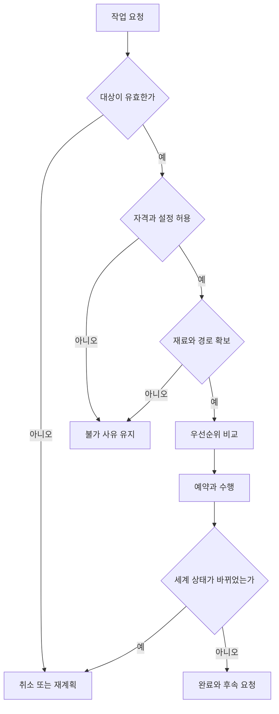

# 04. 작업 생성 · 우선순위 · 일정 · 이동

[전체 목차](00_README.md) · [복제체](03_duplicants_attributes_skills.md) · [물류](16_logistics_storage_conveyors.md)

- 조사 기준일: 2026-11-13
- 적용 범위: 기본 게임과 공통 복제체 작업 구조. 바이오닉 전용 작업과 Spaced Out! 다중 월드는 확장 규칙이다.
- **[확인]**은 공식 공개 설명, **[해석]**은 역기획 분석, **[설계 제안]**은 재현 모델, **[검증 필요]**는 실제 빌드 확인 항목을 뜻한다.
- 원본 작업 스케줄러와 경로 탐색 코드를 확인하지 않았으므로, 이 문서의 처리 순서·자료구조는 원본 구현 명세가 아니다.

## 1. 시스템 목표 [해석]

플레이어는 대부분의 순간 개별 복제체의 손을 직접 조작하지 않는다. 굴착 구역, 건설 청사진, 생산 주문, 시설 설정을 지정하고 복제체가 이를 실제 행동으로 변환한다. 작업 시스템은 **플레이어의 장기 계획을 당장의 실행 가능한 행동으로 연결하는 중간층**이다.

이 구조가 재미를 만들려면 자동화와 설명 가능성이 함께 필요하다. 세부 행동을 매번 명령하지 않아도 기지가 움직여야 하며, 필요한 일이 멈췄을 때는 자격·재료·접근·우선순위·일정 중 무엇이 원인인지 읽을 수 있어야 한다. 따라서 작업 목록 자체가 생산 도구이면서 디버깅 UI다.

## 2. 확인된 우선순위의 층 [확인]

공식 Ranching Upgrade 설명은 개인 복제체의 업무 우선순위와 개별 작업의 Sub-Priority를 분리하고, 개인 설정이 작업 수치보다 먼저 영향을 준다고 설명한다.[^priority] QoL Mk III에는 Top Priority 작업과 Yellow Alert 동작이 추가되었다.[^alert]

| 층 | 플레이어가 묻는 질문 | 주의점 |
|---|---|---|
| 작업 가능성 | 이 사람이 실제로 수행할 수 있는가? | 자격·접근·재료 부족은 숫자 상승으로 해결되지 않는다. |
| 개인 업무 선호 | 이 사람은 어떤 종류의 일을 먼저 하는가? | 인력의 역할 분담을 결정한다. |
| 개별 작업 중요도 | 같은 종류에서 무엇을 먼저 할 것인가? | 시설·명령 단위의 처리 순서를 조절한다. |
| 긴급 처리 | 생활 중단을 감수하고 지금 해결할 일인가? | 남용하면 일상 복구 작업이 밀린다. |
| 이동·대기 비용 | 비슷한 후보 중 무엇이 효율적인가? | 근접성 설정의 상세 비교식은 별도 검증 대상이다. |

이 표는 플레이어 관점의 분해다. 원본 엔진이 모든 후보에 동일한 순서로 하나의 비교 함수를 적용한다는 뜻은 아니다. 생존 행동·시설 호출·대량 운반은 별도 예외가 있을 수 있다.

## 3. 작업은 어디서 생기는가 [해석]

| 생성원 | 작업 예 | 종료 조건 | 후속 작업 |
|---|---|---|---|
| 플레이어 명령 | 굴착, 건설, 철거, 청소 | 대상 변화 또는 명령 취소 | 자재 운반·잔해 정리 |
| 설비 수요 | 원료 보급, 발전 연료 보충 | 내부 필요량 충족 | 가동·생산물 운반 |
| 생산 주문 | 조리, 제련, 제작 | 주문 수량 충족 | 다음 레시피·저장 |
| 생물 상태 | 수확, 돌봄, 포획 | 상태 회복 또는 목표 달성 | 보급·운반·가공 |
| 복제체 생존 | 호흡 회복, 식사, 수면 | 필수 상태 회복 | 원래 계획 재평가 |
| 시설·생활 설정 | 화장실, 휴식, 장비 착용 | 이용 완료 | 복귀 또는 다음 생활 행동 |

**건설의 세분화:** 청사진 하나도 재료 확보, 재료 전달, 작업 장소 확보, 건설 수행이라는 여러 단계로 나뉜다. 건설 담당만 충분하고 운반 담당이 부족하면 청사진은 계속 대기한다. UI는 “아직 안 지었다” 대신 어느 단계가 막혔는지를 보여 주어야 한다.

## 4. 실행 가능한 작업의 판정 [설계 제안]



| 필터 | 대표 실패 | UI에 필요한 설명 |
|---|---|---|
| 자격 | 필수 굴착·조리·목축 기술 없음 | 필요한 기술과 후보 인원 |
| 개인 제한 | 업무 금지 또는 시설 이용 제한 | 어떤 설정이 막는지 |
| 접근 | 사다리 단절, 출입 금지, 작업 발판 없음 | 목표 지점과 도달 가능한 작업 위치 |
| 물자 | 자재 없음, 다른 작업에 예약됨 | 총량과 사용 가능한 양의 차이 |
| 시설 | 고장, 매몰, 침수, 전원·입출력 문제 | 실제 비가동 원인 |
| 일정·생존 | 식사·수면 또는 긴급 호흡 행동 | 현재 행동과 다음 작업 후보 |

우선순위를 높이는 조작은 **실행 가능한 후보 사이의 순서**를 바꾸는 수단이다. 불가능한 작업을 가능하게 만들지 않는다. 이 원칙이 역기획의 작업 시스템과 경보 시스템 양쪽에 일관되게 적용되어야 한다.

## 5. 일정 시스템 [확인 + 해석]

공식 Expressive Upgrade는 식사·수면·노동 시간을 제어하는 일정 편집기를 도입했다.[^schedule] 2024년 수정에서는 Downtime 블록 수와 사기 보너스의 연결을 명확히 했다.[^downtime]

| 일정 구간 | 기획상 의미 | 배치가 좋을 때 | 배치가 나쁠 때 |
|---|---|---|---|
| 작업 | 생존 외 업무를 수행하는 기본 창 | 역할별 생산이 안정적 | 유지 업무가 여러 생산 작업에 밀림 |
| 휴식 | 식사·교류·오락 등 생활 회복 | 사기와 생활시설 이용 안정 | 이동에 시간이 소모되어 실제 휴식 부족 |
| 수면 | 지구력 회복을 위한 기회 | 규칙적인 업무 지속 | 숙소 접근·소음·이동 문제로 손실 |
| 목욕·위생 관련 시간 | 해당 생활 행동을 수행할 창 | 시설 수요 분산 | 시설·자원 부족으로 시간만 경과 |

일정은 행동을 무조건 정해진 분량만큼 끝내 주는 보장 장치가 아니다. 시설까지 도달할 시간, 이용 가능 여부, 현재 생리 상태가 함께 작용한다. 일정에 휴식이 있어도 휴게시설이 너무 멀면 그 시간의 상당 부분은 이동에 쓰인다.

### 교대 일정의 기획 효과

동시에 모든 인원이 화장실과 식당을 이용하면 짧은 구간에 수요가 집중된다. 교대 일정을 쓰면 동일한 시설을 여러 그룹이 공유하고, 생산·운반·정비가 한 번에 모두 멈추는 상황을 완화할 수 있다. 반면 같은 공간을 공유하는 그룹끼리 소음과 이동을 유발하거나, 공동 식사의 조건을 맞추기 어려울 수 있다.

**가정 예시:** 시설 1개가 한 시간에 4명의 생활 행동을 처리하고 인원 8명이 같은 시간에 몰리면 절반은 대기한다. 두 그룹의 이용 시간을 나누면 시설 증설 없이 대기를 줄일 수 있다. 여기의 시간과 처리량은 실제 게임 상수가 아닌 대기열 분석용 가정이다.

## 6. 이동과 작업 동선 [해석]

작업 목표의 좌표와 실제 복제체가 서서 작업할 좌표는 다를 수 있다. 따라서 경로 탐색은 대상까지의 거리만 재면 충분하지 않다. 접근 가능한 작업 위치, 도구 사용 가능 범위, 주변 발판, 문 권한, 보호복 체크포인트, 이동 장치 상태를 고려해야 한다.

기지 변경은 진행 중인 작업의 전제를 깨뜨린다. 굴착으로 발판이 사라지고, 낙하물이 통로를 막고, 문 접근 설정이 바뀌며, 수압이나 배관 사고가 구역을 위험하게 만들 수 있다. 복제체가 이미 선택한 경로라도 도중에 재평가되어야 한다. 2025년 말 공식 핫픽스들에는 도달 불가 판정과 체크포인트·문·이동 시설의 경로 문제를 수정한 기록이 있어, 이 부분이 실제로 중요한 품질 위험임을 확인할 수 있다.[^navigation]

### 병목을 읽는 순서

1. 작업 자체가 생성되었는가.
2. 필요한 자원과 작업 자격이 있는가.
3. 작업 위치와 재료 위치에 모두 접근 가능한가.
4. 다른 작업이 재료·시설을 점유하는가.
5. 개인 업무 우선순위가 맞는가.
6. 실제로는 이동·대기 시간이 대부분인가.

## 7. 실패 패턴과 회복 설계 [해석]

| 실패 패턴 | 직접 증상 | 구조적 원인 | 효과적인 교정 |
|---|---|---|---|
| 모든 것을 높은 우선순위로 지정 | 중요한 일이 여전히 늦음 | 우선순위 간 차이가 사라짐 | 필수 유지 업무와 확장 업무 분리 |
| 고급 인원이 낮은 가치 운반에 몰림 | 연구·조리·목축 정지 | 역할 설정과 물류 배치 충돌 | 업무 선호 및 가까운 중간 저장 |
| 생활시설에 긴 줄 | 작업 시간이 감소 | 일정 동기화와 시설 수 부족 | 교대 일정·시설 분산 |
| 긴급 작업 반복 | 식사·수면 밀림 | 위기 해결 이후 정상화 부재 | 긴급 상태 해제와 예방 정비 |
| 외곽 건설 방치 | 자재가 조금씩만 도착 | 먼 공급원·경로·운반 경합 | 현장 자재 집하와 범위 축소 |
| 구조 작업이 진행되지 않음 | 갇힌 인원 악화 | 구조 경로도 같은 장애에 의존 | 별도 접근면과 독립적인 생존 여유 |

원인 추적이 가능해야 플레이어가 시스템을 학습한다. “게으름” 같은 모호한 해석에 머무르면 개인 우선순위만 반복해서 올리게 된다. 설계상 필요한 것은 **불가 사유와 선택되지 않은 이유를 구분하는 설명**이다.

## 8. 스케줄러 재구현 모델 [설계 제안]

다음 의사코드는 원작의 알고리즘을 추정하여 복제한 코드가 아니다. 동일한 의사결정 범주를 검증하기 위한 단순 모델이다.

```text
OnDecisionPoint(worker):
    if criticalSurvivalActionExists(worker):
        chooseCriticalAction()
        return

    candidates = collectRelevantRequests(worker.region)
    candidates = filterCapabilityAndPermission(candidates, worker)
    candidates = filterResourcesAndReachability(candidates, worker)
    candidates = applyScheduleEligibility(candidates, worker)

    rank candidates by:
        emergencyClass
        personalCategoryPreference
        requestPriority
        configuredCostAndAgePolicy

    reserve resources and target for selected request
    execute with invalidation checks
```

후보 정렬 이전에 경로를 전부 비싼 정확 탐색으로 검사하면 비용이 커진다. 재구현에서는 지역·이동 가능성 캐시로 후보를 줄이고 최종 후보에 정밀 검사를 적용할 수 있다. 이것은 성능 설계 제안이며, ONI가 동일한 캐시나 탐색 단계를 사용한다고 단정하지 않는다.

| 데이터 | 필수 항목 | 일관성 조건 |
|---|---|---|
| WorkRequest | kind, target, priority, requirements | 취소된 목표로 새 작업을 배정하지 않음 |
| Reservation | worker, target, materialAmount | 동시 예약으로 자원을 초과 소비하지 않음 |
| WorkProgress | completedWork, remainingWork | 중단·재개 시 작업량 정책 일관 |
| FailureReason | code, blockingObject, suggestedContext | UI가 실제 판정 이유와 일치 |
| Schedule | blocks, assignment, phase | 저장·불러오기 후 배정 유지 |
| NavigationRevision | changedCells, permissionVersion | 구조 변경 이후 오래된 경로 무효화 |

## 9. 검증 시나리오

| ID | 입력·변화 | 기대 관찰 |
|---|---|---|
| WRK-01 | 개인 굴착 선호 높음, 건설 작업 중요도 높음 | 개인 설정과 개별 중요도의 관계를 설명할 수 있음 |
| WRK-02 | 높은 우선순위의 필수 기술 미보유 작업 | 계속 대기하며 자격 부족 이유를 표시 |
| WRK-03 | 이동 중 문 권한 변경 | 경로 재평가 및 예약 해제·대체 행동 |
| WRK-04 | 건설 자재를 두 작업이 동시에 요구 | 중복 예약·음수 재고 없이 처리 |
| WRK-05 | 동일 일정과 교대 일정 비교 | 시설 대기·작업·이동 시간을 비교 가능 |
| WRK-06 | 긴급 작업 종료 | 정상 일정과 생활 회복으로 복귀 |
| WRK-07 | 작업 대상 파괴·취소 | 남은 예약과 작업 UI가 정상 정리 |
| WRK-08 | 근접성 설정 전후 같은 작업 집합 | 이동 효율과 먼 작업 지연을 함께 기록 |

**[검증 필요]** 일반 우선순위 숫자의 내부 가중치, 동점 처리, 예약 탐색 범위, 긴급 모드별 생존 행동 예외, 일정 전환 시 중단·완료 정책은 실행 빌드로 검증해야 한다.

## 10. 출처

[^priority]: [공식 Update Log — Ranching Upgrade Mark I, 2018-03-22](https://steamcommunity.com/app/457140/discussions/4/1694920442947303381/). 개인 우선순위와 개별 작업 우선순위의 분리 근거.
[^alert]: [Klei — QoL Mk III, 326232](https://kleiforums.com/game-updates/oni-alpha/326232-r734/). Top Priority와 Yellow Alert의 공식 도입 기록.
[^schedule]: [Klei — Expressive Upgrade, 279457](https://kleiforums.com/game-updates/oni-alpha/279457-r525/). 일정 편집 및 생활·사기 연결의 기본 근거.
[^downtime]: [Klei — 643502, 2024-11-25](https://kleiforums.com/game-updates/oni-alpha/643502-r2427/). Downtime 블록과 사기 보너스의 연결.
[^navigation]: [Klei Steam 개발자 공지 모음 — 2025년 11~12월 핫픽스](https://store.steampowered.com/news/posts/?appids=457140&enddate=1768593671&feed=steam_community_announcements). 701625, 702577/702808, 704096의 경로·도달성·체크포인트 수정 기록. 수정 이전 버그를 현재 의도된 규칙으로 취급하지 않는다.
