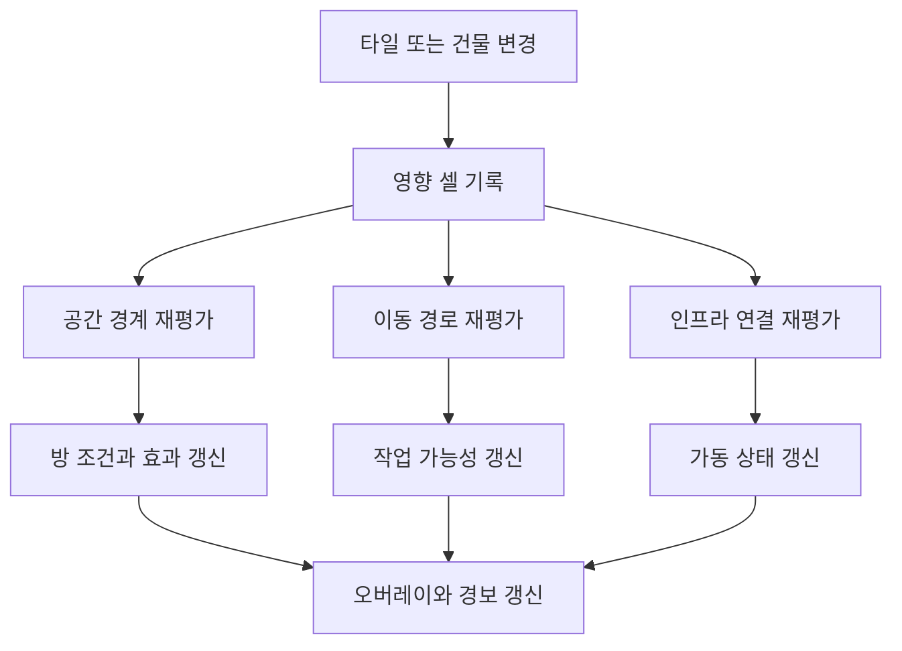

# 05. 건설 · 공간 분할 · 방 판정 · 출입

[전체 목차](00_README.md) · [작업과 일정](04_tasks_priorities_schedules.md) · [열 관리](08_temperature_phase_change.md)

- 조사 기준일: 2026-11-13
- 범위: 기본 게임 및 공통 건설·방 시스템. DLC 전용 건물은 기능 확장으로 다룬다.
- **[확인]** 공개 근거가 있는 규칙 / **[해석]** 역기획 분석 / **[설계 제안]** 재현용 구조 / **[검증 필요]** 실행 빌드 확인 항목.
- 이 문서는 모든 건물의 최신 크기·비용·열전도율을 복제한 데이터집이 아니다. 공간과 건물의 상호작용을 명세하는 시스템 문서다.

## 1. 시스템 목표 [해석]

ONI의 건설은 시설을 지도에 놓는 행위이면서 환경 시뮬레이션의 경계를 만드는 행위다. 벽 하나는 통행을 막고, 기체와 액체의 이동을 바꾸고, 열 전달 경계를 형성하며, 방의 유효성을 바꾼다. 따라서 건설 시스템의 핵심은 **한 구조물이 서로 다른 시스템에서 어떤 의미를 갖는지 일관되게 전달하는 것**이다.

같은 공간에서도 방 판정, 대기 격리, 출입 통제, 전력·배관 연결은 별개의 조건이다. 생활 보너스를 주는 방이 반드시 밀폐된 기체 구역은 아니며, 밀폐 구역이라고 해서 적절한 식당이나 침실로 판정되는 것도 아니다. 플레이어가 이 차이를 이용하여 공간을 설계하는 것이 중요하다.

## 2. 건설 행위의 단계 [해석]

| 단계 | 입력 | 출력 | 흔한 중단 원인 |
|---|---|---|---|
| 배치 계획 | 건물 종류, 위치, 방향, 재료 | 청사진·요구 자재 | 지형·크기·기반 조건 충돌 |
| 접근 확보 | 굴착·사다리·발판 계획 | 작업 가능한 위치 | 작업 범위 밖 또는 통로 단절 |
| 자재 전달 | 저장된 재료와 운반 인력 | 현장 재료 | 접근 불가·예약·재고 부족 |
| 시공 | 작업 자격·인력시간 | 완성 건물 | 다른 업무와 경쟁·현장 위험 |
| 연결 | 전력·배관·자동화·운송 | 연결된 인프라 | 포트 방향·다른 네트워크 연결 |
| 운영 | 필요 조건 충족 | 효과·생산 | 침수·과열·매몰·입출력 막힘 |
| 수정·철거 | 변경 명령 | 새 구조·회수 자재 | 주변 기능 중단·임시 노출 |

청사진 완료와 운영 개시는 다르다. 산소 생산 건물이 지어져 있어도 재료, 전력, 출력 공간이 부족하면 생명 유지 설비로 계산할 수 없다. 기획서의 상태 분류는 “미건설/건설” 두 값보다 세밀해야 한다.

## 3. 공간을 구성하는 서로 다른 층 [해석]

| 층 | 대표 대상 | 주요 판정 | 겹침·분리의 목적 |
|---|---|---|---|
| 월드 셀 | 자연 타일, 기체, 액체 | 질량·온도·상태 | 생존 환경과 자원 |
| 구조물 | 타일, 문, 사다리 | 이동·투과·기반·경계 | 기지 형태와 동선 |
| 기능 건물 | 침대, 작업대, 발전기 | 작동·점유·작업 위치 | 생산과 생활 |
| 연결망 | 전선, 배관, 자동화선, 레일 | 연결·방향·용량 | 물질·에너지·신호 이동 |
| 장식·배경 | 작품, 식물, 배경 요소 | 장식·설치 조건 | 생활 수준과 미관 |
| 관리 구역 | 방, 출입 정책, 업무 범위 | 포함 객체·권한 | 기능 의미 부여 |

이것은 역설계를 위한 논리 분류이며, 원본 엔진의 레이어 수나 메모리 구성을 뜻하지 않는다. 재구현에서는 한 셀에 여러 종류의 인프라가 공존할 수 있다는 사용자 경험을 보존하는 것이 중요하다.

## 4. 방 시스템의 구조

### 4.1 공개 자료로 확인되는 방향 [확인]

방은 생활·업무 효과를 제공하는 구조이며, 공식 자료는 방의 요구 조건과 보상을 구분한다.[^roomui] 2025년 11월에는 Banquet Hall이 추가되고 기존 식당 사기 보너스와 장식물 조건이 조정되었다. Laboratory의 광원 조건도 제거되었다. 빈 화분·시든 식물·미완성 작품은 장식 조건을 충족하지 않는 등 **현재 상태까지 판정에 반영**된다.[^roomupdate]

따라서 오래된 “특정 장식 수치만 넘으면 된다”는 표를 현재 명세로 그대로 재사용해서는 안 된다.

### 4.2 판정과 이용 효과의 분리 [해석]

| 단계 | 판정 질문 | 설계상 필요한 정보 |
|---|---|---|
| 공간 후보 | 어떤 셀들이 같은 공간인가? | 경계와 연결 관계 |
| 크기 조건 | 이 방 유형의 허용 범위인가? | 현재 면적·허용 범위 |
| 필수 객체 | 필요한 시설·장식이 있는가? | 객체 종류·완성·작동 상태 |
| 금지 객체 | 충돌하는 설비가 들어왔는가? | 충돌 태그·대상 표시 |
| 방 유형 결정 | 여러 조건이 동시에 맞으면 무엇인가? | 유형 우선순위·정책 |
| 실제 사용 | 복제체가 유효한 서비스를 이용했는가? | 이용 이벤트·효과 지속 |

방 이름이 오버레이에 표시되는 것과 모든 복제체가 보상을 받는 것은 동일한 사건이 아니다. 식사나 수면처럼 관련 시설을 이용하는 행위와 연결되는 보상은 이용 시점을 따로 추적해야 한다. 원작의 모든 방에 같은 보상 적용 시점을 가정하지 않는다.

### 4.3 방의 기능별 분류 [해석]

| 기능 | 대표 방 | 확보하려는 경험 | 연계 비용 |
|---|---|---|---|
| 휴식 | Barracks, Bedroom 계열 | 규칙적인 회복과 생활 수준 | 공간·침대·동선 |
| 식사 | Mess Hall, Great Hall, Banquet Hall | 음식과 공간의 결합 | 식탁·장식·사회적 이용 |
| 위생 | Latrine, Washroom 계열 | 배설·손 씻기 동선의 안정 | 급수·배수·청소 |
| 생산 보조 | Laboratory, Power Plant 등 | 전문 생산 공간의 의미 | 필수 설비·허용 설비 |
| 생물 관리 | Stable, Greenhouse 계열 | 관리 대상과 작업 시설의 결합 | 면적·환경·먹이 |
| 치료 | Hospital 등 | 회복과 관리 집중 | 의료 인력·시설·접근 |
| 자연·휴양 | Park, Nature Reserve 등 | 보존된 공간의 가치 | 자연물 유지·동선 배치 |

표의 방 이름은 기능을 비교하기 위한 예다. 최소·최대 면적, 보너스 수치, 필수 건물의 최신 조합은 게임 내 Room Overlay의 해당 빌드 내용을 우선한다.

## 5. 문 · 권한 · 기체 격리 [해석]

문에는 최소 세 가지 서로 다른 질문이 걸려 있다.

1. 복제체나 로봇이 통과할 수 있는가.
2. 열렸거나 닫혔을 때 기체·액체·열을 어떻게 전달하는가.
3. 방 경계와 건물 기반으로 어떻게 취급되는가.

이를 하나의 `isOpen` 값으로만 표현하면 예외가 늘어난다. 자동 개폐, 강제 개방, 잠금, 인물별 출입 권한, 이동 방향, 자동화 신호는 관련되지만 서로 다른 설정이다. 2025년 공식 업데이트는 로봇·바이오닉 등 대상 유형에 대한 출입 제어 UI를 확장했다.[^roomupdate]

| 구역 설계 | 목적 | 함정 | 검증해야 할 경계 |
|---|---|---|---|
| 침실 출입 | 불필요한 통행 감소 | 통로로도 사용하면 소음·장식 변화 | 숙소 접근과 우회 경로 |
| 위험 산업구역 | 비전문 인원 접근 제한 | 수리·구조 담당까지 차단 | 보급·정비·구조의 권한 |
| 보호복 통로 | 장비 착용 후 외출 | 우회로가 있으면 장비 정책 무력화 | 모든 출구·재진입 경로 |
| 대기 격리 구역 | 기체·열의 이동 제어 | 출입 권한만으로 밀폐를 보장하지 못함 | 개폐 순간의 환경 이동 |
| 목축 공간 | 생물과 작업 영역 유지 | 종별 이동 특성이 다름 | 크리터 경로와 복제체 경로 분리 |

특히 “문이 잠겨 있으니 안전하다”는 판단은 위험하다. 그 문이 유일한 구조 경로인지, 다른 층에서 기체가 통하는지, 배관으로 위험물이 이동하는지를 따로 점검해야 한다.

## 6. 변경이 전파되는 구조 [설계 제안]

실시간으로 모든 방·모든 경로·모든 네트워크를 전수 검사하기보다 영향 범위를 모아 재평가하는 구조를 제안한다. 다만 계산을 지연하더라도 사용자에게 보여 주는 상태와 실제 행동이 오랫동안 어긋나지 않아야 한다. 방이 사라진 즉시 보너스를 제거하는지, 이미 얻은 효과는 유지되는지도 정책으로 분리한다.

## 7. 공간 투자에 대한 균형 [해석]

작은 기지는 이동과 건설 비용이 적지만 열·오염·산업 설비가 생활 구역과 가까워진다. 큰 기지는 기능을 분리하기 쉬우나 사다리·전선·배관·운반시간을 늘린다. 따라서 기지 확장은 사용 가능한 공간의 총량보다 **자주 오가는 관계가 얼마나 가까운가**로 평가하는 것이 유용하다.

**가정 예시:** 조리실과 식량 저장소 사이 운반을 하루 20회 하고 왕복 15초를 쓰면 총 300초가 이동에 든다. 배치 변경으로 왕복 6초가 되면 180초를 절약한다. 이 값은 원작 레시피나 사이클 상수가 아니라 공간 설계의 비용을 계산하는 가정이다. 동일한 분석을 급수·원료·제품·생활 동선에 적용할 수 있다.

재배치에는 전환 비용도 있다. 식당을 옮기는 동안 기존 시설을 동시에 철거하면 기능 공백이 생긴다. 역기획에서 건설 경험을 설명할 때는 완성된 기지뿐 아니라 **기존 서비스를 유지하며 단계적으로 바꾸는 과정**을 포함해야 한다.

## 8. 재구현용 데이터 [설계 제안]

| 데이터 | 주요 필드 | 검증 불변식 |
|---|---|---|
| BuildingDefinition | footprint, ports, materialTags, requiredSupport | 배치·포트 표시와 실제 동작 일치 |
| ConstructionOrder | location, material, deliveredMass, workRemaining | 자원 중복 소비 방지 |
| BuildingState | constructed, enabled, damaged, blockedReasons | 완성과 가동을 구분 |
| RoomDefinition | bounds, requiredTags, forbiddenTags, effects | 조건과 보상 분리 |
| RoomInstance | cells, containedObjects, matchedType, revision | 변경 이후 오래된 판정 제거 |
| AccessPolicy | entityType, entityId, direction, permission | 대상 유형 간 권한 누출 방지 |
| BoundaryProperties | gasPass, liquidPass, heatPolicy, navPolicy | 방·환경·이동 경계 분리 |

## 9. 검증 시나리오

| ID | 조작 | 확인할 결과 |
|---|---|---|
| BLD-01 | 재료 전달 후 접근 발판 제거 | 시공 대기 사유가 접근 문제로 바뀜 |
| BLD-02 | 필수 시설은 있지만 금지 시설도 추가 | 방 유형 실패 이유가 대상과 함께 표시 |
| BLD-03 | 유효 장식물을 제거·미완성 상태로 변경 | 방 조건이 해당 빌드 규칙대로 갱신 |
| BLD-04 | 방을 둘로 나누고 다시 연결 | 면적·포함 객체·효과 재평가 |
| BLD-05 | 출입 권한만 바꾸고 대기 변화 관찰 | 권한과 유체 격리가 별개임을 검증 |
| BLD-06 | 보호복 통로에 우회 경로 추가 | 우회 가능성과 장비 정책의 관계 확인 |
| BLD-07 | 식당을 순차 이전 | 기능 공백과 이용자 동선 기록 |
| BLD-08 | 저장·불러오기 | 방·문 권한·시공 진척의 일관성 확인 |

**[검증 필요]** 최신 RoomDefinition 전체 값, 여러 방 조건의 동시 충족 시 우선순위, 자동화 문과 방 판정의 세부 관계, 파괴·철거 시 자재 회수량은 실행 빌드의 데이터와 실험으로 확정해야 한다.

## 10. 출처

[^roomui]: [Klei — 356355, 2019 출시 업데이트](https://kleiforums.com/game-updates/oni-alpha/356355-r847/). 방 조건·효과를 구분하는 오버레이 및 도구 설명 근거.
[^roomupdate]: [Klei — November 2025 QoL, 700348/700386](https://kleiforums.com/forums/topic/168832-game-update-november-2025-quality-of-life-update-700348-700386/). 2025년 방·장식 판정·출입 제어 변경. 공식 검색 본문에서 확인했으며 본문 직접 열기는 403이었다. [공식 Steam 공지 모음](https://store.steampowered.com/news/posts/?appids=457140&enddate=1768593671&feed=steam_community_announcements)에서도 해당 날짜의 공지를 확인할 수 있다.
