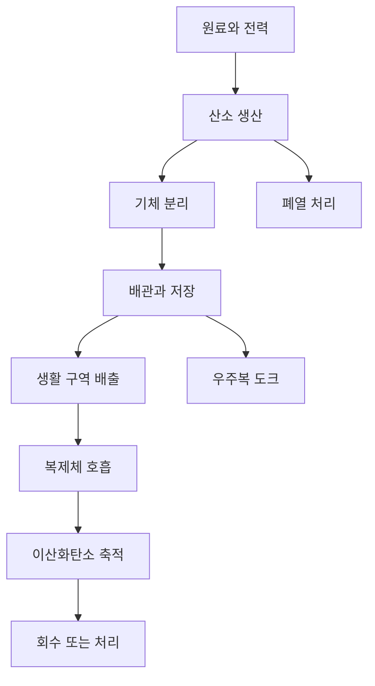

# 06. 대기·산소·기체 분리 시스템

[전체 목차](00_README.md)

- 작성 기준: 2026-11-13
- 범위: 기본 게임과 공통 대기 규칙. 바이오닉 복제체의 저장 산소, DLC별 생물·설비는 해당 문서에서 별도 취급한다.
- 증거 구분: **[확인]** 공개 자료에서 확인한 내용, **[해석]** 게임 규칙을 기획 언어로 정리한 분석, **[설계 제안]** 재현용 구조, **[검증 필요]** 대상 빌드에서 확인해야 할 값.
- 원작 실행 빌드·세이브·소스코드를 제공받지 않았다. 아래 구조와 수식은 원본 구현의 설명이 아닌 역기획 모델이다.

## 1. 시스템 목적과 핵심 경험

**[확인]** 공식 소개는 산소·온도·식량 부족을 식민지 생존의 지속적 위협으로 제시한다.[^official]

**[해석]** 산소는 단순한 재고가 아니다. 생산량이 충분해도 복제체가 일하는 위치에 도달하지 않으면 생존을 보장하지 못한다. 따라서 이 시스템의 질문은 “총 산소가 얼마인가?”에서 “어디에, 얼마나 지속적으로, 어떤 온도로 공급되는가?”로 발전한다.

| 플레이 단계 | 주된 결정 | 비용·위험 | 성공을 판단할 신호 |
|---|---|---|---|
| 초기 | 산소 생산기 위치와 채굴 범위 | 유한 원료 소비, 노동·전력 사용 | 생활 구역에서 숨 쉬러 이동하는 횟수 감소 |
| 정착 | 산소 생산 전용 구획과 배관 | 펌프 전력, 필터, 건설 자재 | 생산·운송·배출이 함께 유지됨 |
| 산업화 | 물 기반 산소와 부산물 회수 | 물 공급, 폐열, 기체 혼입 | 장기간 수지와 온도 추세 안정 |
| 확장 | 작업 구역·우주복 도크별 공급 | 본거지와 원정지의 경쟁 | 특정 도크가 본거지 산소를 고갈시키지 않음 |

산소 부족은 복제체의 이동·작업 시간을 잠식하고, 그 때문에 산소 설비 유지 작업도 늦어지는 피드백을 만든다. 신규 인원 영입은 생산 인력 증가와 생명유지 비용 증가를 동시에 일으킨다.

## 2. 환경 셀과 건물 레이어의 구분

**[확인: 역사적 플레이 관찰]** Klei 포럼의 직접 플레이 설명에서는 환경 셀이 한 종류의 원소를 가지며, 기체 압력은 현실의 압력 방정식보다 셀 질량 중심으로 다뤄진다고 설명한다. 이 자료는 개발자 엔진 사양이 아니며 최신 내부 계산 순서를 입증하지 않는다.[^cells]

**[해석]** 역기획에서 다음을 분리해야 한다.

| 대상 | 필요한 상태 | 서로 구분해야 하는 이유 |
|---|---|---|
| 환경 셀 | 원소, 질량, 온도, 병원체, 점유 상태 | 산소와 이산화탄소가 같은 셀에 현실적 혼합비로 저장된다고 가정하면 안 됨 |
| 환경을 막는 타일 | 고체 재질, 열 상태, 파괴 조건 | 통로의 형태가 기체 이동 경로를 결정 |
| 일반 건물 | 작동 조건, 입출력 위치, 전력, 과열 상태 | 건물이 보인다고 그 모든 칸의 대기가 사라지는 것은 아님 |
| 배관 내용물 | 원소와 질량을 가진 패킷 | 방 안 기체와 배관 속 기체는 별도 운송 상태 |
| 복제체 | 위치, 호흡 가능 상태, 숨 게이지 | 전역 산소량이 아니라 현재 접근 가능한 환경이 중요 |

기체별 상하 분리 경향은 설비 설계에 활용할 수 있지만, 방 전체가 즉시 완벽하게 층화된다고 취급하면 안 된다. 유입 위치, 좁은 통로, 생성 속도, 문 개폐와 주변 셀 상태가 실제 배치를 바꾼다.

## 3. 산소 생산 수단의 역할

**[해석: 공통 플레이 규칙 정리]** 아래는 건물 전수 사전이 아니라 산소 공급 경로의 기획적 역할 비교다. 정확 소비율·발열량·정지 압력은 대상 버전의 인게임 DB를 기준으로 확정해야 한다.

| 경로 | 입력 | 주 출력 | 추가 부담 | 기획상 역할 |
|---|---|---|---|---|
| Oxygen Diffuser | 조류, 전력 | 산소 | 조류 운반과 유한 재고 | 빠르게 설치하는 초기 생존 기반 |
| Electrolyzer | 물, 전력 | 산소와 수소 | 고온 출력, 분리·운송, 물 확보 | 지속 가능한 물 공급을 산소 안정성으로 전환 |
| Deodorizer | 오염된 산소, 여과재, 전력 | 산소와 고체 부산물 | 여과재 공급과 부산물 운반 | 기존 오염된 기체 자원의 활용 |
| Oxylite 등 산소 방출 자원 | 유한 자원 | 산소 | 재고 소진, 보관·압력 조건 | 전력 공급 전의 완충, 이동·원정 보조 |
| 식물·생물 또는 DLC 경로 | 생태 조건과 먹이 | 경로별 기체 | 성장·생활 조건 | 다른 생산 체계와 결합된 대안 |

탈취는 모든 유해 기체를 산소로 바꾸는 범용 처리 과정이 아니다. 원소 변환과 병원체 제거도 별도 문제로 모델링해야 한다. 기체 이름만 정상이라고 온도·병원체까지 안전해지는 것은 아니다.

## 4. 생산에서 호흡까지의 공급 사슬

**[해석]** 공급 능력은 생산기 개수 하나로 결정되지 않는다.

`유효 공급량 = min(생산 능력, 분리 능력, 운송 능력, 수요 지점 배출 능력)`

이는 병목 분석용 관계식이며 실제 게임의 한 틱 계산식은 아니다. 여기에 전력 공급률, 원료 보급률, 과압으로 인한 중단, 유지보수 시간이 가동률로 반영된다. 산소가 남아도 배출구 주변 압력이 높으면 다른 저압 구역으로 공급되지 못할 수 있다.

### 4.1 기체 분리

펌프는 자신이 흡입하는 환경의 기체를 운송하므로 “산소 방 안의 펌프”가 산소만 운송한다고 보장할 수 없다. 수소·이산화탄소·수증기 혼입에 대비해 다음 중 하나를 선택한다.

1. 전용 필터를 사용해 선택한 원소와 나머지를 다른 경로로 보낸다.
2. 공간 분리와 센서를 결합해 원하는 원소가 있을 때만 펌프를 가동한다.
3. 혼합 입력에 견디는 완충·반송 경로를 만든다.

첫 방식은 이해와 진단이 쉽고, 두 번째는 설계·초기화 조건에 민감하며, 세 번째는 공간과 저장 비용이 커진다. 특정 무전력 필터 설계를 원작의 필수 정답으로 일반화하지 않는다.

### 4.2 기동과 정상 운전

전해조의 수소 발전을 활용하는 자립 설비라도 초기에는 기체 정리·펌프 가동·배터리 충전에 외부 전력이 필요할 수 있다. 정상 상태의 수지와 재기동 가능성은 다른 요구사항이다. 물·수소·전력 중 하나가 끊겼을 때 어떤 순서로 복구할지도 설계 대상이다.

## 5. 계산 예제: 인원보다 가동률이 먼저 병목이 되는 경우

**[계산용 가정]** 다음 값은 계산법을 보여주기 위한 입력이다. 특정 빌드의 확정 밸런스 표가 아니다.

- 복제체 1인당 산소 소비를 `0.10 kg/s`로 가정한다.
- 산소 생산 설비 1기의 명목 출력을 `0.90 kg/s`로 가정한다.
- 원료·배출 중단을 포함한 실제 가동률을 `80%`로 가정한다.
- 인원은 6명, 비상 여유율 목표는 20%로 둔다.

| 계산 | 결과 | 해석 |
|---|---:|---|
| 지속 수요 `6 × 0.10` | 0.60 kg/s | 실제 특성·상태별 소비량은 별도 입력 |
| 유효 생산 `0.90 × 0.80` | 0.72 kg/s | 명목 출력만 보면 과대평가됨 |
| 여유 포함 목표 `0.60 × 1.20` | 0.72 kg/s | 현재 조건에서 여유가 모두 소진 |
| 1명 추가 후 수요 | 0.70 kg/s | 단순 생존은 가능해 보여도 비상 여유는 작음 |
| 가동률 60%로 하락 | 0.54 kg/s | 6명이어도 저장 산소를 지속 소비 |

완충 저장 `M`과 순부족률 `D-P`가 일정하다면 `버티는 시간 = M/(D-P)`다. 공급 중단·누출·도크 충전처럼 일시 수요가 크면 이 식을 구간별로 적용한다. 창고나 배관 속 산소가 복제체에게 즉시 사용 가능하다는 가정은 금지한다.

## 6. 상태 전이와 실패 원인

| 상태 | 진입 조건 | 플레이어에게 보여줄 원인 | 회복 방향 |
|---|---|---|---|
| 원료 부족 | 입력 물질 미확보 | 부족한 원소와 요구량 | 생산·운송·우선순위 확인 |
| 전력 부족 | 연결 또는 공급 실패 | 회로·발전·배터리 상태 | 비상 전원 또는 부하 분리 |
| 생산 정지 | 주변 압력·출력 공간 조건 미충족 | 압력/출력 막힘 | 배출·회수 경로 개선 |
| 오염 혼입 | 예상 밖 기체가 흡입됨 | 현재 패킷 원소 | 필터·반송·배관 비우기 |
| 열 위험 | 공급 기체 또는 설비 고온 | 원료·제품·주변 온도 | 열교환과 산업 구획 분리 |
| 국지적 산소 부족 | 특정 작업 구역 공급 지연 | 위치별 호흡 가능성 | 분산 배출·우주복·통로 개선 |

대표 실패 연쇄는 `물 부족 → 전해조 중단 → 산소 감소 → 작업 중 호흡 이동 증가 → 물 공급 작업 지연`이다. 이 루프를 끊으려면 생산기 추가보다 물 공급선·작업 우선순위·비상 산소가 먼저 필요할 수 있다.

## 7. 경계 조건과 버전 검증

- 문은 열린 상태와 닫힌 상태의 대기 차단 결과를 나누어 확인한다. 출입 통로의 시각적 구획만으로 밀폐를 판단하지 않는다.
- 액체 봉쇄는 기체 이동과 액체 유지 조건에 함께 의존한다. 증발·동결·펌핑·복제체 행동으로 봉쇄가 사라질 수 있다.
- 진공과 극소량 기체는 동일하지 않다. 열·기체 유입 판정에서 결과가 달라질 수 있다.
- 우주 노출 구역은 대기 유지 비용을 별도로 가진다. 그 속도와 범위는 실제 환경 조건으로 측정한다.
- 2026년 3월에는 액체 기체 방출 오류가 수정되었다.[^march] 과거 방출량 기반 설계는 재검증한다.
- **[검증 필요]** 기체 이동 갱신 순서, 정확 과압 임계값, 펌프 반경, 병원체 이전 비율과 출력 온도 하한은 대상 빌드 테스트로 확정한다.

## 8. 재현용 데이터와 검증 시나리오

**[설계 제안]** 아래 이름은 원작 클래스명이 아니다.

| 데이터 | 필드 예 | 검증 목적 |
|---|---|---|
| `GasSourceSpec` | 입력 레시피, 출력 원소·질량, 출력 위치, 열 규칙 | 명목량과 유효량 구분 |
| `BreathingDemand` | 소비율, 허용 원소, 상태별 보정 | 일반·특수 복제체 차이 |
| `AtmosphereCell` | 원소, 질량, 온도, 질병 상태 | 환경과 배관의 중복 계상 방지 |
| `SupplyZoneMetrics` | 생산, 소비, 저장, 유출, 공급 중단 시간 | 총량과 국지적 부족 구분 |

| ID | 조건과 조작 | 확인할 결과 |
|---|---|---|
| O2-01 | 동일 인원·동일 생산량에서 방 사이 통로만 좁힘 | 총량이 같아도 위치별 공급 차이가 발생하는지 |
| O2-02 | 생산기는 작동 가능하게 두고 출력 경로만 막음 | 원인을 출력 막힘으로 식별하고 질량이 임의 삭제되지 않는지 |
| O2-03 | 산소 펌프 주변에 다른 기체를 유입 | 필터·반송이 실제 혼입을 처리하는지 |
| O2-04 | 정상 운전 중 전원을 완전히 소진시킨 뒤 복구 | 자립 설비가 재기동할 수 있는지 |
| O2-05 | 원료는 같고 원료 온도만 변경 | 산소량과 열부하를 별도 지표로 관찰할 수 있는지 |
| O2-06 | 도크 대량 충전과 생활 구역 공급 동시 실행 | 우선 공급 정책이 유지되는지 |

## 9. 다른 시스템과의 연결

[전력](09_power_networks.md)은 설비 가동의 전제, [액체·배관](07_liquids_plumbing_sanitation.md)은 전해조 원료와 유량의 전제, [온도](08_temperature_phase_change.md)는 공급 품질의 전제다. [자동화](17_automation.md)는 일정한 생산량보다 필요한 장소에서 안정적으로 공급되는 상태를 유지한다.

## 10. 근거와 한계

[^official]: [Klei 공식 게임 소개](https://www.klei.com/games/oxygen-not-included). 산소·온도·식량 위협과 게임의 기본 목표 확인. 상세 수치 출처로 사용하지 않음.
[^cells]: [Klei 포럼: Suction Piping and Gravity Pumping](https://forums.kleientertainment.com/forums/topic/79436-suction-piping-and-gravity-pumping/). 이용자의 직접 플레이 기반 설명, 2017년 자료. 환경 셀·배관 추상화에 관한 역사적 관찰이며 현 빌드 엔진 사양이 아님.
[^march]: [공식 Steam 공지 목록 — March 2026 Bug Fix Update, 2026-03-31](https://steamcommunity.com/app/457140/announcements/). 목록은 제목·게시일로 식별.
