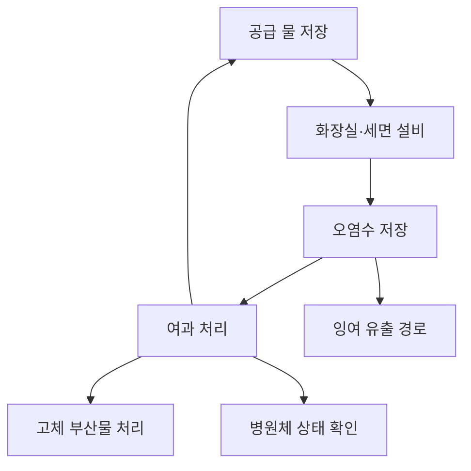

# 07. 액체·배관·위생·물 순환 시스템

[전체 목차](00_README.md)

- 작성 기준: 2026-11-13 / 기본 게임과 공통 액체·배관 규칙 중심
- 표기: **[확인]** 자료 확인, **[해석]** 역기획 분석, **[설계 제안]** 재현용 모델, **[검증 필요]** 대상 빌드 실측 항목
- 원작 소스·실행 빌드의 직접 검증 없이 작성했으며, 예시 수치는 확정 원작 수치표가 아니다.

## 1. 기획 목적

**[해석]** 물은 식수 역할 하나에 묶이지 않는다. 산소 생산, 농업, 위생, 연구, 산업과 냉각을 이어 주는 공통 자원이다. 서로 다른 용도는 같은 물을 요구하더라도 허용 온도·병원체·원소 종류가 다르다. 플레이어는 “물의 총량”과 “각 용도에 사용할 수 있는 물”을 나눠 판단하게 된다.

| 기능 | 물이 하는 역할 | 공급이 끊겼을 때의 2차 영향 |
|---|---|---|
| 위생 | 화장실·손 씻기 설비의 서비스 자원 | 이동 경로·업무시간·오염 경로 변화 |
| 산소 | 전해조 투입물 | 호흡 환경 악화 |
| 농업 | 작물별 관개 자원 | 수확 지연과 식량 부족 |
| 연구 | 연구 설비의 소모 자원 | 후속 기술 진입 지연 |
| 산업 | 공정 원료·열 운반 매체 | 생산 중단, 열 누적 |
| 저장 | 비가동 구간의 완충 | 순간 생산량이 충분해도 휴면기에 고갈 |

수량을 늘리는 결정은 대개 공급 시설·펌프·배관·처리·저장·폐열을 함께 확장해야 완성된다.

## 2. 세 가지 액체 표현

**[해석]** 다음 표현을 같은 것으로 취급하면 운송·회수·질병 설계를 잘못 이해하기 쉽다.

| 표현 | 위치와 이동 | 주요 상호작용 | 별도 상태가 필요한 이유 |
|---|---|---|---|
| 환경 액체 | 셀에서 흐르고 고임 | 침수, 압력, 열교환, 펌프 흡입 | 지형과 용기 형태에 종속 |
| 배관 액체 | 연결된 관의 패킷 | 필터, 밸브, 브리지, 기계 입출력 | 높낮이보다 연결 방향·빈 공간이 중요 |
| 병에 든 액체 | 운반 가능한 오브젝트 | 복제체 운송, 배출·주입 작업 | 노동 시간과 접근성이 필요 |

**[확인: 역사적 관찰]** 배관의 방향성과 환경 유체의 흐름을 구분해야 한다는 설명은 Klei 포럼의 플레이 관찰에서도 확인된다. 이를 현실적 수두압 배관으로 치환할 수는 없다.[^pipes]

펌프는 환경 액체를 배관으로 옮기는 입구 역할을 한다. 이미 배관에 들어간 액체가 모든 구간마다 추가 펌프를 요구하는 것은 아니다. 배관 중간에 고저차가 있다는 이유만으로 현실의 양정 계산을 그대로 적용해서는 안 된다.

## 3. 배관 네트워크의 주요 규칙

### 3.1 포트와 방향

**[해석: 공통 규칙 정리]** 기계의 입력·출력 포트는 액체의 이동 방향을 해석하는 기준점이다. 단순히 관을 인접하게 그린 것만으로 의도한 흐름이 보장되지 않는다. 브리지는 교차 구간을 분리하고 방향을 표현하며, 합류·분기에서는 우선 처리 규칙이 흐름에 영향을 준다.

| 구성 요소 | 플레이어 의도 | 대표 실패 |
|---|---|---|
| 펌프 | 액체를 환경에서 네트워크로 넣음 | 흡입 위치에 원하는 액체가 없음 |
| 배출구 | 액체를 환경으로 돌려보냄 | 주변 압력 또는 공간 때문에 배출 못 함 |
| 필터 | 선택 원소를 분리 | 어느 한 출력이 막혀 전체 흐름 저하 |
| 밸브 | 흐름을 제한 | 공급량을 너무 줄여 수요 설비가 간헐 정지 |
| 차단기 | 자동화 신호로 경로 제어 | 신호는 켜졌지만 전력·출력 공간이 없음 |
| 저장 탱크 | 공급·수요 시차 흡수 | 가득 차서 상류 생산까지 정지 |
| 브리지 | 방향·교차·합류 구조를 표현 | 역방향·순환 경로의 방향 모호성 |

**[검증 필요]** 합류 우선순위, 공평 분배 여부, 한 틱에 이동하는 패킷 수와 최대량은 대상 빌드 실험으로 고정해야 한다. 설계 문서에서 “항상 반씩 나뉜다” 같은 단순화를 규칙으로 확정하지 않는다.

### 3.2 출력 막힘의 역전파

정상 생산은 입력 존재뿐 아니라 제품을 내보낼 여유도 필요하다. 저장이 가득 차면 배관이 차고, 배관이 차면 기계가 정지하며, 위생 시설의 경우 복제체에게 서비스를 제공하지 못한다. 따라서 배관의 끝은 전체 시스템 상태를 결정하는 중요한 지점이다.

### 3.3 패킷과 상변화

배관 안의 원소·질량·온도는 주변 환경과 별도로 유지된다. 냉각·가열로 상이 변하면 해당 관이 담을 수 없는 상태가 되어 손상을 일으킬 수 있다. 오래된 소량 패킷 예외나 비정상 압축 기법은 별도 호환성 테스트 대상으로 남기고 기본 설계에 전제하지 않는다.

## 4. 위생 루프의 역기획

**[해석]** 위생 루프의 가치는 물을 한 번 쓰고 버리는 방식을 반복 사용 구조로 바꾸는 데 있다. 하지만 폐수량이 투입량과 같다는 보장은 없으며, 여과재·부산물·온도·병원체까지 완전 폐쇄 순환으로 해결되는 것도 아니다.

### 4.1 분리해야 하는 세 축

1. **원소 정화:** 오염수를 물로 바꾸는 등 물질 종류의 변환.
2. **병원체 관리:** 처리 후 남아 있는 균의 종류·수량과 전파 경로.
3. **열 관리:** 재사용 가능한 온도인지, 루프가 계속 가열되는지.

이 셋은 독립적인 상태다. “물”이라는 이름과 “병원체 없음”은 동일하지 않고, 저온이라고 무균도 아니다. 여과를 통과한 물을 곧바로 모든 음식·급수 경로에 연결하는 식의 설계는 허용 조건을 먼저 확인해야 한다. 병원체 노출·질병은 [건강 문서](13_health_germs_suits.md)와 함께 검토한다.

### 4.2 화장실 운영은 공간·시간 설계이기도 하다

손 씻기 설비의 배치와 통과 방향, 시설 수, 일정의 동시성, 오수 배출의 여유가 모두 영향을 준다. 인원을 추가했을 때 물 처리량은 충분해도 같은 쉬는 시간에 이용이 몰려 대기열이 생길 수 있다. 위생 동선을 평가할 때 서비스 처리시간과 보행시간을 함께 본다.

### 4.3 잉여 처리의 필요성

**[계산용 가정]** 한 번 이용할 때 투입 `5 kg`, 배출 `10 kg`인 가상 위생 설비와 하루 총 `8회` 이용을 가정하자. 이 값은 계산 설명용이며 원작 시설의 고정값으로 사용하지 않는다.

- 일일 투입: `40 kg`.
- 일일 배출: `80 kg`.
- 정화 손실을 무시한 순증가: `40 kg`.
- 잔여 저장 공간이 `400 kg`이면 약 `10일` 뒤 출력 막힘이 생긴다.

“거의 물이 필요 없는 루프”가 “아무 관리도 필요 없는 루프”가 되지 않는 이유다. 잉여 처리 경로가 농업이라면 작물의 수요 중단도 다시 위생 설비로 역전파될 수 있다.

## 5. 용도별 물의 분류

| 구분 | 확인해야 할 조건 | 권장 판단 방식 |
|---|---|---|
| 생활용수 | 원소, 배관 연결, 시설별 허용 조건 | 중요한 서비스부터 공급 보장 |
| 식품 관련 물 | 병원체와 실제 섭취 경로 | 원소 정화와 소독을 분리 |
| 관개수 | 작물별 원소·온도·공급률 | 작물 중단 시 상류 처리 영향 확인 |
| 산소용 물 | 전해조 입력 조건과 물량 | 고품질 식량용 물과 경쟁 여부 판단 |
| 냉각수 | 비열, 상변화 온도, 전달 경로 | 온도 차 하나보다 장기 열수지 평가 |
| 고온 공정액 | 배관 재질과 설비 허용 온도 | 생산·비상 배출·복구 동선을 함께 설계 |

**[해석]** 좋은 물 관리의 목표는 모든 물을 동일한 최고 품질로 만드는 것이 아니다. 각 소비처의 허용 범위에 맞는 경로를 구성하면 정화·냉각 비용을 줄일 수 있다. 이 원칙은 실제 물리·위생 권고가 아니라 게임 내 자원 운용 분석이다.

## 6. 환경 액체와 지형 안전

채굴은 벽·바닥을 제거해 액체가 이동할 수 있는 경로를 만든다. 그래서 채굴 작업은 자원 획득이면서 동시에 유체 네트워크 편집이다. 대수층을 생활 구역 위에서 열면 물 저장량이 늘기 전에 설비 침수와 통로 차단이 발생할 수 있다.

| 상황 | 즉시 효과 | 숨은 후속 효과 | 기획적 대응 |
|---|---|---|---|
| 저수지 벽 제거 | 액체가 아래로 유입 | 기체 밀려남, 시설 침수 | 우회 통로·배수·격벽 선행 |
| 뜨거운 액체 유입 | 주변 가열 | 농업 중단, 기계 과열 | 산업용 저수지와 생활 구획 분리 |
| 다른 액체 혼입 | 펌프가 혼합 운송 | 입력 불일치 또는 기계 손상 | 분리·반송·비상 저장 |
| 저수량 고갈 | 펌프가 부분 가동 | 위생·산소·농업 동시 부족 | 수요 우선순위와 완충량 설계 |
| 과도한 액체 압력 | 구조물 손상 가능 | 연쇄 누수 | 구조물 종류별 내압 규칙 실측 |

액체의 압력 피해와 기체의 “압력”은 같은 식으로 구현된다고 가정하지 않는다. 특정 재질의 지지 타일·문·기체 투과 타일이 액체 압력에 반응하는 예외도 빌드별 검증 항목으로 남긴다.

## 7. 재현용 시스템 계약

**[설계 제안]** 원작 API가 아닌 요구사항 모델이다.

| 계약 | 내용 |
|---|---|
| 입력 허용 | 설비마다 허용 원소와 소비 조건을 정의 |
| 출력 가능성 | 출력 슬롯·배관·환경의 수용 가능 여부를 구분 |
| 정지 사유 | 원료 부족, 출력 막힘, 전력 부족, 자동화 차단을 동시에 보관 |
| 질량 회계 | 원료 소비·제품 생성·누출·파괴 회수를 별도 기록 |
| 부가 상태 | 온도와 병원체가 이동·혼합·변환되는 규칙을 별도 정의 |
| 해체 | 관 내용물과 건설 자재 반환을 별도 사건으로 처리 |
| 저장 | 원소별 내용량과 액체 패킷 순서를 보존하는 요구사항 검토 |

단순 계산 모델의 처리 순서는 `가능 여부 평가 → 입력 예약 → 작업 → 출력 확정`으로 표현할 수 있다. 원작이 이 순서를 그대로 사용한다는 뜻은 아니다. 중도 전력 차단·작업 취소에서 자원 복제나 소실이 없는지를 시험하기 위한 모델이다.

## 8. 검증 시나리오와 지표

| ID | 실험 | 측정할 것 |
|---|---|---|
| FL-01 | 같은 펌프와 부하에 관 길이·고저차를 변경 | 첫 도달 시간, 정상 유량, 막힘 사유 |
| FL-02 | 필터의 한 출구만 차단 | 나머지 원소가 계속 이동하는 조건 |
| FL-03 | 위생 루프를 장시간 운전 | 입력·폐수·잉여·여과재·부산물 수지 |
| FL-04 | 원소는 정화하되 병원체가 있는 입력 사용 | 원소 변환과 병원체 제거의 독립성 |
| FL-05 | 냉각수 상변화 경계에서 유량과 온도 변경 | 손상·내용물 처리·복구 결과 |
| FL-06 | 같은 인원에서 휴식 일정을 분산 | 시설 대기시간과 서비스 누락 |
| FL-07 | 탱크를 가득 채운 후 잉여 경로 제거 | 상류 정지의 전파와 경보 |

중요 지표는 `용도별 수요 충족률`, `배관 막힘 시간`, `유출량`, `위생 시설 대기시간`, `수온 추세`다. 물 총량 하나만으로 운영 상태를 표시하면 플레이어가 원인을 진단하기 어렵다.

## 9. 버전과 연결

**[확인]** 2026년 11월 공개 테스트 공지는 배관 방향과 막힘을 읽기 쉬운 오버레이 개선을 안내한다.[^novbeta] 본 문서는 공개 테스트 UI를 정식 기본 기능으로 전제하지 않는다.

연결 문서: [대기](06_atmosphere_oxygen.md), [열](08_temperature_phase_change.md), [전력](09_power_networks.md), [자동화](17_automation.md), [간헐천](18_geysers_hazards_renewables.md).

## 10. 근거와 한계

[^pipes]: [Klei 포럼: Suction Piping and Gravity Pumping](https://forums.kleientertainment.com/forums/topic/79436-suction-piping-and-gravity-pumping/). 이용자의 직접 관찰 기반 역사 자료. 원작 엔진 사양 또는 현재 유량 상수로 취급하지 않음.
[^novbeta]: [Klei 공식 761015 공개 테스트 공지](https://kleiforums.com/game-updates/oni-alpha/761015-r2830/page/2/). 2026년 11월 QoL 테스트 내용. 정식 배포 상태 및 최종 UI는 별도 확인 대상.
