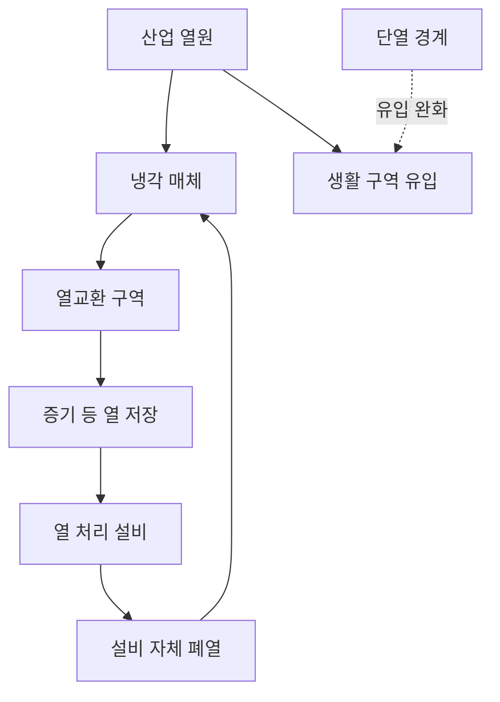

# 08. 온도·열교환·단열·상변화 시스템

[전체 목차](00_README.md)

- 작성 기준: 2026-11-13 / 공통 열 시스템 중심
- 표기: **[확인]** 공개 자료 확인, **[해석]** 기획 분석, **[설계 제안]** 재현용 모델, **[검증 필요]** 대상 빌드 실측 필요
- 실제 소스와 빌드는 제공되지 않았다. 수식은 설계 판단용 열수지이며 원작의 셀별 열교환 알고리즘을 재현했다고 주장하지 않는다.

## 1. 열이 장기 생존 압력이 되는 이유

**[해석]** 산소와 식량은 부족을 비교적 빠르게 알아차리지만 열은 공간에 축적되어 늦게 문제를 일으킨다. 공장 설치 직후 정상처럼 보여도 수십 사이클 뒤 농장·생활 구역·배관에 영향이 나타날 수 있다. 열 시스템은 “지금 작동하는 기지”와 “계속 작동하는 기지”를 구분한다.

| 플레이어가 보는 현상 | 숨어 있는 설계 문제 |
|---|---|
| 작물이 멈춤 | 생활·농업 구역으로 넘어오는 장기 열부하 |
| 기계가 과열됨 | 재질 허용치와 방열 경로의 불일치 |
| 배관이 손상됨 | 내용물의 상변화 경계 침범 |
| 냉각기가 돌아도 주변이 더워짐 | 열을 제거하지 않고 다른 위치로 옮기기만 함 |
| 차가운 지형이 점점 사라짐 | 자연 냉열 저장고를 소모하고 있음 |
| 같은 온도여도 식는 속도가 다름 | 질량·비열·열전도율·접촉 상태 차이 |

열은 고급 장비의 추가 비용인 동시에 발전·상변화 생산의 원료가 된다. 따라서 무조건 없애는 대상보다 위치와 흐름을 통제하는 자원으로 발전한다.

## 2. 상태와 역할의 분리

| 속성 | 의미 | 플레이어 판단 |
|---|---|---|
| 온도 | 물질이나 건물의 현재 열적 상태 | 생물·설비의 허용 범위 안인가 |
| 질량 | 열을 저장하는 물질의 양 | 같은 열이 들어올 때 얼마나 빨리 변하는가 |
| 비열 | 단위 질량의 온도를 바꾸는 데 필요한 양 | 냉각 매체·열 저장고 선택 |
| 열전도율 | 열 이동의 쉬움 | 단열재·방열재·열교환기 선택 |
| 상변화 경계 | 다른 물질 상태로 변하는 조건 | 배관 보호와 생산 공정 설계 |
| 과열 한계 | 설비가 손상을 받기 시작하는 조건 | 건설 재질·냉각 요구 결정 |
| 출력 열 규칙 | 레시피가 열을 전달·생성하는 방식 | 공정별 열수지 계산 |

**[해석]** 온도만으로 열량을 비교하면 안 된다. 적은 양의 고온 기체와 많은 양의 미지근한 액체는 주변에 주는 장기 영향이 다르다. 또한 “열전도율이 높은 재질”과 “높은 온도를 버티는 재질”은 같은 특성이 아니다.

## 3. 열 이동 경로

### 3.1 환경·건물·배관은 별도 접촉 관계

**[해석]** 물질 셀, 건물 본체, 건설 재질, 배관 내용물, 바닥의 잔해는 열을 저장하는 방식과 교환 경로가 다를 수 있다. 재현 모델에서는 “그 칸의 온도 하나”로 모두 통합하지 않는다. 열이 어떤 객체에서 어떤 객체로 이동했는지 추적할 수 있어야 오류와 장비 효과를 설명할 수 있다.

### 3.2 진공은 만능 방열 상태가 아니다

진공은 주변 기체를 통한 교환 경로를 없애지만, 파이프·접촉 구조·특수 설비를 통한 열 이동까지 모두 없애는 것은 아니다. 반대로 기체가 없으면 자체 발열 설비가 열을 내보낼 경로를 잃을 수도 있다.

**[확인]** Hot Shots 공식 업데이트는 진공의 우주 산업 설비를 냉각할 수 있는 수단으로 Conduction Panel을 소개했다.[^hotshots] 이 사실은 “진공이면 모든 열 문제가 해결된다”는 단순 모델이 부적절함을 보여준다.

### 3.3 단열과 냉각의 차이

단열은 열의 유입 속도를 줄인다. 내부에서 열이 계속 발생하면 단열실도 결국 뜨거워질 수 있다. 냉각 매체는 열을 싣고 다른 장소로 옮긴다. 마지막으로 열을 처리하거나 외부로 보내는 단계가 없으면 전체 시스템은 열 저장고의 용량만큼만 버틴다.

## 4. 냉각 공정의 역기획

**[해석: 공통 플레이 규칙 정리]** Thermo Aquatuner와 Thermo Regulator는 처리 대상의 온도를 내리면서 그 열을 기계 본체로 옮기는 장치다. 기계 본체·주변 공간이 견딜 수 있는 환경과 최종 열 처리 경로가 필요하다. 다른 냉각 수단은 열을 이동·흡수·제거하는지 개별 규칙을 구분해야 한다. Steam Turbine을 결합하는 대표적 구성이 있어도 입력 증기의 조건, 출력수 경로, 터빈 자체 냉각, 전력 부하를 모두 만족해야 한다.

| 단계 | 요구사항 | 실패하면 생기는 일 |
|---|---|---|
| 열 수집 | 농장·기계·생활 구역과 매체가 충분히 교환 | 특정 공간만 계속 고온 |
| 운송 | 적절한 유량과 연속 루프 | 냉각 편차, 패킷 정체 |
| 적극 냉각 | 전력, 매체 허용 온도, 센서 | 냉각 중단 또는 동결 |
| 열 저장·회수 | 충분한 질량·공간과 설비 | 과열실 온도 급상승 |
| 최종 처리 | 증기 등 입력 조건과 출력 공간 | 전체 루프가 열 포화 |
| 제어 | 냉각 필요량·온도 안전 여유 | 과냉각, 잦은 토글, 재기동 실패 |

주요 플레이 선택은 냉각재의 “가장 낮은 도달 온도”만이 아니다. 비열·끓는점·어는점·재료 비용·운송 형태·가용 기술을 동시에 고려한다.

## 5. 열수지 계산 예제

**[계산용 가정]** 다음은 원작 엔진 공식이나 특정 냉각재 데이터가 아닌 설명용 모델이다.

`Q = m × c × ΔT`

- `m`: 질량, 여기서는 kg.
- `c`: 단위 질량·온도당 열량, 여기서는 kDTU/(kg·°C).
- `ΔT`: 온도차.
- `Q`: 열량, 여기서는 kDTU.

비열 `4 kDTU/(kg·°C)`인 매체 `1,000 kg`을 `10°C` 가열하려면 약 `40,000 kDTU`가 필요하다. 외부에서 `20 kDTU/s`가 계속 들어오고 열을 내보내지 않으면 약 `2,000초` 만에 그 온도 상승에 도달한다. 현실의 잠열·복사·화학 반응을 포함한 완전한 물리 모델은 아니다.

### 5.1 흐르는 매체

`운송하는 열률 ≈ 질량유량 × 비열 × 입출력 온도차`

가정한 매체가 `5 kg/s`, 비열이 `4`, 입출력 차이가 `10°C`라면 `200 kDTU/s`를 운송한다. 열을 운송할 수 있다는 계산이지 해당 열이 최종적으로 삭제되었다는 뜻은 아니다. 방열 구역도 같은 양을 받아 처리해야 한다.

### 5.2 장기 수지

`누적 열 변화 ≈ 산업 발생 + 외부 유입 - 외부 방출 - 열 처리`

누적량이 양수이면 평균 온도는 장기적으로 오른다. 자연 냉각 지형을 이용할 때는 현재 온도보다 남은 열 저장 능력을 관찰해야 한다. 간헐천 냉각은 분출 순간의 피크와 장기 평균을 함께 고려한다.

## 6. 상변화와 생산

| 활용 | 기획상 이익 | 제어해야 할 조건 |
|---|---|---|
| 얼음·눈 융해 | 물 확보와 냉열 활용 | 융해 위치, 흘러나올 공간 |
| 물의 증발·응축 | 열 이동·수원 처리 | 열원, 포집, 응축 경로 |
| 원유 등 고온 공정 | 기계 레시피와 다른 생산 경로 | 온도 범위, 부산물, 내열 구조 |
| 기체 액화 | 우주 산업용 저장·연료 | 매우 낮은 온도, 단열과 재기동 |
| 금속 용융·응고 | 자연 자원 회수·열 회수 | 설비 내열, 잔해 회수, 복제체 접근 |

**[해석]** 물질이 상태를 바꾸는 순간 새 경로가 열린다. 고체가 액체가 되면 지형 지지 기능과 운송 방식이 바뀌고, 액체가 기체가 되면 부피를 점유하는 방식과 배관 종류가 바뀐다. 그래서 상변화는 시각 효과가 아닌 시스템 간 경계 사건이다.

**[검증 필요]** 각 원소의 전이 온도, 방향별 히스테리시스, 전환 비율, 제품 온도 규칙, 소량 패킷 예외는 인게임 DB와 실험으로 확정해야 한다. 현실의 잠열·밀도·이상기체 법칙을 그대로 적용했다고 단정하지 않는다.

## 7. 위험 연쇄와 대응 설계

| 시작 사건 | 연쇄 영향 | 조기 관측 | 대응 원칙 |
|---|---|---|---|
| 금속 정련 시작 | 냉각수 가열 → 배관 파손 → 공장 정지 | 냉각수 입출력 온도 | 레시피별 열량과 안전 여유 설정 |
| 농장 옆 발전기 증설 | 토양 가열 → 작물 정지 → 식량 감소 | 농장 온도 추세 | 열원 구획·완충·냉각 경로 분리 |
| 외부 열원은 계속 작동하고 냉각·방열만 정지 | 열 누적 → 설비 과열·손상 | 남아 있는 열원·배터리·순환 유량 | 열원 차단 또는 필수 냉각 전력 확보 |
| 센서 오설정 | 과냉각 → 동결 → 루프 단절 | 매체의 상변화 여유 | 제어 기준을 실제 패킷 위치와 연결 |
| 열원 휴지 후 재가동 | 차가운 구간에 고온물 집중 | 경계 구간 최대 온도 | 시작 과도상태까지 검증 |

설비가 고장 나기 전에 작물·복제체의 허용 범위가 먼저 깨질 수 있다. 기계의 과열 경보 하나만으로 열 안전을 대표하면 안 된다.

## 8. 재현용 데이터·관측 설계

**[설계 제안]** 다음 모델은 원작 내부 구조를 추정해 단정한 것이 아니다.

| 데이터 | 핵심 필드 |
|---|---|
| `ThermalBody` | 질량, 비열, 온도, 접촉 범주 |
| `ThermalContact` | 연결된 두 대상, 재질·접촉 조건, 교환 제한 |
| `PhaseRule` | 출발 원소, 경계, 도착 원소, 비율·온도 규칙 |
| `ThermalMachineSpec` | 처리 대상, 전력, 본체 발열, 제품 열 규칙 |
| `ThermalBudget` | 공급원별 열 유입, 처리량, 누적 추세 |

온도 오버레이에 더해 “열이 유입되는 원인”을 설명할 수 있으면 플레이어가 설비 교체와 구획 변경 중 무엇을 해야 할지 판단하기 쉽다. 평균값뿐 아니라 최대값·변화율·상변화까지 남은 여유를 기록한다.

## 9. 검증 시나리오

| ID | 조작 | 기대되는 확인 |
|---|---|---|
| HT-01 | 같은 온도에서 질량만 다른 두 저장고 가열 | 온도 상승 속도와 열량 차이 |
| HT-02 | 같은 질량에서 재질·비열만 변경 | 저장 능력과 교환 속도의 분리 |
| HT-03 | 냉각 장치만 가동하고 최종 방열을 제거 | 국소 냉각과 전체 열 누적의 동시 발생 |
| HT-04 | 배관을 어는점·끓는점 근처로 운전 | 상변화·손상·복구 처리 |
| HT-05 | 진공·극소 질량 기체·보통 기체 비교 | 접촉 경로별 차이 |
| HT-06 | 고온 설비를 일시 정지 후 재기동 | 순간 온도 피크와 제어 안정성 |
| HT-07 | 저장·불러오기 전후 동일 조건 유지 | 열 상태·상변화·센서 상태의 연속성 |

## 10. 버전 가드와 근거

**[확인]** 2026-03-31 패치는 열교환·미소 질량·진공 열린 문 처리를 수정했다.[^march] 과거 열 관련 특수 설계는 현재 빌드에서 재검증한다.

연결 문서: [산소](06_atmosphere_oxygen.md), [액체](07_liquids_plumbing_sanitation.md), [전력](09_power_networks.md), [산업](10_materials_industry.md), [간헐천](18_geysers_hazards_renewables.md).

[^hotshots]: [공식 Steam 공지 — Game Update 535720, Hot Shots, 2022-12-15](https://store.steampowered.com/news/posts/?appids=457140&enddate=1686352137&feed=steam_community_announcements). Conduction Panel의 진공 설비 냉각 용도 확인. 페이지 내 해당 제목으로 식별.
[^march]: [공식 Steam 공지 — March 2026 Bug Fix Update, 2026-03-31](https://steamcommunity.com/app/457140/announcements/). 상세 신규 수식은 제시하지 않음.
