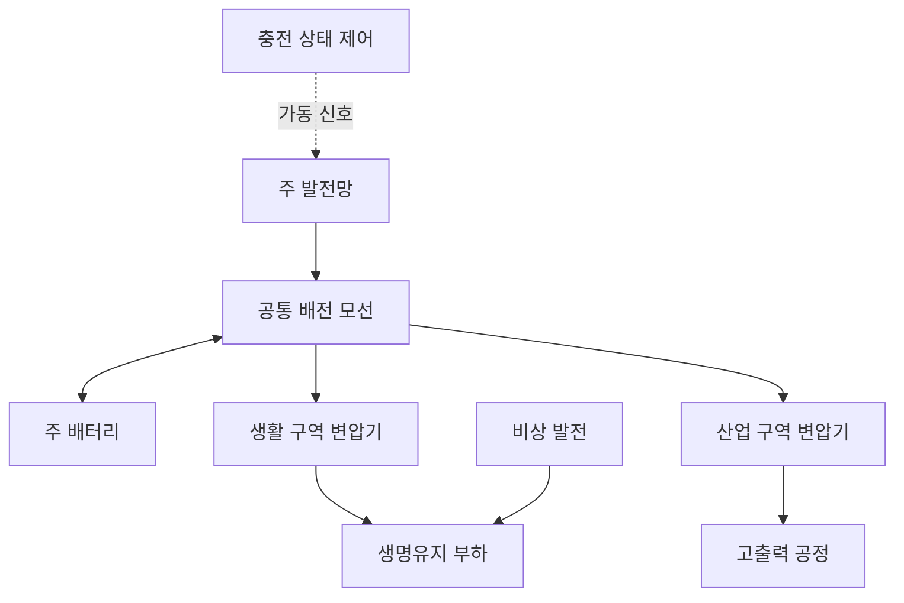

# 09. 발전·배전·배터리·전력 부하 시스템

[전체 목차](00_README.md)

- 작성 기준: 2026-11-13 / 공통 전력 규칙과 DLC 차이 표시
- 표기: **[확인]** 공개 자료 확인, **[해석]** 역기획 분석, **[설계 제안]** 재현 모델, **[검증 필요]** 빌드별 실측 항목
- 전선 종류별 전체 용량·발전기 효율 표는 대상 빌드가 정해지기 전에는 확정하지 않는다. 본 문서의 수치 예제는 계산용 가정이다.

## 1. 목적: 노동에서 산업 인프라로 넘어가는 관문

**[해석]** 초기 전력은 복제체의 시간을 기계 가동으로 바꾸는 수단이다. 이후 연료·물·폐열·배선을 관리하는 네트워크로 발전한다. 발전기를 추가하면 출력뿐 아니라 연료 보급·부산물·냉각·배선 용량 문제도 커진다.

| 단계 | 전력의 주된 제약 | 플레이어가 배우는 것 |
|---|---|---|
| 초기 수동 발전 | 복제체 노동 | 산소·연구·채굴 사이의 시간 배분 |
| 연료 발전 | 연료와 운반 | 물류와 발전을 함께 유지해야 함 |
| 자동 제어 | 배터리와 신호 | 필요한 만큼만 생산하기 |
| 산업 배전 | 회로 용량과 순간 부하 | 총발전량과 안전 배전은 별개 |
| 장기 운영 | 재생 자원·냉각·휴면기 | 평균 수지와 완충을 동시에 설계 |
| 우주·DLC 확장 | 환경 조건과 지역 자립 | 본거지와 떨어진 거점의 독립 운전 |

## 2. 기본 단위와 오해하기 쉬운 구분

| 항목 | 단위·의미 | 기획적 용도 |
|---|---|---|
| 전력 | W, J/s | 현재 생산·소비 속도 |
| 저장 에너지 | J | 공급이 끊겼을 때 버티는 양 |
| 발전 능력 | 가동 조건 충족 시 출력 | 연료·온도·운전률에 따라 유효량 달라짐 |
| 회로 허용량 | 배선 구성의 제한 | 특정 구간·네트워크의 안전 조건 |
| 연결 부하 | 설비가 모두 켜질 때의 잠재 수요 | 최악 동시 가동 계산 |
| 실제 부하 | 현재 작동하는 소비 합계 | 현재 공급·과부하 판단 |
| 변압기 용량 | 다른 회로에 전달 가능한 한도 | 공급망 분리와 부하 제한 |

**[해석]** 배터리를 늘리면 저장량은 늘지만 지속 발전 능력이 늘지는 않는다. 반대로 발전기가 많아도 허용량이 낮은 회로를 통해 많은 부하를 공급하려 하면 배선 문제가 생긴다. 멈춰 있는 기계의 잠재 부하와 실제 소비량도 구분해야 한다.

## 3. 주요 발전 경로의 기능

| 경로 | 입력·조건 | 운영 비용 | 설계상 장점과 제약 |
|---|---|---|---|
| 수동 발전 | 복제체 작업 | 인력·이동·일정 | 연료망 없이 시작 가능, 확장 비용이 노동에 집중 |
| 석탄 발전 | 석탄 | 운반·부산물·열 | 사용이 쉽지만 재고 관리 필요 |
| 수소 발전 | 적합한 수소 공급 | 분리·배관·저장 | 산소 생산 부산물과 결합 가능 |
| 천연가스 발전 | 천연가스 | 간헐천 주기·배관·부산물 | 휴면기 저장이 중요 |
| 석유 계열 발전 | 연료 생산망 | 원료·정제·열·배출 | 큰 산업 체계와 함께 성장 |
| 증기 터빈 | 적합한 증기와 방열 조건 | 설비 자체 냉각·출력수 경로 | 열 처리를 전력과 결합 |
| 태양광 | 노출·광량·배치 | 표면 환경 관리·야간 완충 | 연료 물류를 줄이고 시간 변동을 도입 |
| 원자로 연계 | Spaced Out! 기술·연료·냉각 | 방사선·폐기물·대형 열 관리 | 별도 고난도 산업 체계 |

**[확인]** 공식 Oil Upgrade는 원유·석유·플라스틱과 석유 발전의 연결을 소개했다.[^oil] 전력 설계는 개별 발전기보다 이와 같은 입력·부산물 체계까지 포함해야 한다.

## 4. 배전 구조와 회로 경계



**[해석]** 배터리는 공통 모선에 병렬로 연결되는 저장 장치이며, 발전 전력이 반드시 배터리를 거쳐야 하는 것은 아니다. 회로를 분리하는 이유는 부하 종류와 고장 영향을 분리하기 위해서다. 산소 펌프와 대형 정련기를 같은 조건으로 껐다 켜면 공장 가동이 생명유지에 영향을 줄 수 있다.

### 4.1 변압기는 무한 전력 공급기가 아니다

상류의 공급, 자체 전달 한도, 하류의 부하가 모두 맞아야 한다. 같은 하류에 여러 변압기를 병렬로 연결하거나 하류에 배터리·발전기를 더하면, 변압기 하나의 한도만으로 하류 회로의 총 공급을 안전하게 제한한다고 볼 수 없다.

### 4.2 가장 약한 구성 요소

전선과 연결 부품이 혼재하면 용량을 낮추는 구성 요소가 남아 있을 수 있다. 외관상 대부분을 고급 전선으로 교체해도 일부 저용량 구간이나 연결 부품을 놓치면 안전하지 않다. 회로 검사 UI가 실제 연결된 구성 전체를 평가하는지가 중요하다.

### 4.3 최신 전선 구성

**[확인]** 2026-06-11 공식 무료 업데이트는 4k 전선을 추가했다고 알렸다.[^aquatic] 따라서 과거 공략의 전선 용량 목록을 현행 전체 목록으로 재사용하지 않는다. **[검증 필요]** 해당 빌드의 정확 건물명·재료·열 특성·연구 해금은 인게임 DB로 확정한다.

## 5. 배터리와 자동 발전 제어

**[해석]** 배터리는 시간차를 흡수하지만 보관 손실과 열, 건설 비용을 가질 수 있다. 발전기가 배터리 충전을 보고 자동으로 멈추는지, 연료 보급 작업만 달라지는지, 별도 자동화 신호가 필요한지를 구분해야 한다.

### 5.1 충전량 히스테리시스

Smart Battery를 이용한 전형적 제어는 낮은 충전율에서 발전을 시작하고 높은 충전율에 도달하면 정지하는 방식이다. 중간 구간에서는 직전 상태를 유지한다. 이 개념은 역사적 플레이 설명에서도 확인된다.[^battery]

**[설계 제안]** 원작 코드가 아닌 요구사항 표현:

```text
충전율이 하한 이하이면 발전 요청 = 켜짐
충전율이 상한 이상이면 발전 요청 = 꺼짐
그 사이이면 이전 요청을 유지
```

하한·상한을 같은 값에 가깝게 두면 짧은 간격으로 상태가 바뀔 수 있다. 일시적인 펌프 부하와 전력 부족 경보가 반복된다면 발전기 수만이 아니라 제어 폭도 검토한다.

### 5.2 우선 발전원과 비상 발전원

저장 여유가 있을 때는 처리하지 않으면 버려지는 자원이나 열을 우선 이용하고, 부족할 때 예비 연료를 사용하도록 구성할 수 있다. 이때 각 발전원의 연료 보급·출력 막힘·기동 조건이 다르므로 배터리 임계값만으로 모든 상황이 해결되지는 않는다.

## 6. 계산 예제: 평균은 충분하지만 피크에서 실패

**[계산용 가정]** 발전 능력 `2,000 W`, 기본 생활 부하 `800 W`, 공정 A `1,200 W`, 공정 B `900 W`, 저장량 `60,000 J`인 가상 구성을 가정한다.

| 가동 상태 | 실제 부하 | 발전 대비 결과 |
|---|---:|---|
| 생활만 | 800 W | 여유 1,200 W |
| 생활 + A | 2,000 W | 여유 없음 |
| 생활 + B | 1,700 W | 여유 300 W |
| 생활 + A + B | 2,900 W | 900 W 부족 |

완충 배터리가 가득 차 있고 모든 에너지를 사용할 수 있다고 단순화하면, 마지막 상태를 `60,000/900 ≈ 66.7초` 버틴다. 저장 손실과 제어·연료 지연을 포함하면 실제 여유는 더 작을 수 있다. 또한 회로 허용량이 `2,000 W`라면 충분한 배터리가 있어도 `2,900 W` 부하를 안전하게 배전하는 문제가 남는다.

장기 수지는 다음처럼 별도로 계산한다.

`평균 잉여 전력 = 시간평균 발전 - 시간평균 소비 - 저장 등 손실`

양수여도 짧은 순간의 정전은 가능하다. 그래서 평균·최대 동시 부하·배터리 잔량·최대 부족 지속시간을 함께 기록한다.

## 7. 정전의 연쇄 영향과 복구

| 시작 | 연쇄 | 복구가 어려워지는 이유 |
|---|---|---|
| 연료 운반 지연 | 발전 중단 → 산소 펌프 중단 | 호흡 이동으로 운반이 더 늦어짐 |
| 냉각 전원 차단 | 설비 과열 → 발전 손상 | 전력 복구만으로 손상이 해소되지 않음 |
| 연료 생산 공장 중단 | 저장 연료 고갈 → 발전 중단 | 연료 공장을 재가동할 외부 전력이 필요 |
| 배출구 막힘 | 발전기 정지 | 원인이 전력 화면 밖 배관에 있음 |
| 산업 동시 가동 | 배터리 소진·과부하 | 핵심 부하와 선택 부하를 구분하지 않음 |

**[해석]** 블랙스타트, 즉 완전 정지 이후 다시 켜는 경로가 운영 설계에 포함되어야 한다. 수동 발전이나 예비 연료가 정상 운전의 효율을 높이지 않더라도 복구 가능성을 크게 높일 수 있다.

## 8. 재현용 데이터·UI 요구사항

**[설계 제안]** 실제 원작 클래스명·스케줄러 구조를 뜻하지 않는다.

| 구성 | 필수 데이터 |
|---|---|
| 발전원 | 가동 조건, 출력, 연료, 부산물, 발열, 제어 신호 |
| 소비 설비 | 현재 요구량, 대기·작업 상태, 전력 부족 반응 |
| 저장 장치 | 에너지, 용량, 손실, 제어 임계값 |
| 네트워크 | 연결 구성, 공급·소비 합계, 제한 요소 |
| 변압기 | 입력 회로, 출력 회로, 전달 한도 |
| 경보 | 실제 부족, 잠재 과부하, 연료 소진 예상, 복구 경로 |

화면은 “전력이 부족함”이라는 결과 외에 상류 발전·배선·변압기·부하 중 어느 조건이 부족한지 보여줘야 한다. 정상으로 보이는 평균 그래프 속 순간 피크도 확인할 수 있어야 한다.

## 9. 검증 시나리오

| ID | 조건과 조작 | 관측 |
|---|---|---|
| PW-01 | 설비 연결 수는 같고 동시 가동 수만 변경 | 연결 부하와 실제 부하 구분 |
| PW-02 | 고용량 회로에 낮은 용량 부품 하나 추가 | 제한 부품 탐지와 손상 위치 |
| PW-03 | 하류 배터리 유무·변압기 병렬 수 변경 | 실제 하류 공급과 과부하 |
| PW-04 | 배터리 완전 소진 후 연료망 복구 | 외부 도움 없이 재기동 가능한 조건 |
| PW-05 | 같은 생산량에서 발전기 제어 임계값 변경 | 연료 소비와 가동 주기 |
| PW-06 | 발전기의 부산물 출력만 차단 | 전력 경보가 배관 원인을 설명하는지 |
| PW-07 | 필수 부하와 공정을 회로 분리 | 산업 장애가 생활 서비스에 전파되는 범위 |

연결: [산소](06_atmosphere_oxygen.md), [열](08_temperature_phase_change.md), [산업](10_materials_industry.md), [자동화](17_automation.md), [간헐천](18_geysers_hazards_renewables.md).

## 10. 근거

[^oil]: [공식 Oil Upgrade 발표](https://store.steampowered.com/news/posts/?appids=457140&enddate=1510271099). 2017-10-05 게시글. 현재 수치표가 아닌 생산 체계 도입 근거.
[^aquatic]: [공식 Aquatic 출시·무료 업데이트 공지, 2026-06-11](https://steamcommunity.com/games/457140/announcements/detail/686381746058429913).
[^battery]: [Klei 포럼: Automation and Smart Battery Help](https://kleiforums.com/forums/topic/87794-automation-and-smart-battery-help/). 2018년 이용자의 작동 관찰. 히스테리시스 설명만 사용하며 과거 손실 수치는 옮기지 않음.
