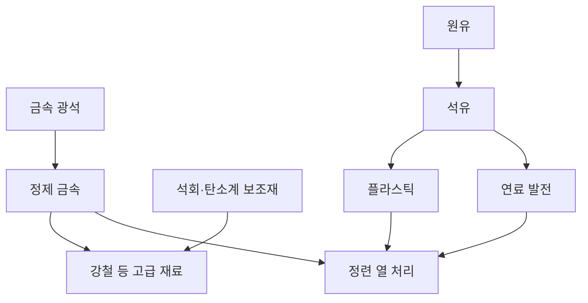

# 10. 재료·정제·산업 레시피·부산물 시스템

[전체 목차](00_README.md)

- 작성 기준: 2026-11-13 / 기본 게임 산업 중심, DLC 경로는 명시
- 표기: **[확인]** 공개 자료 확인, **[해석]** 역기획 분석, **[설계 제안]** 재현용 구조, **[검증 필요]** 실제 빌드로 확정할 항목
- 원작 레시피 DB나 소스코드를 추출하지 않았다. 정량 레시피·설비 수치는 대상 버전의 DB를 통해 보완해야 한다.

## 1. 목적: 자원 수량에서 자원 성질로 의사결정 확장

**[해석]** 초기에는 건물을 지을 만큼 원료가 있느냐가 중요하다. 산업 단계에서는 같은 건물을 어떤 재질로 만들 것인지, 고급 재료를 만들기 위해 어떤 열·노동·전력 비용을 감수할 것인지가 중요해진다.

산업은 기술 트리에서 해금된 건물을 실제로 만들 수 있게 하는 두 번째 진행 조건이다. 연구를 완료해도 정제 금속·플라스틱·내열 재료를 공급하지 못하면 다음 단계로 넘어갈 수 없다.

| 관점 | 질문 | 플레이 결정 |
|---|---|---|
| 수량 | 필요한 자재가 있는가 | 채굴·회수·생산량 확장 |
| 성질 | 사용 환경에 맞는가 | 단열·방열·내열 재질 선택 |
| 생산망 | 무엇을 소모하는가 | 원료·연료·냉각수의 경쟁 조정 |
| 부산물 | 어디에 쌓이거나 방출되는가 | 회수·저장·재사용·외부 처리 |
| 운영 | 누가 얼마나 자주 작업하는가 | 인력·우선순위·자동 운송 |
| 지속성 | 천연 재고 이후에도 유지되는가 | 생태·간헐천·우주 자원 연결 |

## 2. 주요 재료군과 역할

| 재료군 | 대표 기능 | 설계상 선택 기준 |
|---|---|---|
| 원석·광물 | 타일·건물·기초 구조 | 가용량, 열 특성, 용도별 제한 |
| 금속 광석 | 초기 전선·기계 | 고급 정제의 입력과 초기 건설 수요 경쟁 |
| 정제 금속 | 전력·자동화·산업 설비 | 확보 경로, 생산 손실, 열 처리 |
| 강철 등 고온용 재료 | 높은 온도의 설비 운용 | 여러 입력 자원의 조합과 정련 부담 |
| 세라믹 등 단열 재료 | 열 구획 | 원료·연료를 단열 성능으로 전환 |
| 유리 | 광학·태양광 등 | 고온 제품 취급과 건설 공급 |
| 플라스틱 | 고급 이동·생활·산업 장비 | 석유 산업 또는 생태 경로 선택 |
| 고급 우주 재료 | 특수 열·성능 역할 | 장거리 자원 획득과 가공 |
| DLC 추가 자원 | 새로운 레시피와 대체 경로 | 활성 DLC와 월드 생성 조건 |

**[해석]** 이 목록은 모든 원소·재료의 열람표가 아니다. 재료의 역할과 생산 의존 관계를 설명하기 위한 분류다. 한국어 이름은 번역 버전에 따라 달라질 수 있으므로 필요한 경우 영문 인게임 이름으로 식별한다.

## 3. 대표 산업 사슬

**[확인]** 공식 Oil Upgrade 발표는 원유에서 석유·플라스틱·발전으로 이어지는 생산망을 소개했다.[^oil] 이 기본 연결은 개별 설비를 나열하는 것보다 진행 구조를 설명하는 데 유용하다.

### 3.1 금속 정제

**[해석: 공통 플레이 규칙 정리]** 초기 분쇄 방식과 본격적인 정련 방식은 수율·부산물·전력·작업·열처리 비용이 다르다. 더 높은 수율의 공정이 항상 즉시 최적은 아니다. 냉각 기반이 없는 기지에서는 초기 방식이 위험을 줄이며 필요한 소량의 정제 금속을 제공할 수 있다.

금속 정련은 원료를 제품으로 바꾸는 동시에 냉각 매체에 부담을 준다. 같은 냉각수와 같은 설비라도 레시피에 따라 열부하가 달라질 수 있으므로 기계 단위의 고정 발열값 하나로 전체 공정을 설명하면 부족하다.

### 3.2 강철과 보조 자원

강철 계열 생산을 예로 들면 주재료 금속 외에도 탄소계 재료와 석회 같은 보조 입력이 필요하다. 따라서 주광석이 풍부해도 다른 입력에서 병목이 생긴다. 생물의 알껍데기·화석·탈피 부산물처럼 다른 시스템에서 들어오는 자원을 추적하면 식량·사육이 산업 성장과 연결된다. 정확 조합과 수량은 실제 레시피로 확정한다.

### 3.3 플라스틱의 복수 경로

석유 기반 공장 경로는 액체·전력·열 인프라를 요구한다. 생물의 생산물을 이용하는 경로는 먹이·환경·사육 노동과 개체 유지 조건을 요구한다. 같은 최종 재료를 얻더라도 다른 시스템에 비용을 배분한다는 점이 핵심이다. 특정 DLC 전용 생물·레시피를 기본 게임의 대안으로 잘못 넣지 않는다.

## 4. 레시피 하나의 완전한 계약

**[설계 제안]** 다음은 원작 코드를 추정한 클래스가 아닌 역기획용 레시피 명세다.

| 구분 | 필수 항목 | 빠뜨리면 생기는 문제 |
|---|---|---|
| 자격 | 연구·건물·작업자 능력 | 해금만 하면 생산 가능하다고 착각 |
| 입력 | 원소·수량·형태·허용 상태 | 병과 배관, 광석과 정제 금속 혼동 |
| 작업 | 소요 시간·작업자 필요·전력 | 노동과 설비 가동률 계산 오류 |
| 열 | 본체 발열·냉각수 전달·제품 온도 | 냉각 설비 과소 산정 |
| 출력 | 주제품·부산물·배출 형태·위치·정지 조건 | 배관 막힘과 바닥 제품 적치를 혼동 |
| 재고 | 입력·제품 저장 한도 | 무한 생산·무한 저장 가정 |
| 중단 | 전력·입력·출력·과열·수동 정지 | 중간 상태에서 자원 손실·중복 |
| 회수 | 해체·취소 시 반환 | 자원 회계 불일치 |

레시피의 출력은 고체 제품뿐 아니라 뜨거워진 냉각수·배출 기체·주변 열까지 포함한다. 이들을 표에 담아야 “이 공정을 기지 안에서 돌려도 되는가?”를 검토할 수 있다.

## 5. 생산 능력과 실제 처리량

**[해석]** 생산량은 레시피의 완료 시간만으로 결정되지 않는다.

`실제 처리량 = 명목 처리량 × 운영 가동률`

가동률을 낮추는 원인은 입력 운반, 작업자 도착, 장비 점유, 전력, 냉각, 출력 수용 제한, 자동화 차단 등이다. 어떤 요인이 병목인지에 따라 해결책이 다르다.

**배출 형태를 구분해야 한다.** 배관 출력이나 용량이 제한된 내부 저장은 수용 여유가 없어 생산을 막을 수 있다. 반면 고체 제품을 바닥에 배출하는 설비는 제품을 수거하지 않았다는 이유만으로 보편적으로 정지하지 않는다. 바닥 적치는 잔해·열·장식·후속 운반의 문제로 별도 평가하며, 정지 조건은 설비별로 확인한다.

| 병목 | 잘못 고르기 쉬운 해결책 | 실제로 먼저 볼 항목 |
|---|---|---|
| 작업자 이동 | 설비 추가 | 작업자 우선순위·동선·가까운 입력 저장 |
| 냉각 포화 | 작업자 추가 | 열 교환과 최종 열 처리 |
| 특정 보조재 부족 | 주광석 추가 채굴 | 하위 레시피와 생태 부산물 |
| 배관·내부 저장형 출력 포화 | 입력 증가 | 출력 경로·수용량·소비처 |
| 순간 전력 부족 | 배터리만 증설 | 동시 부하·회로·장기 발전량 |

### 계산 예제

**[계산용 가정]** 한 번에 제품 `100 kg`, 작업 `40초`, 작업 후 공급·이동 대기 `20초`인 공정을 가정한다.

- 이상적 처리량: `100/40 = 2.5 kg/s`.
- 실제 반복 처리량: `100/(40+20) ≈ 1.67 kg/s`.
- 대기를 `5초`로 줄이면 `100/45 ≈ 2.22 kg/s`.

이 경우 설비를 추가하지 않고 물류를 개선해 처리량을 약 33% 높일 수 있다. 실제 게임 값이 아니라 생산 병목을 분석하는 계산 예다.

## 6. 생산 명령과 재고 정책

**[해석]** 생산 명령은 “레시피 선택”뿐 아니라 얼마를 언제까지 생산할지의 정책이다. 무제한 생산은 희소 원료를 바닥내거나 냉각·저장 용량을 넘길 수 있다. 고급 자재 수요가 불연속적이면 일정량 비축 후 멈추는 방식이 적합할 수 있다.

| 정책 | 장점 | 위험 |
|---|---|---|
| 지정 횟수 | 자원 사용량 예측 가능 | 이후 수요에 대응하려면 다시 명령 필요 |
| 지속 생산 | 반복 관리 감소 | 원료 소진·제품 적체·열 누적 |
| 목표 재고 | 건설 수요와 공급 연결 | 측정 범위·중복 저장·사용 중 재고 해석 필요 |
| 조건부 생산 | 전력·온도·재고에 맞춤 | 센서·우선순위 오류가 복잡해짐 |

재현 기획에서 현재 원작 UI가 지원하는 기능과 개선 제안을 구분해야 한다. 목표 재고 제어를 설명하더라도 모든 원작 건물에 동일한 전용 UI가 있다고 가정하지 않는다. 필요한 경우 센서·자동화·운영 절차로 구현되는 정책이다.

## 7. 부산물 중심의 시스템 결합

**[해석]** 한 공정의 비용을 다른 공정의 입력으로 이용하면 운영 효율이 좋아진다. 그러나 모든 부산물 재사용은 추가 의존성을 만든다.

- 산소 생산의 수소를 발전에 쓰면 물 공급과 전력망이 연결된다.
- 위생 폐수를 다른 용도로 돌리면 생활 서비스와 소비처의 가동 상태가 연결된다.
- 정련 열을 발전에 쓰면 냉각의 안정성과 증기 처리 조건이 연결된다.
- 생물 부산물을 산업 보조재로 쓰면 먹이·개체수·작업 조건이 건설 재료 공급에 영향을 준다.

이때 “부산물이 공짜”라고 계산하지 않는다. 포집·분리·보관·운송·가열·냉각·복구 비용이 남는다. 부산물을 먹는 후속 공정이 멈췄을 때 상류가 계속 작동할 완충 경로도 필요하다.

## 8. 실패 사례

| 실패 | 원인 구조 | 조기 경보 | 회복 방향 |
|---|---|---|---|
| 첫 정련 후 배관 파손 | 매체가 레시피 열을 감당 못 함 | 제품별 출구 온도 | 더 적합한 매체·열교환·작업 제한 |
| 고급 자재 생산 중단 | 보조 원료 고갈 | 각 입력의 소진 예상 시간 | 대체 획득·재고 최소량 |
| 공장이 생활권 가열 | 단열·열처리 누락 | 주변 농장 온도 추세 | 산업 구역 분리 |
| 원료가 있는데 생산 안 함 | 접근·작업자·포트 조건 미충족 | 정지 사유별 대기 시간 | 실제 병목 해소 |
| 한도가 있는 출력의 포화 | 무제한 명령과 배관·내부 저장의 수용량 부족 | 출력 점유·누적 증가 | 생산 제한·운송·소비처 확보 |

## 9. 재현용 데이터와 검증 시나리오

**[설계 제안]** `MaterialSpec`, `RecipeSpec`, `ProductionOrder`, `ProcessState`, `ByproductRoute`를 별도 개념으로 두면 재료의 성질과 제조법을 분리할 수 있다. 동일 제품을 여러 경로로 만들 때도 제품 정보를 복제하지 않고 레시피만 늘리는 구조다.

| ID | 실험 | 확인할 것 |
|---|---|---|
| IN-01 | 같은 레시피를 수동 운반·자동 운반으로 비교 | 대기와 실제 작업 시간 |
| IN-02 | 배관 출력 또는 용량 제한 내부 저장형 설비에서 제품 회수를 중단 | 해당 설비의 출력 막힘 조건과 정지 시점 |
| IN-03 | 생산 도중 전력·작업을 취소 | 예약 입력·완성품·미완성 상태의 회계 |
| IN-04 | 같은 냉각 매체로 서로 다른 금속 정련 | 레시피별 열부하 |
| IN-05 | 주원료는 충분히 두고 보조재만 제한 | UI가 실제 부족 원료를 설명하는지 |
| IN-06 | 대체 생산 경로를 동일 목표량으로 운전 | 원료·노동·전력·열·공간의 총비용 |
| IN-07 | 입력 재고와 한도가 있는 부산물 저장을 각각 포화 | 장애가 상류·하류로 전파되는 순서 |
| IN-08 | 고체 바닥 배출형 설비의 제품을 수거하지 않음 | 단순 적치와 실제 정지 조건을 구분하고 열·장식·운반 영향 기록 |

## 10. 연결·출처·확정할 항목

연결: [열](08_temperature_phase_change.md), [전력](09_power_networks.md), [사육](12_ranching_ecosystems.md), [물류](16_logistics_storage_conveyors.md), [간헐천](18_geysers_hazards_renewables.md).

**[검증 필요]** 레시피 수율, 냉각수 최소량, 제품 온도 하한, 작업자 능력 보정, 손상·해체 반환량, DLC별 재료 해금과 대체 입력 허용 범위. 이 표를 게임 DB 전수 데이터처럼 사용할 수는 없다.

[^oil]: [공식 Oil Upgrade 발표, 2017-10-05](https://store.steampowered.com/news/posts/?appids=457140&enddate=1510271099). 원유·석유·플라스틱·발전 연결의 1차 근거. 오래된 밸런스 수치를 현행값으로 복사하지 않음.
