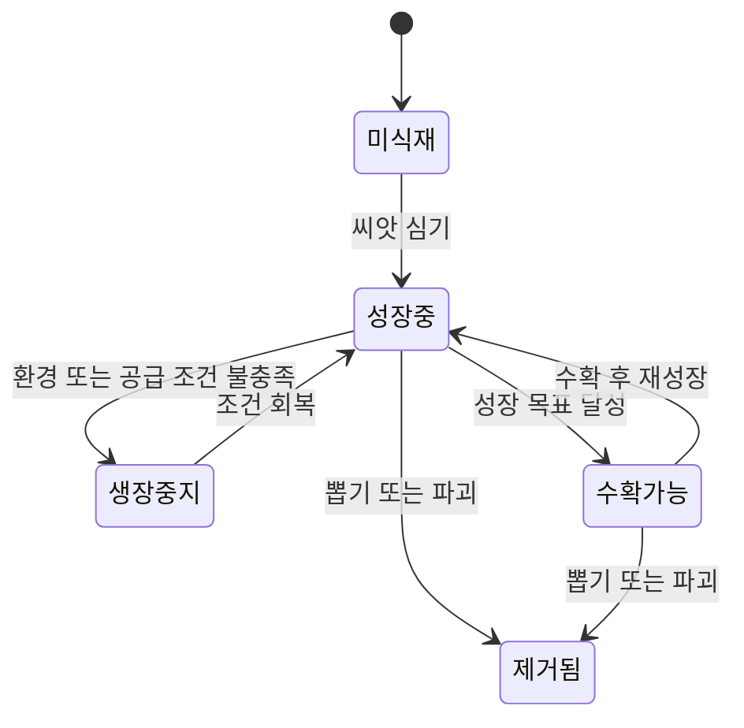

# 11. 식량·농업·조리·보존 시스템 역기획

> 기준일: 2026-11-13 · 범위: 기본 게임의 유기체 복제체, 공통 농업·조리 규칙. 돌연변이는 Spaced Out! 확장 규칙이다.  
> [목차](00_README.md) · [축산](12_ranching_ecosystems.md) · [열](08_temperature_phase_change.md) · [사기](14_morale_stress_decor.md)

## 1. 시스템의 목적과 판정 범위

**[해석] 식량은 인구를 제한하는 소모품이면서, 식민지의 열·물·노동·물류 상태를 뒤늦게 드러내는 종합 지표다.** 현재 보유한 kcal만으로 생산의 안정성을 판단할 수 없다. 수확 직후에는 저장량이 높아도 다음 수확 전에 온도 이탈, 관수 단절, 요리사 부재가 발생하면 굶주림으로 이어진다. 따라서 이 시스템을 `생산 → 가공 → 보존 → 배식 → 섭취`의 다섯 단계로 나눠 분석한다.

**[확인]** 농업의 핵심 조건에는 환경, 관수, 비료 공급이 포함되며 생산물은 조리 계통으로 연결된다. 초기 공식 농업·직업 업데이트는 이 연결을 도입했다. 다만 당시의 Harvest Rating이나 Jobs Board 같은 옛 기능을 현행 규칙으로 재사용하지 않는다.[^F1][^F2]

이 문서의 계산식과 데이터 구조는 **[설계 제안]** 이다. 게임을 실행해 상수를 추출한 문서가 아니므로, 작물별 정확한 온도·압력·성장 시간·열량·소비량을 확정 데이터베이스로 제시하지 않는다.

## 2. 플레이어가 내리는 결정

| 결정 | 즉시 얻는 이점 | 새로 생기는 운영 부담 |
|---|---|---|
| 자연 식량을 채집한다 | 시설 투자 없이 초반 열량 확보 | 매장량이 유한하고 이동 거리가 길어진다 |
| 야생 식물을 보존한다 | 외부 투입을 적게 쓰는 수확원 확보 | 성장 속도와 배치 통제에 제약이 있다 |
| 재배 면적을 늘린다 | 생산량과 수확 시점 관리가 쉬워진다 | 비료·관수·수확 노동과 온도 관리가 필요하다 |
| 더 좋은 요리로 전환한다 | 음식 품질을 통한 사기 개선 | 복합 재료, 연료, 전력, 조리 노동이 추가된다 |
| 생산물을 장기 보존한다 | 수확 주기와 수요의 차이를 흡수한다 | 저장 환경 유지와 배달 경로가 필요하다 |
| 인구를 늘린다 | 농업·조리 인력을 확보한다 | 같은 순간부터 식량 수요도 증가한다 |

**[해석]** 고급 식량의 가치는 단순한 kcal 증가에 한정되지 않는다. 사기 여유를 통해 전문화된 복제체를 유지하거나, 적은 공간에서 많은 인구를 부양하도록 생산 방식을 바꾸는 데 있다. 반대로 재료가 여러 종류인 레시피는 가장 느린 공급선에 전체 생산이 묶인다.

## 3. 상태와 입출력

### 3.1 생산 단위

| 단위 | 주요 상태 | 입력 | 출력 또는 다음 상태 |
|---|---|---|---|
| 씨앗 | 종류, 변이, 심기 가능 방향·지형 | 심기 작업, 적합한 자리 | 식물 인스턴스 |
| 식물 | 야생/재배, 성장도, 환경 적합성 | 시간, 종별 비료·관수·광조건 | 수확 가능 상태 |
| 농업 작업 | 작업자, 접근성, 숙련, 우선순위 | 노동 시간 | 심기·수확·관리 완료 |
| 식재료 | 질량, 열량, 신선도, 온도, 오염 | 수확·축산·채집 | 조리 입력 또는 직접 섭취 |
| 조리 건물 | 레시피, 대기 주문, 재료, 가동 상태 | 재료, 노동, 전력·연료 | 음식, 경우에 따라 부산물 |
| 저장 음식 | 품질, 신선도, 접근성, 예약량 | 저장 환경, 시간 | 섭취 가능 음식 또는 부패물 |
| 복제체의 식사 | 허용 음식, 현재 열량, 경로 | 식사 시간, 음식 | 포만 유지, 품질에 따른 효과 |

식물의 종류는 서로 다른 투입 자원을 사용한다. 예를 들어 Mealwood는 흙을 소비하는 초기 농업의 대표 사례다.[^F2] 다른 작물을 추가할 때에도 `물 작물`, `흙 작물`처럼 하나의 속성만 복제하지 말고 환경 조건·투입·결과·조리 연결을 한 세트로 정의해야 한다.

### 3.2 성장 상태 모델

**[설계 제안]** 위 도식은 일반 재성장형 작물을 표현한다. 일회 수확형, 가지를 별도로 관리하는 식물, 장식 식물, DLC 식물은 같은 상태도를 강제하지 않고 수명주기 유형을 따로 둔다. `생장중지`와 `죽음`을 같은 상태로 합치면 온도 일탈의 복구 가능성과 실제 파괴의 차이가 사라진다.

## 4. 핵심 규칙

### 4.1 환경 적합성

**[해석]** 작물별 성장 판정은 여러 독립 조건을 모두 통과해야 하는 구조로 이해할 수 있다.

`성장 가능 = 식재 조건 ∧ 온도 조건 ∧ 대기/액체 조건 ∧ 압력 조건 ∧ 빛 조건 ∧ 투입 조건`

모든 작물이 이 조건을 전부 사용하는 것은 아니다. 사용하지 않는 조건은 명시적으로 비활성화해야 한다. `최소 광량 0`과 `빛을 검사하지 않음`도 다른 설정이다. 별도의 농업 상태 UI는 현재 막힌 조건들을 표시해야 하며, 조건 하나를 해결해도 다른 조건 때문에 성장이 재개되지 않을 수 있다.

농장의 공기 온도가 적합해도 뜨거운 관수액이 계속 들어오면 토양·농장 타일·주변 환경이 가열될 수 있다. 따라서 관수는 물류 조건인 동시에 열 조건이다. 이것이 농업 시설을 발전·정련 시설과 함께 배치할 때 발생하는 중요한 장기 비용이다.

### 4.2 야생과 재배

**[해석]** 야생·재배 구분은 빠른 생산과 외부 자원 의존성 사이의 선택을 만든다. 야생 식물 보존은 땅의 형태와 느린 수확에 적응하는 전략이고, 재배는 정해진 공간을 생산 설비처럼 운영하는 전략이다. 식물의 야생 여부를 단순한 외형 차이로 취급하지 않고 성장 보정·자원 소비 규칙과 묶어야 한다.

정확한 야생 성장 배율, 종별 투입량, 비료 공급 허용량은 **[검증 필요]** 값이다. 공통 배율 하나로 모든 DLC 식물까지 계산하지 않는다.

### 4.3 시듦과 자원 소비

**[확인]** 2026-03 정식판은 시든 재배 식물의 비료 소비를 중단하도록 수정했다.[^F3]

**[해석]** 이 변경으로 농장 계산은 명목상 최대 소비와 실제 가동 중 소비를 구분해야 한다. 성장하지 않는 동안에도 모든 투입을 항상 소비한다고 가정하면 실제 저장량 변화를 잘못 예측한다. 그러나 이 수정 문구만으로 관수·빛·전력 등 다른 자원의 정지 규칙까지 동일하다고 확대 해석해서는 안 된다.

### 4.4 조리와 식단

조리 시스템은 재료 목록만 충족하는 합성이 아니라 작업 요청이다. 작업자 자격, 접근 가능한 재료, 건물 상태, 전력·연료, 작업 예약을 함께 만족해야 음식이 나온다. 음식 허용 설정은 존재하는 식량과 실제 먹을 수 있는 식량을 분리한다.

**[설계 제안]** 음식 재고를 다음 네 값으로 나누면 UI와 AI가 같은 의미를 공유하기 쉽다.

- 전체 저장 kcal: 소유한 음식의 명목 열량.
- 접근 가능 kcal: 현재 복제체 집단이 경로로 도달할 수 있는 열량.
- 식단 허용 kcal: 해당 복제체의 소비 정책에 맞는 열량.
- 가용 kcal: 다른 작업·식사에서 예약한 몫을 제외한 열량.

## 5. 식품 보존

**[확인]** 공식 식품 보존 개편은 온도 효과와 대기 효과를 결합했으며, 완전 보존을 위해서는 깊은 냉동과 적합한 무균 대기 상태가 함께 필요하다고 설명한다. 냉장고가 식품 수명을 늘리는 것과 무기한 보존하는 것은 같은 기능이 아니다.[^F4]

**[해석]** 저장은 단순한 창고 슬롯이 아니라 환경 제어 문제다. 부패 손실을 줄이면 필요한 농장 면적과 조리 노동도 줄어든다. 반대로 음식을 생산한 위치와 식당 사이의 거리가 지나치게 길면, 보존률이 높더라도 배식 경로에서 시간이 낭비된다.

| 조건 | 기획상 의미 | 놓치기 쉬운 점 |
|---|---|---|
| 식품의 실제 온도 | 열 교환 후 결정되는 물리 상태 | 방 온도와 식품 온도는 즉시 같아지지 않는다 |
| 저장 대기 | 부패 속도에 영향을 주는 환경 | 산소 부족 공간이 곧 무균 저장고인 것은 아니다 |
| 건물의 가동 상태 | 냉장 기능 제공 여부 | 전원 차단 후에도 저장 위치는 그대로 남는다 |
| 신선도 | 시간에 따라 감소하는 품질 상태 | 꺼냈다 다시 넣어 신선도가 초기화되면 안 된다 |
| 반출 빈도 | 저온 재고가 따뜻한 공간에 노출되는 횟수 | 장기 저장고와 당일 배식대를 분리할 동기가 생긴다 |

수치상 냉동 경계와 대기별 부패 계수는 실행 빌드의 인게임 데이터로 보완할 항목이다. 옛 공략의 냉장고 배율을 최신판의 모든 식품에 일괄 적용하지 않는다.

## 6. 생산량과 비축량 계산 예제

아래는 **[설계 제안: 계산용 가정]** 이며 실제 작물 레시피가 아니다.

복제체 8명, 1인 수요 1,000 kcal/cycle, 가상 작물 1포기당 3 cycle에 2,000 kcal, 재배·수확·조리·보존을 합친 가동률 85%를 가정한다.

`유효 생산량 = 포기 수 × (2,000 / 3) × 0.85`

`필요 포기 수 = ceil(8,000 / 566.67) = 15`

명목 생산만 보면 12포기가 수요를 맞추지만, 85% 가동률에서는 부족하다. 여기서 가동률은 원작의 숨겨진 변수라는 뜻이 아니라, 여러 정지 원인을 기획 검토용으로 압축한 값이다.

비축은 평균 소비에만 맞추지 않는다.

`최소 비축 목표 = 하루 수요 × (최장 수확 대기 + 예상 복구 지연) + 별도 비상분`

예를 들어 가정상 수확 공백 3 cycle, 정비 지연 1 cycle이면 32,000 kcal가 그 구간의 소비량이다. 보존되지 못하는 재고는 비축량에서 할인해야 한다. 농장을 여러 구획으로 나누고 수확 시점을 분산하면 같은 평균 생산량에서도 순간 재고의 출렁임을 줄일 수 있다.

## 7. 실패 연쇄와 복구 결정

| 출발 문제 | 연쇄 | 우선 관찰 | 복구 선택 |
|---|---|---|---|
| 뜨거운 관수 공급 | 작물 정지 → 재고 감소 → 굶주림 | 작물 온도, 유입액 온도 | 열원 분리, 임시 식단, 냉각 여력 확보 |
| 조리사 부족 | 식재료만 쌓임 → 먹을 수 있는 음식 부족 | 조리 작업 대기, 음식 허용 | 작업 우선순위·담당 변경, 대체 음식 허용 |
| 비료 고갈 | 넓은 농장 동시 정지 | 비료 재고와 최근 순소비 | 작물 다양화, 면적 축소, 공급선 탐사 |
| 저장고 정전 | 부패 증가 → 생산 부족처럼 보임 | 손실량과 생산량 분리 | 전력 복구, 당일 소비량 중심 생산 |
| 인구 급증 | 생산은 지연, 소비는 즉시 증가 | 입식 전 다음 수확까지의 비축 | 증원 보류, 먼저 생산과 비축 확장 |
| 배식 경로 차단 | 식량이 있어도 특정 집단 굶주림 | 접근·문 권한·식단 정책 | 구획별 배식대, 접근성 복구 |

**[해석]** 식량 경고는 최종 증상인 경우가 많다. 역기획 구현에서 식량 시스템만 검사하면 열원, 노동 배정, 물류 오류가 원인인 실패를 설명할 수 없다.

## 8. Spaced Out!와 콘텐츠 팩 확장 지점

**[확인]** Spaced Out!의 돌연변이 농업은 방사선에 노출된 작물에서 생기는 변이 씨앗을 분석한 후, 서로 다른 장단점을 가진 재배 선택지로 활용하는 구조다.[^F4] 세부는 [방사선 문서](20_radiation_nuclear_spaced_out.md)를 따른다.

**[설계 제안]** 콘텐츠 팩은 기본 작물 테이블에 이름만 추가하는 방식보다 다음 확장 축을 갖는 것이 적절하다: 심기 방향, 수중 성장, 허용 환경, 부산물, 특수 수확 작업, 연관 생물. 그러나 이 확장 축이 모든 팩에 실제로 존재한다고 가정하지 않는다. 팩별 확인 범위는 [DLC 매트릭스](22_dlc_content_matrix.md)에 모은다.

## 9. 역설계 데이터와 검증

| 제안 필드 | 의미 | 분리해야 하는 이유 |
|---|---|---|
| `CropDef.environmentRules` | 성장 조건 집합 | 작물마다 필요한 조건이 다르다 |
| `CropState.growthProgress` | 누적 성장 | 환경 복구 시 처리 규칙을 보존한다 |
| `CropDef.resourceRates` | 비료·관수 소비 | 정지 상태에서의 소비 규칙을 따로 검증한다 |
| `HarvestRecipe` | 수확물·씨앗·부산물 | 조리 레시피와 수확을 혼합하지 않는다 |
| `FoodState.freshness` | 신선도 | 저장 이동과 저장/불러오기에 유지한다 |
| `DietPolicy` | 복제체별 허용 음식 | 명목 재고와 사용 가능한 재고를 구별한다 |
| `FoodReservation` | 식사·조리 예약 | 중복 소모와 유령 재고를 막는다 |

필수 검증 시나리오는 다음과 같다.

1. 성장 중인 작물의 조건을 하나씩 끊고, 다른 조건이 정상이어도 성장이 멈추는지 확인한다.
2. 시든 재배 작물의 비료량을 저장 전후에 비교한다. 2026-03 수정과 어긋나는 소비가 없어야 한다.
3. 음식이 충분하되 특정 복제체의 식단·경로만 제한하고, 경고가 총량 부족과 구별되는지 확인한다.
4. 같은 음식 묶음을 냉장·깊은 냉동·대기 조합에 나눠 두고 신선도 변화와 실제 식품 온도를 기록한다.
5. 농업 인력만 두 배로 늘렸을 때 이미 자원·온도에 막힌 농장의 출력이 자동 증가하지 않는지 본다.
6. 요리 예약 중 재료가 다른 작업으로 이동하거나 부패하면 예약이 해제되고 재평가되는지 확인한다.

## 10. 출처와 확인 범위

[^F1]: Klei 개발자 공지, [Agricultural Upgrade & Early Access](https://steamcommunity.com/app/457140/discussions/4/1471969431584062835/). 농업·관수·조리의 도입 배경에만 사용. 2017년 수치와 당시 제거된 규칙은 현행 근거로 사용하지 않음.
[^F2]: Klei, [Occupational Upgrade 254439](https://kleiforums.com/game-updates/oni-alpha/254439-r375/). 농업 관리·온실, Mealwood의 흙 공급, 자동 운송 도입의 역사적 근거. 오래된 직업 시스템은 별도.
[^F3]: Klei, [March 2026 Bug Fix Update 719533](https://kleiforums.com/game-updates/oni-alpha/719533-r2701). 시든 식물의 비료 소비, 수경재배 로드 상태 수정 확인.
[^F4]: Klei, [Peculiar Plants 463874](https://kleiforums.com/game-updates/oni-so/463874-r1546/). 온도·대기 결합 보존과 돌연변이 농업의 공식 설계 설명. 현행 세부 수치는 재검증 대상.
