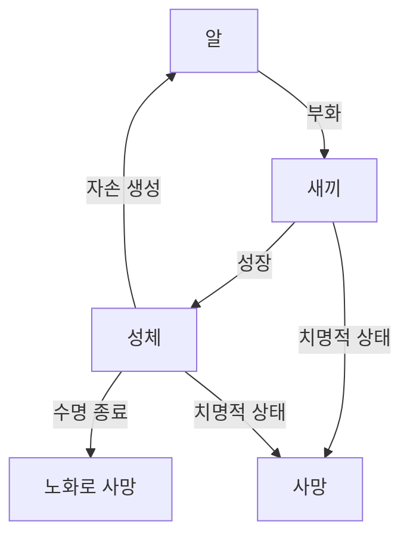
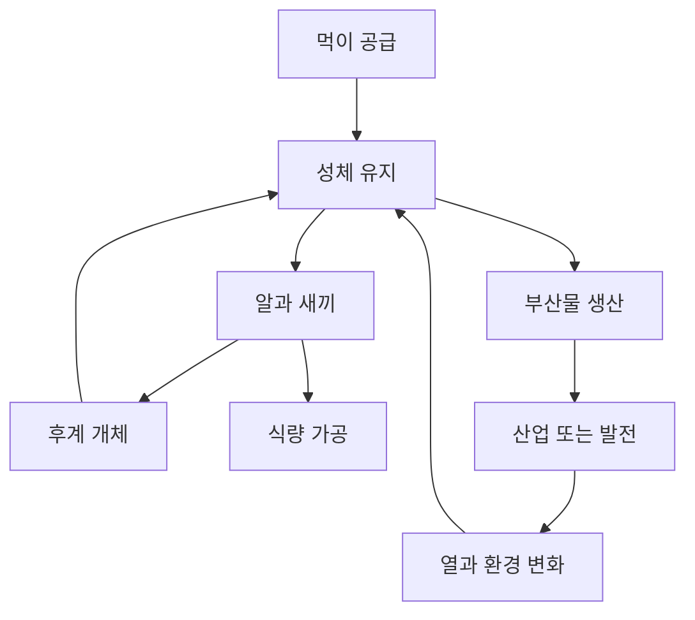

# 12. 축산·생물·번식·생태 생산 시스템 역기획

> 기준일: 2026-11-13 · 범위: 기본 게임 공통 축산, Spaced Out!·콘텐츠 팩의 생물은 명시된 경우만 포함.  
> [목차](00_README.md) · [농업](11_food_farming.md) · [물류](16_logistics_storage_conveyors.md) · [DLC](22_dlc_content_matrix.md)

## 1. 시스템의 역할

**[해석] 축산은 환경과 노동을 유지하면서 자원의 형태를 바꾸는 생물 기반 생산 체계다.** 생물은 식량원이면서 광물·가스·식물 등 서로 다른 계통을 연결하는 변환기다. 기계 생산과 달리 먹이 부족, 성장, 수명, 번식, 공간, 돌봄 때문에 출력이 시간적으로 지연된다. 그 지연이 축산의 운영 난도와 이야기성을 만든다.

**[확인]** 공식 Ranching Mark II 설명은 먹이·환경 조건이 다른 종류의 알을 낳을 가능성에 영향을 주고, 그 알에서 요구 조건과 부산물이 다른 변종이 태어나는 구조를 설명한다. 새끼가 성체가 되는 과정도 별도 생애 단계다.[^R1]

축산을 역설계할 때는 `생존`, `길들임`, `행복`, `번식`, `수확 가능`을 분리해야 한다. 먹이를 먹고 살아 있다고 해서 번식 속도나 털 생산이 최적인 것은 아니다. 이 문서는 실제 실행 파일을 분석한 결과가 아니므로 정확한 수명·알 생산 주기·종별 공간 상수는 **[검증 필요]** 로 둔다.

## 2. 주요 선택과 자원 연결

| 선택 | 얻는 결과 | 비용·제약 |
|---|---|---|
| 야생 생물을 그대로 둔다 | 초기 생태와 자연 생산 보존 | 이동·알 위치·출력 통제가 어렵다 |
| 목장에 모아 돌본다 | 계획 가능한 생산과 번식 | 목장 공간, 사육 담당자, 먹이 공급 |
| 생존용 개체와 생산용 개체를 구분한다 | 번식과 최종 산출 조절 | 알·새끼·성체 선별 물류 필요 |
| 특정 변종을 유도한다 | 원하는 부산물로 생산 전환 | 조건 유지와 세대 교체 지연 |
| 알을 음식으로 사용한다 | 단기 식량 확보 | 미래 개체 수와 생산 능력 감소 |
| 알을 부화시킨다 | 장기 생산력 확보 | 부화 시간, 공간, 유지비 |

### 대표 분석 대상

| 생물 계통 | 시스템을 연결하는 역할 | 역기획 시 분리할 상태 |
|---|---|---|
| Hatch 계열 | 먹이 자원과 석탄 생산·식량을 연결 | 먹이 종류, 변종, 번식, 굴 파기 행동 |
| Drecko 계열 | 식물 소비와 털·비늘 수확을 연결 | 먹이 접근, 대기 노출, 수확 준비도 |
| Pacu 계열 | 수중 공간과 먹이·번식·식량을 연결 | 연결된 수영장, 수중 공간, 먹이, 알 |
| Slickster 계열 | 기체 소비와 액체 생산을 연결 | 적합 대기, 온도, 종별 부산물 |
| Puft 계열 | 기체 계통과 고형 부산물을 연결 | 기체 식성, 비행 접근, 종별 생산 |

위 표는 **[해석]** 을 위한 계통 지도이며 완전한 종 목록이나 정량 레시피가 아니다. Drecko의 식물 섭취·수소 환경·털 수확, Pacu의 수중 생활과 번식 역할은 공식 소개에서 확인된다.[^R1] 나머지 계통의 정확한 입력 대비 출력량은 실제 버전의 생물 정보창으로 보완해야 한다.

## 3. 생애와 생산을 분리하는 상태 모델

**[설계 제안]** 부모 성체와 새로 생성된 알은 독립된 개체로 관리한다. 알에 보존되는 상태와 새끼·성체 전환 시 유지할 상태를 따로 정의한다.

생애와 별개로 다음 상태를 병렬 보유한다.

| 상태 축 | 예시 값 | 영향을 받는 결과 |
|---|---|---|
| 길들임 | 야생, 길들임 진행, 길들여짐 | 관리와 소비·번식 계통 |
| 영양 | 정상, 굶주림 진행 | 생존 및 생산 |
| 행복·공간 | 정상, 혼잡, 번식 억제 등 | 번식·산출의 효율 |
| 생산 준비도 | 털·비늘·우유 등 미준비/준비 | 수확 작업 생성 |
| 번식 준비도 | 진행률, 후보 변종 가중치 | 다음 알 또는 종별 번식 결과 |
| 환경 | 적합, 과열, 저온, 잘못된 대기 등 | 생존과 개별 생산 규칙 |

한 개의 `happy` 값으로 이 모든 것을 합치면 “털은 준비됐지만 작업자가 없다”, “먹이는 충분하지만 알 때문에 번식이 막혔다” 같은 상태를 설명할 수 없다.

## 4. 돌봄 작업과 목장 판정

### 4.1 작업의 생성 조건

**[해석]** 그루밍·털 깎기·이동은 자동 발생하는 생산 계수와 다르게 복제체의 작업 체계에 들어간다. 작업이 보인다는 것과 실제 수행된다는 것은 다르다.

`돌봄 가능 = 대상 준비 ∧ 적절한 시설 ∧ 작업자 자격 ∧ 도달 가능 ∧ 우선순위 선택`

작업자가 목장까지 들어와도 동물이 호출 위치에 도달하지 못하면 완료되지 않을 수 있다. 따라서 목장 문·바닥·사다리·장애물은 단순 장식이 아니라 생산 시설의 일부다. 복제체에게 통과 가능한 경로와 생물에게 가능한 경로가 항상 같지는 않다.

**[확인]** Sweet Dreams는 축산 작업 대기를 도입했다.[^R2] 2026-03에는 대상의 준비 여부를 진단 문구에 명확히 반영했다.[^R3]

### 4.2 공간과 혼합 사육

**[확인]** 2025-11 정식 QoL는 혼잡 판정에 개체별 공간 배분을 반영했다.[^R4]

**[해석]** 그러므로 오래된 공략의 “방 크기 ÷ 단일 종 공간 = 모든 목장의 최대 마릿수”를 일반식으로 고정해서는 안 된다. 수생 생물은 방 경계뿐 아니라 연결된 수영장의 상태를 함께 확인해야 한다. 생물과 알의 취급, 종별 공간 요구, 여러 종의 조합은 실행 버전별 검증 항목이다.

**[설계 제안]** 재구현에서는 최소한 `방 식별자`, `연결된 수역 식별자`, `개체별 공간 요구`, `알의 점유 규칙`을 분리한다. 단순히 화면상 같은 방에 있다는 이유로 모든 생물에게 동일한 혼잡 페널티를 복사하지 않는다.

## 5. 번식·변종·세대 교체

변종은 현재 개체의 외형을 즉시 바꾸는 업그레이드로 취급하지 않는다. **[확인]** 공식 소개의 기본 구조는 특정 조건이 새 변종 알의 출현에 영향을 주고, 그 알이 새로운 개체로 부화하는 것이다.[^R1]

**[해석]** 이에 따라 플레이어는 세 개의 시간을 관리한다.

1. 현재 성체의 생산을 유지하는 시간.
2. 원하는 번식 조건을 누적·충족하는 시간.
3. 알이 부화하고 새끼가 성체가 되어 생산에 합류하는 시간.

즉, 지금 먹이를 바꿨다고 즉시 전체 목장의 산출물이 바뀌지 않는다. 변종 유도는 생산 설비 교체보다 전환 시간이 길며, 원하는 종의 확보가 끝날 때까지 기존 종을 남겨 놓을 동기가 생긴다.

**[설계 제안]** 변종 계산은 `EggOutcomeWeights`로 표현할 수 있지만 실제 게임 내부가 이 이름이나 구조를 쓴다는 뜻은 아니다. 중요한 것은 조건에 따른 확률 변화, 결과의 이력, 알 생성 시점의 결정이 서로 섞이지 않는 것이다. 같은 알을 저장 후 불러올 때 다른 종으로 재추첨하는 식의 불일치는 피해야 한다.

## 6. 생산량은 개체 수보다 운영률로 계산한다

다음 식은 **[설계 제안]** 이며 원작의 내부 공식이 아니다.

`평균 출력 = 생산 가능한 성체 수 × 성체당 명목 출력 × 환경 가동률 × 먹이 공급률 × 돌봄 충족률`

가상의 생물 6마리가 각각 10 단위/cycle을 생산하고, 전체 제약을 합친 가동률이 75%라면 실효 출력은 45 단위/cycle이다. 성체를 2마리 더 넣어도 공간 페널티로 가동률이 50%가 되면 40 단위/cycle로 오히려 줄 수 있다. 이는 원작의 구체적 혼잡 배율을 주장하는 계산이 아니라 **마릿수와 실제 산출을 구분하는 예시**다.

번식 재고도 최종 음식과 다르게 평가한다.

| 재고 | 현재 식량 가치 | 미래 생산 가치 |
|---|---|---|
| 알 | 요리에 사용할 수 있는 경우 단기 가치 | 부화 후 생물 생산 능력 |
| 새끼 | 즉시 완전한 생산력을 기대하기 어렵다 | 성체가 되면 생산·번식에 합류 |
| 성체 | 종별 최종 식량 가치 | 유지 기간 동안 반복 산출 |
| 생산 부산물 | 식량 또는 산업 투입 | 다음 생산 체계의 가동률을 높임 |

목장 확장 계획에는 생애 단계별 개체 수와 대체 개체가 성체가 되는 예상 시점을 함께 봐야 한다. 동시에 늙은 성체만 모아 놓으면 총 마릿수는 정상이어도 세대 공백이 생긴다.

## 7. 물류·열·전력과의 결합

**[해석]** 축산에서 자동화의 첫 가치는 생산속도 증가보다 반복 운반과 알 정리의 누락을 줄이는 데 있다. 먹이는 들어오는데 산출물이 쌓여 환경이나 공간 상태를 바꾸는 문제를 방지한다. 반대로 물류 설정을 잘못하면 번식용 알까지 전부 음식 공정으로 보내 장기 생산을 없앨 수 있다.

권장 분석 경계는 다음과 같다.

- 먹이 공급량과 사육 개체의 실제 섭취량을 별도로 집계한다.
- 알 반출은 생산 라인 이동과 후계 개체 확보를 구분한다.
- 가스·액체를 소비하거나 배출하는 종은 주변 시뮬레이션 상태에 직접 연결한다.
- 생물 사망과 수확 산출을 기계 레시피 완료와 다른 이벤트로 기록한다.
- 생물 수가 많은 환경의 탐색·호출·물류 비용은 별도 성능 검증 대상으로 둔다.

## 8. 실패 사례와 복구

| 증상 | 가능한 원인 | 확인 순서 |
|---|---|---|
| 생물은 많은데 생산이 적다 | 새끼 비율, 환경, 먹이, 돌봄, 혼잡 | 생애 → 상태 → 소비량 → 작업 대기 |
| 알 생산이 갑자기 멈춘다 | 공간 규칙 변화, 알 잔류, 행복 저하 | 개체·알 목록과 공간 상태 확인 |
| 수확 작업이 생기지 않는다 | 아직 수확 준비도 미달, 시설·자격 | “준비된 대상” 여부와 작업자 확인 |
| 알은 충분한데 생산이 끊긴다 | 부화·성체 전환 시간 미반영 | 세대별 나이 분포와 대체 일정 확인 |
| 자원 공급이 예상보다 빨리 줄어든다 | 길들임 이후 소비 체계 변화, 인구 증가 | 개체별 실제 소비 추세 확인 |
| 자동 운송 후 목장이 고갈된다 | 후계 알과 생산 알을 같은 필터로 처리 | 반출 정책과 목적지별 수량 확인 |

복구는 무조건 마릿수를 늘리는 방향으로 하지 않는다. 먼저 공간·먹이·돌봄 병목을 확인한 뒤 정상 작동하는 최소 개체군을 유지하고, 후계 개체의 성숙 시간을 기다릴 버퍼를 확보한다.

## 9. 확장과 버전 경계

Spaced Out!에는 Plug Slug 계열 등 기본판과 다른 생태 연결이 추가된다. **[확인]** Sweet Dreams 공지는 이 계통에 정제금속 먹이 조정과 새로운 기체·액체 관련 변종을 추가했다고 설명한다.[^R2] 이 내용을 기본판 전체 생물의 공통 식성으로 확대하지 않는다.

**[검증 필요]** 2026-11 공개테스트의 수중 그루밍 공통화와 Pacu 밸런스 조정은 출시 확정 규칙과 분리한다. 본문은 이를 모든 안정판에 이미 적용된 기능으로 계산하지 않는다. Aquatic의 수생 생물과 다른 팩의 생물도 설치된 콘텐츠·월드 생성 조건을 먼저 확인해야 한다.

## 10. 제안 데이터와 검증 시나리오

| 제안 데이터 | 핵심 필드 |
|---|---|
| `CritterSpeciesDef` | 생애 단계, 먹이 필터, 환경 조건, 공간 요구, 출력 |
| `CritterState` | 나이, 영양, 길들임, 상태 효과, 생산·번식 진행도 |
| `RanchContext` | 방, 수역, 시설, 거주 개체와 알 목록 |
| `CareErrand` | 대상, 준비도, 작업자 자격, 호출 위치, 만료 조건 |
| `EggState` | 종·변종, 부화 진행, 유전되는 상태, 위치 |
| `RanchPolicy` | 유지 개체 목표, 반출 기준, 후계 개체 수 |

1. 같은 총 마릿수로 단일 종과 혼합 종을 배치하고 혼잡 결과가 어떤 입력을 사용하는지 기록한다.
2. 같은 방의 분리된 수영장을 합치고 나눠, 수생 개체의 공간 판정이 갱신되는지 확인한다.
3. 알을 방 안·외부·운송 중으로 이동시키며 상태 변화를 기록한다. 특정 상수를 미리 기대값으로 박지 않는다.
4. 먹이와 환경은 유지하고 사육 작업만 중단하여 직접 소비와 돌봄 의존 출력의 차이를 측정한다.
5. 성체가 노화로 사라지는 시점과 후계 새끼의 성장 시점이 겹치지 않도록 세대 교체 사례를 만든다.
6. 수확 준비도가 찬 생물과 아직 차지 않은 생물이 같은 시설을 공유할 때 작업 목록과 진단 문구를 확인한다.

## 11. 출처

[^R1]: Klei 개발자 공지, [Ranching Upgrade Mark II 266730](https://forums.kleientertainment.com/game-updates/oni-alpha/266730-r429/). 생애, 변종 알, Drecko·Pacu, 돌봄 시설의 도입 원리를 확인하는 역사 자료. 정확한 현재 상수의 근거는 아님.
[^R2]: Klei, [Sweet Dreams 525812](https://kleiforums.com/game-updates/oni-alpha/525812-r1877/). 축산 대기 동작과 Plug Slug 확장 확인.
[^R3]: Klei, [March 2026 Bug Fix Update 719533](https://kleiforums.com/game-updates/oni-alpha/719533-r2701). 사육 건물의 준비 상태 진단 문구 변경 확인.
[^R4]: Klei, [November 2025 QoL 700348 + 700386](https://kleiforums.com/forums/topic/168832-game-update-november-2025-quality-of-life-update-700348-700386/). 개체별 공간 계산 변경 확인. 직접 열기는 403이었으나 해당 공식 게시물의 검색 인덱스 본문으로 확인함.
