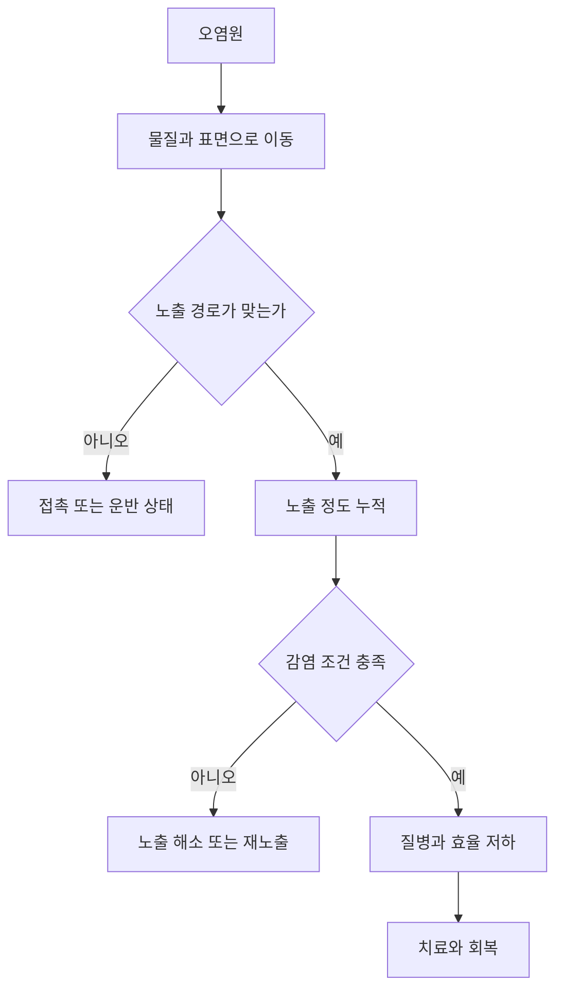

# 13. 건강 · 병원균 · 위생 · 보호 장비

[전체 목차](00_README.md) · [액체·위생 설비](07_liquids_plumbing_sanitation.md) · [복제체](03_duplicants_attributes_skills.md)

- 조사 기준일: 2026-11-13
- 범위: 일반 복제체의 부상·질병·위생·탐사 장비. 방사선은 [20번 문서](20_radiation_nuclear_spaced_out.md), 바이오닉 예외는 본문에 별도 표시한다.
- **[확인]** 공식 근거 / **[해석]** 기획 분석 / **[설계 제안]** 재현 모델 / **[검증 필요]** 실행 빌드 확인.
- 여기의 질병 설명은 게임 규칙 분석이며 현실의 의료·위생 모델을 설명하는 문서가 아니다.

## 1. 시스템의 목적 [해석]

건강 시스템은 탐사의 위험과 생산 인력의 가동률을 연결한다. 산소와 식량을 충분히 확보했더라도 고온 작업, 위험 환경, 오염된 물질의 이동, 보호복 정비 실패가 복제체를 일에서 이탈시킬 수 있다. 의료시설은 사후 회복을 맡고, 공간 격리·보호장비·동선은 위험에 노출되는 빈도를 줄인다.

중요한 설계 구분은 **생명 유지 부족, 직접 부상, 병원균 노출, 질병, 스트레스**를 서로 다른 상태로 관리하는 것이다. 각각 해결 자원과 시간축이 다르다. 식량을 더 생산해도 화상은 치료되지 않으며, 병원균 수를 줄였다고 이미 발생한 질병 상태가 즉시 사라지는 것도 아니다.

## 2. 위험 상태의 분류 [해석]

| 분류 | 입력 | 직접 결과 | 주된 대응 |
|---|---|---|---|
| 호흡 위험 | 호흡 가능한 기체·저장 산소 부족 | 작업 중단·생존 위기 | 안전 지점·산소 공급·보호장비 |
| 영양 위험 | 소비 가능한 식량 부족 | 생산성 저하·생존 위기 | 생산·저장·소비 허용 설정 |
| 환경 피해 | 극단적 온도 등 | 체력·상태 이상 | 노출 시간 감소·환경 제어·장비 |
| 부상 | 위험 생물·사고·피해 | 체력 감소·무력화 | 구조와 치료 |
| 병원균 | 오염 매체와 노출 경로 | 노출 단계·감염 가능성 | 전파 차단·세척·환경 처리 |
| 질병 | 감염 판정 | 행동 효율·생리 상태 변화 | 의료·시간·노출 방지 |
| 심리 부담 | 사기 부족·불편·사건 | 스트레스·반응 | 생활 수준과 운영 개선 |

한 복제체가 여러 상태를 동시에 가질 수 있으므로, 가장 급한 문제를 치료하는 동안 다른 상태의 악화도 계속 추적해야 한다.

## 3. 병원균과 질병을 분리하는 이유

### 3.1 공식 설명의 핵심 [확인]

2019년 질병 개편은 이전의 면역 시스템을 제거하고 병원균 노출에 따른 감염과 작업 효율 손실 중심으로 바꾸었다.[^disease] 출시 업데이트는 접촉 경고와 실제 질병 위험을 구분하고, 섭취 노출 및 일정 시간 이어지는 흡입 노출을 다룬다.[^exposure]

이 때문에 “세균이 보인다”와 “해당 복제체가 감염된다”는 동일한 조건이 아니다. 매체에 있는 병원균, 복제체가 받은 노출, 감염된 질병을 별도로 추적해야 한다.

### 3.2 전파 경로를 읽는 모델 [해석]

| 항목 | 추적할 정보 | 잘못된 단순화 |
|---|---|---|
| 오염 매체 | 기체·액체·고체·표면, 병원균 종류와 수 | 모든 오염 매체를 같은 위험으로 취급 |
| 전파 | 접촉·취급·이동·공정 | 오염원이 출발 지점에만 남는다고 가정 |
| 노출 경로 | 섭취·흡입·특수 조건 | 세균 수만으로 감염 판정 |
| 노출 정도 | 양·시간·저항·조건 | 한 번 접촉하면 즉시 발병 |
| 질병 효과 | 지속시간·능력 저하·추가 증상 | 모든 질병이 동일한 체력 피해 |
| 회복 | 치료·시간·재노출 여부 | 매체 소독과 인물 치료를 동일시 |

식품 관련 위험은 먹는 과정과 손·재료·조리·보관 흐름을 함께 보아야 한다. 공기 관련 위험은 호흡하는 위치와 공급 산소의 상태를 함께 보아야 한다. 보이는 오염원 하나만 제거해도 이미 다른 매체로 옮겨 간 병원균이나 인물의 질병이 남을 수 있다.

## 4. 물질 정화와 살균의 분리 [해석]

액체의 원소 종류가 바뀌는 처리와 병원균 수를 줄이는 처리는 서로 다른 축이다. 물 처리 공정을 평가할 때에는 `입력 원소 → 출력 원소`, `입력 온도 → 출력 온도`, `입력 병원균 → 출력 병원균`을 각각 기록해야 한다. 물질 이름이 깨끗해 보인다는 이유로 살균 완료로 판정해서는 안 된다.

| 공정 평가 축 | 관찰할 값 | 뒤에 연결되는 시스템 |
|---|---|---|
| 원소·조성 | 무엇으로 바뀌는가 | 설비 투입 자격 |
| 질량 | 얼마나 나오고 남는가 | 저장·배관·지속 생산 |
| 온도 | 어디서 열이 유입·배출되는가 | 농업·냉각·생활 환경 |
| 병원균 | 살아남고 퍼지는가 | 식품·공기·노출 |
| 노동 | 보급·청소·운반이 필요한가 | 일일 유지비 |

**[검증 필요]** 특정 정수기·염소 공간·저장 탱크·배관 안 물질의 살균 속도나 예외를 이 문서에서 보편식으로 고정하지 않는다. 특히 저장물과 배관 패킷이 주변 환경과 같은 방식으로 상호작용한다고 가정하면 안 된다.

## 5. 위생 동선 [해석]

위생시설은 건설 수량만으로 효과가 결정되지 않는다. 오염원에서 식품·작업대·생활구역으로 이동하는 실제 경로 위에서 사용되어야 한다. 통과 방향, 이용 가능한 물자, 대기열, 다른 출구가 결과를 바꾼다.

1. 화장실·오염 작업장 등 오염 발생 위치를 정한다.
2. 정상 경로가 세척 지점을 지나도록 구성한다.
3. 급수·배수·소모품 부족으로 시설이 멈추지 않는지 확인한다.
4. 우회문·이동 장치·장비 착탈 뒤의 경로도 검토한다.
5. 음식과 원료를 다루는 인원의 실제 상태를 확인한다.

세척 설비를 여러 개 놓았어도 이용 시점이 몰리면 대기나 우회가 발생할 수 있다. 위생 동선은 [일정 시스템](04_tasks_priorities_schedules.md)의 수요 분산과 함께 평가해야 한다.

## 6. 보호 장비의 역할과 유지비

**[확인]** 공식 Breath of Fresh Air 설명은 Oxygen Mask를 산소가 부족한 지역의 작업 시간을 늘리는 초기 장비로 구분하며, 가혹한 환경 전체를 보호하는 장비로 설명하지 않는다. 보호복 내구도는 일회성 건설 이후에도 정비 공급망이 필요하도록 도입되었다.[^suits]

| 장비 계열 | 주요 목적 | 반드시 확인할 한계 | 연결되는 유지 자원 |
|---|---|---|
| Oxygen Mask | 산소 부족 지역에서 작업 지속 | 열·압력·기타 환경 보호와 구별 | 산소 충전·장비 상태 |
| Atmo Suit | 외부 작업의 환경 방호와 산소 확보 | 산소 잔량·온도 한계·복귀 경로 | 도크·전력·산소·정비 |
| Jet Suit | 이동 가능성 확장 | 연료·이동 행동·배출 영향 | 연료·산소·장비 정비 |
| Lead Suit 계열 | 방사선 위험 작업 지원 | 차폐가 모든 위험을 제거하지 않음 | 장비·산소·방사선 구역 설계 |

개별 장비의 정확한 보호 범위, 내구도 설정 기본값, 재료와 수리 비용은 빌드·설정에 따라 확인해야 한다. 이 표를 서로 다른 장비가 모두 같은 수준의 보호를 제공한다는 뜻으로 읽으면 안 된다.

### 보호복 통로를 하나의 서비스로 평가하기 [해석]

체크포인트가 있다는 사실보다 **충전된 사용 가능 장비를 출입자에게 제공하고, 귀환 후 정비하여 다시 공급할 수 있는가**가 중요하다. 도크의 산소 공급이 끊기거나 낡은 장비가 회수되지 않으면, 보호복 기반 외부 산업 전체가 일시에 정지할 수 있다.

| 운영 단계 | 실패 | 기지 영향 |
|---|---|---|
| 장비 배치 | 장비 없음·미충전 | 외부 작업 시작 불가 |
| 외출 | 우회로·권한 문제 | 보호 없이 위험 지역 접근 또는 작업 중단 |
| 작업 | 산소·연료 부족·장비 상태 악화 | 복귀 증가·구조 필요 |
| 귀환 | 빈 도크 정책·통로 막힘 | 장비 반납·재출발 문제 |
| 정비 | 재료·자격·주문 누락 | 시간이 지나며 전체 가동률 감소 |

## 7. 의료와 구조 [해석]

예방 설비와 의료 설비는 다른 문제를 해결한다. 의료가 필요할 때 바로 접근할 수 있도록 치료 장소, 이동 경로, 의료 자격과 약품 공급을 유지해야 한다. 멀리 떨어진 위험 구역에서 무력화된 복제체는 치료 능력보다 먼저 구조 경로가 필요하다.

치료 대기시간이 길어지면 해당 인원의 작업만 멈추는 것이 아니라 구조·간호·약품 제작을 맡은 다른 인원까지 동원된다. 따라서 건강 손실의 기지 비용은 `환자의 손실 시간 + 구조·치료 시간 + 대체 업무 지연`으로 평가해야 한다.

**가정 예시:** 전문 조리 담당 한 명이 4시간 이탈하고, 구조·치료에 다른 인원의 1.5시간이 추가되면 직접 인력 손실은 5.5시간이다. 조리 작업이 중단되어 식품 변질이나 식사 품질 하락까지 생기면 간접 비용은 더 커진다. 이 수치는 분석용 가정이다.

## 8. 바이오닉 예외 [확인 + 해석]

2025년 공식 수정 기록은 바이오닉의 Slimelung 관련 동작과 방사선 질병의 운동능력 불이익을 다룬다. Food Poisoning은 증상 면역으로 구분한다.[^bionicdisease] 따라서 “기계형이므로 모든 질병에 면역”이라는 전제는 사용할 수 없다.

재구현에서는 일반 복제체와 바이오닉이 공통 질병 정의를 참조하되, 각 상태 효과의 적용 가능성을 유형별로 결정하는 모델이 적절하다. `질병 전체 면역` 한 값만 두면 특정 증상만 적용되지 않는 구조를 표현하기 어렵다.

## 9. 재구현 데이터와 규칙 [설계 제안]

| 데이터 | 핵심 필드 | 필요한 불변식 |
|---|---|---|
| GermCarrier | germType, count, medium, position | 물질 이동과 오염 이동이 일관 |
| ExposureState | route, dose, duration, lastSource | 접촉과 유효 노출을 구별 |
| DiseaseDefinition | allowedModels, effects, recoveryPolicy | 유형별 증상 예외 가능 |
| HealthState | hitPoints, injuryEffects, incapacitated | 의료와 질병 상태를 혼동하지 않음 |
| ProtectiveEquipment | oxygen, fuel, durability, protections | 보급 실패가 UI에 반영 |
| MedicalRequest | patient, treatment, material, assignedWorker | 이중 치료 예약 방지 |

노출 판정은 소스·매체·경로·양·지속시간을 기록하고, 질병은 자체 지속시간과 효과를 가진 상태로 둔다. 한 상태가 사라졌을 때 관련 이동능력이나 행동 수정치도 정리되어야 한다. 치료 이후 증상이 남는 문제는 공식 수정 기록에도 등장한 실제 품질 위험이다.[^bionicdisease]

## 10. 검증 시나리오

| ID | 조건 | 확인할 결과 |
|---|---|---|
| HLT-01 | 같은 병원균을 다른 매체·노출 경로로 제공 | 단순 접촉과 감염 가능 노출의 차이 |
| HLT-02 | 오염원 제거 후 이미 감염된 복제체 관찰 | 매체 정화와 질병 회복의 독립성 |
| HLT-03 | 정수 공정 전후 측정 | 원소·온도·병원균 각각 기록 |
| HLT-04 | 위생시설 우회로 추가 | 실제 이용 여부와 전파 경로 변화 |
| HLT-05 | 도크 산소·전력·수리 재료 중 하나 차단 | 원인에 맞는 경보와 외부 작업 영향 |
| HLT-06 | 같은 위험에 Mask와 Suit 착용 비교 | 장비별 보호 범위 확인 |
| HLT-07 | 치료 완료·저장·불러오기 | 질병과 능력 저하 효과의 정상 제거 |
| HLT-08 | 일반·바이오닉에 같은 질병 조건 | 유형별 증상 예외 |

## 11. 출처

[^disease]: [Klei — QoL Mk III, 326232](https://kleiforums.com/game-updates/oni-alpha/326232-r734/). 질병 체계 개편의 공식 설명. 2017년 면역 수치 기반 공략과 구분한다.
[^exposure]: [Klei — 356355](https://kleiforums.com/game-updates/oni-alpha/356355-r847/). 섭취·흡입 노출, 접촉 경고와 감염 위험 구분의 근거. 현재의 정확 임계값은 이 과거 공지로 확정하지 않는다.
[^suits]: [Klei — A Breath of Fresh Air, 471618, 2021-07-15](https://kleiforums.com/forums/topic/131854-a-breath-of-fresh-air-update-available-now-471618/). 산소 마스크와 보호복 정비 체계의 도입 의도. [Spaced Out! 449549](https://kleiforums.com/game-updates/oni-so/449549-r1424/)에도 내구도를 지속 운영 비용으로 도입한 설명이 있다.
[^bionicdisease]: [Klei 개발자 — 660272/660455, 2025-03](https://kleiforums.com/forums/topic/164873-game-update-660272-660455/). 검색 본문에서 확인했으며 직접 열기는 403이었다. [공식 Steam 공지 모음](https://store.steampowered.com/news/posts/?appids=457140&enddate=1751493046&feed=steam_community_announcements)에서 같은 핫픽스 내용을 확인할 수 있다.
