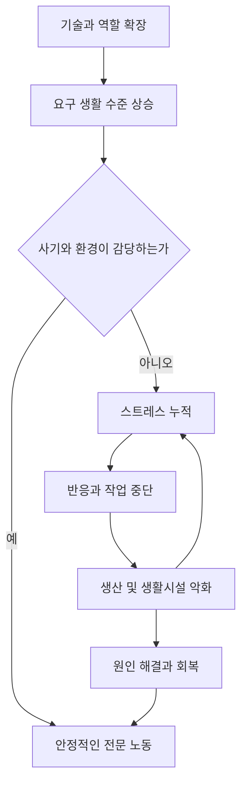

# 14. 사기 · 스트레스 · 장식 · 여가

[전체 목차](00_README.md) · [복제체와 기술](03_duplicants_attributes_skills.md) · [공간과 방](05_construction_rooms_access.md)

- 조사 기준일: 2026-11-13
- 범위: 일반 복제체의 생활 수준과 심리적 상태. 바이오닉·DLC 반응은 별도 콘텐츠 정의로 확장한다.
- **[확인]** 공식 공개 규칙 / **[해석]** 설계 분석 / **[설계 제안]** 재현용 수식·데이터 / **[검증 필요]** 현재 빌드의 상세 상수.
- 정확한 보너스 수치·효과 지속시간·반응 확률을 실행 빌드에서 측정한 문서는 아니다.

## 1. 시스템 목표 [해석]

사기 시스템은 생존 이후에도 생활 환경에 투자할 이유를 만든다. 산소와 칼로리가 충분하더라도 기지가 전문화될수록 복제체의 기대 수준을 충족해야 한다. 좋은 음식, 잘 구성된 공간, 장식, 여가 시간은 단순한 외형 개선을 넘어 더 많은 기술을 안정적으로 운용하는 기반이 된다.

스트레스는 현재 생활 수준 그 자체가 아니라 **누적되는 운영 부담**이다. 사기를 낮게 유지하는 것, 불편한 환경을 반복해서 통과하는 것, 사건을 겪는 것 등이 시간에 걸쳐 부담을 만들 수 있다. 이 둘을 분리하면 생활 개선의 장기 가치와 위기 대응의 즉시 가치가 함께 성립한다.

## 2. 네 개의 핵심 값

**[확인]** 공식 Expressive Upgrade는 음식·방·여가·장식 등을 사기 체계에 연결하고, 목표 사기와의 차이가 스트레스에 영향을 주도록 설명한다.[^morale] 요구 사기는 기술 성장과 연결된다.[^skills]

| 값 | 플레이어 관점의 질문 | 다른 값과 혼동하면 생기는 문제 |
|---|---|---|
| 현재 사기 | 지금 어떤 생활 보너스를 받고 있는가? | 사기가 높으면 모든 스트레스 원인이 사라진다고 오해 |
| 요구 사기 | 이 기술 구성을 안정적으로 감당하려면 얼마가 필요한가? | 기술을 늘려도 유지비가 같다고 오해 |
| 스트레스 | 최근 부담이 얼마나 누적되었는가? | 음식 하나를 바꾸면 즉시 초기화된다고 오해 |
| 개별 효과 | 무엇이 얼마 동안 영향을 주는가? | 만료 예정 보너스를 영구 수입처럼 계산 |

운영 화면은 최종 합계와 원인 항목을 함께 제공해야 한다. “사기 부족”이라는 상태만 보여 주면 식당 문제인지, 음식 변경인지, 휴식 보너스 만료인지, 신규 기술 때문인지 알기 어렵다.

## 3. 사기의 공급원과 유지 비용 [해석]

| 공급원 | 플레이어 투자 | 유지 비용 | 실패 가능성 |
|---|---|---|---|
| 음식 품질 | 농업·목축·조리의 고도화 | 원료·노동·온도 관리 | 원료 부족·변질·소비 허용 문제 |
| 생활 공간 | 침실·식당·위생실 구성 | 공간·설비·이동시간 | 방 조건 상실·시설 점유 |
| 장식 | 예술품·식물·재료·정리 | 제작·관리·배치 | 산업 통로·잔해와 상쇄 |
| 여가 | 휴게시설과 이용 시간 | 전력·재료·복제체 시간 | 긴 통근·자원 부족·효과 만료 |
| 일정 | 휴식 구간 배정 | 직접 노동시간 감소 | 너무 짧은 생활 창·시설 혼잡 |
| 흥미와 기술 | 적성에 맞는 역할 구성 | 기술 배분의 기회비용 | 역할과 실제 작업 불일치 |

같은 보너스라도 기지의 단계에 따라 한계 비용이 다르다. 초기에 식당 동선을 정리하는 것은 저렴할 수 있지만, 이미 안정된 식당을 더 꾸미는 것보다 식량 품질을 올리는 편이 효율적일 수 있다. 따라서 역기획의 핵심은 보너스 총합보다 **다음 한 단계의 생활 수준을 올리는 비용**이다.

## 4. 장식의 공간 효과와 체험 시간

### 4.1 확인된 방향 [확인]

공식 Expressive Upgrade는 한 사이클에 경험한 평균 장식을 다음 사기 효과에 연결하는 구조를 설명한다.[^morale] 즉, 지도의 가장 아름다운 한 지점보다 복제체가 실제로 어디서 얼마나 시간을 보냈는지가 중요하다. 현재 빌드의 상한·하한·표본 추출 방식은 별도 확인 대상이다.

### 4.2 장식 배치의 기획적 의미 [해석]

| 위치 | 투자 가치가 높은 이유 | 확인할 역효과 |
|---|---|---|
| 수면 공간 | 긴 체류시간 | 접근성·소음·필수 방 조건 |
| 식당·여가 공간 | 여러 인원이 반복 방문 | 시설 밀집·동선 충돌 |
| 주요 이동 통로 | 노출 횟수가 많음 | 산업 연결망·잔해·공사 |
| 전문 작업장 | 담당 인원의 긴 작업시간 | 열·기체·산업 시설의 장식 비용 |
| 외곽 개척 구역 | 불리한 환경 완화 가능 | 낮은 방문 빈도와 건설 비용 |

**가정 예시:** 생활구역에서 40%의 시간을 장식 점수 60, 작업장에서 40%를 -20, 통로에서 20%를 0으로 경험한다고 단순화하면 시간 가중 평균은 16이다. 작업장을 -20에서 0으로 올리면 평균은 24가 된다. 실제 게임의 장식 상한이나 사기 변환표를 재현하는 계산이 아니라 배치 우선순위를 설명하는 분석 예다.

장식 공급자는 존재 여부만으로 충분하지 않을 수 있다. 설치 조건과 식물 상태 등 방 판정에 관련된 현재 조건은 [공간·방 문서](05_construction_rooms_access.md)의 버전 주의를 함께 읽어야 한다.

## 5. 스트레스의 시간축 [설계 제안]

원작의 내부 계산식이 아니라 상태를 설명하고 재현하는 개념 모델이다.

```text
사기 여유 = 현재 사기 - 요구 사기

스트레스 변화율 = 사기 여유에 따른 항
                + 환경·사건·상태 효과의 합
                - 휴식·치료 등 완화 항

새 스트레스 = 허용범위로 제한(기존 스트레스 + 변화율 × 경과시간)
```

이 모델에서 사기가 요구량보다 높아도 다른 불편이 강하면 스트레스가 증가할 수 있다. 반대로 현재 스트레스가 높더라도 원인을 해결하고 감소 중이라면 즉시 추가 설비를 지어야 하는 상황과 구분할 수 있다. UI에 현재값뿐 아니라 변화 방향과 원인별 기여가 필요한 이유다.



스트레스가 부르는 추가 손실 때문에 한 번 시작된 문제가 확대될 수 있다. 의료·휴식 시설은 회복을 돕지만, 원인인 부족한 생활 수준이나 끊긴 생산망을 함께 복구하지 않으면 같은 반응이 반복된다.

## 6. 스트레스 반응과 긍정적 반응 [해석]

스트레스 반응은 인물마다 다른 형태로 기지에 영향을 준다. 기획적으로는 노동 중단, 시설 손상, 식량 추가 소비, 액체 배출, 주변 인물 영향처럼 **다른 시스템으로 비용을 전파하는 분기**로 분류할 수 있다. 실제 반응 종류와 수치는 복제체 유형·버전에 맞는 콘텐츠 데이터에서 읽어야 한다.

| 반응의 비용 유형 | 기지에서 나타나는 2차 문제 | 대응의 관점 |
|---|---|---|
| 작업 중단 | 필수 생산·유지 업무 지연 | 필수 역할의 대체 인력 |
| 시설 영향 | 고장·전력·생명 유지 문제 | 핵심 설비 접근성과 수리 여유 |
| 소비 증가 | 식량 등 재고 급감 | 비상 재고와 소비 추세 |
| 환경 배출 | 청소·대기·바닥 상태 악화 | 배출물 처리와 동선 |
| 주변 인물 영향 | 부담의 확산 | 생활공간 분리와 원인 해결 |

**[확인]** 2019년 Recreation Pack은 기대보다 높은 사기에서 생산성·장식 등에 도움이 되는 Overjoyed Responses를 도입했다.[^joy] 2024년에는 이 상태가 수면 이후에만 발생하던 제한이 바뀌었다.[^joytiming]

긍정 반응은 생활 투자에 추가 보상을 제공하지만, 발생 확률과 행동 가능 시간에 좌우되는 보너스다. 필수 산소·식량 생산 계획을 이 반응이 항상 발생한다는 전제로 짜면 안 된다. 기본 수지의 안전 여유 위에 얻는 추가 이익으로 보는 편이 타당하다.

## 7. 사회적 생활과 여가의 운영 가치 [해석]

교류와 여가를 위해서는 사용 가능한 시설뿐 아니라 이용할 시간과 동료의 일정도 필요하다. 시설이 멀거나 재료가 끊겼거나 근무 시간이 어긋나면 설치한 설비가 기대한 경험을 만들지 못한다. 방의 이름, 그 방을 사용하는 행위, 그 행위가 주는 효과를 분리해서 관찰해야 한다.

여가의 비용은 전력이나 물자만이 아니다. 이용 시간과 이동 시간 동안 직접 생산을 하지 않는다. 그러나 안정적인 사기가 더 높은 기술 수준을 가능하게 하거나 위기 반응을 줄인다면 총 생산성은 오를 수 있다. 이 시스템은 생산과 휴식을 단순한 제로섬으로 만들지 않는다.

| 투자 후보 | 직접 비용 | 비교할 성과 |
|---|---|---|
| 휴식 시간 확대 | 작업 가능 시간 감소 | 스트레스 경향·시설 이용률·요구 사기 충족 |
| 식사 품질 개선 | 원료·조리·보관 비용 | 안정 보너스와 공급 중단 위험 |
| 방 재구성 | 건설·공간·이전 비용 | 실제 이용 인원·왕복 동선 |
| 여가시설 추가 | 전력·소모품·이용시간 | 기존 효과와 중복·사용 가능 시간 |
| 기술 재설정 | 재배분 시간과 역할 조정 | 요구 사기 감소와 잃는 작업 자격 |

## 8. 실제 위기 분석 예시 [해석]

**장면:** 새 기술을 여러 개 배운 뒤 외부 산업을 확장했는데 복제체의 스트레스가 지속 증가한다.

1. 요구 사기의 증가와 기존 생활 보너스 만료를 먼저 확인한다.
2. 외곽 왕복시간이 늘어 식사·여가에 도달할 시간이 줄었는지 본다.
3. 외부 환경·장비·질병 등 사기와 별개인 상태 효과를 분리한다.
4. 필수 자격만 남기는 기술 조정과 생활 인프라 개선의 비용을 비교한다.
5. 스트레스 감소 방향을 확인한 뒤 확장 작업량을 다시 늘린다.

마사지 같은 즉시 완화 수단은 시간을 벌어 준다. 기지가 제공하지 못하는 생활 수준이나 계속 반복되는 위험 노출은 별도의 구조 변경으로 해결해야 한다. 평가 지표도 “지금 스트레스가 낮아졌는가”에서 “다음 여러 사이클에 같은 원인이 반복되는가”로 확장한다.

## 9. 재구현 데이터 [설계 제안]

| 데이터 | 핵심 필드 | 이유 |
|---|---|---|
| MoraleEffect | sourceId, value, duration, stackPolicy | 보너스 출처·만료·중복 설명 |
| MoraleRequirement | skillId, cost, exemptions | 성장 비용과 예외를 추적 |
| DecorSample | location, value, duration | 공간값과 체험시간 연결 |
| StressEffect | rate, duration, source, applicableModels | 사기와 별도 부담 표현 |
| ReactionDefinition | trigger, action, outputs, interruptionPolicy | 반응의 시스템 간 영향 |
| RecreationService | requirements, duration, effect, capacity | 이용 대기와 실제 혜택 연결 |

효과를 단순 합산하기 전에 중복 정책을 정해야 한다. 같은 효과의 시간만 갱신하는지, 상위 효과가 하위를 대체하는지, 같은 이름의 출처가 다른 보너스를 주는지 구분한다. 이 부분이 설명되지 않으면 여러 식당·여가시설의 투자 가치를 잘못 계산하게 된다.

## 10. 검증 시나리오

| ID | 실험 | 관찰 목표 |
|---|---|---|
| MRL-01 | 생활 조건 고정, 기술만 추가 | 요구 사기 변화와 실제 스트레스 변화 |
| MRL-02 | 같은 최종 사기에서 환경 효과 다르게 | 사기와 스트레스의 독립 요인 |
| MRL-03 | 장식 총량 동일, 배치만 변경 | 체류시간이 결과를 바꾸는지 |
| MRL-04 | 같은 생활시설에 일정만 변경 | 이용률·대기·효과 만료 |
| MRL-05 | 방 조건을 잠시 제거 후 복구 | 이미 받은 효과와 신규 이용 효과 구분 |
| MRL-06 | 스트레스 반응 중 생명 유지 차단 | 반응 중단·생존 행동 우선순위 |
| MRL-07 | 충분한 사기로 장기 관찰 | 긍정 반응의 빈도·실제 가동 손익 |
| MRL-08 | 저장·불러오기 전후 비교 | 평균 장식·효과 시간·일정 보너스 유지 |

**[검증 필요]** 사기 구간별 스트레스 계수, 장식 평균의 정확한 산출·제한, 각 반응의 임계값·지속시간·우선순위, 현재 방 보너스 수치는 버전 고정 후 확정한다.

## 11. 출처

[^morale]: [Klei — Expressive Upgrade, 279457, 2018-07-25](https://kleiforums.com/game-updates/oni-alpha/279457-r525/). 사기·생활·장식·스트레스 연결의 공식 도입 설명. 현재의 숫자표로 사용하지 않는다.
[^skills]: [Klei — QoL Mk III, 326232](https://kleiforums.com/game-updates/oni-alpha/326232-r734/). 기술별 요구 사기 누적의 근거.
[^joy]: [Klei — Recreation Content Pack, 381414, 2019](https://kleiforums.com/game-updates/oni-alpha/381414-r964/). Overjoyed Responses의 목적과 종류.
[^joytiming]: [Klei — 646687, 2024-12-12, All versions 항목](https://kleiforums.com/game-updates/oni-alpha/646687-r2443). 긍정 반응의 발생 시점 변경.
