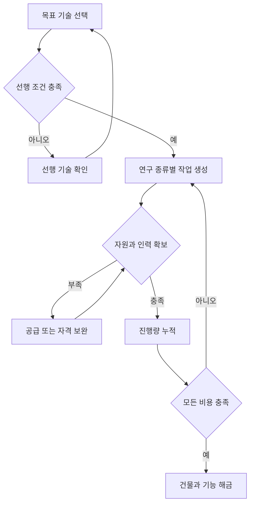

# 15. 연구·기술 해금·진행 구조 역기획

> 기준일: 2026-11-13 · 범위: 기본 게임과 Spaced Out!의 연구 계통을 구분.  
> [목차](00_README.md) · [복제체 능력](03_duplicants_attributes_skills.md) · [기본판 우주](19_space_rocketry_base.md) · [방사선](20_radiation_nuclear_spaced_out.md)

## 1. 연구의 기획적 역할

**[해석] 연구는 시간이 흐르면 자동으로 올라가는 계정 레벨이 아니라, 현재 식민지의 자원과 노동을 미래 문제 해결 능력으로 전환하는 선택이다.** 기술을 해금했다고 바로 설비를 가동할 수 있는 것도 아니다. 건설 재료, 기술을 가진 복제체, 전력, 투입 자원, 폐열 처리까지 확보해야 실제 능력이 된다.

따라서 진행을 네 단계로 구분한다.

`지식 해금 → 건설 가능 → 운전 가능 → 지속 운전 가능`

이 네 단계 사이의 간격이 ONI의 중장기 목표를 만든다. 예를 들어 냉각 기술을 해금했더라도 안정적인 전력이나 고온에 버티는 재료가 부족하면 사용할 수 없다. 반대로 필요한 기술이 해금되기 전에 냉각 공간과 자원 공급선을 준비하면 전환 비용을 줄일 수 있다.

## 2. 연구 유형과 모드 분리

아래 표는 계통을 구분하기 위한 **[역기획 정리]** 다. 정확한 연구 포인트 비용, 건물 해금 노드, 작업자 스킬 이름의 한국어 번역은 실행 빌드의 인게임 트리와 대조해야 한다.

| 범위 | 연구 계통 | 대표 시설·입력 | 기획상 의미 |
|---|---|---|---|
| 공통 | 기초 연구 | Research Station, 흙·노동·전력 | 생활 기반 기술 확보 |
| 공통 | 고급 연구 | Super Computer, 물·노동·전력 | 물 소비와 인력 전문화가 진행 비용이 됨 |
| 기본판 | 성간 연구 | Virtual Planetarium, Data Bank | 우주 탐사 결과를 지상 해금으로 환류 |
| Spaced Out! | 응용 과학 연구 | Materials Study Terminal, Radbolt | 방사선 설비 구축을 연구 관문으로 사용 |
| Spaced Out! | 데이터 분석 연구 | Virtual Planetarium, Data Bank | 탐사·분석·우주 활동을 지식 자원으로 결합 |

**[확인]** Spaced Out!의 데이터 분석 연구는 Data Bank를 Virtual Planetarium에서 처리하는 구조이며, 과거 명칭이었던 Orbital Research·Orbital Microlab과 현행 명칭을 혼동하면 안 된다. 2021년 공식 개편은 궤도 수집 연구실, 간헐천 조사, 유물 분석, 조사 가능한 POI 등 여러 Data Bank 획득 경로를 설명했다.[^T1]

한 기술에 여러 종류의 연구 포인트가 필요한 구조에서는 고급 연구 시설이 기초 연구 시설을 무조건 대체하지 않는다. 해금 완료 조건은 각 비용 계통의 충족 여부를 함께 판단한다.

## 3. 연구 작업의 상태와 흐름

**[설계 제안]** 내부 구현의 이름을 주장하지 않고, `TechNode`와 `ResearchTask`를 분리한다. 기술 노드는 전역적 해금 상태를 관리하고, 연구 작업은 특정 시설과 작업자가 수행하는 현장 작업이다. 시설이 침수·정전되거나 작업자가 이동해도 이미 누적된 연구와 작업 예약을 일관되게 처리해야 한다.

| 상태 | 의미 | 플레이어에게 보여 줄 원인 |
|---|---|---|
| 잠김 | 선행 기술 미완료 | 필요한 선행 기술 |
| 선택 가능 | 기술 트리상 진행 가능 | 비용 종류와 해금 결과 |
| 선택됨·대기 | 목표는 정했지만 현장 작업 불가 | 자원·시설·자격·경로 중 부족 항목 |
| 진행 중 | 한 종류 이상의 연구 작업 수행 | 종류별 완료량, 예상 병목 |
| 부분 완료 | 특정 연구 비용만 남음 | 남은 연구 종류 |
| 완료 | 모든 요구 비용 충족 | 새 건설 가능 항목과 후속 기술 |

“연구 안 함” 알림 하나로 잠김·공급 부족·인력 부재를 합치면 플레이어가 엉뚱한 해결책을 택한다. 원인별 상태와 연구실·공급 작업의 현장 연결이 필요하다.

## 4. 연구 자원의 실제 비용

**[해석]** 연구 비용에는 화면상 흙·물·Data Bank뿐 아니라 연구자가 다른 일을 하지 못한 기회비용과 운반 노동도 포함된다.

`실효 연구 비용 = 직접 투입 + 연구 노동 + 투입 운반 + 전력·폐열 대응 + 생존 여유 감소`

예를 들어 물을 연구에 쓰면 같은 물을 관수·위생·산소 생산에 사용할 수 없다. 연구자의 과학 능력이 높아져 작업이 빨라져도 포인트당 직접 자원 비용이 줄었다고 가정해서는 안 된다. 속도 보너스와 효율 보너스를 별도 필드로 분석해야 한다.

### 계획 계산 예제

아래 수치는 **[설계 제안: 가정]** 이다. 원작 연구 노드의 실제 비용이 아니다.

- 목표 기술 비용: 기초 60점, 고급 40점.
- 가상의 포인트당 직접 투입: 기초 자원 10kg, 고급 자원 20kg.
- 가상의 작업 속도: 각 시설이 실제 일하는 동안 1점/분.
- 실효 작업 시간 비율: 기초 75%, 고급 50%.

직접 자원은 각각 600kg·800kg이다. 필요한 실제 경과 시간은 기초 80분, 고급 80분으로 같다. 두 계통을 병렬로 운영할 수 있다면 병목은 80분이지만, 한 작업자가 번갈아 작업하면 이동·공급 시간을 포함해 더 오래 걸린다. 모든 시설을 추가로 건설하는 것이 항상 해법인 것은 아니다.

## 5. 기술·스킬·재료의 다중 관문

| 관문 | 막히는 상황 | 해결 방향 |
|---|---|---|
| 기술 해금 | 건설 메뉴에서 선택 불가 | 선행 연구·포인트 완료 |
| 복제체 자격 | 시설은 있지만 작업 불가 | 필요한 스킬을 갖춘 복제체 확보 |
| 건설 재료 | 청사진만 있고 완공 안 됨 | 정련·탐사·수입 경로 확보 |
| 운전 투입 | 완공 후 자원 없음 | 물류와 생산 체계 연결 |
| 열·전력 인프라 | 가동 직후 과열·정전 | 부담을 받아낼 기반 확장 |
| 운영 여유 | 담당자가 식사·위생·생존 대응에 몰림 | 노동 스케줄과 이동 동선 개선 |

**[해석]** 이 구분은 진행 설계의 품질을 좌우한다. 기술 해금만 목표로 삼으면 해금 목록은 빨리 늘지만 실제 식민지는 좋아지지 않는다. 반대로 기초 생존 문제를 해결할 만큼만 연구하고 현장 전환을 끝내는 운영이 장기적으로 안정적일 수 있다.

기술 트리는 특정 플레이 순서를 강요하기보다 병목을 해결할 여러 경로를 제공한다. 원작에서 모든 노드의 목적을 동일한 “상위 건물 해금”으로 처리하면 탐사·사기·농업·물류의 선택 가치가 흐려진다.

## 6. Data Bank 획득과 소모

Data Bank는 연구 포인트 자체와 구별되는 실물 자원이다. 획득한 뒤 적절한 시설로 가져가 처리해야 최종 연구가 된다. **[확인]** 기본판의 우주 연구는 로켓의 Research Module과 지상의 Virtual Planetarium을 연결하는 형태로 도입됐다.[^T2]

### 모드에 따라 달라지는 획득 경로

| 경로 | 기본판 | Spaced Out! | 판단 원칙 |
|---|---|---|---|
| 일반 Telescope | 항성 목적지 관측 | 새 우주 격자 관측과 Data Bank 획득 | 이름이 같아도 산출 규칙을 공유하지 않음 |
| Enclosed Telescope | Data Bank 관련 기능 존재 | 새 우주 격자 관측과 Data Bank 획득 | 정확 산출량·조건 별도 확인 |
| 로켓 Research Module | 목적지 연구 임무 | 우주 POI에 떠 있는 Data Bank 회수 | 두 모드의 동명 모듈을 별도 정의 |
| Orbital Data Collection Lab | 해당 SO 방식 적용 안 함 | 궤도 연구로 Data Bank 생산 | 소모품·운영·승무원 유지비 고려 |
| 간헐천·유물·POI 분석 | 공통으로 단정하지 않음 | 공식적으로 획득 경로가 확장됨 | 개별 콘텐츠와 빌드 확인 |

**[확인]** 망원경의 모드별 차이는 2026-03 공지에 명시됐다.[^T3] 2025-11 SO Research Module의 POI Data Bank는 비재생 물량이다.[^T4]

이 표에서 **[검증 필요]** 인 것은 건물별 정확한 획득량, 최초 발견 보상과 반복 생산의 구분, 저장 파일 업그레이드로 추가되는 데이터의 범위다. “Data Bank는 모두 유한하다” 또는 “우주에만 가면 모두 무한하다”는 두 가지 일반화 모두 피해야 한다.

## 7. 진행의 단계별 목표 모델

아래는 원작의 강제 퀘스트 순서가 아닌 **[해석]** 이다.

| 단계 | 식민지의 질문 | 연구의 역할 | 현장 완료 기준 |
|---|---|---|---|
| 초기 생존 | 오늘의 산소·음식·화장실을 어떻게 유지할까 | 기초 생산과 저장 확보 | 최소 공급선이 실제 가동 |
| 안정화 | 단발성 자원이 떨어져도 살 수 있을까 | 정화·전력·농업·물류 선택 확대 | 순생산과 비축으로 수요 유지 |
| 산업화 | 폐열과 부산물을 어떻게 다룰까 | 정련·냉각·자동화 기술 | 열·전력 부담까지 지속 가능 |
| 탐사 확장 | 현재 맵에 부족한 자원은 어디서 얻을까 | 장비·로켓·분석 능력 | 탐사 결과를 생산에 편입 |
| 장기 최적화 | 더 적은 노동으로 더 많은 목표를 달성할까 | 고급 소재·특수 시설 | 운영 자동화와 복구 여유 확보 |

SO에서는 우주 활동이 중간 단계부터 개입하도록 공식적으로 확장됐다.[^T5] 따라서 기본판의 후반 로켓 전환 순서를 SO의 모든 시작 클러스터에 그대로 적용하지 않는다.

## 8. 실패 패턴

| 실패 | 실제 병목 | 역기획상의 교훈 |
|---|---|---|
| 연구 건물을 늘려도 빨라지지 않음 | 연구자·공급 작업·전력 부족 | 시설 수와 처리량을 분리 |
| 기술은 완료됐는데 못 씀 | 재료·스킬·열 처리 미준비 | 해금과 운영 준비를 따로 보여 줌 |
| 후반 연구를 위해 초기 물이 고갈 | 직접 비용의 생존 계통 경쟁 | 자원별 수요 합산이 필요 |
| 연구 하나가 끝나지 않음 | 일부 연구 계통의 포인트 미달 | 종류별 진행 표시 |
| Data Bank를 보유했는데 연구 중단 | 실물 위치·운반·허용 자격 문제 | 전역 총량을 작업 가능량으로 취급하지 않음 |
| 고급 연구를 급히 시작해 사기 부족 | 스킬 투자와 생활 수준 불균형 | 연구와 복제체 성장 비용을 연결 |

## 9. 제안 데이터 구조

| 구조 | 필드 예시 | 설계 이유 |
|---|---|---|
| `TechDefinition` | ID, 선행 ID, 비용 배열, 해금 ID, 콘텐츠 조건 | 기본판과 DLC 트리를 동일 상수로 합치지 않음 |
| `TechProgress` | 연구 종류별 누적치, 완료 여부 | 여러 연구 계통 병렬 진행 |
| `ResearchBuildingDef` | 생산 가능한 연구 종류, 투입, 자격 | 건물과 기술 노드의 관계 분리 |
| `ResearchErrand` | 시설, 목표, 작업자, 예약 자원 | 현장 중단과 재개 처리 |
| `KnowledgeItem` | Data Bank 종류, 위치, 수량 | 물리 자원과 전역 포인트 분리 |
| `UnlockEvent` | 기술 ID, 해금 항목, 발생 시각 | UI 갱신과 중복 해금 방지 |

**[설계 제안]** 저장 시 기술 정의 전체를 복제하기보다 정의 ID와 진행량을 저장하고, 버전 변경 시 정의 이동에 대한 마이그레이션 규칙을 둔다. 실제 원작의 직렬화 구조를 추정해 확정한 것은 아니다.

## 10. 검증 시나리오

1. 두 종류의 연구 비용이 필요한 기술에서 한 종류만 채우고 완료되지 않는지 확인한다.
2. 연구 도중 목표를 바꾸고 기존 진행량·투입 예약·작업 목록의 처리 방식을 기록한다.
3. 같은 과학 능력에서 공급 거리만 바꿔 현장 처리량 차이를 측정한다.
4. 연구 완료 직후 건설 가능한 시설이 자격·재료 부족 상태를 정확히 표시하는지 확인한다.
5. 기본판과 SO에서 각각 Telescope·Enclosed Telescope·Research Module의 설명과 산출을 비교한다.
6. Data Bank 보상이 있는 POI를 반복 조사해 최초 보상과 반복 가능한 생산을 구분한다.
7. 연구하는 복제체를 다른 소행성·로켓으로 옮겼을 때 남은 시설의 작업·예약이 정리되는지 확인한다.
8. 저장 후 불러오기에서 일부 완료 연구, 분수 진행, 현재 목표가 일관되게 유지되는지 확인한다.

## 11. 출처

[^T1]: Klei, [Game Update 483944](https://kleiforums.com/forums/topic/134860-game-update-483944/). 데이터 분석 연구·Virtual Planetarium·Orbital Data Collection Lab 및 지상 획득 경로 개편.
[^T2]: Klei, [Space Industry Upgrade 290148](https://kleiforums.com/forums/topic/96908-space-industry-upgrade-available-now-game-update-290148/). 기본판 우주 연구 계통의 역사적 근거. 공식 검색 인덱스에서 확인; 직접 열기는 403.
[^T3]: Klei, [March 2026 Bug Fix Update 719533](https://kleiforums.com/game-updates/oni-alpha/719533-r2701). 모드별 망원경 설명 수정.
[^T4]: Klei, [November 2025 QoL 700348 + 700386](https://kleiforums.com/forums/topic/168832-game-update-november-2025-quality-of-life-update-700348-700386/). SO Research Module 및 POI 자원 수집 개편. 공식 검색 인덱스로 확인.
[^T5]: Klei Support, [What is Oxygen Not Included — Spaced Out?](https://support.klei.com/hc/en-us/articles/360053456331-What-is-Oxygen-Not-Included-Spaced-Out). 다중 월드와 중반 로켓 진행의 공식 방향.
