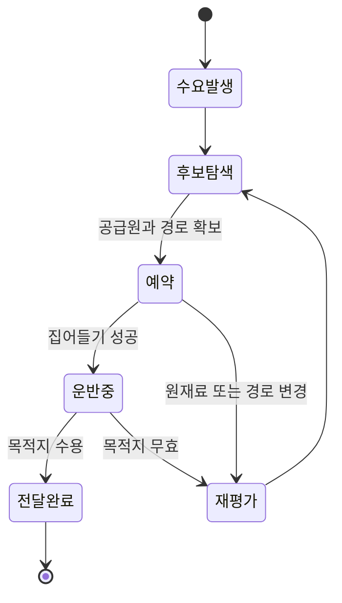
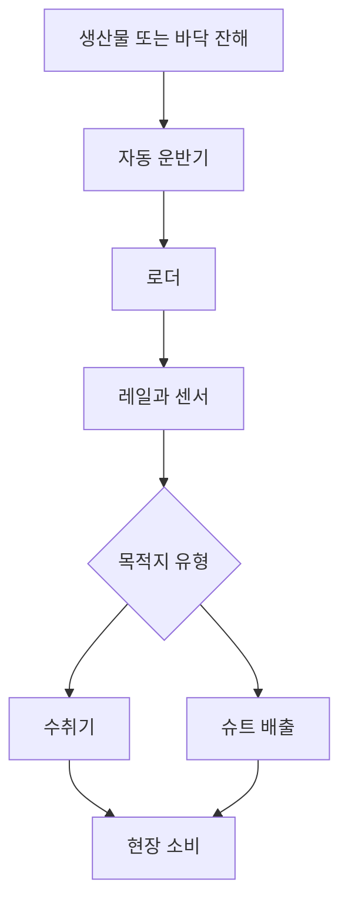

# 16. 저장·운반·컨베이어·자원 예약 시스템 역기획

> 기준일: 2026-11-13 · 범위: 공통 지상 물류. 로켓·행성 간 물류는 [21장](21_multicolony_spaced_out.md)에서 확장한다.  
> [목차](00_README.md) · [작업 선택](04_tasks_priorities_schedules.md) · [자동화](17_automation.md) · [열](08_temperature_phase_change.md)

## 1. 시스템의 역할

**[해석] ONI의 생산량은 자원이 존재하는 양보다 필요한 곳에 도착하는 양에 의해 제한된다.** 채굴한 광물이 맵 어딘가에 있어도 건설 위치에 전달되지 않으면 청사진은 완성되지 않는다. 수확한 음식, 목장에서 나온 석탄, 정련 금속, 비료, 알도 같은 문제를 공유한다.

물류는 다음 세 계층으로 구분한다.

| 계층 | 담당 기능 | 대표 실패 |
|---|---|---|
| 자원 인지·정책 | 무엇을 어디에 둘지 결정 | 필터·수량 설정 불일치 |
| 작업·예약 | 누가 어느 묶음을 옮길지 결정 | 접근 불가, 담당자 부족, 중복 예약 |
| 실제 이송 | 복제체·자동 운반기·레일로 이동 | 정전, 출력 막힘, 네트워크 단절 |

**[확인]** 공식 Occupational Upgrade는 레일·로더·수취기와 자동 운반기를 통해 고체 자원을 운송하고 시설에 배분하는 체계를 도입했다.[^L1] 이는 모든 자원 이동을 순간적인 전역 재고 차감으로 처리하는 게임과 구별되는 핵심 구조다.

## 2. 자원은 수량 외의 상태를 가진다

| 속성 | 물류에 미치는 영향 | 구분하지 않았을 때의 문제 |
|---|---|---|
| 종류·태그 | 저장 필터와 레시피 적합성 | 잘못된 재료가 건물에 들어감 |
| 질량·수량 | 운반량, 저장 용량, 패킷 분할 | 음수 재고·중복 소비 |
| 위치·월드 | 실제 접근 가능성 | 다른 소행성 자원에 접근 가능한 것으로 오판 |
| 온도 | 운송 중 열 교환과 소비처 환경 | 뜨거운 산출물이 농장·기지를 가열 |
| 세균·오염 | 위생·식품 공정 | 저장 위치만으로 안전하다고 오판 |
| 신선도 | 식품 소비 우선순위와 부패 | 재포장으로 신선도 초기화 |
| 예약 상태 | 다른 작업과의 경쟁 | 두 복제체가 같은 묶음을 동시에 사용 |
| 접근 권한 | 문·수트·구역 제약 | 존재하지만 사용할 수 없는 재고 |

**[설계 제안]** `전체 보유량`, `물리적으로 도달 가능한 양`, `정책상 사용 가능한 양`, `미예약량`을 별도로 계산한다. 전역 재고 표시는 정보 기능이고 작업 가능량은 작업자·목적지마다 달라지는 질의 결과다.

## 3. 수동 물류와 작업 생성

### 3.1 공급형 작업

건물의 입력 저장량이 목표보다 부족하면 공급 수요가 생긴다. 건설·조리·농업·발전·연구가 모두 공급 수요자가 될 수 있다. 공급 작업을 실행하려면 유효한 원재료와 목적지의 남은 용량, 작업자의 이동 경로가 필요하다.

### 3.2 정리형 작업

바닥의 잔해를 치우는 작업은 수요 건물에 전달하는 작업과 목적이 다르다. 정리는 환경·정돈·접근성을 개선하지만, 실사용 장소에서 멀리 떨어진 창고로 모두 옮기면 다음 공급 때 다시 운반해야 한다.

**[해석]** “창고에 모으기”와 “생산에 필요한 만큼 가까이 두기”는 별개의 정책이다. 모든 재료를 중앙 창고 하나에 보내는 구조는 관리가 쉬워도 노동이 중앙으로 왕복하면서 길어질 수 있다.

### 3.3 예약 수명주기

이 상태도는 **[설계 제안]** 이다. 원작의 실제 내부 스케줄러 순서나 클래스명을 뜻하지 않는다. 기획상 반드시 유지해야 할 성질은 같은 수요를 과잉 충족하지 않는 것, 목적지가 사라졌을 때 예약을 해제하는 것, 작업 중단 후 손에 든 물건의 소유·위치를 잃지 않는 것이다.

## 4. 저장 시설의 역할

| 설정·기능 | 플레이어 의도 | 검증해야 할 예외 |
|---|---|---|
| 자원 필터 | 저장할 물건 제한 | 필터를 끈 뒤 이미 들어 있던 물건 처리 |
| 최대 저장량 | 과도한 반입 억제 | 운반 중인 몫을 용량 계산에 포함하는가 |
| 우선순위 | 여러 수요 중 상대적 중요도 표시 | 복제체 개인 우선순위·다른 작업과의 관계 |
| 정리 전용 설정 | 지정한 잔해만 수거 | 일반 공급 작업까지 막는지 별도 확인 |
| 비우기 | 현 재고를 외부로 반출 | 비우는 동안 재입고가 반복되지 않는가 |
| 자동화 신호 | 저장 상태를 다른 시설에 전달 | 신호의 의미가 가득 참인지 목표 달성인지 |

**[설계 제안]** “최대량까지 자동 보충”과 “사용자가 지정한 청소 결과만 받음”을 서로 다른 수요 생성 정책으로 표현한다. 정책을 하나의 우선순위 숫자에 억지로 넣으면 플레이어가 이유를 이해하기 어렵다.

저장 건물 안의 자원이 다른 물리 규칙에서 완전히 사라진다고 가정해서도 안 된다. 열 교환·오염·부패·배출 규칙은 보관 유형별로 별도 확인해야 한다. 모든 저장소를 같은 만능 보존 시설로 만들면 냉장·열 차폐·오염 관리의 의미가 줄어든다.

## 5. 자동 운반기와 컨베이어

### 5.1 기능별 분해

| 요소 | 역할 | 외부 의존 |
|---|---|---|
| Auto-Sweeper | 범위 내 물건과 시설 입력·저장 사이 이송 | 전력, 유효 범위, 접근 가능한 대상 |
| Conveyor Loader | 선택된 고체를 레일 패킷으로 투입 | 입력 물건, 필터, 가동 상태, 출력 공간 |
| Conveyor Rail | 고체 패킷의 이동 경로 | 연결 방향과 연결된 입출력 |
| Conveyor Receptacle | 레일에서 고체를 받아 저장 | 수용량, 후속 소비·반출 |
| Conveyor Chute | 레일 물건을 월드로 배출 | 출구 위치·주변 환경 |
| Conveyor Meter | 지정 물량의 통과를 관리 | 누적량, 리셋·제어 신호 |
| 센서·차단기 | 조건을 읽고 통과를 허용·분기 | 패킷 상태, 자동화 신호 |

**[확인]** Meter 계열은 기체·액체·고체 수송에서 정해진 양을 보내는 기능으로 공식 소개됐다.[^L2] 따라서 단위 시간당 최대 흐름을 제한하는 밸브와 총 누적 반출량을 제한하는 계량 기능은 다른 개념이다.

### 5.2 고체 물류 흐름

**[해석]** 자동 운반기와 레일은 서로 대체재가 아니다. 자동 운반기는 짧은 범위의 집기·분배를 맡고, 레일은 시설 사이의 장거리 운송을 맡는다. 두 장치 중 하나만 있어서는 완결된 생산·소비 흐름을 만들지 못할 수 있다.

### 5.3 꼭 구분할 규칙

- 레일에 연결했다는 것과 물건을 로더 안으로 공급했다는 것은 다르다.
- 수취기까지 도착했다는 것과 실제 소비 건물에 들어갔다는 것은 다르다.
- 배출 슈트를 통한 바닥 투하는 저장 시설의 용량 제한과 다른 방식으로 동작한다.
- 출력이 막히면 상류 패킷이 대기하고, 그 정체가 생산 건물까지 전파될 수 있다.
- 필터·수동 사용 허용·우선순위·자동화 정지를 각각 확인해야 한다.
- 전력 요구는 요소별로 다르므로 레일 전체 길이에 임의의 운전 전력을 부과하지 않는다.

상세한 포트 우선순위, 브리지의 합류·분기 규칙, 패킷 최대 질량과 처리 주기는 **[검증 필요]** 다. 액체 배관에서 외운 수치를 고체 레일에 복사하지 않는다.

## 6. 처리량과 버퍼 계산

다음은 원작의 실제 레일 상수를 사용하지 않는 **[설계 제안]** 이다.

`전체 처리량 = min(생산 처리량, 집기 처리량, 로더 처리량, 레일 처리량, 수취 처리량, 최종 소비량)`

가정상 생산 15kg/s, 집기 12kg/s, 레일 20kg/s, 소비 10kg/s라면 지속 소비에 기여하는 최대량은 10kg/s다. 이때 레일을 증설하는 것만으로 소비량이 늘지 않는다. 15kg/s가 계속 생성되면 초당 5kg이 어딘가에 쌓인다.

소비 시설이 40초간 정비로 멈추고 생산이 15kg/s를 유지한다면, 그 구간의 완충 저장량은 최소 600kg이다. 이후 소비량이 생산량보다 높지 않으면 버퍼는 원래 수준으로 줄어들지 않는다. 버퍼는 부족한 평균 처리량을 해결하는 장치가 아니라 일시적인 불균형을 받아내는 장치다.

### 노동 절감 평가

`절감된 노동 ≈ 기존 왕복 이동 시간 + 집기·전달 시간 − 자동 설비 유지 노동`

짧은 거리에 드물게 필요한 물건보다, 원거리에서 반복적으로 나오는 생산물을 먼저 자동화할 유인이 크다. 다만 건설 비용·전력·열·고장 복구까지 포함해야 자동화의 실효 이득을 비교할 수 있다.

## 7. 대표 실패와 진단 순서

| 증상 | 주요 원인 후보 | 진단 순서 |
|---|---|---|
| 물건은 있는데 로더가 비어 있음 | 범위·필터·수동 공급·전력 문제 | 대상 선택 → 집기 가능 → 입력 허용 |
| 로더가 차 있고 레일은 정지 | 출력 연결·네트워크 방향·차단 | 첫 출력 패킷부터 목적지까지 추적 |
| 수취기가 가득 차 있음 | 최종 소비·반출 부족 | 목적지 수용량과 작업 확인 |
| 창고 사이 왕복 운반 반복 | 수요 정책 충돌·우선순위 순환 | 같은 자원의 출발·도착 이력 확인 |
| 특정 자원만 멈춤 | 필터 누락·혼입·목적지 불일치 | 막힌 패킷의 자원 태그 확인 |
| 농장이 열로 멈춤 | 뜨거운 고체가 농장 관통 | 물품 온도와 레일 경로 확인 |
| 총재고는 많은데 건설 중단 | 다른 월드·닫힌 구역·예약 | 도달 가능한 미예약량 확인 |

**[해석]** 좋은 진단 UI는 “작동하지 않음” 대신 최초로 충족되지 않은 전제조건을 보여 준다. 사용자는 레일의 끝을 바꾸기 전에 실제 막힌 지점과 막힌 물건을 알아야 한다.

## 8. 자동화·축산·식량과의 결합

자동화 예시는 **[설계 제안]** 이다.

| 목적 | 입력 정보 | 제어 대상 | 실패 시 기본 동작 |
|---|---|---|---|
| 연료 비축 유지 | 현장 연료 저장량 | 로더·차단기 | 최소 비축을 남기는 정책 |
| 농업 재료 우선 공급 | 비료 저장량 | 분기·목적지 | 음식 생산에 필요한 재료 확보 |
| 뜨거운 금속 냉각 후 배출 | 레일 물품 온도 | 차단·순환 경로 | 과열 물건을 생활구역에 보내지 않음 |
| 후계 알 보호 | 알·개체 목표량 | 선택적 반출 | 모든 알이 가공되는 정책 방지 |
| 정량 선적 | 누적 반출량 | 계량 장치 | 목표량 뒤 멈추고 명시적 재시작 |

원작의 특정 블루프린트를 정답으로 복제하기보다, 어떤 상태를 관측하고 어떤 위험을 제어하는지 기록해야 다른 식민지에서도 설계 의도를 재사용할 수 있다.

## 9. 제안 데이터 구조

| 구조 | 주요 필드 |
|---|---|
| `ResourceStack` | 자원 ID, 질량, 온도, 신선도, 오염, 위치 |
| `StoragePolicy` | 허용 필터, 최대량, 공급·정리 정책, 우선순위 |
| `StorageState` | 보유량, 반입 예약량, 반출 예약량 |
| `LogisticsDemand` | 목적지, 필요 종류·수량, 유효 조건 |
| `TransportReservation` | 공급원, 목적지, 물량, 작업자, 만료 조건 |
| `ConveyorPacket` | 내용물 상태, 현재 구간, 다음 연결 |
| `ConveyorNetwork` | 연결 그래프, 입출력, 막힘 상태 |

**[설계 제안]** 네트워크 캐시를 갱신하는 사건은 건설·철거·다리 연결·차단기 상태 변경 등으로 한정할 수 있다. 물건의 온도·부패와 경로 연결은 서로 다른 갱신 이유를 가지므로 같은 캐시에 무조건 넣지 않는다. 이는 재구현 아이디어이며 원작 코드 구조를 단정하지 않는다.

## 10. 검증 시나리오

1. 한 묶음을 여러 공급 작업이 동시에 선택하게 하고, 총 전달량이 원래 질량을 초과하지 않는지 본다.
2. 운반 중 목적지를 철거·비활성화·필터 변경하고 재평가·하차 위치를 확인한다.
3. 수취기를 막아 상류 정체가 예상 위치까지 전파되는지 확인한 뒤 정상 재개를 검증한다.
4. 동일 재료의 우선순위가 다른 창고를 두고 순환 운반이 생기는 조건을 기록한다.
5. 온도·오염·신선도가 다른 같은 종류의 물건을 합치고 분리할 때 상태 보존을 확인한다.
6. 자동 운반기 범위 경계와 벽·문 위치를 바꿔 표시 범위와 실제 작업 가능 대상이 일치하는지 본다.
7. 계량 완료 순간 저장 후 불러오기를 수행해 재시작하지 않은 물량이 추가 반출되지 않는지 본다.
8. 물류만 끊긴 상태와 자원 고갈 상태의 알림이 구별되는지 확인한다.

## 11. 출처

[^L1]: Klei, [Occupational Upgrade 254439](https://kleiforums.com/game-updates/oni-alpha/254439-r375/). 자동 운반기·고체 컨베이어·저장 자동화의 공식 도입 설명. 당시 직업·UI 수치는 현행 근거로 사용하지 않음.
[^L2]: Klei, [Peculiar Plants 463874](https://kleiforums.com/game-updates/oni-so/463874-r1546/). 기체·액체·고체 정량 이송 장치의 기능 소개. 정확 처리량과 현재 해금 단계는 별도 검증.
