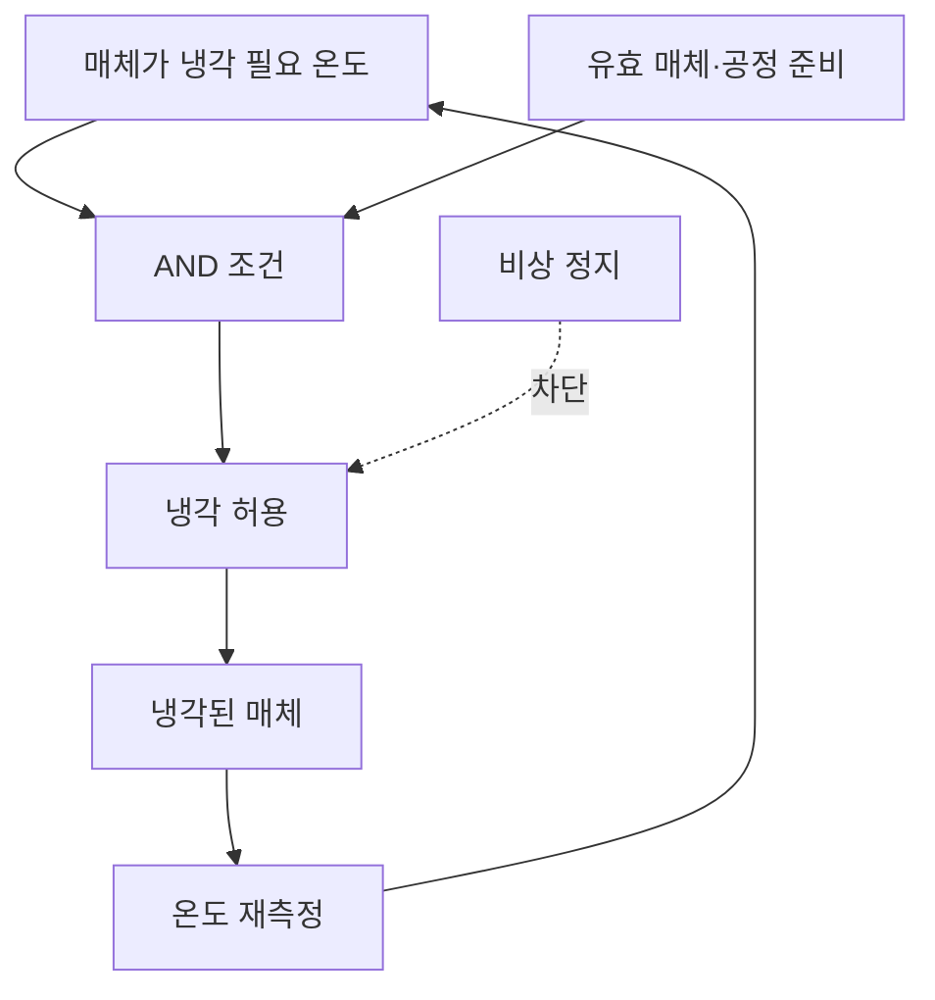

# 17. 센서·논리 회로·자동 제어 시스템

[전체 목차](00_README.md)

- 작성 기준: 2026-11-13 / 기본 게임 공통 자동화 중심
- 표기: **[확인]** 자료 확인, **[해석]** 역기획 분석, **[설계 제안]** 재현용 구조, **[검증 필요]** 대상 빌드 테스트 항목
- 논리표·제어 예제는 기능 명세를 위한 표현이며, 원작 내부 코드·틱 주기·실행 순서를 확인한 결과가 아니다.

## 1. 목적: 플레이어의 반복 판단을 시설에 저장

**[확인]** 공식 Automation Upgrade는 센서·스위치·논리 게이트를 통해 기지를 제어하는 체계를 소개했다. 온도·기체/액체 상태·시간을 조건으로 사용할 수 있다.[^automation]

**[해석]** 자동화의 핵심은 복제체 노동을 모두 없애는 데 있지 않다. “물이 부족하면 멈춘다”, “충전이 충분하면 발전을 멈춘다”, “매체가 너무 차가우면 냉각하지 않는다” 같은 반복 판단을 기지에 남기는 것이다. 플레이어는 설비 배치자에서 운전 규칙의 설계자로 역할을 확장한다.

| 제어 목표 | 입력 | 출력 | 플레이어가 선택하는 것 |
|---|---|---|---|
| 자원 절약 | 저장량·충전율 | 생산기 가동 | 목표 재고와 비상 여유 |
| 생존 안정 | 산소·물·온도 | 펌프·냉각·경보 | 허용 범위와 우선순위 |
| 공정 보호 | 배관 원소·온도 | 차단·반송 | 허용 입력과 예외 처리 |
| 시간 분산 | 사이클 시간·타이머 | 공정 가동 | 동시 부하와 운영 시간 |
| 물류 조정 | 재고·무게·통과량 | 공급·출하 | 과잉 생산·배송 정책 |

## 2. 신호와 실제 작동의 차이

**[해석]** 자동화 신호의 녹색·적색은 논리 조건의 충족 여부다. 녹색이라고 기계가 반드시 작동하는 것은 아니다. 원료, 전력, 출력 공간, 작업자, 환경 조건이 추가로 필요할 수 있다.

`실제 작동 가능 = 제어 허용 AND 설비 자체 조건 충족`

이 식은 기획상 조건 분해다. 기계마다 자동화 포트 의미가 다를 수 있으므로 모든 녹색을 같은 동작으로 해석하지 않는다. 출력 포트도 단순한 켜짐 상태, 저장량 조건, 작업 완료 등의 의미가 있을 수 있다.

자동화 전선은 전력선과 다른 네트워크다. 신호가 연결되어 있다는 이유로 전력이 공급되는 것도 아니고, 전력만 연결되어 있다는 이유로 제어 조건이 전달되는 것도 아니다.

## 3. 센서의 측정 범위

| 센서 계열 | 측정 대상 | 자주 발생하는 오해 |
|---|---|---|
| 환경 온도 | 센서 위치의 환경 | 방 전체 평균으로 착각 |
| 기체·액체 압력 | 해당 위치의 질량·환경 조건 | 현실의 압력 모델과 동일시 |
| 원소 | 환경 또는 배관 속 선택 원소 | 이름이 비슷해도 환경 센서와 배관 센서를 혼동 |
| 배관 온도 | 특정 구간의 패킷 | 몇 칸 뒤 냉각 장치가 처리할 패킷과 시간 불일치 |
| 병원체 | 특정 매체의 균 상태 | 원소 정화와 병원체 제거를 동일시 |
| 저장·무게 | 연결된 저장·측정 대상 | 다른 창고까지 전역 집계된다고 착각 |
| 시간 | 사이클 또는 타이머 상태 | 정지·저장·불러오기 후 재개 방식 미확인 |

**[검증 필요]** 센서 셀이 비었을 때의 출력, 목표 원소가 없을 때의 비교 결과, 등호 경계, 갱신 주기는 센서 종류별로 실측해야 한다. 모든 센서가 같은 빈 입력 정책을 가진다고 가정하지 않는다.

## 4. 조합 논리와 시간 논리

### 4.1 기본 논리

아래 표는 일반 불 대수의 정의다. 공식 자동화 기능은 이러한 논리를 기지 제어에 노출한다.[^automation]

| A | B | AND | OR | XOR |
|---|---|---|---|---|
| 적색 | 적색 | 적색 | 적색 | 적색 |
| 적색 | 녹색 | 적색 | 녹색 | 녹색 |
| 녹색 | 적색 | 적색 | 녹색 | 녹색 |
| 녹색 | 녹색 | 녹색 | 녹색 | 적색 |

NOT은 녹색과 적색을 뒤집는다. 배선 연결이 논리 의도와 일치하는지 알아보기 쉽도록 조건명을 긍정형으로 정하면 좋다. 예를 들어 `냉각수 있음`, `온도 안전`, `전력 여유`를 AND로 조합하면 각 조건이 왜 꺼졌는지 추적하기 쉽다.

### 4.2 Filter와 Buffer

**[해석: 기능 모델]** Filter Gate는 일정 시간 유지되는 녹색을 통과시키는 방향의 지연, Buffer Gate는 입력이 꺼진 뒤에도 출력을 잠시 유지하는 방향의 지연으로 이해할 수 있다. 둘을 단순히 “신호를 똑같이 늦추는 장치”로 처리하면 짧은 펄스와 종료 시 동작을 잘못 설계한다.

| 장치 | 목적 | 예제 |
|---|---|---|
| Filter | 순간 조건 변화 무시 | 압력이 잠깐 변할 때 펌프 토글 방지 |
| Buffer | 작업 종료 후 여유 시간 유지 | 입력이 멈춘 뒤 배관의 잔량 배출 |
| 메모리 계열 | 과거 상태 유지 | 상한까지 채우고 하한까지 사용 |
| 주기·시간 계열 | 시간창 제공 | 공정 가동 시간 분산 |

**[검증 필요]** 정확 시간 정밀도, 저장 시 경과 시간 보존, 같은 갱신에서 입력이 여러 번 바뀌었을 때의 결과는 빌드별 검증 대상이다. 논리 기능 설명이 스케줄러 내부의 순간 응답을 보증하지 않는다.

## 5. 대표 제어 패턴

### 5.1 저장량 히스테리시스

**[설계 제안]** 특정 원작 건물의 고정 임계값이 아닌 예시다. 저장률이 30% 이하이면 생산을 켜고, 80% 이상이면 끈다. 그 사이에서는 이전 상태를 유지한다.

| 저장률 흐름 | 제어 상태 |
|---|---|
| 90%에서 감소 중 | 정지 유지 |
| 30% 도달 | 생산 시작 |
| 50%로 증가 | 생산 유지 |
| 80% 도달 | 생산 정지 |

한 임계값만 쓰면 측정값이 경계 근처에서 흔들릴 때 설비가 반복 토글될 수 있다. 저장량이 작거나 공정 지연이 크면 임계값 간격을 넓히는 것이 유효하다.

### 5.2 냉각 보호

냉각 센서는 자신이 읽는 패킷과 실제 장치에 들어가는 패킷이 연결되도록 배치해야 한다. 센서가 멀리 있으면 앞선 패킷의 온도로 뒤의 다른 패킷을 냉각할 수 있다. 바이패스·브리지·루프 방향과 함께 설계해야 한다.

### 5.3 원소 검출과 반송

허용 원소이면 공정으로, 아니면 별도 저장이나 반송으로 보낸다. 이때 반송 구간이 가득 찼을 때도 본 공정이 어떻게 동작할지 정의해야 한다. 센서는 오류를 감지할 뿐 처리 공간을 만들어 주지는 않는다.

### 5.4 저장 넘침 방지

생산 중지 신호와 실제 출력 중지 사이에는 이미 처리 중인 물량이 남을 수 있다. 예를 들어 입력을 끊어도 공정 내부·관·컨베이어에 제품이 남는다. 상한을 100%로 두기보다 이 잔량을 받을 공간을 남기는 이유다.

## 6. 제어계의 시간과 여유량

**[계산용 가정]** 생산률 `2 kg/s`, 센서에서 실제 중단까지의 총 지연 `5초`, 이미 운송 중인 물량 `12 kg`을 가정한다.

`필요한 잉여 공간 ≥ 생산률 × 제어 지연 + 운송 중 물량`

이 예에서는 `2×5+12 = 22 kg` 이상의 여유가 필요하다. 원작의 틱 지연이나 특정 기계 값이 아니라, 신호 제어와 물질 운송을 함께 고려하는 방법이다.

센서의 반응이 아무리 빨라도 공정 내부의 이미 생성된 제품은 사라지지 않는다. 정량 출하나 과냉각 방지는 센서 정확도뿐 아니라 물질이 어디에 있는지 아는 설계가 필요하다.

## 7. 실패 모드

| 실패 | 원인 | 진단 순서 |
|---|---|---|
| 녹색인데 기계가 정지 | 전력·원료·출력·작업자 조건 | 기계 자체 정지 사유 먼저 확인 |
| 빠른 켜짐·꺼짐 반복 | 단일 임계값과 지연 | 측정 추세·히스테리시스·필터 확인 |
| 원하지 않는 기체가 통과 | 센서와 차단 위치 불일치 | 실제 패킷의 이동 순서 추적 |
| 정상 운전 후 재기동 불가 | 초기 상태를 고려하지 않음 | 메모리·저장량·비상 전원 확인 |
| 신호 변경 후 회로 전체 오동작 | 의도하지 않은 배선 접속 | 포트·브리지·교차 구간 확인 |
| 저장·불러오기 후 다른 동작 | 시간·메모리 상태 복원 차이 | 경과 시간·래치 상태 비교 |

제어 실패를 모두 센서 수치 문제로 보지 않는다. 공정 자체의 병목, 센서 위치, 신호 배선, 상태 초기화 중 어느 층에서 문제가 생겼는지 분리한다.

## 8. 플레이어 학습과 UI

**[해석]** 초반에는 스위치 하나로 켜고 끄는 경험, 다음에는 센서 하나로 조건부 가동, 이후 AND·NOT·시간 지연·메모리 순서가 이해하기 쉽다. 이 순서는 원작 튜토리얼의 실제 고정 단계가 아니라 학습 난도의 역기획 해석이다.

UI에 필요한 정보는 현재 신호 색만이 아니다.

- 센서가 현재 측정하는 대상과 값.
- 설정 임계값·비교 방향.
- 게이트의 입력별 상태와 남은 지연 시간.
- 연결된 출력 장치와 실제 가동 불가 사유.
- 저장·불러오기 이후 유지되는 상태.

이 정보가 있으면 복잡한 회로도 “어느 조건이 충족되지 않았는가?”로 나눠 진단할 수 있다.

## 9. 재현용 모델과 검증

**[설계 제안]** 데이터는 `SensorSpec`, `SignalPort`, `LogicNode`, `TimerState`, `ActuatorBinding`으로 구분할 수 있다. 신호망과 전력망·배관망은 연결 관계를 공유할 수 있지만 의미는 분리한다. 실제 원작 엔진이 이 구조라는 뜻은 아니다.

| ID | 시험 | 판단 기준 |
|---|---|---|
| AU-01 | 모든 기본 게이트 입력 조합 | 논리표와 출력의 일치 |
| AU-02 | Filter에 짧은·긴 녹색 펄스 | 통과·차단과 지연 상태 |
| AU-03 | Buffer 입력 종료 후 시간 경과 | 유지 시간과 재입력 처리 |
| AU-04 | 저장량을 상·하한 사이에서 왕복 | 기억 상태와 토글 안정성 |
| AU-05 | 온도가 다른 패킷을 번갈아 투입 | 올바른 패킷에 대한 제어 |
| AU-06 | 시작 시 탱크 비움·충만 상태 비교 | 초기화·재기동 가능성 |
| AU-07 | 지연 진행 중 저장·불러오기 | 신호·타이머 연속성 |
| AU-08 | 출력 막힘과 전력 부족을 동시에 발생 | 신호 허용과 실제 가동의 구분 |

연결: [배관](07_liquids_plumbing_sanitation.md), [열](08_temperature_phase_change.md), [전력](09_power_networks.md), [물류](16_logistics_storage_conveyors.md), [간헐천](18_geysers_hazards_renewables.md).

## 10. 근거

[^automation]: [공식 Automation Upgrade 발표, 2017-11-16](https://store.steampowered.com/news/posts/?appids=457140&enddate=1517595794&feed=steam_community_announcements). 자동화·게이트·센서 기능의 1차 근거. 이 문서의 진리표는 일반 논리 정의이며 세부 시간·실행 순서는 직접 검증 필요.
