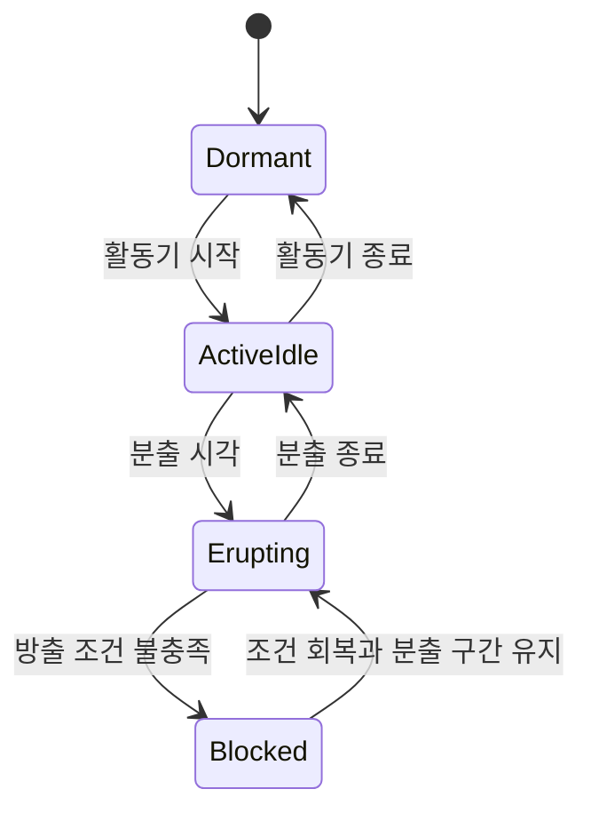
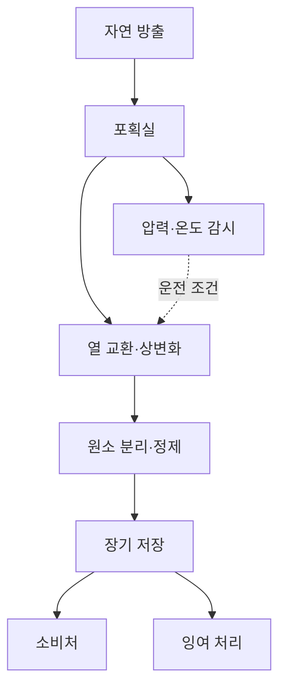

# 18. 간헐천·화산·자연 위험·재생 자원 시스템

[전체 목차](00_README.md)

- 작성 기준: 2026-11-13 / 기본 게임과 공통 자연 자원, 행성·DLC 차이 표시
- 표기: **[확인]** 자료 확인, **[해석]** 역기획 분석, **[설계 제안]** 재현용 모델, **[검증 필요]** 실측 대상
- 간헐천의 개별 생성값·월드별 보장 출현·평균 출력은 현재 세이브를 분석해야 확정할 수 있다. 아래 수치는 계산 설명용이다.

## 1. 목적: 유한 채굴에서 장기 공급으로 전환

**[해석]** 자연 자원은 채굴 자원의 한계를 넘게 해 주지만, 발견 즉시 사용할 수 있는 공짜 생산기가 아니다. 위치·온도·원소·가동 주기·작업 접근성·저장 용량을 기술과 설계로 해결해야 한다.

| 자원 유형 | 잠재 보상 | 함께 들어오는 문제 |
|---|---|---|
| 물·염수·오염수 계열 | 산소·농업·산업의 장기 입력 | 원소 정제, 온도, 주기적 공급 |
| 증기 계열 | 물과 열 | 응축 또는 열 회수, 과압 |
| 가연성 기체 | 발전·산업 원료 | 기체 분리·저장·휴면기 |
| 금속 화산 | 정제 금속과 대량 열 | 극고온 재질·냉각·회수 |
| 마그마·지열 | 장기 열원 | 열 전달 제어와 내열 구조 |
| 표면 환경 | 빛·우주 접근·특수 자원 | 진공·낙하물·행성별 조건 |

발견 보상은 “이제 자원이 무한하다”보다 “이 자원을 안전하게 회수할 다음 프로젝트가 생겼다”에 가깝다.

## 2. 발견·노출·분석·포획의 단계

| 단계 | 플레이어 행동 | 얻는 정보·자원 | 위험 |
|---|---|---|---|
| 탐색 | 외곽과 바이옴 조사 | 후보 지점 확인 | 위험 구역 진입 |
| 노출 | 주변 지형 제거 | 자원원 접근 | 예기치 않은 방출 |
| 분석 | 적합한 복제체 작업 | 주기·평균 산출 등 운영 정보 | 작업 위치 안전 확보 필요 |
| 포획 | 방·배관·열처리 설치 | 실제 회수 가능한 출력 | 과압·과열·정체 |
| 완충 | 저장·대체 경로 구축 | 휴면기에도 지속 공급 | 저장 공간·자재·누출 |
| 확장 | 증폭·복수 자원원 통합 | 더 큰 장기 공급 | 처리 용량도 함께 늘려야 함 |

**[확인]** Hot Shots 공식 공지는 분석된 간헐천의 평균 출력 표시와 Geotuner의 출력·온도 증가 기능을 소개한다.[^hotshots] 분석 정보는 설계 규모를 정하기 위한 입력이지 시설 완성 자체는 아니다.

## 3. 분출 주기와 휴면 주기의 중첩

**[해석]** 간헐천의 공급은 한 가지 켜짐·꺼짐 주기만으로 설명되지 않는다. 활동 기간 안의 짧은 분출·대기 패턴과 더 긴 활동·휴면 패턴을 구분해야 한다.

이 다이어그램은 계획용 상태 모델이다. 출력 정지가 내부 주기 타이머를 늦추는지, 예정된 분출 구간을 소비하는지, 활동기 경계에서 어떻게 처리하는지는 대상 빌드로 확인해야 한다. 원작의 정확 상태기계라고 주장하지 않는다.

### 3.1 장기 평균

분출 중 질량 유량을 `q`, 활동기 안 분출 비율을 `f`, 전체 시간 중 활동 비율을 `a`라 하면:

`장기 평균 공급 ≈ q × f × a`

일정 주기·고정 유량·방출 방해 없음의 단순 모델이다. 실제 포획률 `r`을 포함하면 소비처에 도달하는 평균은 `q×f×a×r`다. 과압으로 방출을 놓치거나 냉각·펌프가 따라가지 못하면 `r`이 낮아진다.

### 3.2 피크와 평균은 다른 설계값

저장고는 장기 공급과 소비의 시간차를 흡수한다. 펌프·열교환기는 분출 순간의 피크를 직접 받거나, 포획실에 임시 저장한 물량을 천천히 처리한다. 평균 출력에만 맞춰 시설을 만들면 분출 중 과압·열폭주가 발생할 수 있다.

## 4. 계산 예제: 평균 공급이 수요를 넘어도 저장이 필요한 이유

**[계산용 가정]** 실제 간헐천 수치가 아니다.

- 분출 중 출력: `4 kg/s`.
- 활동기 중 분출 비율: `50%`.
- 전체 주기 중 활동 비율: `60%`.
- 포획률: `90%`.
- 소비량: `0.8 kg/s`.
- 가장 긴 완전 무공급 구간: `6,000초`.

| 항목 | 계산 | 결과 |
|---|---|---:|
| 이론 장기 평균 | `4 × 0.5 × 0.6` | 1.2 kg/s |
| 실제 회수 평균 | `1.2 × 0.9` | 1.08 kg/s |
| 평균 잉여 | `1.08 - 0.8` | 0.28 kg/s |
| 무공급 구간 최소 비축 | `0.8 × 6,000` | 4,800 kg |

평균은 충분해도 `4,800 kg`보다 작은 유효 저장량으로 해당 무공급 구간을 버틸 수 없다. 안전 여유와 다른 수요를 추가하면 더 필요하다. 동시에 저장을 채우는 데 시간이 필요하므로 첫 휴면기 전에 충분한 비축이 가능한지도 확인한다.

## 5. 포획 설비의 기능 분해

| 기능 | 설계 질문 |
|---|---|
| 방출 공간 | 주변 물질 때문에 출력이 멈추지 않는가 |
| 내열 구조 | 첫 분출과 반복 운전 모두 견디는가 |
| 열 교환 | 즉시 피크를 처리하는가, 열 저장고가 흡수하는가 |
| 원소 처리 | 출력물 자체가 소비 설비의 입력 조건에 맞는가 |
| 운송 | 환경에서 배관·컨베이어로 안전하게 옮길 수 있는가 |
| 장기 저장 | 휴면기와 예상치 못한 정지를 감당하는가 |
| 작업 접근 | 분석·건설·수리를 위해 들어갈 통로가 있는가 |
| 비상 격리 | 실패가 생활 구역으로 확산하지 않는가 |

## 6. Geotuner와 출력 증폭의 비용

**[해석]** 출력 증폭은 필요한 저장·펌프·열처리 능력도 키운다. 자원량 증가만 계산하면 기존 포획 설비를 초과할 수 있다. 또한 증폭에 필요한 보조 자원·복제체 작업·방 조건을 포함해야 순이익이 드러난다.

예를 들어 출력 물량이 늘고 온도도 오르면 열부하는 단순한 질량 증가율보다 크게 늘 수 있다. 열 예산은 [온도 문서](08_temperature_phase_change.md)의 `질량유량 × 비열 × 온도차` 모델로 따로 평가한다. 최대 증폭 수나 개별 증가량은 대상 빌드 데이터로 확정한다.

## 7. 자연 위험의 기획 구조

| 위험 | 유발 조건 | 플레이어 선택 | 시스템 연계 |
|---|---|---|---|
| 고온 바이옴·마그마 | 채굴·열 연결 | 우회, 단열, 열 회수 | 건설·재료·온도 |
| 액체 저장층 | 지형 개방 | 배수·격벽·저수지 전환 | 배관·경로·기체 |
| 유해·비호흡 기체 | 새로운 공간 연결 | 밀폐, 분리, 우주복 | 산소·건강·동선 |
| 자연 방출 | 간헐천 노출·분출 | 포획 전 노출 억제, 원격 제어 | 열·전력·물류 |
| 표면 낙하물 | 행성·설정별 환경 | 차폐·감지·수리 | 우주·전력·자동화 |
| 재고 고갈 | 채굴 자원 지속 소비 | 재생 자원·대안 공정 | 산업·사육·연구 |

**[해석]** 위험은 주로 플레이어의 확장 행동과 연결된다. 새로운 자원에 접근하기 위해 경계를 열면 그 경계가 막고 있던 열·기체·액체도 함께 들어온다. 자원 획득 보상과 환경 침입 위험을 묶는 구조다.

표면 낙하물의 종류·빈도·방어 조건은 기본 게임과 Spaced Out!, 시작 행성·설정·DLC에 따라 달라진다. “모든 행성은 동일한 운석 방어 시설이 필요하다”는 전제를 사용하지 않는다.

## 8. 재생 가능성과 무한 지속의 차이

**[해석]** 자연 자원원은 재생되더라도 그 자원을 처리하는 체계는 보조 재료와 노동을 계속 소모할 수 있다. 장기 자립을 판단하려면 다음을 각각 확인해야 한다.

1. 원천 자원의 주기 평균 공급이 수요를 충족하는가.
2. 가장 긴 무공급 구간을 비축으로 넘기는가.
3. 여과재·증폭재·수리재·연료 등 보조 입력도 지속 가능한가.
4. 폐열·부산물·기체의 누적이 정지 조건에 도달하지 않는가.
5. 인력 부재·정전 이후 다시 시작할 수 있는가.

이 검토는 단일 간헐천뿐 아니라 재생 자원에 연결된 산소·농업·발전망 전체에 적용된다.

## 9. 데이터·관측·검증

**[설계 제안]** 원작 데이터 구조를 단정하지 않는 재현용 항목이다.

| 데이터 | 필드 |
|---|---|
| `NaturalSourceSpec` | 출력 원소, 온도, 분출량 범위, 주변 조건 |
| `SourceInstance` | 생성된 실제 값, 위치, 분석 상태 |
| `ActivitySchedule` | 분출·대기·활동·휴면 시간 |
| `CaptureMetrics` | 생성, 회수, 누출, 과압 중단 |
| `ReservePlan` | 수요, 최대 무공급 시간, 유효 저장량 |
| `AmplificationState` | 보조 자원·작업 상태와 증폭 결과 |

| ID | 실험 | 확인할 것 |
|---|---|---|
| GS-01 | 한 전체 활동·휴면 주기 기록 | 평균 출력과 실제 회수량 차이 |
| GS-02 | 분출 중 포획실 압력을 높였다 낮춤 | 과압·타이머·회복 처리 |
| GS-03 | 같은 평균, 다른 저장 용량 | 휴면기 공급 안정성 |
| GS-04 | 증폭 전후 같은 냉각 설비 사용 | 물량과 열부하의 증가 |
| GS-05 | 운송 펌프 전력만 차단 | 포획실 누적과 상류 정지 |
| GS-06 | 생활 구역 경계 하나를 열음 | 위험 전파 범위와 격리 기능 |
| GS-07 | 분석 전후 UI와 저장·불러오기 비교 | 정보 공개와 상태 보존 |

## 10. 연결·근거·추가 확인

연결: [월드·탐험](02_world_biomes_exploration.md), [액체](07_liquids_plumbing_sanitation.md), [열](08_temperature_phase_change.md), [전력](09_power_networks.md), [산업](10_materials_industry.md), [자동화](17_automation.md).

**[검증 필요]** 간헐천별 정확 출력 범위·온도·과압 임계값·휴면 범위·노출 판정 셀·증폭 효과·출력 봉쇄 시 주기 처리. 공식 공지에 없는 생성 알고리즘을 실제 구현이라고 단정하지 않는다.

[^hotshots]: [Klei 공식 Hot Shots 개발 로그, 2022-12-15](https://kleiforums.com/forums/topic/145229-game-update-hot-shots-535720-535842/) 및 [공식 Steam 게시본](https://store.steampowered.com/news/posts/?appids=457140&enddate=1686352137&feed=steam_community_announcements). 검색 색인과 Steam 게시본을 대조. 포럼 직접 열기는 접근 제한이 있었다.
