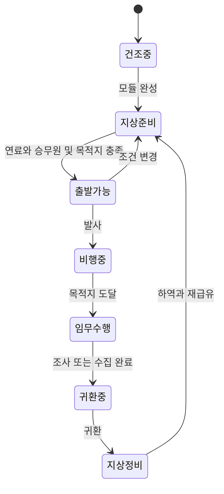

# 19. 기본 게임의 우주 탐사·로켓·후반 목표 역기획

> 기준일: 2026-11-13 · 범위: **Spaced Out!을 활성화하지 않은 기본판 우주 체계**. 추가 콘텐츠 팩은 별도 표시한다.  
> [목차](00_README.md) · [연구](15_research_progression.md) · [SO 다중 월드](21_multicolony_spaced_out.md) · [열](08_temperature_phase_change.md)

## 1. 기본판과 Spaced Out!의 경계

**[해석] 기본판 우주는 지상 식민지의 산업화 결과를 평가하는 후반 물류·연구 계통이다.** 지상에서 연료·산화제·특수 소재·우주항을 준비하고, 로켓을 원정시켜 조사 결과와 자원을 가져온다. 목적지는 원정 대상으로 표현되며, SO처럼 여러 로컬 소행성 기지와 로켓 내부 생활 공간을 함께 운영하는 규칙을 이 문서에 섞지 않는다.

**[확인]** 공식 Space Industry 업데이트는 망원경 관측, 로켓 Research Module의 Data Bank, Virtual Planetarium의 연구, 로켓 자동화를 하나의 진행 흐름으로 연결했다.[^S1] SO는 이후 모듈 로켓·우주 지도·다중 월드 관리가 크게 확장된 별도 체계다.[^S2]

| 항목 | 이 문서의 기본판 | SO 문서로 넘길 항목 |
|---|---|---|
| 우주 지도 | 거리와 목적지 중심의 원정 | 육각 격자 이동·탐사 |
| 목적지 | 탐사·자원 수집 대상 | 착륙·개척 가능한 소행성 |
| 승무원 공간 | 기본판 캡슐·임무 규칙 | 건설 가능한 로켓 내부 생활 공간 |
| 산업 목표 | 연료·극저온·특수 소재·반복 원정 | 여러 거점의 분업과 정기 수송 |
| Data Bank | 기본판 획득 규칙 | 궤도·POI 수집 등 SO별 규칙 |

모드에 따라 같은 이름의 건물도 동작이 다를 수 있다. 특히 Research Module과 망원경의 Data Bank 규칙은 [15장](15_research_progression.md)의 비교표를 따른다.

## 2. 플레이어 목표와 선택

| 목표 | 준비해야 할 것 | 판단 기준 |
|---|---|---|
| 우주 지도를 관측한다 | 관측 위치, 시설, 작업자 | 시야와 작업 가능 조건 |
| 첫 로켓을 보낸다 | 추진 체계, 기본 모듈, 조종 자격 | 도달 가능한 목적지와 귀환 |
| 후반 연구를 연다 | Data Bank 획득·운반·분석 | 연구비용과 반복 가능한 공급원 |
| 희귀 자원을 수집한다 | 목적지 정보와 적합 화물 구성 | 운송 가치 대비 연료·시간 |
| 더 먼 목적지로 간다 | 고급 추진제·산화제·재료 | 연료 성능과 로켓 구성의 균형 |
| 반복 원정을 자동화한다 | 충전·탑승·발사·귀환 준비 | 잘못된 조건에서 재발사하지 않는가 |
| 최종 우주 목표에 도달한다 | 장기 생산망과 탐사 진행 | 지상 생존을 유지하며 목표 수행 |

**[해석]** 가장 강한 엔진을 확보하는 것만으로 우주 시스템이 완성되지 않는다. 자원 수집 모듈을 더 달면 운송량은 커지지만 로켓 구성·연료 요구·원정 시간의 손익이 바뀐다. 연구선과 화물선을 같은 설계로 고정하지 않을 이유가 생긴다.

## 3. 모듈 구조와 책임

| 모듈 역할 | 입력·조건 | 출력 또는 기능 | 재구현 시 주의 |
|---|---|---|---|
| 추진 | 엔진별 연료·운전 조건 | 임무 수행 능력 | 연료 종류와 산화제 필요 여부 분리 |
| 연료 저장 | 적합한 물질, 용량 | 추진 계통에 공급 | 같은 액체라고 모두 허용하지 않음 |
| 산화제 저장 | 엔진이 요구하는 산화제 | 연소 추진 지원 | 다른 산화제의 효율을 동일시하지 않음 |
| 조종·승무원 | 배정, 자격, 탑승 | 임무 출발 조건 | SO 내부 공간을 그대로 적용하지 않음 |
| 연구 | 목적지 조사 가능성 | Data Bank·정보 | 최초 조사와 반복 임무 보상 분리 |
| 화물 | 저장 유형·용량 | 목적지 자원 운반 | 고체·액체·기체의 수용 형식 구별 |
| 보조 모듈 | 모듈별 조건 | 특정 추진·운영 보완 | 장착 가능 조합을 데이터로 제한 |

위 표는 **[역기획 정리]** 이다. 모듈 종류별 정확한 높이·질량·저장량·엔진과의 호환성은 버전별 게임 데이터 대조가 필요하다. 기본판의 추진 성능 계산을 SO의 이동 가능 칸수 규칙으로 치환하지 않는다.

## 4. 임무 상태 모델

**[설계 제안]** `출발가능`은 화면에서 한 번 체크하고 끝나는 값이 아니라 발사 직전 재검증해야 할 조건 집합이다. 승무원이 내리거나 모듈이 제거되고, 연료 설정이나 목적지가 바뀌면 상태가 다시 준비 단계로 내려갈 수 있어야 한다.

임무는 지상의 시간 흐름과 연결된다. 로켓을 보낸 동안에도 식민지의 산소·식량·열·전력 문제는 계속 진행한다. 출발이 성공했다고 귀환까지의 노동 공백과 유지비가 사라지는 것은 아니다.

## 5. 연료·거리·적재의 기획 관계

정확한 기본판 추진 공식은 **[검증 필요]** 다. 이 문서는 여러 버전의 커뮤니티 공식을 섞어 확정식으로 제공하지 않는다.

**[해석]** 기획 검토에 필요한 관계는 다음과 같다.

- 엔진의 성격은 사용할 수 있는 연료, 도달 범위, 모듈 구성의 선택지를 바꾼다.
- 연료와 산화제를 준비하려면 지상 생산 설비가 필요하다.
- 극저온 연료·산화제는 제조보다 저장·수송 중의 열 유입이 문제일 수 있다.
- 원정당 적재량을 높이는 선택은 로켓 구성과 필요한 자원·시간을 바꾼다.
- 목적지에서 얻은 특수 소재는 다시 지상과 우주 설비의 성능을 높인다.

### 가정에 의한 임무 손익 예제

다음 수치는 **[설계 제안]** 이며 실제 로켓 레시피가 아니다.

| 항목 | 작은 수집선 A | 큰 수집선 B |
|---|---:|---:|
| 원정당 유효 화물 | 1,000kg | 2,000kg |
| 원정·정비 전체 시간 | 5 cycle | 8 cycle |
| 원정당 연료비 | 500kg | 1,200kg |
| 평균 운반량 | 200kg/cycle | 250kg/cycle |
| 화물 1kg당 연료 | 0.50kg | 0.60kg |

B는 시간당 공급량이 높지만 연료 효율은 낮다. 지금 병목이 화물 공급속도인지 연료 제조량인지에 따라 선택이 달라진다. 여기에 귀환 주기에 맞춰 저장할 지상 버퍼와 승무원 부재도 함께 평가해야 한다.

## 6. 우주항은 열·전력·접근성 시설이다

**[해석]** 로켓 발사장을 단순한 건물 바닥으로 보면 주변 시설이 받는 영향을 놓친다. 우주항은 발사·귀환 공간, 연료 공급선, 조종사 접근, 물류 반출, 지표 환경 대응을 함께 설계하는 복합 시설이다.

| 하위 문제 | 잘못 설계했을 때 | 설계 검토 질문 |
|---|---|---|
| 발사 경로 | 상부 구조물·문·설비와 간섭 | 출발·귀환 시 필요한 공간은 확보됐는가 |
| 배기와 열 | 주변 배관·시설 손상 | 열에 민감한 설비가 너무 가까운가 |
| 연료 이송 | 잘못된 물질·상변화·공급 정지 | 입력 필터와 온도 관리가 맞는가 |
| 지표 위험 | 관측·급유·이동 경로 중단 | 유성·잔해를 감지·처리할 수 있는가 |
| 승무원 접근 | 준비된 로켓에 탑승 못 함 | 문 권한·수트·사다리 경로가 유효한가 |
| 하역 | 화물이 남아 다음 임무 지연 | 저장·소비 시설의 여유가 있는가 |

**[확인]** 기본판 공식 우주 산업 개편에는 Space Scanner가 로켓 도착과 유성우를 감지하고 로켓 제어를 자동화하는 기능이 포함됐다.[^S1] 다만 현재 탐지 범위·대기시간·문 동작 상수는 별도의 검증 대상이다.

## 7. 자동화는 임무 정책을 구현한다

자동화 조건의 예는 **[설계 제안]** 이다.

`발사 승인 = 로켓 준비 ∧ 목적지 유효 ∧ 승무원 준비 ∧ 연료 준비 ∧ 출입 공간 준비 ∧ 현재 임무 허용`

운송 수요가 충족됐는데도 무조건 재발사하면 연료·노동·시간을 낭비한다. 출발 조건과 “출발할 필요”를 분리한다. 출발 준비가 완료돼도 지상 저장고가 이미 가득 찼으면 대기하도록 운영 정책을 만들 수 있다.

자동화 회로를 역기획할 때는 다음 세 정보를 기록한다.

1. 어떤 상태를 센서·포트로 읽을 수 있는가.
2. 어떤 동작을 실제로 제어할 수 있는가.
3. 센서와 동작 사이의 지연 동안 조건이 바뀌면 어떻게 되는가.

원작에서 직접 노출되지 않는 정보를 일반 자동화 포트에서 읽을 수 있다고 가정하지 않는다. 예를 들어 복합적인 임무 목표를 한 포트로 전부 확인할 수 있는지는 게임 UI·출력 포트와 대조해야 한다.

## 8. 실패 연쇄와 복구

| 출발 문제 | 연쇄 | 복구의 핵심 |
|---|---|---|
| 추진제 생산만 늘림 | 폐열 상승 → 기지 피해 | 생산량보다 열 배출 능력부터 확인 |
| 더 큰 화물선에만 집중 | 급유·정비 병목 증가 | 전체 임무 주기와 공급률 비교 |
| 연구선을 무작정 반복 | 목적지 정보·보상 특성 오해 | 최초 보상과 반복 보상 분리 |
| 귀환 공간 미준비 | 하역·승무원 복귀 지연 | 도착 감지와 공간 상태를 연결 |
| 전력망 공통 사용 | 우주항 가동 때 생존 설비 정지 | 중요 소비처의 전력 여유 확인 |
| 희귀 소재에 과의존 | 원정 중단이 지상 전체에 전파 | 기존 소재를 쓰는 대체 운전 확보 |

**[해석]** 후반 우주의 중요한 위험은 로켓 자체의 실패뿐 아니라, 그것을 준비하기 위해 안정된 지상 생태를 무너뜨리는 것이다. 우주항 증설은 식민지 전체 공급망 변경으로 평가해야 한다.

## 9. 후반 목표의 설계 의미

기본판의 먼 목적지·특수 자원·최종 우주 목표는 복합 능력을 요구하는 장기 목표다. **[해석]** 엔진 연구, 소재 생산, 열 제어, 지속 전력, 복제체 전문화가 하나의 프로젝트에 모이도록 설계되어 있다.

목표를 달성한 후에도 식민지를 계속 운영할 수 있으므로, 문서상의 완성도 기준은 결말 장면만이 아니다. 반복 임무의 운영 비용을 감당하고, 일시적 공급 중단 뒤 정상 상태로 복귀할 수 있는지까지 보아야 한다.

시간의 찢어진 틈 등 개별 목표의 정확한 도달 거리·선행 조건·현재 버전의 종료 연출은 **[검증 필요]** 이다. 이를 고정된 사이클 수의 캠페인 퀘스트로 재해석하지 않는다.

## 10. 제안 데이터와 검증

| 제안 데이터 | 핵심 내용 |
|---|---|
| `BaseRocketDefinition` | 모듈 목록, 추진 계통, 연료·산화제 제약 |
| `BaseSpaceDestination` | 거리, 관측 상태, 조사·자원 상태 |
| `RocketMission` | 출발지, 목적지, 임무 종류, 단계, 진행 시간 |
| `RocketCargo` | 자원 유형별 용량과 실제 적재 |
| `LaunchReadiness` | 조건별 준비 여부와 불가 원인 |
| `SpaceportPolicy` | 임무 허용, 목표 비축, 재급유·재발사 정책 |

검증 시나리오:

1. 같은 엔진에서 연료·모듈 구성을 바꿔 실제 도달 범위와 UI 예측이 일치하는지 본다.
2. 출발 준비 이후 승무원·목적지·모듈을 변경하고 재검증되는지 확인한다.
3. 화물 종류에 맞지 않는 적재 모듈을 선택했을 때 출발 가능 여부와 수집 결과를 구분한다.
4. 최초 조사와 재방문에서 Data Bank·자원·정보의 갱신을 따로 기록한다.
5. 귀환 직전 저장 후 불러오기에서 로켓 위치·임무·적재가 중복되거나 사라지지 않는지 확인한다.
6. 발사·귀환 중 열과 배기 영향을 관찰하고 주변 설비의 손상 원인을 기록한다.
7. 자동 반복 임무에서 하역 막힘·급유 중단·승무원 부재를 각각 유도해 잘못된 재발사를 방지하는지 본다.

## 11. 출처와 한계

[^S1]: Klei, [Space Industry Upgrade 290148](https://kleiforums.com/forums/topic/96908-space-industry-upgrade-available-now-game-update-290148/). 기본판 우주 연구·로켓 자동화의 역사적 공식 근거. 공식 검색 본문으로 확인했으며 직접 열기는 403. 현대 추진 상수를 확정하는 자료로 쓰지 않음.
[^S2]: Klei Support, [What is Oxygen Not Included — Spaced Out?](https://support.klei.com/hc/en-us/articles/360053456331-What-is-Oxygen-Not-Included-Spaced-Out). 기본판과 구별해야 하는 다중 월드·개편 로켓의 범위.

현재 실행 빌드의 모듈 데이터·임무 기록을 제공받지 않았으므로, 사거리·연료 공식·귀환 처리의 내부 알고리즘은 재현 구현을 확정하기 전에 추가 검증해야 한다.
