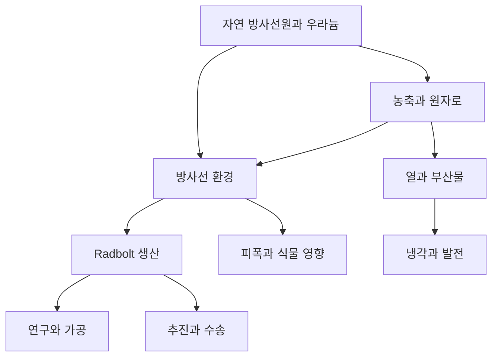

# 20. 방사선·래드볼트·핵 연구·원자로 역기획

> 기준일: 2026-11-13 · 범위: **Spaced Out! 전용 핵심 시스템**. 기본판의 일반 전력·열 시스템에 자동 적용하지 않는다.  
> [목차](00_README.md) · [연구](15_research_progression.md) · [열](08_temperature_phase_change.md) · [다중 월드](21_multicolony_spaced_out.md)

## 1. 하나의 위험을 여러 생산 계통에 연결한다

**[확인]** Spaced Out!은 자연 방사성 물질과 핵 설비, 환경 방사선, 보호복을 포함한다.[^N1] 초기 공식 방사선 업데이트는 우라늄 자원, 연구용 원자로, Radbolt 생산·전달, 방사선원과 생물 계통을 함께 도입했다.[^N2]

**[해석]** 방사선은 피해를 주는 위험 타일만이 아니다. 연구·고급 가공·추진·행성 간 수송·돌연변이 농업 등 서로 다른 계통을 연결한다. 플레이어는 위험을 완전히 없애는 것과 유용한 수준으로 모아 사용하는 것 사이에서 선택한다.

이 문서는 세 개념을 반드시 분리한다.

| 개념 | 의미 | 잘못 합쳤을 때 |
|---|---|---|
| 환경 방사선 | 위치에 따라 노출되는 환경량 | 기체처럼 한 칸에 저장되는 물질로 오해 |
| 복제체의 피폭·건강 상태 | 노출과 시간의 결과 | 현재 위치만 안전하면 즉시 정상으로 오해 |
| Radbolt | 장치가 모아 발사·전달하는 고에너지 자원 | 환경 방사선과 같은 값·단위로 오해 |

표의 구분과 이후 데이터 구조는 **[설계 제안]** 이다. 원작 내부 시뮬레이터의 배열·전달 알고리즘을 복원한 것은 아니다.

## 2. 전체 흐름

**[해석]** 원자로는 유일한 시작 경로로 강제되지 않는다. 낮은 규모의 연구 수요와 대규모 산업 수요는 필요한 인프라 수준이 다르다. 기존 방사선원과 소형 생산 장치로 연구를 진행할지, 원자로를 구축해 열과 방사선을 함께 활용할지 선택할 여지가 있다.

## 3. 환경 방사선과 차폐

### 3.1 공간 규칙

방사선 환경은 발생원, 거리, 통과하는 재료와 형상에 따라 달라지는 공간 문제로 분석할 수 있다. **[확인]** 공식 도입 자료에는 우주 방사선, Wheezewort, Shine Bug, 우라늄 및 핵 시설 등의 방사선원이 포함되어 있다.[^N2]

**[설계 제안]** 환경 방사선은 `source → propagation/shielding → sampled exposure`로 분리한다. 실제 감쇠식·차폐계수·대각 전파 규칙은 **[검증 필요]** 이다. 현실의 방사선 공식을 그대로 원작 게임식이라고 제시하지 않는다.

### 3.2 복제체의 노출

**[해석]** 위험량이 높은 곳을 잠깐 지나는 것과 장시간 연구·정비 작업을 하는 것은 다른 문제다. 안전 동선의 목적은 “한 번도 들어가지 않기”에만 있지 않고 체류 시간을 줄이고 보호 장비를 유지하는 데 있다.

| 관리 항목 | 기획상 역할 |
|---|---|
| 작업 위치 | 피폭이 누적되는 노동 지점 제어 |
| 동선 | 불필요한 통과와 대기 줄이기 |
| 차폐 | 안전 구역과 고방사선 생산 구역 분리 |
| 보호복 | 접근 가능한 작업 범위 확대 |
| 상태 진단 | 현재 노출과 이미 생긴 건강 문제 구분 |

개별 복제체의 피폭 축적·회복·질병 임계치·장비 보호율은 정확한 실행 빌드 확인이 필요하다. `[방사선 없음]`, `[아직 질병 없음]`, `[보호복이 있음]`은 서로 다른 상태다.

## 4. Radbolt 생산과 전달

### 4.1 자원 변환 단계

| 단계 | 핵심 질문 | 병목 |
|---|---|---|
| 발생 | 어떤 방사선원을 이용하는가 | 발생원 세기·위치·연료 |
| 축적 | 장치가 얼마나 빠르게 모으는가 | 방사선·전력·장치 상태 |
| 발사 | 언제 어느 방향으로 보낼 것인가 | 저장량·명령·경로 |
| 전달 | 소비 장치의 입력 지점을 맞추는가 | 장애물·방향·손실 |
| 소비 | 연구·가공·추진에 쓰이는가 | 소비처 저장·작업·기타 투입 |

**[해석]** Radbolt는 배관 패킷처럼 선을 그어 놓으면 자동으로 목적지를 향해 분기하는 자원으로 취급해서는 안 된다. 발사 방향과 실제 이동 경로, 소비 장치의 수용 위치, 통로를 지나는 복제체를 함께 고려해야 한다. 과잉 공급량이 어떻게 처리되는지도 배관의 출력 막힘과 다를 수 있다.

**[확인]** 2025-11부터 Radbolt Generator의 저생산 구간 전력은 생산률에 비례한다.[^N3]

### 4.2 수요와 공급 계산

아래 식은 원작 공식이 아닌 **[설계 제안]** 이다.

`도착량 = 발사량 − 경로 손실 − 수용되지 않은 양`

`평균 유효 공급 = 생산률 × 가동률 × 전달 성공률`

가정상 소비처가 cycle당 80 단위를 요구하고 장치 명목 생산이 100 단위, 전력 가동률 90%, 유효 전달률 95%이면 평균 유효 공급은 85.5 단위다. 평균으로는 충족하지만 소비가 짧은 시간에 집중되면 저장 버퍼가 필요하다. 이 숫자는 실제 Radbolt 감쇠·연구비용을 재현하지 않는다.

### 4.3 제어 정책

**[설계 제안]** `생산 장치 전원`, `발사 승인`, `소비처 활성화`를 나누어 제어한다. 소비처가 잠시 멈춘다고 매번 생산 전원을 끊으면 저장·재가동 규칙에 따라 손해가 생길 수 있다. 전원 차단 시 축적량의 변화는 버전별로 확인하고, 원하는 목적이 발사 중지인지 생산 중지인지 먼저 정한다.

## 5. 연구용 원자로와 열 회수

### 5.1 원자로의 책임

**[해석]** 원자로는 원자력 발전량을 숫자로 즉시 출력하는 추상 건물로 보지 않는다. 핵연료·냉각 유체·반응 상태·열·방사선·부산물을 함께 다루는 설비다. 전기를 얻는 계통은 [열 관리](08_temperature_phase_change.md)와 [발전](09_power_networks.md)에 연결한다.

| 하위 계통 | 입력 | 관리할 결과 |
|---|---|---|
| 연료 준비 | 우라늄 계통 자원·정제 작업 | 사용 가능한 핵연료 |
| 반응 | 핵연료와 원자로 내부 상태 | 열과 방사선, 반응 부산물 |
| 냉각 | 적합한 냉각 유체와 공급 경로 | 반응부 온도와 배출 유체 |
| 열 회수 | 뜨거운 유체·증기 등 | 전력 및 추가 냉각 요구 |
| 폐기물 관리 | 핵 관련 부산물 | 저장 위치, 방사선, 열, 운반 |

**[확인]** 공식 원자로 업데이트는 냉각·반응물 열 교환과 용융 사고를 별도 수정 대상으로 다뤘다. 이는 원자로 내부 연료량과 냉각 상태가 실제 운전의 중요한 변수임을 보여 준다.[^N4]

### 5.2 멈춤 명령의 의미

**[확인]** 공식 방사선 도입 공지는 원자로 자동화 포트를 즉시 반응 정지가 아니라, 현재 연료를 소모한 뒤 재급유를 허용·차단하는 제어로 설명했다.[^N2]

**[해석]** 따라서 재급유를 껐다고 냉각을 동시에 끄면 안전한 정지라고 볼 수 없다. 제어 대상은 다음과 같이 구분해야 한다.

- 신규 연료 투입을 중단한다.
- 현재 진행 중인 반응과 남은 열을 처리한다.
- 작업자가 접근 가능한 상태인지 확인한다.
- 저장·정비·재기동 단계로 전환한다.

정확한 잔여 반응 시간, 냉각 수요, 용융 임계온도는 현재 빌드 대조 없이 숫자로 고정하지 않는다. 오래된 업데이트의 임계치를 최신 수치표로 복사하지 않는 이유다.

## 6. 핵·방사선 시스템의 확장 소비처

| 연결 시스템 | 받는 것 | 플레이어에게 추가되는 선택 |
|---|---|---|
| 응용 과학 연구 | Radbolt | 낮은 수요를 위한 최소 설비 구성 |
| 고급 소재 공정 | 고에너지 투입 | 소재·전력·방사선 생산의 동시 확장 |
| 로켓 추진 | 추진에 필요한 저장 자원 | 지상 충전 능력과 원정 빈도 조율 |
| 행성 간 발사 | 발사 에너지 | 정기 물류와 방사선 설비의 의존성 |
| 돌연변이 농업 | 방사선 노출 | 생산량·조건·부산물의 새 장단점 |
| 위생·건강 | 환경 영향 | 복제체 안전과 오염 처리의 상충 |

**[확인]** 변이 씨앗을 분석해 재배 특성을 바꾸는 농업은 공식 Peculiar Plants 업데이트에서 도입됐다.[^N4] **[해석]** 이를 원하는 작물을 버튼 한 번으로 선택하는 연구 해금과 혼동하지 않고, 씨앗 획득·분석·환경 구축·재배라는 별도 전환 과정을 둔다.

## 7. 실패 시나리오

| 실패 | 직접 결과 | 다음 문제 | 진단 순서 |
|---|---|---|---|
| 발전 여유 부족 | Radbolt 생산 불안정 | 연구·발사 지연 | 실제 전력 공급 → 생산률 → 저장량 |
| 발사선에 작업 동선 존재 | 작업자 피격·운영 중단 | 인력·건강 악화 | 경로와 접근 권한 확인 |
| 소비처 수용 상태 무시 | 에너지 낭비 또는 예상 밖 경로 | 자원 부족·안전 문제 | 소비처 저장·입력 위치 확인 |
| 냉각 공급 단절 | 원자로 온도 상승 | 사고·주변 시설 피해 | 냉각 유입 → 배출 → 열 회수 순서 |
| 재급유 중단과 냉각 중단을 동일시 | 남은 반응·열 미처리 | 정지 과정에서 사고 | 제어 의미와 잔여 상태 확인 |
| 폐기물 방치 | 열·방사선 환경 변화 | 정비 동선과 다른 설비 영향 | 부산물 실제 위치 확인 |
| 연구만 보고 과대 구축 | 전력·물·노동 과소평가 | 기초 생존망 압박 | 전체 수요의 순증가 계산 |

**[해석]** 좋은 고급 설비는 출력뿐 아니라 정지와 복구 과정이 설계되어 있다. 정상 생산 시나리오만으로 검증하면 연료가 거의 떨어진 순간, 물이 막힌 순간, 저장 후 다시 시작하는 순간의 오류를 놓친다.

## 8. 제안 데이터 모델

| 구조 | 주요 필드 | 분리 목적 |
|---|---|---|
| `RadiationSource` | 위치, 출력, 범위·차폐 규칙 | 발생원과 결과 환경장 구분 |
| `RadiationField` | 위치별 환경량 | 복제체·식물·장치가 공통 샘플링 |
| `ExposureState` | 노출·누적·상태 효과 | 환경량과 개체 건강 구분 |
| `RadboltEmitter` | 축적량, 방향, 발사 조건 | 축적과 발사를 별도 처리 |
| `RadboltPayload` | 에너지, 위치, 방향, 충돌 | 이동 자원의 상태 보존 |
| `RadboltConsumer` | 수용량, 소비 레시피, 잔량 | 과잉 수용과 분수량 처리 |
| `ReactorState` | 연료, 냉각, 열, 재급유 허용 | 제어 신호와 반응 지속 구분 |

이 구조는 재구현 제안이다. 환경 방사선을 매 틱 전체 맵에서 재계산할지, 변화한 구역만 갱신할지 등 성능 설계는 별도 실험으로 결정한다. 원작과 같은 알고리즘을 사용한다고 주장하지 않는다.

## 9. 검증 시나리오

1. 같은 발생원에서 거리와 차폐 재료만 바꾸어 환경량을 측정하고, 저장 후에도 동일한지 본다.
2. 높은 환경량을 짧게 통과하는 경우와 낮은 환경량에 오래 머무는 경우를 나눠 건강 상태를 기록한다.
3. 축적 중 전원만 끊은 경우, 발사만 차단한 경우, 소비처만 끈 경우를 구분해 비교한다.
4. Radbolt 경로에 소비처·장애물·복제체를 각각 두고 충돌·잔여량·과잉량 처리를 확인한다.
5. 원자로 재급유 차단 직후 연료·온도·냉각 수요가 즉시 0이 되지 않는 조건을 기록한다.
6. 냉각 입구 또는 배출 경로 중 하나만 막아 UI 경고가 실제 원인을 가리키는지 확인한다.
7. 임계치에 가까운 저장량·분수 에너지에서 연구를 완료하고 남은 수량이 보존되는지 확인한다.
8. 다른 소행성·로켓 내부로 이동한 객체가 원래 월드의 방사선 환경을 계속 참조하지 않는지 본다.

## 10. 출처

[^N1]: Klei, [Spaced Out! 공식 Steam 설명](https://store.steampowered.com/app/1452490/Oxygen_Not_Included__Spaced_Out/). 방사선·핵·보호 장비의 콘텐츠 범위.
[^N2]: Klei, [Radiation Update 455425](https://kleiforums.com/game-updates/oni-so/455425-r1482). 방사선원·핵연료·Radbolt 계통, 재급유 제어의 도입 설명. 당시 세부 수치는 현행 값으로 사용하지 않음.
[^N3]: Klei, [November 2025 QoL 공식 Steam 공지 묶음](https://store.steampowered.com/news/posts/?appgroupname=Oxygen+Not+Included&appids=457140&enddate=1768254000&feed=steam_community_announcements). Radbolt Generator 전력 산정 변경.
[^N4]: Klei, [Peculiar Plants 463874](https://kleiforums.com/game-updates/oni-so/463874-r1546/). 돌연변이 농업, 원자로 냉각·반응부와 사고 관련 수정.
