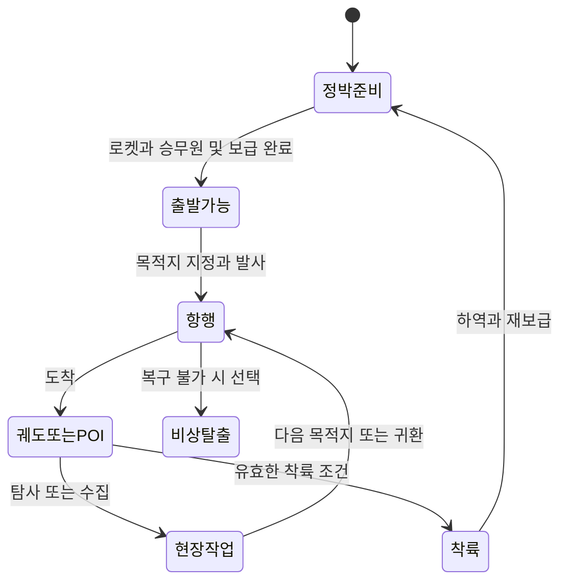

# 21. 다중 소행성·SO 로켓·행성 간 공급망 역기획

> 기준일: 2026-11-13 · 범위: **Spaced Out! 활성 게임**. 기본판 우주 원정은 [19장](19_space_rocketry_base.md)에서 별도로 다룬다.  
> [목차](00_README.md) · [물류](16_logistics_storage_conveyors.md) · [방사선](20_radiation_nuclear_spaced_out.md) · [DLC](22_dlc_content_matrix.md)

## 1. 핵심 변화: 여러 기지가 같은 시간에 살아 있다

**[확인]** Klei는 Spaced Out!을 여러 소행성의 식민지를 동시에 관리하고 거점 사이에 자원을 운송하는 확장으로 설명한다. 로켓과 우주 지도도 개편해 중반부터 우주 활동에 접근하도록 구성했다.[^M1]

**[해석]** 기본판에서 우주가 지상 산업의 후반 목적지였다면 SO에서는 우주와 외부 거점이 일상 공급망에 들어올 수 있다. 어느 소행성을 화면에 표시하는지와 다른 기지의 생존 상태는 별개다. 플레이어가 다른 거점을 보고 있는 동안에도 소비·생산·고장 위험을 고려해야 한다.

이 확장의 난도는 총자원이 부족하다는 점뿐 아니라 **자원이 필요한 위치와 있는 위치가 다르다**는 데 있다. 다른 소행성에 물이 많아도 물이 필요한 기지의 배관이 곧바로 가득 차지 않는다. 이동 수단·운송 주기·도착 후 하역이 완성되어야 사용할 수 있다.

## 2. 월드·우주 지도·로켓 내부의 구분

| 공간 | 주요 상태 | 플레이어 행동 | 공유하지 말아야 할 가정 |
|---|---|---|---|
| 소행성 로컬 월드 | 타일, 기체·액체, 복제체, 시설 | 건설·채굴·생존 운영 | 다른 월드의 재고가 즉시 공급되는 것 |
| 우주 지도 | 발견 상태, 격자, 목적지, 이동체 | 관측·항로·원정 명령 | 로컬 이동 경로와 같은 탐색 규칙 |
| 로켓 내부 | 작은 생활·작업 공간 | 내부 건설·승무원 유지 | 외부 화물창과 무조건 같은 저장공간 |
| 우주 POI | 자원·탐사·수집 상태 | 채굴·회수·연구 | 발견만으로 자원 획득 완료 |

**[설계 제안]** 모든 객체에 `worldId` 또는 동등한 공간 식별자를 부여한다. `화면에 보임`, `시뮬레이션 활성`, `행성에 착륙`, `로켓 내부에 존재`는 다른 상태다. 원작이 어떤 스레드·프로세스로 월드를 처리하는지는 이 문서에서 단정하지 않는다.

## 3. 분업과 자급의 선택

| 운영 방식 | 장점 | 실패에 취약한 지점 |
|---|---|---|
| 각 기지 완전 자급 | 운송 중단의 영향이 작음 | 자원이 부족한 월드에 중복 설비 필요 |
| 중앙 기지 생산 집중 | 대형 설비·숙련 인력 활용 | 운송 실패가 여러 기지에 전파 |
| 현지 기본 생존+산업 수입 | 생존 여유와 분업 이점의 균형 | 현지 비축량과 수입 주기 관리 |
| 무인 산업 거점 | 상주 복제체 소비를 줄임 | 초기 구축·정비·고장 진단 필요 |
| 단기 탐사 거점 | 적은 투자로 자원 조사 | 체류 가능 시간과 귀환 수단 제한 |

**[해석]** 우주선 수를 늘리는 것이 항상 최적은 아니다. 운송해야 하는 자원 자체를 줄이거나 현지 생산을 일부 추가하면 같은 안정성을 더 적은 원정으로 얻을 수 있다. 반대로 희귀 자원이 특정 지역에 집중되어 있으면 분업과 정기 물류가 가치 있어진다.

## 4. 이동 수단과 물류 수단

| 수단 | 주된 역할 | 중요한 제약 |
|---|---|---|
| 복제체 텔레포터 | 정해진 연결 구역 사이 인력 이동 | 월드 생성·설정·충전·사용 조건 |
| 공급 텔레포터 | 연결된 월드 사이 자원 전달 | 물리 입출력과 개별 자원 계통 |
| 로켓 | 인력·자원·탐사 임무 이동 | 연료·범위·승무원·적재·착륙 준비 |
| 궤도 화물 투하 | 목적지에 보급품 전달 | 적재·투하·현장 회수 |
| Interplanetary Launcher | 반복적인 행성 간 자원 발사 | 자원·전력·Radbolt·목적지 수용 |

**[해석]** 텔레포터가 있는 월드 연결을 모든 소행성에 자유롭게 적용할 수 있는 글로벌 운송망으로 취급하지 않는다. 활성화 여부와 연결 조건은 시작 클러스터 및 설정을 먼저 확인한다. 인력용 텔레포터와 공급용 입출력도 별도 기능이다.

**[확인]** 공식 행성 간 발사기 도입 자료는 소행성 사이의 지속 수송 역할을 설명하며, 후속 업데이트의 Targeting Beacon은 화물이 더 일관된 위치에 도착하도록 유도한다.[^M2][^M3]

## 5. SO 로켓의 구성과 임무

### 5.1 외부 구성과 내부 생활

로켓 외부 모듈은 추진·연료·화물·탐사 등의 역할을 담당하고, 승무원 공간 내부는 제한된 면적에서 생존과 작업을 유지하는 별도의 공간이다.

| 관점 | 확인할 준비 |
|---|---|
| 로켓 구성 | 엔진·모듈 조합, 높이·호환성, 목적지 도달 범위 |
| 연료 | 출발·임무·복귀에 필요한 물량과 충전 |
| 승무원 | 조종·연구 등 자격, 배정, 탑승 |
| 산소 | 비행 중 사용할 수 있는 공급·저장 |
| 식량 | 허용 음식·보존·체류 기간·비상분 |
| 위생·수면 | 짧은 공간에서의 생활 시설과 부산물 |
| 전력 | 내부 장비 가동과 공급 지속 |
| 도착지 | 착륙·하역·보급·다음 출발 준비 |

**[확인]** Rocketry Renovation은 로켓 내부와 외부 사이에 기체·액체를 직접 입출력하는 기능, 좁은 내부 공간용 시설, 비상 탈출을 확장했다.[^M4]

**[해석]** 외부 화물창의 산소·음식 총량만 보고 내부 승무원이 사용할 수 있다고 판단하면 안 된다. 해당 화물이 내부 소비 경로에 연결되어 있는지, 실제로 꺼낼 수 있는지 확인해야 한다. “적재됨”과 “생존에 사용 가능함”은 다른 완료 기준이다.

### 5.2 임무 상태

위 상태도는 **[설계 제안]** 이다. 모든 엔진과 모든 임무가 같은 경로를 통과한다고 가정하지 않는다. 목적지 도착, 궤도 대기, 착륙 완료를 분리해야 “도착했지만 착륙하지 않는” 상태를 설명할 수 있다.

## 6. 첫 개척의 의존성

**[해석]** 새로운 소행성 개척의 핵심은 이주 후 모든 것을 현지에서 찾겠다는 가정 대신, 초기 생존과 귀환을 보장하는 최소 묶음을 준비하는 것이다.

| 단계 | 현장 목표 | 이 단계에서 빠지면 위험한 것 |
|---|---|---|
| 원격 조사 | 자원·환경·위험 파악 | 실제 도달·착륙 가능한지 판단 |
| 초기 보급 | 산소·음식·필수 건설 재료 확보 | 정착 인원이 바로 소비할 물량 |
| 인력 투입 | 필요한 기술 보유자 착륙 | 조종사와 건설·채굴 자격 |
| 생존 거점 | 생활·전력·현지 생산 구축 | 위생·온도·노동 회복 |
| 귀환·연결 | 재발사 또는 대체 수송 확보 | 발사 시설과 연료·재료 |
| 정기 운영 | 생산·하역·비축 안정화 | 무인 시간 동안의 복구 여유 |

로버·착륙·보급 모듈의 사용은 이 흐름에서 준비 노동과 첫 인력의 위험을 줄이는 선택으로 분석할 수 있다. 그러나 필요한 정제금속 수량, 착륙 방식별 정확한 자원 반환량 등은 **[검증 필요]** 다. 원작과 다른 숫자로 귀환 계획을 확정해서는 안 된다.

## 7. 우주 POI의 채굴과 수집

**[확인]** 2025-11 SO 개편은 POI의 채굴과 부유 자원의 회수를 분리했다.[^M5]

**[해석]** 따라서 다음 세 상태를 따로 기록한다.

1. 아직 채굴되지 않은 자원.
2. 채굴됐지만 회수하지 않은 자원.
3. 적절한 화물 모듈에 실린 자원.

채굴 장비를 가져가는 임무와 이미 떠 있는 자원을 회수하는 임무는 다른 구성이 가능하다. 적합한 화물 모듈이 없으면 자원이 현장에 있어도 운송을 완료할 수 없다. Research Module의 Data Bank 수집과 유물용 적재도 이 분류에 맞추어 확인한다.

`POI 전체 자원`을 하나의 숫자로만 저장하면 채굴량과 회수량을 중복 차감하거나, 수집할 수 있는 자원이 있는데도 채굴 장비를 요구하는 오류가 생긴다. 정확한 재생 여부·회복 속도는 자원 유형별로 확인하며 Data Bank의 유한 물량을 다른 광물의 재생 규칙과 섞지 않는다.

## 8. 운송 주기와 현지 비축

다음은 원작 상수를 쓰지 않는 **[설계 제안]** 이다.

`필요 선적량 = 현지 순소비 × (운송 간격 + 예상 지연) + 목표 비축 증가분`

가정상 외부 기지가 자원을 cycle당 120kg 순소비하고, 정기선이 5 cycle마다 오며, 2 cycle의 지연을 견뎌야 한다면 최소 840kg이 그 기간의 소비량이다. 최대 1,000kg을 운반할 수 있더라도 적재·하역·현지 접근이 불완전하면 실효량은 줄어든다.

| 계량 지표 | 의미 |
|---|---|
| 순소비 | 소비에서 현지 생산을 뺀 값 |
| 다음 도착까지 시간 | 실제 임무·항행·정비를 포함한 예상 |
| 생존 잔여 시간 | 접근 가능한 비축 ÷ 순소비 |
| 운송 가동률 | 계획된 임무 중 정상 완료 비율 |
| 하역 대기량 | 도착했으나 생산·소비 계통에 편입되지 않은 자원 |

**[해석]** 가장 먼저 경고할 것은 단순한 저재고보다 “남은 비축 시간이 다음 보급보다 짧음”일 수 있다. 원작 UI가 이 계산을 모두 제공한다는 뜻이 아니라, 다중 거점 시스템을 역설계할 때 유효한 진단 목표다.

## 9. 화면 밖 실패와 비상 복구

| 실패 | 다른 월드에서 보일 수 있는 증상 | 복구 선택 |
|---|---|---|
| 소규모 기지 정전 | 산소·관수·수송 동시 중단 | 현지 비상 전력, 선적 우선순위 변경 |
| 정기선 하역 막힘 | 출발 지연과 도착지 재고 고갈 | 하역 목적지 확장·소비 정책 조정 |
| 승무원 생활 보급 부족 | 임무 수행 중 건강·노동 악화 | 조기 귀환, 임무 축소, 구조 |
| 도착지 발사 준비 부족 | 정착 인원이 돌아오지 못함 | 보급품·시설 재료 수송 |
| 공급원 하나에 모든 기지 의존 | 한 시설의 정지가 전체에 전파 | 각 거점의 필수 비축·대체 생산 |
| 우주 POI 수집 모듈 오류 | 채굴 성과는 있지만 화물 없음 | 적합 수집선 재편성 |

**[확인]** 공식 비상 탈출 기능은 로켓을 포기하고 승무원을 발견된 소행성 쪽으로 보내는 구조로 소개됐다. 화물과 로켓을 원상 보존하는 무료 귀환 기능으로 해석해서는 안 된다.[^M4]

**[해석]** 비상 탈출은 정상 계획의 대체가 아니라 손실을 줄이는 마지막 선택이다. 역기획에서는 어떤 자산을 보존하고 무엇을 잃는지, 승무원이 어디에 도착하는지, 도착 직후 생존 가능성이 어떤지를 분명히 해야 한다.

## 10. 제안 데이터 모델과 일관성

| 구조 | 핵심 필드 |
|---|---|
| `WorldState` | 월드 ID, 로컬 시뮬레이션, 인력, 자원, 경고 |
| `ClusterMap` | 발견 상태, 격자, POI, 이동 가능 연결 |
| `RocketState` | 외부 모듈, 내부 월드 ID, 임무, 연료, 화물 |
| `TravelManifest` | 승무원·물품·소속 상태, 출발·도착 |
| `TransportRoute` | 공급원·목적지, 주기, 자원, 목표 비축 |
| `SpaceResourceState` | 미채굴, 부유 물량, 적재 전환 이력 |
| `LocalAvailability` | 월드별 접근 가능한 재고와 예약 |

**[설계 제안]** 월드 이동은 개체를 복제하는 이벤트가 아니라 소속을 전환하는 과정이다. 전환 도중 저장·로드·사망·임무 취소가 발생해도 한 복제체가 두 월드의 작업 목록에 동시에 남지 않아야 한다. 로켓 내부 재고와 외부 적재 모듈 재고도 한 번만 계산한다.

기술 해금처럼 공유되는 진행과 로컬 자원처럼 분리된 상태를 구별한다. 모든 것을 소행성별로 복제하면 해금 불일치가 생기고, 모든 것을 전역으로 합치면 물류가 의미를 잃는다.

## 11. 검증 시나리오

1. 한 월드를 보고 있는 동안 다른 월드의 생산·소비가 이어지고 경고가 노출되는지 확인한다.
2. 공급원 물량은 충분하되 운송을 막고, 도착지의 가용 재고가 증가하지 않는지 확인한다.
3. 한 복제체를 텔레포트·로켓 탑승·착륙시키며 소속·작업·장비·스킬을 추적한다.
4. 로켓 외부 화물과 내부 소비 경로를 분리해, 적재만으로 생존 공급이 완료되지 않는 조건을 확인한다.
5. 목적지 도착과 착륙 조건을 따로 끊어 진단 메시지가 구별되는지 본다.
6. 채굴만 수행한 POI에 다른 수집선을 보내 미채굴량·부유량·화물량의 합계 변화를 확인한다.
7. 정기 보급을 한 번 지연시켜 현지 비축이 의도한 기간을 버티는지 측정한다.
8. 항행·하역·탈출 단계 각각에서 저장 후 불러와 개체·화물의 중복과 유실이 없는지 확인한다.

## 12. 출처

[^M1]: Klei Support, [What is Oxygen Not Included — Spaced Out?](https://support.klei.com/hc/en-us/articles/360053456331-What-is-Oxygen-Not-Included-Spaced-Out). 다중 월드 동시 운영과 중반 로켓의 공식 설명.
[^M2]: Klei, [Spaced Out! 457903](https://kleiforums.com/game-updates/oni-so/457903-r1507/). 행성 간 발사기의 지속 수송 역할.
[^M3]: Klei, [Spaced Out! 458389](https://kleiforums.com/game-updates/oni-so/458389-r1509/). Targeting Beacon, 목적지 착탄과 발사기 제어의 도입 기록. 초기 비용 상수는 현행 값으로 사용하지 않음.
[^M4]: Klei, [Rocketry Renovation 476059](https://kleiforums.com/forums/topic/132992-game-update-rocketry-renovation-476059/). 로켓 내부 입출력·생활 시설·비상 탈출의 공식 설명.
[^M5]: Klei, [November 2025 QoL 700348 + 700386](https://kleiforums.com/forums/topic/168832-game-update-november-2025-quality-of-life-update-700348-700386/). 우주 POI 채굴·회수의 분리. 공식 검색 본문으로 확인.
