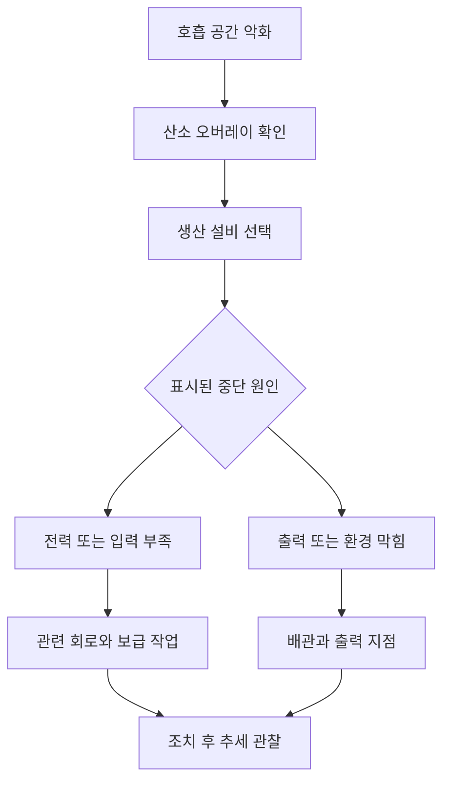

# 23. UI · UX · 정보 공개 · 튜토리얼

[전체 목차](00_README.md) · [작업 배정](04_tasks_priorities_schedules.md) · [검증 계획](26_validation_rebuild_plan.md)

- 조사 기준일: 2026-11-13
- 범위: PC 관리형 시뮬레이션 UI의 기능 구조. 정확한 픽셀 위치나 모든 단축키를 재현하는 화면 명세는 아니다.
- **[확인]** 공식 기능·변경 근거 / **[해석]** 인터랙션 분석 / **[설계 제안]** 개선·재구현 구조 / **[검증 필요]** 실제 빌드 확인.
- 2026년 11월 공개테스트의 화면 변경은 안정판에 이미 배포된 것으로 취급하지 않는다.

## 1. 시스템 목표 [해석]

ONI는 대부분의 원인을 평소 화면만으로 볼 수 없는 게임이다. 기체 종류, 압력, 온도, 병원균, 전력 부하, 배관 흐름, 작업 우선순위가 같은 공간에 겹쳐 존재한다. UI는 이를 플레이어가 이해하고 조작할 수 있는 여러 관찰 도구로 나눈다.

좋은 UI의 기준은 정보를 많이 보여 주는 것보다 **문제 발견 → 원인 분리 → 개입 → 결과 확인**을 한 흐름으로 연결하는 것이다. 산소 부족 경보를 보고 발전 정지, 연료 미보급, 담당자의 개인 우선순위까지 추적할 수 있어야 시스템 학습이 가능하다.

## 2. 정보 구조 [해석]

| 정보 층 | 주로 답하는 질문 | 표현 수단 | 읽기 오류 |
|---|---|---|---|
| 기지 요약 | 지금 살아남을 수 있는가? | 자원·인구·경보·추세 | 전체 재고를 지역 가용량으로 오해 |
| 공간 관찰 | 어디에서 문제가 일어나는가? | 월드 화면·오버레이 | 한 오버레이가 모든 원인을 보여 준다고 오해 |
| 대상 세부 | 왜 이 건물·복제체가 멈췄는가? | 상태·요구조건·효과·작업 탭 | 증상과 원인 혼동 |
| 관리 표 | 누구에게 어떤 정책을 적용하는가? | 우선순위·일정·기술·소비 설정 | 개인 정책과 개별 작업 설정 혼동 |
| 지식 사전 | 어떤 조합으로 해결할 수 있는가? | 데이터베이스·연구·연계 항목 | 아직 없는 기능을 현재 사용 가능하다고 오해 |
| 시간 기록 | 개선이 효과가 있었는가? | 보고서·자원 변화·사건 이력 | 순간 가동을 지속 가능성으로 오해 |

**[확인]** 공식 Ranching Upgrade는 건물·원소·식물·생물 등을 연결하는 Database를 소개했다.[^database] 출시 업데이트는 방의 요구와 효과를 분리하고, 질병 노출 위치로 이동하는 기능 등 문제 진단 정보를 보완했다.[^diagnostics]

## 3. 오버레이의 역할 [해석]

| 관찰 모드 | 보여 주어야 할 핵심 | 함께 봐야 할 정보 | 해결하지 못하는 질문 |
|---|---|---|---|
| 산소·대기 | 숨 쉴 수 있는 공간과 기체 분포 | 기체 질량·생산·배관 | 생산 설비가 왜 멈췄는가 |
| 온도 | 냉·온 영역과 열 흐름의 흔적 | 재료·설비 출력·단열 | 정확한 장기 열수지 |
| 전력 | 회로·발전·소비 관계 | 순간 소비·정격·배터리 | 연료 운반이 왜 안 되는가 |
| 액체·기체 배관 | 연결·방향·내용물 | 펌프·포트·막힘 상태 | 물질의 장기 확보 가능성 |
| 자동화 | 신호·연결·센서 상태 | 설비 자체 가동 조건 | 녹색 신호인데 안 도는 모든 이유 |
| 장식 | 공간의 장식 기여 | 실제 체류시간·개인 효과 | 현재 사기의 모든 원인 |
| 방 | 경계·유형·충족 조건 | 실제 시설 이용 | 기체 밀폐와 안전 |
| 병원균 | 종류·분포·전파 흔적 | 노출 경로·질병 | 세균이 실제 감염을 일으켰는가 |
| 재료 | 원소·자원 위치 | 접근성·온도·소유·예약 | 지금 운반 가능한가 |

오버레이 전환은 같은 세계를 다른 질문으로 다시 보는 행위다. 색상과 범례만 제공하는 것보다 클릭한 셀·건물의 수치와 상태를 함께 읽을 수 있어야 정확한 판단으로 이어진다.

## 4. 선택 대상 패널의 정보 순서 [설계 제안]

원작 화면의 픽셀 복제가 아닌, 관찰 가능한 관리 경험을 재현하기 위한 구성이다.

1. **정체성:** 무엇을 선택했는지, 소속 월드·설비 종류·복제체 유형.
2. **현재 상태:** 작동 중인지, 중단되었는지, 위험 상태인지.
3. **주된 중단 원인:** 전력 부족·출력 막힘·자격 부족 등.
4. **입력과 출력:** 필요한 물질·전력·노동, 예상 산출물과 부산물.
5. **정책 조작:** 레시피, 허용 자원, 임계값, 개인 배정, 우선순위.
6. **관련 근거로 이동:** 배관·전력·작업자·연구·데이터베이스 링크.
7. **부가 정보:** 온도·장식·재료 특성·세부 효과.

중단 원인이 여러 개일 때 한 가지만 감춰서 보여 주면, 플레이어가 한 문제를 고칠 때마다 다음 문제가 새로 생긴 것처럼 보인다. 모든 차단 원인을 공개하되 당장 해결해야 할 순서를 읽기 쉽게 제시하는 방식이 적절하다.

## 5. 진단 흐름 예시: 산소 생산 중단 [해석]

이 흐름에서 가장 중요한 것은 경보를 읽은 뒤 필요한 대상을 찾는 비용이다. 문제 위치로 카메라가 이동하고, 선택 대상에서 연결망으로, 연결망에서 보급 작업으로 이동하는 탐색이 끊기지 않아야 한다.

**[확인]** 2024년 공식 업데이트에는 자동 카메라 이동 후 이전 위치로 돌아가는 UI와 레시피에서 해당 연구를 강조하는 연결 기능이 포함되었다.[^navigation] 이런 기능은 플레이어가 문제를 추적한 뒤 원래 계획으로 복귀하는 비용을 줄인다.

## 6. 조작의 종류와 오조작 방지 [해석]

| 조작 | 의도 | 필요한 피드백 | 위험한 모호함 |
|---|---|---|---|
| 건설·굴착 영역 지정 | 여러 작업을 한 번에 생성 | 적용 범위·재료·불가 위치 | 현재 도구와 다른 명령 실행 |
| 우선순위 변경 | 작업 순서 조정 | 숫자·대상·개인 설정과 관계 | 자격 문제도 해결된다고 오해 |
| 허용 목록·필터 | 물질·음식·대상 제한 | 선택 집합과 비어 있는 상태 | 모두 금지된 것을 놓침 |
| 복사 설정 | 반복 설비 설정 통일 | 복사 대상과 필드 범위 | 서로 다른 설비·맥락에 잘못 적용 |
| 자동화 임계값 | 가동 정책 변경 | 단위·비교 방향·현재 값 | 이상/이하 반전 |
| 출입·배정 | 대상별 이용 제어 | 인물·방향·대상 유형 | 구조 인력과 반환 경로 차단 |
| 일시 정지 | 원인을 관찰하고 계획 | 명령 대기와 실제 변화 구별 | 정지 중 표시 갱신 누락 |

Blueprint라는 단어는 문맥에 주의해야 한다. 공식 꾸미기 UI의 cosmetic blueprint와 건설 계획 표시를 혼동하거나, 이를 다중 건물 설계도 저장 기능으로 자동 해석해서는 안 된다. 특정 모드가 제공하는 기능은 기본 UI 명세에서 분리한다.

## 7. 경보의 우선순위 [설계 제안]

| 경보 등급 | 판단 기준 | 예시 성격 | 해제 조건 |
|---|---|---|---|
| 즉시 생존 | 짧은 시간 안에 인명 손실 가능 | 질식·구조 필요 | 위험 해소 또는 결과 확정 |
| 필수 서비스 | 생명 유지망의 기능 중단 | 산소·물·전력 연쇄 정지 | 실제 가동 회복 |
| 지속 수지 | 현재 재고로는 버티지만 감소 중 | 식량·연료·물 부족 추세 | 지속 공급 또는 수요 조정 |
| 효율·정책 | 장기 운영 손실 | 긴 통근·유휴·작업 대기 | 조건 해소 또는 사용자 인지 |
| 정보·발견 | 새 선택지 제공 | 연구·탐사·후보·이야기 | 열람·적용 |

동일 원인으로 수십 개 설비가 정지했을 때 모든 경보를 동등하게 쌓으면 원인을 찾기 어려워진다. 재구현에서는 “상위 전력망 중단 때문에 정지한 설비”처럼 원인별로 묶되, 개별 대상에 접근할 수 있게 한다. 원작이 동일한 원인 집계 방식을 사용한다고 주장하지 않는다.

경보 해제 역시 중요하다. 입력 물자가 한 번 도착했다고 알림을 즉시 지우면 지속 고갈을 놓칠 수 있다. 반대로 이미 정상화한 문제를 계속 표시하면 알림 신뢰도가 낮아진다. 순간 상태와 추세 경보를 구분해야 한다.

## 8. 튜토리얼과 정보 공개 [해석]

초기 학습의 핵심은 모든 건물 이름을 외우는 것이 아니라 **질문에 맞는 도구를 찾는 법**이다. 초기에 호흡·식량·화장실·수면을 해결하면서 대기, 소비, 일정, 작업 가능성을 배우게 되고, 이후 전력·배관·열·자동화로 확장된다.

| 학습 단계 | 플레이어가 배워야 할 질문 | 적절한 설명 방식 |
|---|---|---|
| 첫 생존 | 왜 이 공간에서는 숨을 못 쉬는가? | 해당 위치와 기체 정보 연결 |
| 첫 생산 | 왜 재료가 있는데 건물이 멈췄는가? | 입력·출력·전력 차단 사유 |
| 첫 작업 정체 | 왜 높은 우선순위가 처리되지 않는가? | 자격·접근·개인 설정 설명 |
| 첫 열 문제 | 왜 잘 되던 농장이 멈췄는가? | 온도 변화와 장기 원인 연결 |
| 첫 자동화 | 녹색 신호인데 왜 가동하지 않는가? | 허용 신호와 가동 가능 조건 구분 |
| 첫 원정 | 다른 월드의 재고는 왜 쓸 수 없는가? | 소속·운송·생명 유지 범위 |

재현용 튜토리얼은 정답 배치를 강요하기보다 관찰 위치와 이유를 알려 주는 형태가 적절하다. 실패 이후 회복 경로도 안내해야 플레이어가 새로운 기지를 시작하는 것만을 해결책으로 받아들이지 않는다.

## 9. 버전 차이를 UI 명세에 반영하기

**[확인]** 2026년 11월 공개테스트에는 배관 흐름 하위 오버레이와 막힘 진단 보강 등이 포함되어 있다.[^test] 이 문서의 안정판 설명에 해당 화면을 확정적으로 포함하지 않는다.

반대로 이미 배포된 변화도 옛 화면 자료와 다를 수 있다. 2025년 1월 공식 수정은 Vitals의 음식 섭취 정보 위치와 바이오닉 전력 표시 등을 조정했다.[^vitals] 따라서 화면 설계 비교에는 캡처 날짜·빌드·활성 DLC를 함께 적어야 한다.

화면에서 읽은 수치를 데이터 규칙으로 전환할 때도 단위를 보존한다. 질량과 개수, 순간 출력과 시간당 생산량, 현재 재고와 예약 제외 가용량을 같은 열에 섞으면 기지의 실제 수지를 잘못 판단하게 된다.

## 10. UI 데이터 계약 [설계 제안]

| 데이터 | 포함할 내용 | 검증 기준 |
|---|---|---|
| StatusViewModel | 실제 상태, 차단 이유, 심각도 | 표시와 실제 시뮬레이션 일치 |
| ResourceView | total, accessible, reserved, location | 합계와 사용 가능량 구분 |
| OverlaySample | cell, type, value, unit, range | 색상·범례·툴팁 같은 값 |
| ActionCommand | targetSet, operation, parameters | 미리보기와 실행 범위 일치 |
| ExplanationLink | source, reason, relatedTarget | 원인으로 이동 가능 |
| VersionContext | build, branch, DLCs, locale | 버전별 화면 차이 기록 |

색각 차이·해상도·UI 배율·번역 길이가 달라도 위험의 의미가 전달되어야 한다. 색상만 쓰지 않고 아이콘·문자·방향 표시를 함께 제공하고, 단위가 바뀌어도 값의 의미를 유지하는 것이 필요한 품질 조건이다.

## 11. 검증 시나리오

| ID | 검증 장면 | 합격 기준 |
|---|---|---|
| UI-01 | 건물이 여러 이유로 중단 | 모든 실제 차단 원인에 접근 가능 |
| UI-02 | 자원은 많지만 접근 불가 | 전체량과 작업 가용량의 차이를 설명 |
| UI-03 | 경보에서 연결망·작업자로 추적 | 원인 대상에 도달하고 원래 위치로 복귀 |
| UI-04 | 정지 중 대량 명령·취소 | 화면 미리보기와 재생 후 결과 일치 |
| UI-05 | 단위가 다른 자원 표시 | 질량·개수·시간당 값 혼동 없음 |
| UI-06 | 색각 설정·UI 배율·긴 번역 | 위험·포트·상태 의미 보존 |
| UI-07 | 기본 게임·DLC·테스트 분기 비교 | 없는 기능을 활성처럼 표시하지 않음 |
| UI-08 | 초보자가 첫 생산 정지를 진단 | 외부 공략 없이 차단 원인을 찾을 수 있음 |

## 12. 출처

[^database]: [공식 Update Log — Ranching Upgrade Mark I](https://steamcommunity.com/app/457140/discussions/4/1694920442947303381/). 데이터베이스와 관리 화면 분리의 근거.
[^diagnostics]: [Klei — 356355](https://kleiforums.com/game-updates/oni-alpha/356355-r847/). 요구·효과 구분, 노출 진단 등 UI 개선 기록.
[^navigation]: [Klei — 646687, 2024-12-12](https://kleiforums.com/game-updates/oni-alpha/646687-r2443). Camera Return 및 레시피·연구 연결.
[^vitals]: [Klei — 648807, 2025-01-09](https://kleiforums.com/game-updates/oni-alpha/648807-r2455/). 관리 표·일정·바이오닉 전력 표시 변경.
[^test]: [Klei — 761015, 2026-10-29 공개테스트](https://kleiforums.com/game-updates/oni-alpha/761015-r2830/page/2/). 흐름 오버레이 등의 테스트 변경 근거.
