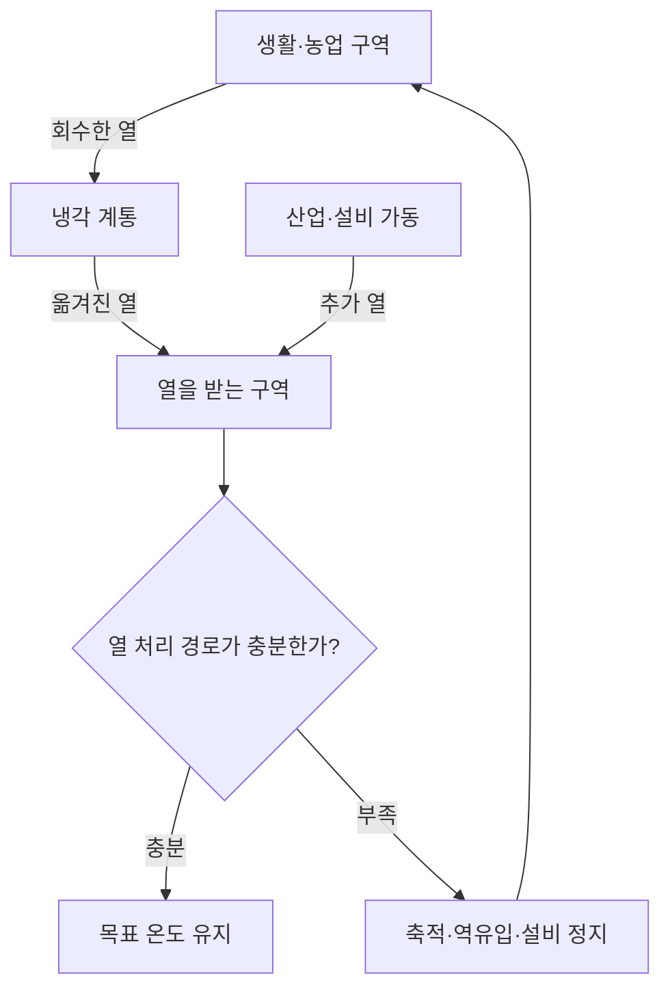
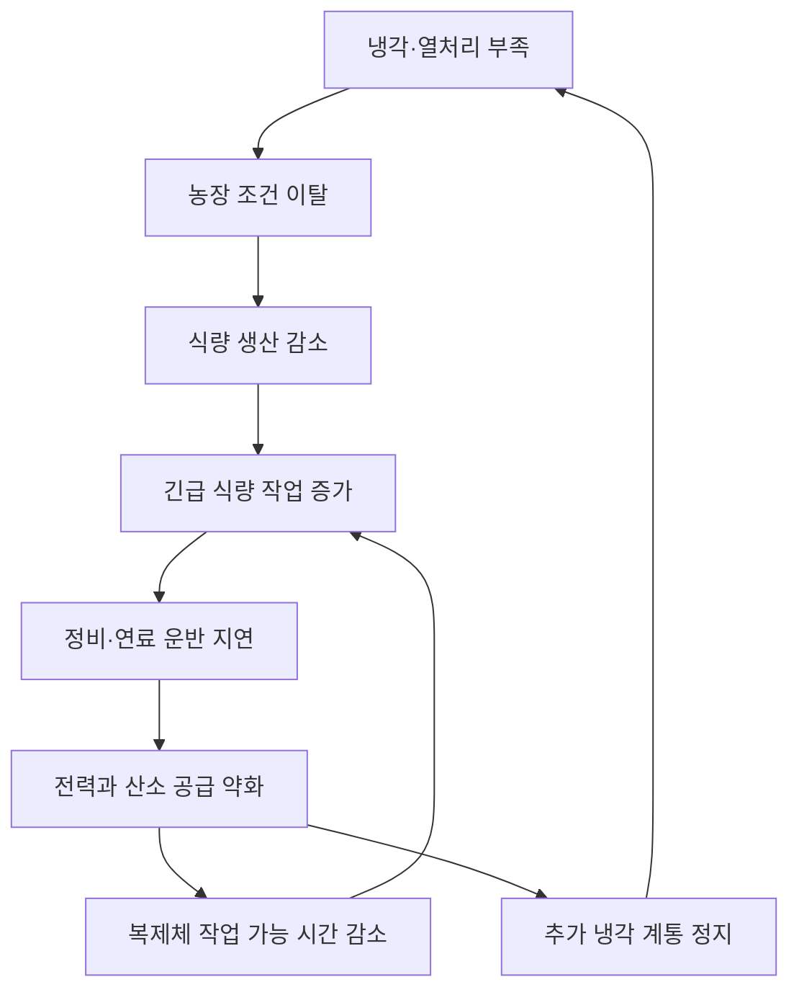

# 24. 통합 수지·병목·실패 연쇄 분석

> **조사 기준일:** 2026-11-13 · **범위:** 기본 게임 공통 분석, 특정 DLC 사례는 명시  
> **중요:** 이 문서의 숫자는 모두 계산 구조를 보여 주는 **가정값**이다. 원작 설비·복제체의 실제 상수가 아니다. 실제 수치표로 전용하려면 해당 빌드의 데이터로 교체해야 한다.  
> [전체 목차](00_README.md)

## 1. 분석 목표

**[해석]** ONI에서 지속 가능성은 “오늘 생산량이 오늘 소비량보다 많다”만으로 판단할 수 없다. 자원이 필요한 위치로 이동하는지, 생산에 필요한 노동이 남아 있는지, 휴면기와 피크 부하를 버틸 저장이 있는지, 폐열이 계속 누적되는지까지 함께 계산해야 한다. 공식 소개가 함께 제시하는 재활용·전력·유체·열·복제체 관리의 관계를 이 장에서 수식과 사례로 풀어낸다.[^core]

## 2. 공통 수지 모델

### 2.1 재고 변화

**[분석 모델]** 자원 r의 재고를 다음처럼 기록한다.

```text
ΔStock[r] = Production[r] + Import[r]
          - Consumption[r] - Export[r] - Loss[r]
```

모든 항은 같은 관측 기간과 단위를 사용한다. 질량은 kg, 저장 전기에너지는 J, 식량은 kcal처럼 측정 차원을 분리한다. 질량과 전력을 하나의 숫자로 합산하지 않는다.

### 2.2 유효 공급

```text
EffectiveSupply ≈ min(ProductionCapacity,
                      InputAvailability,
                      TransportCapacity,
                      RecipientCapacity)
                  × OperatingFraction
```

모든 용량 항은 **목표 제품의 단위 시간당 생산 가능량**으로 환산한다. 예를 들어 입력 원료 공급량은 레시피 수율을 곱해 목표 제품 기준으로 바꾼다. `OperatingFraction`은 용량 항에 아직 반영하지 않은 정지 시간만 나타낸다. 이미 실제 시간 평균 처리량을 넣었다면 같은 중단을 가동률로 다시 곱하지 않는다.

이는 병목을 찾는 근사식이다. 병렬 경로, 시차, 저장, 운송 우선순위가 있는 실제 네트워크의 정확 해법은 아니다. 인접한 여러 설비의 명목 생산량을 더하는 것보다 어떤 조건이 가동을 막는지 찾는 데 사용한다.

### 2.3 비축으로 버틸 수 있는 시간

```text
BufferTime = UsableStock / NetDeficitRate
```

`NetDeficitRate > 0`일 때만 의미가 있다. 저장량 중 접근 불가·오염·허용 온도 초과 등으로 쓰지 못하는 부분은 `UsableStock`에서 제외한다.

## 3. 사례 A: 산소 생산은 충분한데 복제체가 숨을 못 쉰다

### 가정

| 변수 | 가정값 |
|---|---:|
| 인구 | 8명 |
| 분석용 1인 산소 수요 | 0.10kg/s |
| 생산 설비 총 명목 공급 | 1.00kg/s |
| 작업 구역까지 전달 가능한 최대량 | 0.70kg/s |
| 실제 가동률 | 90% |

총 수요는 `8 × 0.10 = 0.80kg/s`이다. 경로의 병목을 반영한 공급은 `min(1.00, 0.70) × 0.90 = 0.63kg/s`이므로 `0.17kg/s`가 부족하다. 이 가정에서 접근 가능한 비축 산소가 102kg이면 적자가 일정할 때 약 600초를 버틴다.

### 진단 순서

1. 전체 재고·생산량만 보지 않고 복제체가 실제 있는 구역을 본다.
2. 생산 설비가 입력·전력·압력·출력 조건 때문에 쉬는지 확인한다.
3. 기체 운송 또는 방 사이 이동 경로가 공급을 제한하는지 확인한다.
4. 소모 지역별 수요와 예비 공급 경로를 평가한다.

**[해석]** 공급기를 추가하는 해결은 생산 단계가 병목일 때 효과가 있다. 이미 전달 경로가 막혔다면 설비 추가는 전력과 열 부담만 늘릴 수 있다.

관련: [산소](06_atmosphere_oxygen.md), [전력](09_power_networks.md), [작업](04_tasks_priorities_schedules.md).

## 4. 사례 B: 신규 인원을 받았는데 순생산이 감소한다

### 가정 모델

```text
NetLabor = GrossAvailableLabor
         - SelfMaintenanceLabor
         - SupportLabor
         - TravelAndWaiting
```

| 항목 | 충원 전 | 충원 후 | 차이 |
|---|---:|---:|---:|
| 가용 작업 시간 | 2,400초 | 2,700초 | +300초 |
| 식량·산소·위생 공급 작업 | 800초 | 960초 | +160초 |
| 이동·대기·재보급 | 500초 | 700초 | +200초 |
| 확장에 쓸 수 있는 시간 | 1,100초 | 1,040초 | -60초 |

위 숫자는 하나의 가상 관측 기간에 대한 값이다. 충원으로 생활시설 대기와 운반이 늘어나면 신규 인원이 제공한 노동보다 추가 운영 부담이 커질 수 있음을 보여 준다.

### 역기획 포인트

- 인구는 인력과 수요를 동시에 늘리는 투자다.
- 노동 시간의 명목 합계와 실제 생산에 투입되는 시간을 구별해야 한다.
- 신규 인원 도입의 판단 정보에는 식량 재고뿐 아니라 화장실·침상·산소·작업 능력·이동 거리도 포함되어야 한다.
- 수익을 내는 인력을 추가하기 전에 생활 기반을 증설하는 선택이 합리적일 수 있다.

관련: [복제체](03_duplicants_attributes_skills.md), [작업·일정](04_tasks_priorities_schedules.md), [사기](14_morale_stress_decor.md).

## 5. 사례 C: 평균 수량은 충분한 간헐천이지만 가뭄이 온다

### 가정

| 변수 | 가정값 |
|---|---:|
| 분출 중 생산 | 4kg/s |
| 활동 기간 내 분출 비율 | 50% |
| 전체 시간 중 활동 기간 비율 | 40% |
| 장기 평균 수요 | 0.70kg/s |
| 가장 긴 예상 무공급 시간 | 3,000초 |

장기 평균 공급은 `4 × 0.50 × 0.40 = 0.80kg/s`로 수요보다 크다. 그러나 무공급 구간을 버티려면 손실을 제외해도 `0.70 × 3,000 = 2,100kg` 이상을 쓸 수 있어야 한다. 분석용 여유율 20%를 붙이면 목표 비축은 `2,520kg`이다.

**[분석 한계]** 활동·휴면이 단순한 직사각형 주기라는 가정이다. 실제 설계에는 세부 분출 간격, 포획 실패, 온도 처리 능력, 보관·배관·펌프 제한을 추가해야 한다. 정확한 생산 주기는 해당 간헐천의 실제 분석 결과로 대체한다.

**[해석]** 평균 생산 능력, 순간 처리 능력, 완충 저장은 서로 다른 설계 변수다. 저장고를 늘리면 순간 생산량이 증가하는 것은 아니지만 공급의 시간 불균형을 흡수할 수 있다.

관련: [간헐천](18_geysers_hazards_renewables.md), [액체](07_liquids_plumbing_sanitation.md), [열](08_temperature_phase_change.md).

## 6. 사례 D: 냉각기를 설치했는데 기지 전체가 더워진다

**[분석 모델]** 열을 이동시키는 장치를 설치하면 냉각 대상의 온도는 내려갈 수 있지만, 다른 구역으로 옮겨진 열과 운용 과정의 추가 부담을 처리해야 한다.



### 가정 계산

열 저장 구역의 유효 열용량을 `500kJ/K`, 순유입 열을 `10kJ/s`라고 가정하면, 열 손실과 상변화를 무시한 초기 근사는 `dT/dt = 10 / 500 = 0.02K/s`이다. 1,000초 동안 약 20K 상승할 수 있다.

이 계산은 원작 셀 간 열교환 알고리즘이 아니다. **지속적인 순열유입을 큰 물통 하나만으로 무한히 처리할 수 없다는 점**을 설명하기 위한 집중 열용량 모델이다. 실제 게임의 건물별 열 생성·이동·삭제 규칙은 개별 검증이 필요하며, 현실의 에너지 보존을 모든 레시피에 강제하면 원작과 다른 결과가 날 수 있다.

관련: [열·상변화](08_temperature_phase_change.md), [산업](10_materials_industry.md).

## 7. 사례 E: 전력 증설 이후에도 생명유지 설비가 멈춘다

### 구분해야 할 네 가지 용량

| 항목 | 단위 | 답하는 질문 |
|---|---|---|
| 발전 출력 | W | 순간적으로 얼마를 공급하는가? |
| 저장 전기에너지 | J | 공급 부족을 얼마나 오래 버티는가? |
| 회로 허용 부하 | W | 해당 경로가 얼마의 부하를 처리하는가? |
| 연료 비축·공급 | kg, kg/s 등 | 발전을 얼마나 오래 유지하는가? |

가정상 발전 2kW, 피크 소비 3kW, 사용 가능한 저장 120kJ라면 발전과 부하가 유지될 때 부족분 1kW를 120초 보완할 수 있다. 저장을 두 배로 늘려도 지속적인 1kW 적자가 해소되는 것은 아니다.

또한 발전이 4kW로 늘어도 실제 회로의 허용 부하, 분리 방식, 운송·냉각의 선행 조건이 부적절하면 개별 설비는 정지할 수 있다. **위 2·3·4kW는 계산 가정이며 특정 전선의 원작 정격표가 아니다.**

### 비상 설계의 기획적 가치

- 필수 부하와 선택적 산업 부하를 분리하면 부족 시 대응 가능성이 커진다.
- 연료·전력·냉각을 같은 단일 경로에 의존시키면 한 지점 장애가 전체 정지로 이어진다.
- 제어 신호가 꺼졌을 때 안전한 상태와 생산적인 상태가 항상 일치하지 않는다.

관련: [전력망](09_power_networks.md), [자동화](17_automation.md).

## 8. 사례 F: 식량 재고는 많은데 기근이 온다

### 가정

| 항목 | 값 |
|---|---:|
| 재고 표시 총열량 | 24,000kcal |
| 금지·접근 불가·소비 불가 물량 | 6,000kcal |
| 실제 이용 가능 열량 | 18,000kcal |
| 분석용 1일 총수요 | 6,000kcal |

겉으로는 4일분이지만 이용 가능한 기준으로는 3일분이다. 그 사이 재배 온도가 어긋나 성장과 수확이 지연되면 새 식량이 나오기 전에 비축이 줄어든다.

**[해석]** 식량 안정성에는 총열량 외에도 수확까지 남은 시간, 조리 노동, 보존, 먹이로 소비되는 원료, 허용 정책이 필요하다. 높은 품질의 음식만 목표로 삼아 초기 식량 다양성과 예비 생산을 잃으면 취약해질 수 있다.

관련: [농업](11_food_farming.md), [축산](12_ranching_ecosystems.md), [사기](14_morale_stress_decor.md).

## 9. 통합 실패 연쇄



이 그림은 특정 세이브에서 관찰한 사고 기록이 아니라, 시스템 의존성을 이용해 구성한 **[분석 시나리오]**다. 악순환을 끊으려면 가장 눈에 띄는 증상만 수정하는 것보다 생존 필수 작업의 공급을 먼저 회복할 필요가 있다.

## 10. 기획자가 조절할 밸런스 축

| 조절 축 | 강화하면 생기는 경험 | 과도할 때의 문제 |
|---|---|---|
| 생존 소비량 | 확장과 충원의 판단이 중요 | 복구할 시간 없이 반복 붕괴 |
| 초기 비축 | 실험·학습 시간 확보 | 수지 학습 전에 무계획 확장 |
| 운반 비용 | 배치와 자동화 가치 상승 | 생산보다 이동 관찰에 과도한 시간 |
| 부작용 강도 | 시스템 간 연결이 풍부해짐 | 문제 원인이 너무 멀리 떨어져 진단 곤란 |
| 저장 비용 | 공급 변동과 공간 선택이 중요 | 간헐 공급 사용이 불합리해짐 |
| 전문화 보상 | 인력 배치에 의미가 생김 | 특정 인력 부재가 완전 진행 차단 |
| 경고의 선행 시간 | 관찰 후 대응 가능 | 모든 위험을 너무 일찍 자동 설명 |
| 기술의 대체 경로 | 월드별 적응과 창의적 해법 | 기술별 개성이 약해짐 |

## 11. 재현 실험 기록 양식

```yaml
# 원작 실행 결과가 아니라 실제 검증용 기록 틀
scenario_id: BAL-O2-001
ruleset: Base
build: record_actual_build
content_packs: []
assumptions:
  population: record_actual
  observation_seconds: record_actual
measurements:
  usable_stock_start: null
  production_total: null
  consumption_total: null
  blocked_seconds: null
  worker_travel_seconds: null
  usable_stock_end: null
conclusion:
  bottleneck: unmeasured
  evidence: unmeasured
```

**검증 상태:** 문서의 산술은 식과 일치하도록 점검했다. 실제 게임의 생산량·행동시간·빌드별 균형을 측정한 벤치마크는 수행하지 않았다.

## 12. 근거와 연결

[^core]: [Klei의 공식 게임 설명](https://www.klei.com/games/oxygen-not-included). 생존형 식민지 시뮬레이션이라는 제품 범위 확인. 본 장의 수식·숫자·실패 연쇄·밸런스 평가표는 문서 작성자의 독자적 분석이며 Klei의 수치나 발표를 옮긴 것이 아니다.
