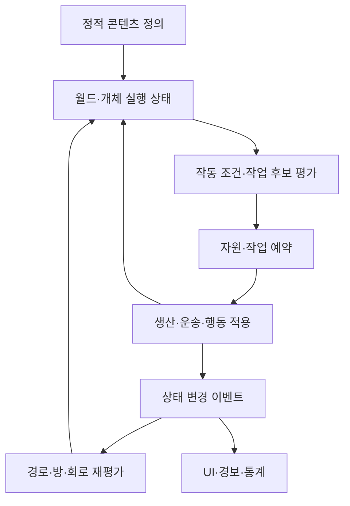
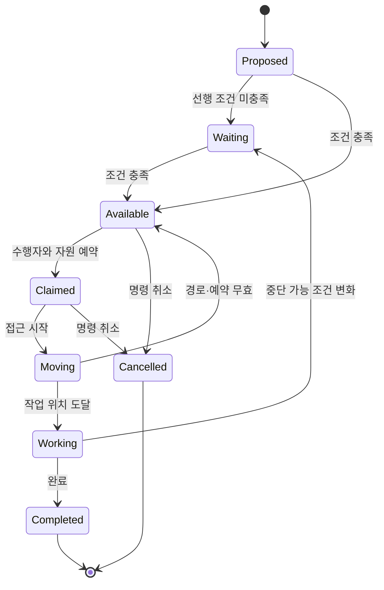

# 25. 데이터 모델과 시스템 경계의 재구성

> **조사 기준일:** 2026-11-13 · **문서 전체의 성격:** 명시적 **[설계 제안]**  
> 이 장의 엔티티·필드·상태 이름·의사코드·처리 순서는 관찰 가능한 게임 기능을 구현하기 위해 제안한 모델이다. **Klei의 원본 클래스, 실제 저장 형식, 시뮬레이션 실행 순서를 복원한 결과가 아니다.**  
> [전체 목차](00_README.md) · [검증·재구현 단계](26_validation_rebuild_plan.md)

## 1. 재구성의 목표

개별 시스템 문서의 입력과 출력을 공통 데이터 계약으로 연결한다. 목표는 대량의 건물 클래스를 먼저 만드는 것이 아니라, 산소·물·열·노동·전력의 흐름을 같은 규칙으로 기술할 수 있는 최소 구조를 정의하는 것이다.

공식 제품 설명이 열거하는 시뮬레이션 범위는 기체·액체·열·전력·식민지 관리다.[^scope] 여기서 특정 엔진·스레드 구조·자료구조가 사용되었다고 추론할 근거는 없으므로, 아래 구조는 엔진과 무관한 기능 설계로 제시한다.

## 2. 정적 정의와 실행 상태 분리

| 분류 | 정적 정의의 예 | 실행 상태의 예 | 분리 이유 |
|---|---|---|---|
| 물질 | 비열, 열전도 특성, 상변화 관계 | 셀의 질량·온도 | 같은 물질도 위치마다 상태가 다름 |
| 건물 | 크기, 포트, 레시피, 설치 조건 | 전력·입력·출력·손상·작업 상태 | 기능 정의와 현재 가동 가능성을 구별 |
| 복제체 | 종별 소비 규칙, 특성 정의 | 욕구, 능력, 위치, 작업 | 개체별 변화와 콘텐츠 정의를 분리 |
| 식물·생물 | 요구 환경, 성장·번식·산출 정의 | 나이, 성장도, 환경 충족 상태 | 생산 주기와 개체 상태 추적 |
| 연구 | 선행 조건, 요구 포인트, 해금 | 현재 누적 포인트 | 콘텐츠 그래프와 플레이 진행 분리 |
| 월드 | 프리셋·생성 규칙 | 셀·발견 상태·시설·시간 | 시작 조건과 세이브 상태를 구별 |

정적 정의를 수정해도 기존 실행 상태가 자동으로 유효해지는 것은 아니다. 예를 들어 건물의 크기나 포트 위치가 바뀌면 기존 세이브에서 인접 객체와 충돌할 수 있으므로 변경 종류별 마이그레이션 정책이 필요하다.

## 3. 주요 엔티티와 최소 필드

### 3.1 환경과 물질

| 엔티티 | 제안 필드 | 단위·제약 | 연결 시스템 |
|---|---|---|---|
| ElementDefinition | id, phase, thermalProperties, transitions | 질량·온도·상태의 기준 정의 | 열·유체·제조 |
| CellState | elementId, mass, temperature, contamination | 질량 0 미만 금지, 절대온도 기준 저장 검토 | 환경 시뮬레이션 |
| TerrainState | solidOccupancy, digRule, materialYield | 채굴 가능 여부와 산출 규칙 분리 | 채굴·이동 |
| RegionState | bounds, boundaryRevision, environmentSummary | 변경 발생 시 재평가 대상 | 방 판정·UI |
| SourceState | outputDefinition, schedule, blockedState | 순간 출력과 장기 주기 분리 | 간헐천·자원 수지 |

`CellState`를 정의했다고 모든 건물·포트·파이프를 같은 셀 물질로 흡수하지 않는다. 공간 좌표를 공유하되 기능별 점유와 연결 관계를 분리한다.

### 3.2 설비와 생산

| 엔티티 | 제안 필드 | 핵심 의미 |
|---|---|---|
| BuildingDefinition | footprint, placementRules, materialRules, ports, capabilities | 무엇을 어디에 만들 수 있는지 |
| BuildingState | constructionPhase, integrity, operationalReasons, storedInputs | 지금 무엇 때문에 작동하는지/멈추는지 |
| RecipeDefinition | inputs, outputs, workRequirement, powerRequirement, thermalRule | 자원 변환의 명시적 계약 |
| RecipeJob | recipeId, requestedCount, progress, reservedInputs | 반복 생산 설정과 실제 수행 단위 |
| PortDefinition | medium, direction, filters, capacity | 네트워크와의 접점 |
| StorageState | contents, capacity, acceptancePolicy, reservations | 보유량·허용량·예약량 구별 |

가동 불가 사유는 단일 불리언으로 축약하지 않는 편이 좋다. 입력 부족과 전력 부족이 동시에 있을 수 있고, 플레이어에게 어느 조건을 먼저 해결해야 하는지 설명해야 하기 때문이다.

### 3.3 인력과 작업

| 엔티티 | 제안 필드 | 핵심 의미 |
|---|---|---|
| DuplicantState | needs, attributes, traits, capabilities, scheduleId, policyId | 행동 가능성과 유지 비용 |
| TaskDefinition | category, requiredCapabilities, targetRules, interruptPolicy | 어떤 종류의 작업인가? |
| TaskInstance | target, prerequisites, state, priority, claimOwner | 이번 작업을 누가 언제 수행하는가? |
| Reservation | resourceRef, amount, claimant, expirationRule | 중복 배정과 자원 중복 소비 방지 |
| NavigationRequest | start, goalSet, accessProfile, hazardPolicy | 경로와 도달 가능성 |
| ScheduleState | phase, permittedActivities, transitionTime | 시간 정책과 현재 행동 연결 |

## 4. 시스템 사이의 연결 원칙



그림은 제안하는 논리적 관계다. 모든 시스템을 한 줄의 순차 업데이트로 실행해야 한다는 의미가 아니다. 구현 시 병렬화·하위 스텝·이벤트 배치 방식을 선택하더라도 관찰 가능한 상태의 일관성을 유지해야 한다.

## 5. 건물 가동 조건의 명시적 평가

```text
EvaluateBuilding(building, snapshot):
    reasons = []
    if not building.isConstructed:
        reasons += UnderConstruction
    if not placementStillValid(building, snapshot):
        reasons += InvalidPlacement
    if not sufficientInput(building, snapshot):
        reasons += MissingInput
    if not outputCanAccept(building, snapshot):
        reasons += OutputBlocked
    if not powerAvailable(building, snapshot):
        reasons += InsufficientPower
    if not automationAllows(building, snapshot):
        reasons += DisabledByAutomation
    if not environmentAllowed(building, snapshot):
        reasons += InvalidEnvironment
    return OperationalResult(reasons)
```

**제안의 의도:** UI 설명, 작업 생성, 가동 통계를 같은 평가 결과에서 파생시켜 “상태창은 가동 가능인데 실제로는 멈춘” 불일치를 줄인다. 원작이 이 순서나 구조로 조건을 확인한다는 주장은 아니다.

## 6. 작업의 상태 전이



다이어그램은 가장 단순한 공통 상태만 보여 준다. 복제체의 생존 긴급 행동, 물품을 운반 중인 취소, 부분 투입 자원 회수는 개별 정책이 필요하다. 특히 다음을 명시해야 한다.

- 중단 시 이미 투입한 자원을 반환할지, 내부 저장에 유지할지, 산출물로 남길지.
- 작업 취소와 수행자 교체가 동등한지.
- 예약 주체가 사라졌을 때 자원과 대상의 예약을 언제 해제하는지.
- 경로가 바뀌었을 때 진행도를 유지할지.
- 동일한 작업을 두 복제체가 동시에 소유하지 못하도록 어디서 보장하는지.

## 7. 서로 다른 네트워크의 공통점과 차이

| 네트워크 | 흐르는 것 | 필수 데이터 | 독립적으로 검증할 것 |
|---|---|---|---|
| 기체·액체 배관 | 물질 내용물 | 포트·방향·수용량·내용물 상태 | 합류·분기·역압·상변화 |
| 고체 운송 | 물품 또는 물질 묶음 | 적재·필터·도착·회수 | 로더 정체·출력 포화·열교환 |
| 전력 | 순간 공급과 저장 에너지 | 연결 회로·부하·발전·저장 | 과부하·분리·부하 우선 처리 |
| 자동화 | 논리 신호 | 입력·출력·게이트 상태·시간 | 지연·초기값·전원과의 의존성 |
| 복제체 이동 | 이동 가능 경로 | 능력·출입 정책·목적지 | 경로 무효화·잠금·위험·중간 공사 |

그래프라는 공통 추상화는 유용하지만 모든 네트워크를 동일한 전파 규칙으로 구현할 수는 없다. 논리 신호에는 질량이 없고, 전력망의 연결과 배관의 방향성은 다른 문제다.

## 8. 단위와 수치의 관리

| 값 | 문서용 단위 | 구현에서의 주의 |
|---|---|---|
| 질량 | kg, g | 입력·산출·저장 단위를 명시적으로 변환 |
| 질량 유량 | kg/s, g/s | 프레임 수가 아닌 시뮬레이션 시간과 연결 |
| 전력 | W | 순간 소비와 생산의 비율 |
| 저장 에너지 | J, kJ | 전력과 시간을 곱해 비교 |
| 식량 | kcal | 음식 질량과 열량을 별도 보유 |
| 온도 | °C 또는 K | 표시·저장·차이 계산을 구분 |
| 열량·열유량 | 게임 표기 DTU 계열 또는 분석용 J | 변환 가정과 적용 범위를 표시 |
| 주기 | cycle | 실제 빌드의 시뮬레이션 초와 연결 |
| 방사선 | 해당 게임 표기 단위 | 현실의 의학적 선량 단위와 혼용하지 않음 |

상수마다 `value`, `unit`, `ruleset`, `content`, `source`, `verifiedBuild`, `confidence`를 둔다. 근거가 없는 값을 `0`으로 채우면 검증 누락과 실제 0을 구분할 수 없으므로 `null` 또는 `unverified`로 유지한다.

## 9. 레시피의 열·질량 규칙

원작과 비슷한 경험을 만들려면 현실 물리식을 일괄 적용하는 대신 관찰되는 게임 규칙을 명시적으로 기술해야 한다.

```yaml
# 재구현 스키마 예시이며 실제 원작 레시피 값이 아니다.
recipe:
  id: sample_conversion
  inputs:
    - element: resource_a
      rate_kg_s: null
  outputs:
    - element: resource_b
      rate_kg_s: null
  output_temperature_rule:
    mode: requires_verification
  building_heat_rule:
    mode: requires_verification
  labor:
    required: null
    capability: unverified
  provenance:
    verified_build: null
    evidence_url: null
```

원작에서는 건물마다 입력과 출력의 온도 규칙이 다를 수 있다. 따라서 출력 온도가 입력의 질량 가중 평균인지, 최소값이 있는지, 건물 온도에 영향을 받는지를 확인하지 않고 일반식으로 통합하지 않는다.

## 10. 변경 이벤트와 파생 상태

| 사건 | 즉시 변경할 것 | 재평가할 파생 정보 |
|---|---|---|
| 타일 완공·철거 | 공간 점유 | 경로·방 경계·환경 연결 |
| 문 정책 변경 | 접근 조건 | 대상별 경로·작업 수행 가능성 |
| 배관 절단 | 연결 관계 | 네트워크·정체·누출/내용물 처리 |
| 물질 상변화 | 물질·상태 | 점유·압력·손상·이동 |
| 인력 능력 변경 | 능력 집합 | 작업 후보·예약 적합성 |
| 저장 정책 변경 | 수용 조건 | 운반 요청·필터·예약 |
| 연구 완료 | 해금 집합 | 메뉴·제조 가능 목록 |
| 월드 전환 | 사용자의 관찰 대상 | 표시 정보·경보 초점 |

“월드를 보고 있지 않다”와 “월드의 시뮬레이션이 없다”는 다른 개념이다. 다중 거점의 기능 요구는 [21번](21_multicolony_spaced_out.md)에서 정의하고, 실제 갱신 최적화는 별도의 성능 결정으로 둔다.

## 11. 세이브와 재현성

저장할 최소 상태에는 자원·건물·개체 외에도 예약, 네트워크 내용물, 자동화 타이머, 진행 중 생산, 정책과 일정이 포함될 수 있다. 반면 재계산할 수 있는 그래프·표시용 요약을 모두 영구 저장해야 하는 것은 아니다.

저장 후 불러오기를 검증할 때는 다음을 비교한다.

1. 이용 가능한 재고와 예약된 재고의 합이 기대값을 유지하는가?
2. 진행 중 작업이 이중 완료되거나 자원을 이중 소비하지 않는가?
3. 자동화 타이머가 불러오기 직후 의도치 않은 펄스를 만들지 않는가?
4. 문 정책·배관 내용물·가동 금지 상태가 복원되는가?
5. 콘텐츠가 없는 빌드에서 알 수 없는 정의를 처리하는 정책이 있는가?

## 12. 성능 설계의 경계

**제안:** 오직 측정된 병목을 기준으로 최적화한다. 예를 들어 모든 작업자에게 모든 작업의 전체 경로를 매 프레임 계산하는 방식은 피할 후보지만, 실제 원작이 그렇게 동작한다고 주장하지 않는다.

| 비용 영역 | 계측할 양 | 고려할 전략 |
|---|---|---|
| 환경 갱신 | 활성 셀 수·교환 횟수 | 변경 영역 추적, 안전한 작업 배치 |
| 경로 탐색 | 요청 수·재탐색 수·경로 길이 | 변경 이벤트 기반 무효화, 공유 가능한 질의 |
| 작업 배정 | 후보 수·조건 검사 수 | 작업 범주별 인덱스, 예약 실패 통계 |
| 방·네트워크 | 재구성 횟수·영향 범위 | 지역적 갱신, 변경 묶음 처리 |
| UI | 조회·정렬·집계 비용 | 읽기용 스냅샷과 집계 캐시 |

정확한 업데이트 주기, 쓰레드 수, SIMD 사용, 데이터 배치 등은 원작 관찰만으로 확정할 수 없다. 성능 제안은 기능이 맞는 최소 구현을 만든 뒤 측정한 결과로 선택한다.

## 13. 근거

[^scope]: [Oxygen Not Included 공식 Steam 소개](https://store.steampowered.com/app/457140/Oxygen_Not_Included/). 제품의 기능 범위만 참고했다. 본 장의 구조·스키마·의사코드는 모두 독자적으로 작성한 재구현 제안이다.
