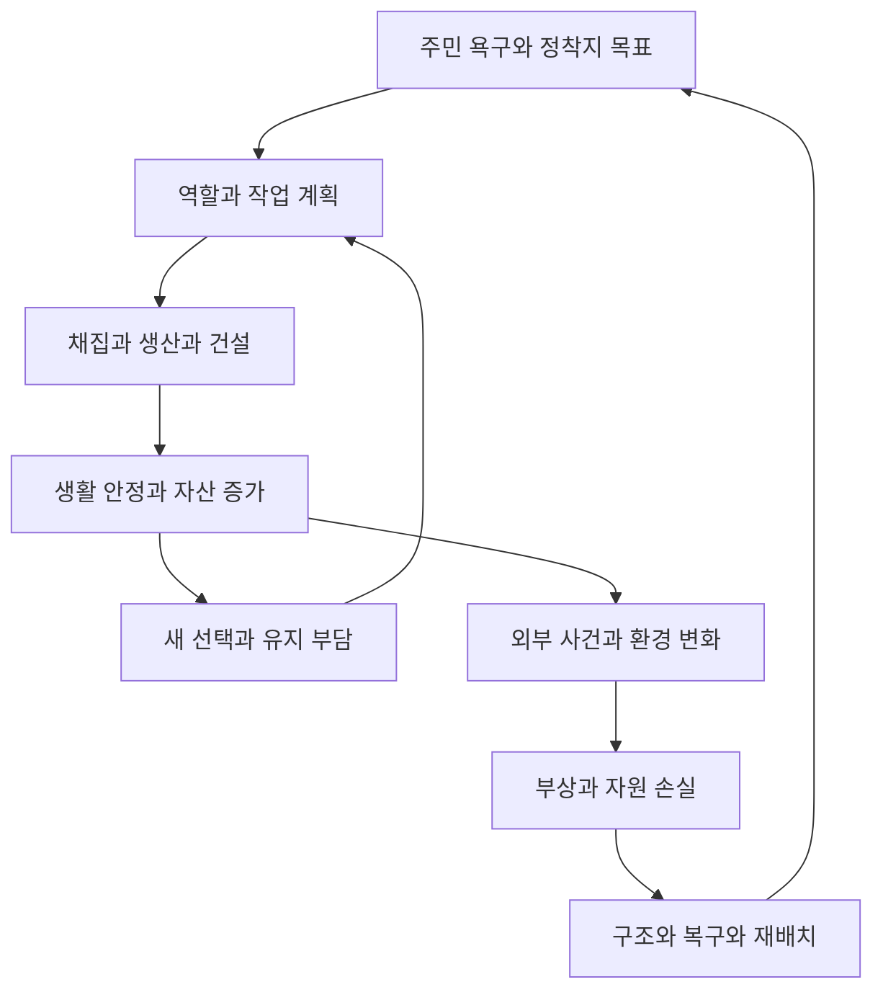

# 전체 게임 구조와 핵심 루프

[전체 목차](README.md) · [의존성](meta/02_system_dependencies.md) · [출처](meta/04_sources_verification.md)

## 1. 역기획의 핵심 결론

[해석] 림월드의 중심은 건축물의 숫자를 늘리는 데보다 **서로 다른 주민들이 제한된 노동과 자원으로 생활하고, 외부 사건이 그 균형을 흔들며, 플레이어가 다시 생활 체계를 조정하는 과정**에 있다. 주인공은 주민 집단이며 기지·생산·연구는 그들의 생존과 선택을 바꾸는 수단이다.

[확인] 공식 소개는 림월드를 사건을 제어하는 AI 스토리텔러가 이끄는 정착지 시뮬레이션으로 설명한다. 주민의 욕구·관계·부상, 건설·제작·동물·거래·상단이 주요 기능에 포함된다.[O1] 여기서 AI라는 표현을 생성형 언어 모델이나 임의 서사를 자유롭게 쓰는 시스템으로 해석하지 않는다.

## 2. 플레이어가 통제하는 것

| 의사결정 층 | 대표 결정 | 결과가 드러나는 시간 | 관련 문서 |
| --- | --- | --- | --- |
| 즉시 개입 | 징집, 구조, 우선 작업, 화재 대응 | 짧은 행동 단위 | [작업](systems/04_work_priorities_jobs.md), [전투](systems/10_combat_defense_equipment.md) |
| 생활 운영 | 역할, 시간표, 식사·의료 정책, 창고 | 게임 내 하루 안팎 | [기분](systems/03_needs_mood_mental_breaks.md), [물류](systems/06_items_storage_logistics.md) |
| 기반 확장 | 방, 농업, 전력, 연구 | 계절·생산 주기 | [건설](systems/05_building_rooms_zones.md), [연구](systems/13_research_technology_progression.md) |
| 외부 전략 | 거래, 외교, 원정, 임무 수락 | 이동·약속 기간 | [외교](systems/14_factions_trade_prisoners.md), [임무](systems/16_quests_endings.md) |
| 이야기 방향 | 시작 조건, 난도, 생활 가치, 장기 목표 | 캠페인 전체 | [스토리텔러](systems/12_storyteller_incidents_difficulty.md), DLC 문서 |

시간 척도는 [해석]을 위한 구분이며 원작이 이러한 내부 계층으로 구현되었다는 뜻은 아니다.

## 3. 핵심 반복 구조

아래는 [해석]으로 구성한 게임 루프다. 각각의 시스템 설명이 아니라 시스템을 연결했을 때 나타나는 의사결정 흐름이다.

`자산 증가 → 사건` 연결은 모든 사건이 재산만으로 결정된다는 뜻이 아니다. 사건 종류·타이밍·강도는 여러 조건과 설정의 영향을 받는다. 세부 구분은 [SYS-12](systems/12_storyteller_incidents_difficulty.md)에 있다.

## 4. 중요한 시스템 결합 다섯 가지

### 4.1 노동은 모든 선택의 공통 비용이다

[해석] 씨앗을 심는 시간, 부품을 운반하는 시간, 환자를 돌보는 시간, 연구하는 시간이 같은 주민 자원을 두고 경쟁한다. 자원 비용만 계산하면 실제 운영 비용을 놓친다. 구현을 검토할 때는 `작업량 + 이동 + 준비 + 중단 + 회복`을 함께 본다.

### 4.2 주민의 상태가 생산과 방어를 동시에 바꾼다

[해석] 한 주민의 부상은 단순한 체력 손실에서 끝나지 않는다. 담당 작업의 속도와 수행 가능성을 바꾸고, 의료 인력·약품을 소비하며, 다른 주민의 역할을 재배치하게 만든다. 캐릭터 데이터는 전투 전용과 노동 전용으로 완전히 갈라질 수 없다.

### 4.3 기지는 공간이면서 운영 정책이다

[해석] 방 크기·위치·문·창고·전력 배치는 이동, 작업 환경, 방어, 사고 확산을 동시에 바꾼다. 같은 건물 수라도 배치가 다르면 일손과 위험 부담이 달라진다. 건축 UI가 배치 가능 여부만 설명하면 운영 측면을 충분히 전달하지 못한다.

### 4.4 자동화는 예외에서 드러난다

[해석] 정상 상태에서 요리·운반·연구가 돌아가는 것보다, 재료가 사라지거나 담당자가 쓰러졌을 때 대체 행동이 가능한지가 중요하다. 원작 내부 예약 구현은 확인하지 않았지만, 유사한 게임을 만들 때는 예약 반환·재평가·작업 실패 이유가 핵심 설계 항목이다.

### 4.5 복구 과정 자체가 다음 이야기를 만든다

[해석] 습격을 막은 뒤의 치료·장례·식량·수리·포로 처리가 새로운 목표가 된다. 전투 승리 화면으로 생존 시스템을 끊으면 이러한 연결이 약해진다. 손실의 지속성과 회복의 선택지가 함께 있어야 사건이 이후 생활에 흔적을 남긴다.

## 5. 대표적인 연쇄 상황

다음은 여러 시스템을 함께 검토하기 위한 **[제안] 가상 시나리오**다. 실제 플레이 기록이나 모든 정착지에 필연적으로 발생하는 흐름이 아니다.

| 단계 | 상황 변화 | 다음 시스템에 주는 부담 | 플레이어 개입 |
| --- | --- | --- | --- |
| 1 | 냉각 설비가 전력 공급을 잃음 | 저장 온도와 식품 보존 악화 가능 | 전력 우선 복구, 식량 이동 |
| 2 | 조리 담당자가 부상 | 조리 작업 지연 | 대체 담당자 배치, 임시 식사 정책 |
| 3 | 음식 공급과 휴식이 불안정 | 주민 기분·일상 운영 부담 | 생활 시간표와 작업 우선순위 조정 |
| 4 | 외부 임무가 같은 시기에 제안됨 | 원정으로 남은 인력 감소 가능 | 수락 연기·거절 또는 축소 편성 |
| 5 | 회복 후 구조를 개선 | 저장·생산·전력의 취약점 완화 | 공급 경로와 배치 재설계 |

이 시나리오를 [통합 수용 기준](meta/05_acceptance_tests.md)에서 테스트 가능한 조건으로 구체화했다.

## 6. 기본 게임과 확장의 관계

[해석] DLC는 다음과 같이 기존 루프에 다른 판단 기준을 추가하는 것으로 읽을 수 있다. 각 기능의 확인 근거와 무료 패치 경계는 링크된 문서에 있다.

| DLC | 추가되는 주된 질문 | 기존 시스템 연결 |
| --- | --- | --- |
| [Royalty](dlc/01_royalty.md) | 특권을 얻기 위해 어떤 의무를 감수할 것인가? | 주민·기분·건축·임무·전투 |
| [Ideology](dlc/02_ideology.md) | 이 집단은 무엇을 좋은 삶으로 보는가? | 생각·사회·식사·의식·역할 |
| [Biotech](dlc/03_biotech.md) | 다음 세대와 개조된 노동력을 어떻게 유지할 것인가? | 인구·교육·유전자·생산·오염 |
| [Anomaly](dlc/04_anomaly.md) | 위험한 미지의 존재를 어디까지 이용할 것인가? | 조사·연구·수용·방어·의식 |
| [Odyssey](dlc/05_odyssey.md) | 생활 기반을 옮기며 어떤 목적지를 선택할 것인가? | 건축·연료·월드·기후·궤도 생존 |

## 7. 독립 재구현을 위한 단계 제안

아래는 원작의 실제 개발 순서가 아닌 **[제안]**이다. 기간·인원 견적은 요청 범위에 포함하지 않았다.

| 단계 | 먼저 연결할 기능 | 통과 기준 |
| --- | --- | --- |
| A. 생활 최소 단위 | 주민·욕구·작업·아이템·저장 | 먹고 자고 운반하며 취소 시 물자가 보존됨 |
| B. 생산과 공간 | 건설·방·농업·조리·전력·온도 | 사용자가 만든 배치에 따라 공급이 달라짐 |
| C. 손실과 복구 | 전투·건강·화재·기분·사건 | 전투 이후 치료와 복구가 새 작업으로 이어짐 |
| D. 장기 선택 | 연구·거래·포로·상단·임무 | 내부 생산 외의 성장 경로가 작동함 |
| E. 확장 | 목표로 선택한 DLC 축 | 기본 생활 루프와 새 비용·보상이 연결됨 |

UI와 저장은 모든 단계에 포함한다. 후반에 한 번에 붙이는 선택 기능으로 두면 실패 원인 설명과 상태 연속성을 뒤늦게 고치게 된다.

## 8. 분석 범위와 버전 경계

[확인] 공식 1.6 출시 공지는 무료 업데이트와 Odyssey를 구분한다.[O2] 2026-10-12에는 1.7과 Waylith 엔진의 시험 버전이 발표됐다.[O3] 본 문서는 게임플레이 비교 기준을 고정하기 위해 1.6을 대상으로 삼으며, 1.7 내부 구현이나 이후 최신 배포 상태의 검증 보고서가 아니다.

원작 게임을 실행하지 않았고 엔진 소스·원본 정의 파일을 확인하지 않았다. 문헌상 규칙의 확실성과 코드 수준 재현성을 동일하게 취급하지 않는다. 정확한 상수나 패치 의존 동작이 필요한 경우 [출처·검증 범위](meta/04_sources_verification.md)의 미확인 목록부터 확인한다.

## 9. 주요 출처

| 키 | 출처 | 사용 범위 |
| --- | --- | --- |
| O1 | [RimWorld 공식 소개](https://rimworldgame.com/) | 장르·스토리텔러·주요 기능 |
| O2 | [Ludeon — Odyssey expansion is out now](https://ludeon.com/blog/2025/07/the-rimworld-odyssey-expansion-is-out-now/) | 기본 1.6과 확장 구분 |
| O3 | [Ludeon — Waylith Engine and Update 1.7 발표](https://ludeon.com/blog/2026/10/announcing-the-waylith-engine-and-update-1-7/) | 시험 버전 발표 경계 |

모두 2026-11-13 확인. 공식 블로그 중 직접 열기 제한이 있는 자료는 검색 서비스가 제공한 공식 도메인의 본문으로 확인했다. 세부 메커니즘은 각 시스템 문서의 출처로 연결한다.
