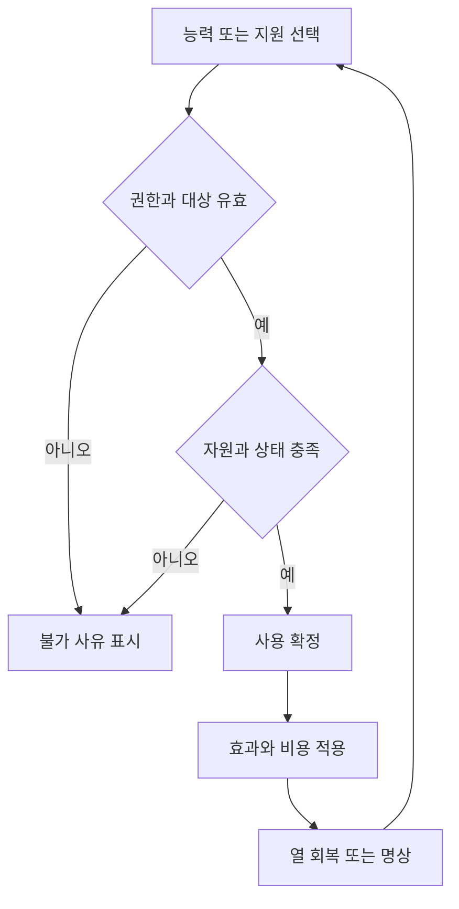

# Royalty — 작위·초능력·제국 지원

[목차](../README.md) · [퀘스트·엔딩](../systems/16_quests_endings.md)

> `[확인]`은 공개자료에 의한 간접 확인이다. 원작 실행·소스 검증은 수행하지 않았다. `[해석]`은 분석이며, `[제안]`의 데이터와 검증 항목은 재구현용이다.

## 1. 시스템 목적과 플레이 경험

[해석] Royalty는 특정 정착민에게 권력과 전술 능력을 집중시켜, 공동체가 그 인물을 지원하도록 만드는 성장 구조다. 강한 인물 하나를 얻는 선택이 방 배치, 시간표, 외교, 보상 선택까지 바꾸므로 전투 성장과 기지 운영이 함께 움직인다.

**설계 질문:** 정착민 한 명의 권한이 커질 때, 다른 주민의 노동과 공간을 얼마나 투자하게 할 것인가? 또한 그 인물이 쓰러져도 플레이어가 회복 가능한 대안을 가질 것인가?

## 2. 범위와 입출력

| 구분 | 내용 |
| --- | --- |
| 담당 | 작위, 명예, 제국 지원 허가, 초능력 획득·사용·명상, 관련 장비와 위협의 연결 |
| 입력 | 퀘스트 보상, 개인 이력·특성, 시설, 명상 시간, 제국 관계, 전투 대상 |
| 출력 | 작위별 요구, 허가 선택권, 능력 효과, 신경열, 지원 병력·물자·운송 |
| 유지 상태 | 개인 명예·작위, 학습 능력, 초집중, 신경열, 허가 재사용 상태 |
| 경계 | 일반 세력 호감도는 외교 시스템, 일반 연구는 연구 시스템, 기본 퀘스트 전체를 Royalty 소유로 보지 않음 |

[확인] Royalty와 무료 1.1 업데이트는 별도로 출시되었다. 따라서 해당 시기 기본 게임에 추가된 기능 전체를 DLC 요구사항으로 분류하지 않는다. [S5]

## 3. 플레이어 조작과 제공 정보

[확인] 플레이어는 퀘스트 보상으로 명예를 얻고, 작위에 맞는 지원 허가를 선택하며, 명상 장소와 시간표를 정하고 초능력을 사용한다. 초능력 획득에는 제국 작위 외에도 아니마 나무 등의 경로가 있다. [S1][S2][S3]

[제안] 정보는 **장기 투자**와 **현재 사용 가능성**을 나눠 보여준다. 인물 창에는 작위 요구와 명예를, 전투 명령에는 대상 적합성·초집중 비용·신경열 부담을 표시한다. 버튼 비활성화 사유도 자원 부족, 관계 문제, 대상 문제로 구분해야 한다. “계급이 높다”는 정보만으로 어떤 능력을 쓸 수 있는지 추정하게 만들지 않는다.

## 4. 핵심 규칙

| ID | 조건 | 처리·결과 | 근거 |
| --- | --- | --- | --- |
| RY-01 | 제국 관련 퀘스트 보상 획득 | 개인이 명예를 얻어 작위 성장에 연결 | [확인, S1] |
| RY-02 | 높은 작위 유지 | 지위에 맞는 공간·복식 요구가 운영에 추가 | [확인, S1] |
| RY-03 | 작위에서 허가 선택 가능 | 군사 지원·수송·노동 지원 등의 선택 또는 강화 | [확인, S3] |
| RY-04 | 허가가 재사용 대기 중 | 명예 비용으로 재사용할 수 있으며, 제국과 적대하면 사용 불가 | [확인, S4] |
| RY-05 | 초능력 사용과 시간 경과 | 초집중을 소모·감소시키고 명상으로 회복 | [확인, S2] |
| RY-06 | 초능력을 연속 사용 | 단기 부담인 신경열이 쌓임; 장기 자원인 초집중과 구분 | [확인, S2] |
| RY-07 | 다른 성장 경로 선택 | 작위와 초능력 성장을 반드시 동일 경로로 묶지 않음 | [확인, S1] |
| RY-08 | 메카노이드 군집 출현 | 휴면 상태에서 공격 계획을 세울 여지를 제공 | [확인, S1] |

## 5. 상태와 처리 흐름

[제안] 아래는 능력 사용의 검증 순서다. 원작 내부 호출 순서를 주장하지 않는다.



작위 상승, 초능력 습득, 순간 사용 가능성은 별도 상태로 유지한다. 이렇게 하면 비제국 초능력자와 작위만 가진 인물도 같은 틀에서 표현할 수 있다.

## 6. 데이터 모델 및 인터페이스

[제안] 고정 정의와 개인 상태를 분리한다. 아래 이름은 재구현 예시이며 원작 클래스명이 아니다.

| 필드 | 타입 | 역할 |
| --- | --- | --- |
| `title_def_id` | DefinitionId | 요구 시설·복식·허가 조건 정의 |
| `honor_by_faction` | Map<FactionId, number> | 개인의 세력별 명예; 세력 전체 호감도와 분리 |
| `known_ability_ids` | Set<DefinitionId> | 습득한 능력 |
| `focus_ratio` | number, 0..1 | 정규화한 초집중 상태 |
| `heat_ratio` | number, 0..1 | 프로토타입의 정규화한 단기 부담 |
| `meditation_tags` | Set<string> | 이용 가능한 명상 방식 |
| `permit_ready_tick` | Map<DefinitionId, simulation_tick> | 허가별 재사용 시점 |

```yaml
# 제안: 수치는 원작 밸런스가 아닌 상태 표현 예시
pawn_id: colonist_07
title_def_id: noble_tier_b
focus_ratio: 0.65
heat_ratio: 0.30
known_ability_ids: [move_target, suppress_target]
```

[제안] `TitleChanged`는 시설 요구와 허가 목록을 갱신하고, `FactionRelationChanged`는 지원 허가의 사용 가능성을 갱신한다. 능력 실행 시에는 대상과 비용을 함께 재검증하여, 이동한 대상에 비용만 지불하는 오류를 막는다.

## 7. 수치와 밸런스

| 구분 | 문서화 기준 |
| --- | --- |
| 확인된 구조 | 초집중은 명상 투자와 연결되고 신경열은 연속 시전 부담과 연결된다. [S2] |
| 미확인 상수 | 1.6 세부 빌드의 능력별 비용·사거리·열, 작위별 명예 기준, 허가별 일수 |
| 프로토타입 제안 | 전투당 능력 사용 횟수, 명상에 쓰는 하루 노동 비율, 허가 사용 후 다음 위협까지 공백을 측정 |

[해석] 한 자원으로 통합하면 “전투 전 준비”와 “전투 중 과사용”이 같은 문제가 된다. 두 자원을 유지하면 명상 시설의 장기 투자와 순간 판단을 서로 다른 축으로 조절할 수 있다.

## 8. 대표 플레이 사례와 예외

[제안 사례] 의료 담당자를 초능력자로 육성한 정착지에서 습격이 발생한다. 플레이어는 부상자를 능력으로 이동시키려 하지만 초집중이 낮다. 제국 지원을 요청하면 전투를 버틸 수 있으나 재사용 대기 중이라 추가 명예가 필요하다. 사건 뒤에는 명상 시간을 늘리는 대신 의료·제작 노동이 줄어드는 문제를 해결한다.

- 허가 선택 직후 제국과 적대하면 권한 재검증이 필요하다.
- 명상 시설 파괴 시 해당 인물을 무한 대기시키지 않고 대체 가능 장소를 다시 찾는다.
- 시전 대상 사망·맵 이탈은 예약과 대기 명령을 취소하는 조건으로 둔다.
- 작위별 노동 거부는 특성과 조건을 함께 확인해야 한다. 모든 귀족이 동일하게 노동을 거부한다고 단순화하지 않는다.

## 9. 다른 시스템과의 연결

| 연결 | 전달·반영 데이터 |
| --- | --- |
| [퀘스트](../systems/16_quests_endings.md) | 명예 보상과 특별 손님 보호 조건 → 개인 성장 |
| [건축·방](../systems/05_building_rooms_zones.md) | 방 조건 → 작위 요구 충족·명상 환경 |
| [작업·시간표](../systems/04_work_priorities_jobs.md) | 명상 시간 → 일반 노동 가용 시간 감소 |
| [전투](../systems/10_combat_defense_equipment.md) | 능력·지원 → 위치·상태·전력 변경 |
| [외교](../systems/14_factions_trade_prisoners.md) | 제국 관계 → 지원 사용 가능 여부 |

## 10. 검증 시나리오

[제안] 다음은 재구현 수용기준이며 실행한 테스트가 아니다.

| Given | When | Then |
| --- | --- | --- |
| 같은 작위의 두 인물이 서로 다른 능력을 습득 | 전투 명령 표시 | 각자의 습득 목록과 자원으로 사용 가능성을 계산 |
| 허가 재사용 대기 중이고 명예 부족 | 지원 요청 | 비용·부족 사유 표시, 효과·비용 모두 미적용 |
| 사용 가능한 허가를 선택한 뒤 제국과 적대 | 사용 확정 | 최종 검증에서 차단하고 대기 명령 해제 |
| 명상 중 대상 시설 파괴 | 다음 작업 갱신 | 유효한 대체 장소 탐색 또는 사유 있는 종료 |
| 능력 시전 확정 전에 대상이 맵 이탈 | 시전 처리 | 사라진 대상 참조를 남기지 않고 취소 |

## 11. 설계 해석과 재구현 우선순위

[해석] 제국의 외교와 개인의 작위를 분리하는 구조는 “세력의 친구이지만 귀족은 없는 정착지”, “제국과 단절된 초능력자”처럼 서로 다른 이야기를 허용한다. 군집 위협은 준비 후 공격하는 전투를, 지원 허가는 축적한 관계 자원을 위기에서 소비하는 선택을 만든다.

**MVP 제안:** 개인 성장 상태, 능력 두 종류, 명상 작업, 지원 한 종류, 명확한 사용 불가 사유. **후속 구현:** 작위별 요구, 허가 선택 트리, 군집 생성, 고급 장비와 제국 엔딩. 기능 수보다 권한·대상·비용 검증의 일관성을 먼저 확보한다.

## 12. 출처와 확인 필요 사항

모든 출처 확인일: **2026-11-13**. 검색 결과로 제공된 본문을 포함한다.

- **S1 · 공식:** [RimWorld Royalty Expansion Pack](https://rimworldgame.com/royalty/) — 명예·작위, 초능력 경로, 메카노이드 군집, 제국 관련 콘텐츠.
- **S2 · 공식:** [Update 1.1.2647 adds psychic meditation, new psycasts, and tons more](https://ludeon.com/blog/2020/05/update-may-2020/) — 초집중·명상·신경열의 구분.
- **S3 · 공식:** [Update 1.2 adds new quests, psycasts, gear, and more](https://ludeon.com/blog/2020/08/1-2-update-with-new-quests-psycasts-gear-and-more/) — 허가 선택 구조.
- **S4 · 커뮤니티:** [RimWorld Wiki: Permits](https://rimworldwiki.com/wiki/Permits) — 재사용 대기·명예 비용·적대 관계 제한. 세부값은 대상 빌드에서 재확인 필요.
- **S5 · 공식:** [RimWorld free update 1.1 and Royalty expansion released](https://ludeon.com/blog/2020/02/rimworld-free-update-1-1-and-royalty-expansion-released/) — 무료 패치와 유료 확장 구분.

[미확인] 1.6 빌드별 귀족 요구·특성 예외, 열 한도 초과 결과, 궤도에서의 허가 제한, 작위 상속·부활 처리. 이 항목은 실제 빌드와 대조하기 전 고정 규칙으로 구현하지 않는다.
