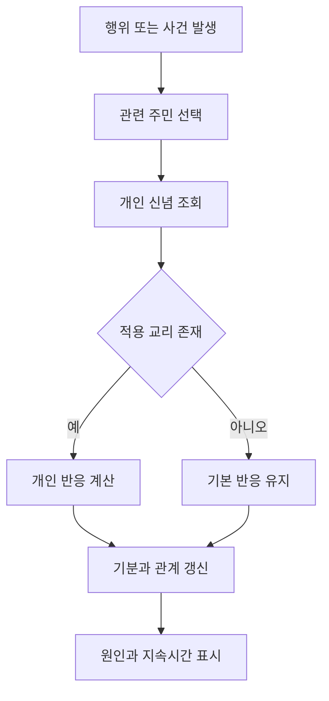

# Ideology — 신념·역할·의례·생활 규칙

[목차](../README.md) · [욕구·기분](../systems/03_needs_mood_mental_breaks.md)

> 공개자료 기반의 간접 확인이며 실행·소스 검증은 하지 않았다. `[확인]`과 `[해석]`, 재구현용 `[제안]`을 구분한다.

## 1. 시스템 목적과 플레이 경험

[해석] Ideology는 동일한 행위의 의미를 정착민마다 다르게 만들어, 생산 효율만으로 결정되던 운영에 가치관이라는 기준을 추가한다. 좋은 음식, 좋은 방, 바람직한 신체가 한 가지 기준으로 고정되지 않으므로 플레이어가 선택한 공동체의 생활양식이 기지 구조까지 바꾼다.

**설계 질문:** 신념이 배경 설명에 머물지 않고 식사·노동·사교·건축의 선택을 어떻게 바꾸는가? 여러 신념을 함께 유지하는 편익과 관리 비용을 어떻게 보여줄 것인가?

## 2. 범위와 입출력

| 구분 | 내용 |
| --- | --- |
| 담당 | 밈·세부 교리, 신념 소속, 사회적 역할, 개종, 의례, 관련 시설·유물·성장 목표 |
| 입력 | 주민의 신념·특성, 일어난 행위, 시설과 물품, 참여자, 역할, 의례 수행 |
| 출력 | 기분·관계 반응, 역할 능력·작업 제한, 개종 변화, 의례 보상, 개혁 가능성 |
| 유지 상태 | 신념 정의, 개인 소속·확신, 역할 임명, 의례 이력, 유동 신념 발전 상태 |
| 비담당 | 일반 기분·관계 계산 전체, 일반 동물 펜, 기본 종교 없는 플레이의 모든 규칙 |

[확인] 동물 펜·울타리 시스템은 Ideology 전용이 아니라 무료 1.3 업데이트의 내용이다. 신념에 따른 동물 존중이나 생활 규칙과 구분한다. [S4]

## 3. 플레이어 조작과 제공 정보

[확인] 플레이어는 신념을 구성하고 역할을 맡기며 의례를 개최할 수 있다. 교도관이나 도덕 지도자를 통한 개종 경로가 있고, 여러 신념이 공존하는 운영도 가능하다. 유동 신념은 활동으로 얻은 발전을 사용해 개혁할 수 있다. [S1][S2][S3]

[제안] 행위 전에는 “공동체가 좋아한다”는 단일 평가 대신 영향을 받는 인물별 반응을 보여준다. 의례 화면에는 참여 가능 인원, 필수 역할, 시설 부족, 예상 품질을 분리하고, 결과가 확률적이라면 예상과 확정을 같은 숫자로 표시하지 않는다. 개종 대상의 신념 변화와 정착지 합류 여부도 별개로 읽혀야 한다.

## 4. 핵심 규칙

| ID | 조건 | 처리·결과 | 근거 |
| --- | --- | --- | --- |
| ID-01 | 신념 구성 | 핵심 밈과 세부 교리가 생활 선호·금기를 정의 | [확인, S1] |
| ID-02 | 같은 행위를 다른 신념의 주민이 경험 | 음식·신체 개조·의식 등에 다른 평가 가능 | [확인, S1] |
| ID-03 | 지도자·도덕 지도자 임명 | 사교·의례·지원 능력을 담당 | [확인, S2] |
| ID-04 | 전문 역할 부여 | 특화 능력을 얻고 일부 다른 노동이 제한 | [확인, S2] |
| ID-05 | 의례 개최 | 참여자·역할·환경이 결과에 관여 | [확인, S2] |
| ID-06 | 개종 활동 | 개인의 신념을 바꾸는 경로이며 특성에 따라 난도 차이 | [확인, S1] |
| ID-07 | 유동 신념으로 플레이 | 의례·관련 행동으로 발전을 얻어 신념 개혁 | [확인, S3] |
| ID-08 | 유물 탐색·나무 연결 | 외부 탐험 및 지속 관리 노동과 신념 운영이 연결 | [확인, S1] |

## 5. 상태와 처리 흐름

[제안] 신념에 따른 사건 해석을 기본 사건 처리 뒤의 별도 단계로 둔다.



같은 사건 ID를 여러 사람에게 전파하되 결과를 공유하지 않는다. 신념 변경 뒤에도 과거 기억을 자동 삭제할지 여부는 별도 규칙으로 명시해야 한다.

## 6. 데이터 모델 및 인터페이스

[제안] 신념의 외형·이야기 설정과 실제 반응 규칙을 분리하고, 개인의 소속을 ID로 참조한다.

| 필드 | 타입 | 역할 |
| --- | --- | --- |
| `belief_id` | DefinitionId | 신념 구성의 식별자 |
| `meme_ids` | Set<DefinitionId> | 생활양식의 핵심 구성 |
| `precept_rules` | List<Rule> | 사건 태그 → 조건 → 개인 반응 |
| `role_assignments` | Map<RoleId, EntityId[]> | 임명과 정원 검사 |
| `certainty_ratio` | number, 0..1 | 재구현에서 정규화한 개인 확신 |
| `development_points` | number | 유동 신념의 개혁 자원 |
| `reform_revision` | integer | 신념 변경 시 캐시·저장 검증용 버전 |

```yaml
# 제안: 원작 교리 ID·점수표가 아님
belief_id: community_a
precept_rules:
  - event: body_modified
    subject: believer
    response: approval
reform_revision: 2
```

[제안] `BeliefChanged`는 음식·복식 정책에 대한 적합성 경고를 다시 계산한다. `RoleChanged`는 작업 자격을 갱신하고 이미 예약한 부적격 작업을 종료한다. 기분 효과에는 `event_id`, `rule_id`, `source_belief_id`를 남겨 왜 생겼는지 추적한다.

## 7. 수치와 밸런스

| 구분 | 문서화 기준 |
| --- | --- |
| 확인된 구조 | 전문 역할은 능력 향상과 노동 제약을 결합하며, 의례 결과는 환경·참여에 영향을 받는다. [S2] |
| 미확인 상수 | 현재 빌드의 의례별 품질 공식, 확신 감소량, 역할별 요구 인원·대기 시간 |
| 프로토타입 제안 | 교리 위반으로 생긴 기분 변화의 빈도, 의례에 참여한 총 인시, 개종에 필요한 누적 노동을 계측 |

[해석] 제약을 없애고 보너스만 남기면 모든 공동체가 같은 효율적 조합으로 수렴한다. 제약은 유지하되 플레이어가 사전에 이해하고 대응할 수 있어야 생활양식의 차이로 작동한다.

## 8. 대표 플레이 사례와 예외

[제안 사례] 기계 신체를 선호하는 기존 주민과 자연 신체를 중시하는 신규 주민이 함께 산다. 신규 주민의 다리를 치료하려는 선택에서 이동 능력 개선과 신념 반응이 충돌한다. 플레이어는 먼저 개종할지, 현재 신념을 존중할지, 생산 손실을 감수할지 판단한다. 이후 제작 전문 역할을 임명하자 운반 인력이 줄어 별도 노동 배치를 조정한다.

- 서로 다른 신념의 주민을 공동 의례에 초대했을 때 반응을 동일하게 적용하지 않는다.
- 필수 역할 인물이 전투로 쓰러지면 의례 시작·지속 조건을 다시 판정한다.
- 신념 개혁 중 참조 중인 역할·시설 요구가 사라지면 정리 규칙이 필요하다.
- 신념 위반과 작업 불가능은 다르다. 싫어하는 행동이 언제나 시스템적으로 금지되는 것은 아니다.

## 9. 다른 시스템과의 연결

| 연결 | 전달·반영 데이터 |
| --- | --- |
| [욕구·기분](../systems/03_needs_mood_mental_breaks.md) | 교리 평가 → 생각·기분 효과 |
| [인물·관계](../systems/02_colonists_skills_relationships.md) | 신념 차이·개종 → 사교 갈등과 소속 |
| [작업](../systems/04_work_priorities_jobs.md) | 역할 자격·금지 노동 → 작업 후보 필터 |
| [건축](../systems/05_building_rooms_zones.md) | 의례·선호 시설 → 기지 구성 변경 |
| [퀘스트](../systems/16_quests_endings.md) | 유물 수집·아르코넥서스 → 장기 목표 |

## 10. 검증 시나리오

[제안] 실제 실행 결과가 아니라 재구현 수용기준이다.

| Given | When | Then |
| --- | --- | --- |
| 두 주민의 신체 개조 평가가 반대 | 같은 종류의 개조 사건 발생 | 각자의 신념으로 다른 반응 산출 |
| 제작 역할 임명으로 운반 자격 상실 | 기존 운반 작업 갱신 | 예약 해제 후 유효한 작업만 선택 |
| 의례 필수 인물이 전투 불능 | 의례 시작 요청 | 부족한 조건을 알리고 시작 차단 |
| 포로가 개종했지만 모집은 완료되지 않음 | 포로 상태 조회 | 신념 소속만 변경되고 식민지 소속은 유지 |
| 유동 신념이 개혁됨 | 저장 후 다시 불러오기 | 새 규칙·역할 참조·개혁 버전이 일치 |

## 11. 설계 해석과 재구현 우선순위

[해석] 핵심은 많은 교리 목록보다 **사건을 개인의 기준으로 해석하는 공통 경로**다. 이를 갖추면 음식, 사냥, 장례, 치료 같은 기존 기능을 수정하는 방식으로 확장을 늘릴 수 있다. 반대로 각 기능에 신념 예외를 직접 흩뿌리면 개혁·개종 시 불일치가 커진다.

**MVP 제안:** 신념 두 종류, 상반된 교리 두 쌍, 개인 반응, 개종과 역할 하나. **후속 구현:** 의례 품질·보상, 유동 개혁, 드라이어드 노동, 유물 탐험, 관련 엔딩. 초기에는 복잡한 확률보다 반응 근거를 설명하는 UI를 먼저 검증한다.

## 12. 출처와 확인 필요 사항

모든 출처 확인일: **2026-11-13**.

- **S1 · 공식:** [RimWorld Ideology Expansion Pack](https://rimworldgame.com/ideology/) — 밈·교리, 개종, 유물, 나무와 드라이어드, 신념별 생활 방식.
- **S2 · 공식:** [Ideology adds social roles and rituals](https://ludeon.com/blog/2021/07/ideology-adds-social-roles-and-rituals/) — 역할의 편익·제약, 의례 환경·참여와 결과.
- **S3 · 공식:** [Update 1.3.3101 adds ideoligion development during play, and more](https://ludeon.com/blog/2021/08/update-1-3-3101-adds-ideoligion-development-during-play-and-more/) — 유동 신념 발전·개혁.
- **S4 · 공식:** [Announcing update 1.3 and the Ideology expansion](https://ludeon.com/blog/2021/07/announcing-update-1-3-and-the-ideology-expansion/) — 펜·울타리는 기본 게임 무료 패치.

[미확인] 모든 교리 조합의 충돌 규칙, 역할별 정확한 정원·능력 계수, 개종 후 과거 기억의 처리, 1.6 빌드별 의례 공식. 정착민별 특성·다른 DLC 효과가 겹칠 때의 우선순위도 실행 대조가 필요하다.
