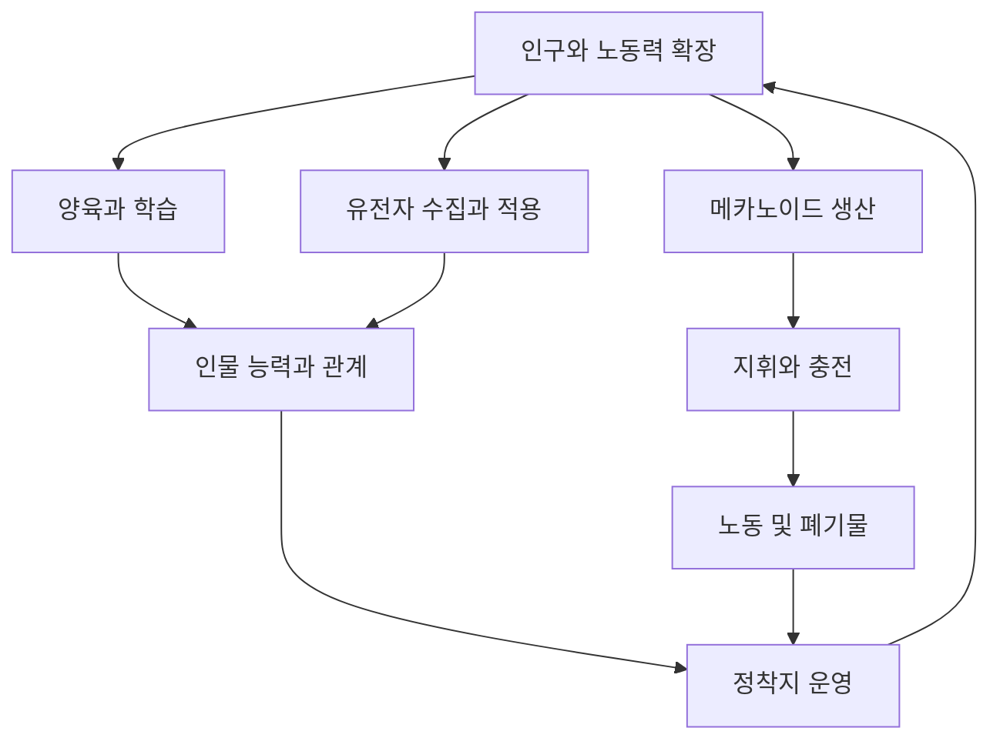

# Biotech — 출산·성장·유전자·메카노이드·오염

[목차](../README.md) · [인물](../systems/02_colonists_skills_relationships.md) · [건강](../systems/09_health_medical_body.md)

> 공개자료 기반의 간접 확인이다. 실행·원본 코드 검증은 수행하지 않았다. 데이터 모델·인터페이스·수용기준은 모두 `[제안]`이다.

## 1. 시스템 목적과 플레이 경험

[해석] Biotech는 인구와 노동력을 늘리는 방법을 세 갈래로 확장한다. 아이를 기르는 방식은 시간과 돌봄을, 유전자 편집은 인물의 특성 구성을, 메카노이드 운용은 전력·시설·오염을 중심으로 다른 비용을 만든다. 세 경로를 단순한 생산력 증가로 합치지 않는 것이 분석의 핵심이다.

**설계 질문:** 성장에 드는 시간을 줄이면 무엇을 포기하는가? 자동화된 노동력이 늘어날 때 인간 정착민이 여전히 중요한 이유는 무엇인가?

## 2. 범위와 입출력

| 하위 영역 | 입력 | 상태와 출력 |
| --- | --- | --- |
| 출산·성장 | 부모, 의료·돌봄, 식량, 학습 기회 | 임신·성장 단계, 학습 성과, 성장 시 선택 |
| 유전자 | 유전자 팩, 추출 대상, 조합 장비 | 유전자 구성과 이종인 특성 |
| 메카노이드 | 메카링크 보유자, 자원, 하위핵, 전력 | 생산·통제·충전 상태와 노동·전투 능력 |
| 오염 | 생산·충전 부산물, 저장 환경 | 폐기물 보관 부담, 오염 지형과 생태 영향 |

[확인] 인간의 출산·아동 양육과 유전자·메카노이드 지휘는 Biotech 콘텐츠다. 선반 개선과 도색 등 무료 1.4의 변경은 DLC 소유 범위에 넣지 않는다. 기본 동물 번식도 인간의 출산 기능과 구분한다. [S1][S5]

## 3. 플레이어 조작과 제공 정보

[확인] 플레이어는 아이의 돌봄·학습과 노동의 균형을 관리하고 성장 시 특성·열정 선택에 관여한다. 유전자 팩을 모아 조합하고, 메카노이드를 생산·통제하며 충전 기반시설을 확보한다. [S1][S2][S3]

[제안] 아동 창은 현재 노동 능력과 미래 성장 기회를 함께 표시한다. 유전자 조합 화면은 보유 팩, 적용될 효과, 적용 실패 조건을 확정 전에 보여준다. 메카노이드 창에는 지휘자·대역폭·충전 상태를, 폐기물 창에는 현재 보관량과 처리 유입·유출을 표시하여 생산만 보고 자동화를 확장하지 않게 한다.

## 4. 핵심 규칙

| ID | 조건 | 처리·결과 | 근거 |
| --- | --- | --- | --- |
| BT-01 | 자연 임신 또는 생식 기술 사용 | 임신·출산과 의료·돌봄 과제가 발생 | [확인, S3] |
| BT-02 | 아동에게 충분한 학습 기회 제공 | 성장 시 특성·열정 선택지가 좋아짐 | [확인, S1] |
| BT-03 | 성장 배양기 사용 | 성장 속도를 얻지만 자연스러운 학습 기회를 잃고 영양을 소비 | [확인, S3] |
| BT-04 | 거래·퀘스트·추출로 유전자 팩 획득 | 조합 가능한 유전자 자산이 증가 | [확인, S3] |
| BT-05 | 유전자 팩 조합·이식 | 새 유전자 구성이 인물에게 적용 | [확인, S3] |
| BT-06 | 메카링크 장착 | 특정 인간이 메카노이드 통제의 중심이 됨 | [확인, S2] |
| BT-07 | 통제 대역폭 부족 | 일부 연결이 끊어지고 장기 방치 시 통제 상실 위험 | [확인, S2] |
| BT-08 | 생산·충전과 폐기물 방치 | 유독 폐기물이 쌓이고 미냉동 폐기물이 주변을 오염 | [확인, S4] |
| BT-09 | 지휘 메카노이드 격파·칩 확보 | 다음 메카노이드 기술 단계로 진행 | [확인, S4] |

## 5. 상태와 처리 흐름

[제안] 세 경로는 독립적으로 시작하되 공통 인물·자원·기지 상태에서 만난다.



유전자 적용과 아동 성장은 인물의 상태를 바꾸지만 메카노이드 추가는 별도 개체와 지휘 관계를 만든다. 저장·죽음·맵 이동에서도 이 차이를 유지한다.

## 6. 데이터 모델 및 인터페이스

[제안] 생물학적 성장, 유전자 정의, 소유·지휘 관계를 독립 구성 요소로 설계한다.

| 필드 | 타입 | 역할 |
| --- | --- | --- |
| `life_stage` | Enum | 영아·아동·성인 등 재구현 성장 단계 |
| `learning_progress` | number, 0..1 | 현재 성장 구간의 학습 성과 |
| `gene_set_id` | DefinitionId | 활성 유전자 조합 참조 |
| `gene_revision` | integer | 재계산·저장 일치 확인 |
| `controller_id` | EntityId | 메카노이드 지휘자 |
| `bandwidth_cost` | number | 개체별 통제 자원 요구 |
| `energy_ratio` | number, 0..1 | 충전 상태 |
| `waste_storage_id` | EntityId | 폐기물 저장 위치 |

```yaml
# 제안: 원작 ID나 대역폭 수치를 복제한 것이 아님
unit_id: worker_mech_03
controller_id: colonist_07
mode: work
energy_ratio: 0.42
control_state: linked
```

[제안] `GrowthStageReached`는 성장 선택을 한 번만 생성한다. `GeneSetApplied`는 관련 능력·욕구를 함께 재계산한다. `ControllerUnavailable`과 `BandwidthChanged`는 지휘 상태를 다시 평가하되 모든 메카노이드의 동작을 즉시 동일하게 처리하지 않는다. 통제 단절의 유예·회복 정책은 명시적 설정으로 둔다.

## 7. 수치와 밸런스

| 구분 | 관리 기준 |
| --- | --- |
| 확인된 구조 | 자연 양육의 학습 편익, 배양기의 영양·시간 교환, 메카노이드의 시설·전력·오염 비용 [S1][S2][S3][S4] |
| 미확인 상수 | 1.6 설정별 노화 배율·성장 임계, 유전자 복잡도·대사 비용, 대역폭·충전·폐기물 발생량 |
| 프로토타입 제안 | 양육에 쓴 인시, 성인까지의 게임 일수, 자동화 노동 1시간당 전력·폐기물·관리 인시를 비교 |

[해석] 메카노이드의 이익을 인간 노동시간 절약으로만 계산하면 충전 대기와 폐기물 처리 병목이 사라진다. 생산 한 사이클 전체의 비용을 측정해야 같은 효율 기준에서 양육·채용·기계화를 비교할 수 있다.

## 8. 대표 플레이 사례와 예외

[제안 사례] 소규모 정착지가 청소·운반 메카노이드로 돌봄 인력을 확보한다. 아이들은 학습 시간을 얻지만 자동화가 증가하면서 충전기와 냉동 폐기물 창고가 커진다. 폭염 중 전력 공급이 부족해지면 충전과 냉동이 함께 흔들리므로, 플레이어는 생산 중단과 전력 우선 배분을 결정한다.

- 지휘자 사망·납치·다른 맵 이동은 서로 구분한 상태 변화로 다룬다.
- 유전자 이식 중 대상이 사라지면 자원·예약을 원자적으로 정리한다.
- 성장 선택 대화상자가 열린 채 저장되어도 동일 보상을 중복 지급하지 않는다.
- 폐기물 이동은 오염의 소멸과 다르다. 위치 변경과 분해·처리 완료를 별도 사건으로 기록한다.
- 흡혈귀 계열 등 특수 이종인은 일반 인간 성장·욕구의 예외 모듈로 확장한다. 세부 생리 전체는 이 문서의 확정 규칙에 포함하지 않는다.

## 9. 다른 시스템과의 연결

| 연결 | 전달·반영 데이터 |
| --- | --- |
| [인물](../systems/02_colonists_skills_relationships.md) | 성장·유전자 → 능력·가족 관계 |
| [건강](../systems/09_health_medical_body.md) | 임신·출산·이식 → 의료 작업 |
| [식량](../systems/07_food_agriculture_production.md) | 아동·배양기·유전자 구성 → 영양 수요 |
| [전력](../systems/08_power_temperature_fire.md) | 충전·생산·냉동 → 전력 공급 우선순위 |
| [연구](../systems/13_research_technology_progression.md) | 지휘 개체 칩 → 기술 단계 조건 |
| [물류](../systems/06_items_storage_logistics.md) | 폐기물 생성 → 운반·보관 작업 |

## 10. 검증 시나리오

[제안] 아래는 재구현 시 수행할 수용검사다.

| Given | When | Then |
| --- | --- | --- |
| 같은 성장 단계의 아동 둘, 학습 성과가 다름 | 성장 선택 생성 | 학습 성과를 반영한 선택 기회 차이 |
| 배양기에 영양이 부족 | 성장 갱신 | 정상 성장으로 처리하지 않고 부족 상태·원인 표시 |
| 가용 대역폭이 감소 | 통제 갱신 | 연결 우선순위에 따라 일관되게 단절·경고 |
| 모든 충전기가 사용 중 | 추가 메카노이드 충전 요청 | 중복 점유 없이 대기·대안 탐색 |
| 냉동 폐기물 창고 전력 상실 | 보관 상태 갱신 | 온도·분해 조건을 거쳐 오염 변화; 전력 상실 자체가 즉시 전량 오염은 아님 |
| 성장 선택 직전 저장 | 불러오기 후 선택 | 성장 보상이 한 번만 반영 |

## 11. 설계 해석과 재구현 우선순위

[해석] 세 하위 시스템은 같은 “성장”이어도 시간 축과 실패 원인이 다르다. 학습은 기회를 놓치는 문제, 유전자는 구성과 적합성 문제, 메카노이드는 운영 기반의 문제다. 하나의 공통 생산 큐로 합치기보다 인물·자원 인터페이스만 공유하는 편이 상태 설명에 유리하다.

**MVP 제안:** 세 경로 중 하나를 먼저 완성한다. 노동 자동화를 검증한다면 지휘자, 노동 메카노이드 한 종류, 충전, 폐기물까지 포함한다. **후속 구현:** 아동 학습·성장, 유전자 조합, 전투 메카노이드와 보스 단계, 특수 이종인. 서로 다른 목표의 프로토타입을 동시에 불완전하게 늘리지 않는다.

## 12. 출처와 확인 필요 사항

모든 출처 확인일: **2026-11-13**.

- **S1 · 공식:** [RimWorld Biotech Expansion Pack](https://rimworldgame.com/biotech/) — 양육과 학습 성과, 확장 콘텐츠 범위.
- **S2 · 공식:** [Biotech preview #1: Mechanitor infrastructure and labor mechs](https://ludeon.com/blog/2022/10/biotech-preview-1-mechanitor-infrastructure-and-labor-mechs/) — 인간 지휘자, 대역폭, 생산·충전 기반시설.
- **S3 · 공식:** [Biotech preview #3: Reproduction, children, genetic modification, & release date](https://ludeon.com/blog/2022/10/biotech-preview-3-reproduction-children-genetic-modification-release-date/) — 출산, 배양기, 유전자 팩과 조합.
- **S4 · 공식:** [Biotech preview #2: Combat mechanoids, pollution, and super-mechanoid bosses](https://ludeon.com/blog/2022/10/biotech-preview-2-combat-mechanoids-pollution-and-super-mechanoid-bosses/) — 칩 단계, 생산·충전 폐기물과 오염.
- **S5 · 공식:** [Biotech expansion announced! Update 1.4 on unstable branch](https://ludeon.com/blog/2022/10/biotech-expansion-announced-update-1-4-on-unstable-branch/) — 무료 1.4와 유료 기능의 구분.

[미확인] 유전자 상속·덮어쓰기·비활성화의 전체 조합, 성장 설정별 계수, 지휘자의 상태별 명령 범위, 폐기물 처리의 외교 영향. 실행 빌드와 설정을 고정한 뒤 개별 표로 보완한다.
