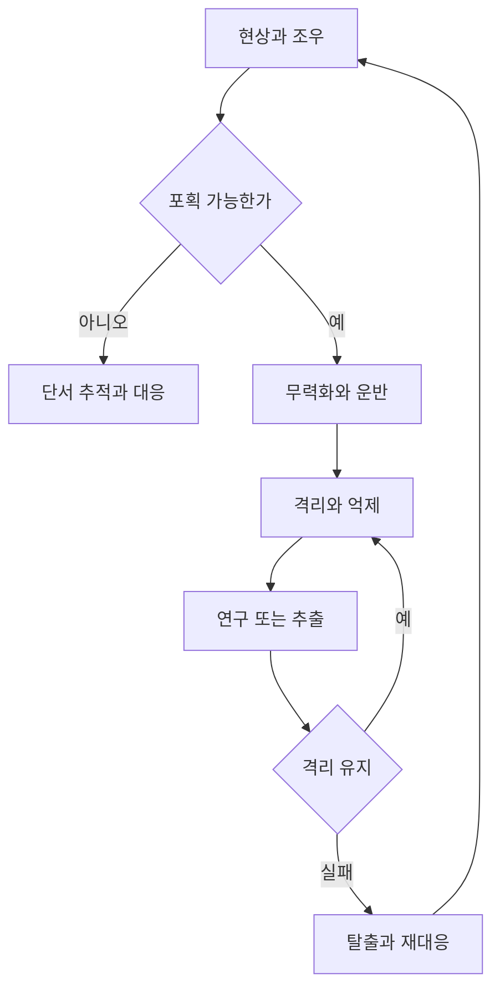

# Anomaly — 미지 현상·격리·연구·초능력 의식

[목차](../README.md) · [스토리텔러](../systems/12_storyteller_incidents_difficulty.md)

> 공개자료에 의한 간접 확인이며 실제 플레이·코드 검증은 하지 않았다. 진행 구조와 엔딩에 관한 설명을 포함한다. `[제안]`은 원작 구현 사실과 구별한다.

## 1. 시스템 목적과 플레이 경험

[해석] Anomaly는 적의 체력과 공격력을 아는 상태에서 대응하는 전투에, 정체·원인·해결법이 충분히 알려지지 않은 사건을 더한다. 플레이어는 위험을 제거할지, 포획해 연구와 자원 생산에 사용할지 결정한다. 방어 성공 후에도 위험을 정착지 내부에 남겨두는 선택이 계속 긴장을 만든다.

**설계 질문:** 알지 못하는 위험을 어떻게 추적 가능한 문제로 바꿀 것인가? 격리가 성공했을 때도 감시·억제·연구의 선택이 의미를 유지하는가?

## 2. 범위와 입출력

| 구분 | 내용 |
| --- | --- |
| 담당 | 초자연적 사건, 격리 가능한 개체, 암흑 연구, 바이오페라이트·에너지 이용, 초능력 의식, 모노리스 진행 |
| 입력 | 시작 모드, 사건·표본·개체, 시설 상태, 연구 노동, 의식 참여자 |
| 출력 | 대응 지식, 기술·도구, 자원, 탈출 위험, 새로운 사건·진행 단계 |
| 유지 상태 | 현상별 발견·연구, 개체별 격리·억제, 모노리스 진행, 의식 작업 |
| 경계 | 일반 책·책장과 기본 연구는 무료 1.5·기본 게임; Anomaly 전용 연구 서적은 별도 콘텐츠 |

[확인] 일반 책과 책장은 무료 1.5에 추가되었고, 해당 소개에서 Anomaly 연구용 서적을 구분한다. 책 기능 전체를 DLC 전용으로 취급하면 안 된다. [S5]

## 3. 플레이어 조작과 제공 정보

[확인] 쓰러뜨린 적합한 개체를 수용 위치로 운반하고 연구 담당자를 배치하며, 억제 시설과 자원 추출 장치를 운영할 수 있다. 또한 의식 장소와 관련 장식을 준비해 초능력 의식을 수행한다. [S2][S3]

[확인] 커뮤니티 위키는 수용실의 격리 강도와 개체별 탈출 간격을 구분한다. 현재 벽·문의 내구도, 시설과 추출 장치 등이 격리 여건에 관여한다. 발매 전 소개의 표현만 따라 모든 개체에 동일한 수동 억제 작업이 있다고 가정하지 않는다. [S6]

[제안] 알 수 없는 정보와 알려진 위험을 구분한다. 아직 발견하지 못한 해결법은 숨길 수 있지만, 현재 격리 여건이 나빠졌다는 사실과 시설 파손 원인은 분명하게 표시한다. 연구 화면에는 “무엇이 더 필요한가”를, 격리 화면에는 개체별 억제 상태·담당자·추출 가동 여부를 노출한다.

## 4. 핵심 규칙

| ID | 조건 | 처리·결과 | 근거 |
| --- | --- | --- | --- |
| AN-01 | 모노리스 표준 모드 | 모노리스와 위협·진행이 연결 | [확인, S4] |
| AN-02 | Ambient horror 선택 | 모노리스 없이 일반 사건에 Anomaly 위협이 섞이며 모노리스 엔딩 없음 | [확인, S4] |
| AN-03 | Disabled 선택 | Anomaly 위협·모노리스는 없지만 관련 도구 일부는 유지 | [확인, S4] |
| AN-04 | 포획 가능한 개체를 무력화 | 수용 위치로 운반해 격리·연구 | [확인, S2] |
| AN-05 | 정식 수용시설 운영 | 개체별 플랫폼과 수용실 격리 강도·시설 조건으로 관리 | [확인, S2][S6] |
| AN-06 | 격리 개체 연구 | 일반 연구와 구별되는 지식 진행 | [확인, S2] |
| AN-07 | 개체에서 자원·전력 추출 | 편익을 얻지만 격리 여건이 나빠져 탈출 위험과 교환 | [확인, S2][S6] |
| AN-08 | 초능력 의식 수행 | 참여·장소·장비와 연결된 초자연적 효과 발생 | [확인, S3] |
| AN-09 | 표준 모드 후반 진행 | 모노리스와 연결된 종결 선택에 도달 | [확인, S1] |

## 5. 상태와 처리 흐름

[제안] 격리는 연구와 착취로 분기하며, 탈출은 정상 게임플레이 실패 상태로 다룬다.



모든 현상을 체력 감소 후 포획하는 단일 경로에 넣지 않는다. 조사형 사건은 별도 단서·단계 상태로 표현하고, 적절한 경우에만 격리 개체와 연결한다.

## 6. 데이터 모델 및 인터페이스

[제안] 전역 진행 설정과 개별 개체의 상태를 분리한다.

| 필드 | 타입 | 역할 |
| --- | --- | --- |
| `integration_mode` | Enum | 표준·환경형·위협 비활성 구분 |
| `phenomenon_id` | DefinitionId | 현상과 조사 규칙 참조 |
| `discovery_stage` | Enum | 발견·분석·대응 지식 상태 |
| `contained_entity_id` | EntityId? | 격리할 수 있는 경우만 사용 |
| `holding_slot_id` | EntityId? | 수용 공간의 독점 점유 |
| `containment_score` | number, 설계 점수 | 수용실·시설의 격리 여건; 원작 공식과 분리 |
| `extraction_enabled` | boolean | 위험 증가를 수반하는 생산 선택 |
| `monolith_stage` | DefinitionId? | 표준 모드 전용 진행; 다른 모드에는 없음 |

```yaml
# 제안: 원작 내부값이 아닌 상태 모델
integration_mode: ambient
monolith_stage: null
phenomenon_id: captive_type_a
discovery_stage: studied
extraction_enabled: true
```

[제안] `ContainmentChanged`는 연구 가능성·추출·경보를 함께 갱신한다. `EntityEscaped`는 플랫폼 예약, 연구 작업, 추출 연결을 종료한다. 의식은 단계별 작업으로 두고 필수 참여자 이탈 시 취소·중단 결과를 명시한다.

## 7. 수치와 밸런스

| 구분 | 관리 기준 |
| --- | --- |
| 확인된 구조 | 연구 효율은 설정으로 조절 가능하며, 저기술 정착지도 전력 없이 일부 연구·바이오페라이트 획득 경로를 이용할 수 있다. [S4] |
| 미확인 상수 | 현상별 등장 조건·가중치, 격리 강도·탈출 간격 공식, 추출량, 의식 품질 공식 |
| 프로토타입 제안 | 위험 인지부터 대응까지의 시간, 시설 고장 시 탈출 빈도, 연구·자원 수익 대비 감시 인시를 측정 |

[해석] 위험을 예측 불가능하게 만드는 것과 결과의 원인을 설명하지 않는 것은 다르다. 플레이어가 격리 실패 후 “추출을 늘렸고 파손된 문을 방치했다”는 원인을 이해할 수 있어야 다음 선택이 바뀐다.

## 8. 대표 플레이 사례와 예외

[제안 사례] 정착지가 약한 개체 하나를 포획해 연구한다. 지식이 쌓인 뒤 추출 시설을 설치해 에너지·재료를 얻는다. 동시에 수용실 문이 손상되고 수리 인력이 부족해진다. 플레이어는 추출 중단, 수리 우선순위 변경, 추가 수용실 건설 중 하나를 선택한다. 탈출하면 생산 시설을 잃는 대신 기존 방어 동선이 내부 적에게도 효과적인지 시험받는다.

- Ambient 모드에서 모노리스 진행을 요구하는 퀘스트를 잘못 생성하지 않는다.
- 수용실 파괴 시 존재하지 않는 플랫폼을 연구 대상에 계속 연결하지 않는다.
- 쓰러졌지만 포획 불가능한 현상에는 운반 명령을 제공하지 않는다.
- 연구가 완료되어도 모든 현상의 위협을 자동 해제하지 않는다. 해결 조건은 현상별로 분리한다.
- 여러 DLC의 의례 기능을 이름이 비슷하다는 이유로 동일한 규칙 집합으로 합치지 않는다.

## 9. 다른 시스템과의 연결

| 연결 | 전달·반영 데이터 |
| --- | --- |
| [스토리텔러](../systems/12_storyteller_incidents_difficulty.md) | 통합 모드·발견 단계 → 허용 사건 목록 |
| [건축](../systems/05_building_rooms_zones.md) | 수용 시설·방 상태 → 격리 조건 |
| [작업](../systems/04_work_priorities_jobs.md) | 운반·억제·연구 → 인력 배분 |
| [연구](../systems/13_research_technology_progression.md) | 현상 지식 → 대응 도구·전용 기술 |
| [전투](../systems/10_combat_defense_equipment.md) | 무력화·탈출 → 전투 재개 |

## 10. 검증 시나리오

[제안] 아래 검사는 실행되지 않은 재구현 수용기준이다.

| Given | When | Then |
| --- | --- | --- |
| Ambient 모드로 새 게임 | 진행 상태 생성 | 모노리스 참조와 전용 엔딩 조건이 생성되지 않음 |
| 개체 두 마리, 수용 자리 하나 | 동시에 운반 요청 | 하나만 자리를 예약하고 다른 작업은 대안 탐색 |
| 연구 중 개체 탈출 | 상태 갱신 | 연구·추출 종료와 경보 발생, 유효하지 않은 참조 제거 |
| 위협 비활성 모드 | 콘텐츠 목록 생성 | 관련 도구 허용과 위협 생성 금지를 별도 적용 |
| 의식 핵심 참여자 이탈 | 다음 단계 진입 | 정의된 중단·취소 정책에 따라 비용·효과 일관 처리 |

## 11. 설계 해석과 재구현 우선순위

[해석] 확장의 중심은 괴물 목록보다 **새 현상을 이해하는 과정**과 **포획한 위험을 운영하는 과정**이다. 위협을 잠시 이익으로 바꾸었다가 운영 실패로 다시 위협이 되는 순환이 정착지 생산과 전투를 연결한다.

**MVP 제안:** 조사형 사건 하나, 포획형 개체 하나, 연구·추출·탈출 순환, 경보 UI. **후속 구현:** 다양한 현상별 조사, 초능력 의식, 저기술 경로, 통합 모드, 모노리스 진행·엔딩. 첫 단계부터 모든 공포 연출을 늘리기보다 실패 원인을 읽을 수 있는 상태 기록을 갖춘다.

## 12. 출처와 확인 필요 사항

모든 출처 확인일: **2026-11-13**.

- **S1 · 공식:** [RimWorld Anomaly Expansion Pack](https://rimworldgame.com/anomaly/) — 현상·조사·종결 진행의 범위.
- **S2 · 공식:** [Anomaly preview #2: Containment facilities, creatures, and release date](https://ludeon.com/blog/2024/03/anomaly-preview-2-containment-facilities-creatures-and-release-date/) — 포획, 수용 플랫폼, 억제, 연구·추출과 탈출 위험.
- **S3 · 공식:** [Anomaly preview #3: Cultists, hate chanters and rituals](https://ludeon.com/blog/2024/04/anomaly-preview-3-cultists-hate-chanters-and-rituals/) — 초능력 의식과 관련 시설.
- **S4 · 공식:** [New ambient horror setting and tribal Anomaly support](https://ludeon.com/blog/2024/05/new-ambient-horror-setting-and-tribal-anomaly-support/) — 표준·Ambient·Disabled 모드, 연구 설정, 저기술 경로.
- **S5 · 공식:** [Anomaly expansion and update 1.5 announced!](https://ludeon.com/blog/2024/03/anomaly-expansion-and-update-1-5-announced/) — 무료 책·책장과 전용 서적 구분.
- **S6 · 커뮤니티:** [RimWorld Wiki: Containment](https://www.rimworldwiki.com/wiki/Containment) — 격리 강도·탈출 간격과 시설 상태를 교차 확인. 문서에 보완 필요 표시가 있어 정확한 수치는 채택하지 않음.

[미확인] 개체별 격리 수치, 모든 현상의 전제 조건, 의식 실패 비용, 1.6 세부 빌드의 모드 변경 제한. 개체별 활동 억제와 수용실의 격리 강도를 같은 수치로 통합하지 않으며, 정확한 공식은 대상 빌드에서 확인한다.
