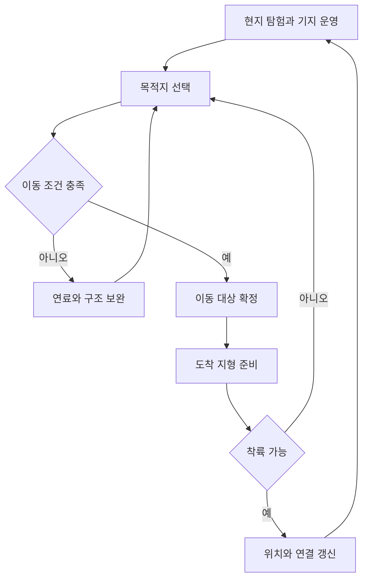

# Odyssey — 이동식 정착지·탐험·궤도 생존

[목차](../README.md) · [캐러밴·여행](../systems/15_caravans_world_travel.md)

> 공개자료 기반의 간접 확인이다. 원작 실행·소스 검증은 하지 않았다. 기지 이전·저장 구조와 검증 항목은 `[제안]`이며, 원작의 실제 구현으로 단정하지 않는다.

## 1. 시스템 목적과 플레이 경험

[해석] Odyssey는 기지에 쌓은 자산을 이동 가능한 생활 공간으로 바꾸어, 정착지 운영과 월드 탐험의 분리를 줄인다. 플레이어는 현지 자원을 계속 채취할지, 다음 목적지로 이동할지 판단하면서 주거·생산·방어 시설의 이동 비용까지 고려한다.

**설계 질문:** 어디서든 살 수 있는 기지가 생겼을 때도 특정 장소에 머무를 이유는 무엇인가? 이동의 편리함이 식량·연료·전력·안전 문제를 없애지 않도록 어떤 준비를 요구하는가?

## 2. 범위와 입출력

| 구분 | 내용 |
| --- | --- |
| 담당 | 중력선과 이동, 중력 기술 수집, 새 지형·랜드마크, 궤도 탐험과 생명 유지, 낚시·동물 활용 확장 |
| 입력 | 기지 구조·적재 개체, 연료·장비, 목적지, 탐험 정보, 생명 유지 상태 |
| 출력 | 기지의 새 위치, 현지 자원과 위협, 탐험 보상, 확장 기술과 장기 목표 |
| 유지 상태 | 중력선 구성·범위, 현재 위치, 연료, 탐험 진행, 탑승 개체의 지속 상태 |
| 경계 | 기본 캐러밴과 일반 월드 생성 전체는 기본 게임; 무료 1.6 변경과 구분 |

[확인] Odyssey는 2025-07-11 출시되었으며 무료 1.6은 DLC 없이 적용된다. 기본 동물의 비행, 맵 생성·건설·UI 개선 전체를 Odyssey 전용으로 넣지 않는다. 낚시와 추가 동물 훈련은 Odyssey 소개에서 제시된 확장 기능이다. [S3][S4]

## 3. 플레이어 조작과 제공 정보

[확인] 플레이어는 중력선에 방과 작업 공간을 구성하고 목적지로 이동한다. 희귀 중력 기술을 찾아 선체를 확장하고, 궤도에서는 밀폐·산소 공급·난방과 우주 활동 장비를 준비한다. [S1][S2]

[제안] 출발 화면에는 이동 대상 범위, 남겨지는 개체·시설, 연료 조건, 목적지 위험을 함께 표시한다. 궤도 진입에는 실내 안전과 외부 활동 장비를 별도로 검사한다. 현재 목적지의 가치도 “자원 수량”뿐 아니라 남은 체류 가능 시간, 생존 비용, 다음 이동 선택지로 읽을 수 있게 한다.

## 4. 핵심 규칙

| ID | 조건 | 처리·결과 | 근거 |
| --- | --- | --- | --- |
| OD-01 | 기능하는 중력선 구성 | 방·시설·사람을 포함한 이동식 정착지로 사용 | [확인, S2] |
| OD-02 | 화학연료와 이동 조건 충족 | 행성 내 다른 장소로 이동 가능 | [확인, S1][S2] |
| OD-03 | 희귀 중력 코어 확보 | 확장 장치와 더 큰 선체 운영에 연결 | [확인, S2] |
| OD-04 | 궤도 생존 준비 | 밀폐 구조·산소·난방·전력이 중요하며 외부 활동에 적합한 장비 필요 | [확인, S2] |
| OD-05 | 궤도 탐색 수단 사용 | 잔해·위성·소행성 등의 탐험 장소 발견 | [확인, S2] |
| OD-06 | 새 생물군계·랜드마크 방문 | 자원·환경 위험·건축 가능성이 달라짐 | [확인, S1] |
| OD-07 | 낚시 지속 | 수역별 어획과 과도한 포획·질병에 의한 공급 위험 | [확인, S3] |
| OD-08 | 동물 훈련 | 위로·채집·채굴·지정 공격 등 추가 역할 가능 | [확인, S3] |
| OD-09 | 메카하이브 목표 진행 | 기술 수집과 방어 돌파 준비를 거쳐 핵심 시설에 접근 | [확인, S5] |
| OD-10 | 출발 맵을 계속 보존하려 함 | 지상에 설치한 중력 닻이 이륙으로 인한 맵 상실을 방지 | [확인, S6] |

## 5. 상태와 처리 흐름

[제안] 이동을 출발·도착의 상태 전이로 정의하고, 도착 확정 전 실패 경로를 둔다.



이 흐름은 원작의 이동 구현을 복원한 것이 아니다. 재구현에서 시설·주민·물품이 복제되거나 누락되지 않도록 검증 가능한 경계를 제안한 것이다.

## 6. 데이터 모델 및 인터페이스

[제안] 기지와 포함 개체의 영구 ID는 유지하고 위치만 갱신하는 모델을 우선 검토한다.

| 필드 | 타입 | 역할 |
| --- | --- | --- |
| `mobile_base_id` | EntityId | 이동식 기지의 지속 식별자 |
| `footprint_cells` | Set<LocalCell> | 이동 범위와 착륙 공간 검사 |
| `member_entity_ids` | Set<EntityId> | 이동에 포함되는 사람·물품·시설 |
| `world_location_id` | WorldLocationId | 지상·궤도 위치 참조 |
| `fuel_amount` | number, 연료 단위 | 이동 자원; 원작 소비 공식은 별도 확인 |
| `life_support_state` | Enum | 정상·부족·누출 등 재구현 상태 |
| `transfer_state` | Enum | 준비·이동 중·도착 확정·복구 |
| `discovered_site_ids` | Set<WorldLocationId> | 탐험으로 얻은 장소 정보 |

```yaml
# 제안: 데이터 구조와 예시값이며 원작 내부 스키마가 아님
mobile_base_id: ship_01
world_location_id: orbit_site_04
transfer_state: arrived
life_support_state: operational
member_entity_ids: [colonist_07, freezer_02, item_stack_19]
```

[제안] `BaseTransferCommitted` 이후 작업 예약, 전력망, 방·온도, 이동 경로를 새 맵 기준으로 갱신한다. 이동 전 작업 목적지가 선외에 있었다면 작업을 재평가한다. 준비 단계 실패 시 출발 상태를 보존하며 연료·물품을 중복 차감하지 않도록 한다.

## 7. 수치와 밸런스

| 구분 | 관리 기준 |
| --- | --- |
| 확인된 구조 | 희귀 기술 수집이 선체 확장과 연결되고, 궤도는 추가 생명 유지 준비를 요구한다. [S2] |
| 미확인 상수 | 1.6 빌드별 비행 거리·연료 공식, 선체 한도, 착륙 제한, 산소·누출·어획 회복 계수 |
| 프로토타입 제안 | 이동 한 번에 드는 연료·정비 인시, 현지 체류당 순자원, 이동 전 준비 시간, 선체 면적 대비 생산량 측정 |

[해석] 이동 비용이 너무 낮으면 자원 고갈이 자리 이동만으로 해결된다. 반대로 준비 비용이 과도하면 중력선이 정착 기지보다 불편한 선택이 된다. 연료뿐 아니라 탐험 위험·편의·회수 가능성까지 함께 조절해야 이동이 운영 선택으로 남는다.

## 8. 대표 플레이 사례와 예외

[제안 사례] 중력선이 혹한 지역에서 금속을 채취한 뒤 식량이 풍부한 해안으로 이동한다. 선체의 작업장과 냉동고는 함께 가지만, 현지 채굴 기지를 보존하려면 중력 닻을 고려해야 한다. 해안에서는 낚시로 식량을 보충하고, 다음 궤도 탐사를 위해 전력과 실내 생존 설비를 준비한다. 궤도 도착 후 외벽이 손상되면 전투와 수리의 우선순위가 충돌한다.

- 목적지 생성 후 착륙 공간이 맞지 않으면 대상을 선택하게 하고 이전 상태를 보존한다.
- 선내 개체는 아군만 있다고 가정하지 않는다. 포함 규칙에 해당하는 적·포로·물품도 구분한다. [S2]
- 침대·작업대·창고의 소유와 참조가 이동 중 끊기지 않도록 한다.
- 지상 사건을 맵 이전 직후 무조건 같은 위치에 재생하지 않는다. 사건의 대상 범위를 명확히 정의한다.
- 지상과 궤도의 생존 조건을 같은 외기 온도 하나로만 표현하지 않는다.

## 9. 다른 시스템과의 연결

| 연결 | 전달·반영 데이터 |
| --- | --- |
| [월드·환경](../systems/01_world_map_environment.md) | 위치·랜드마크 → 탐험 조건·생성 맵 |
| [건축](../systems/05_building_rooms_zones.md) | 이동 범위·밀폐 구조 → 선체 구성·생존 조건 |
| [전력·온도](../systems/08_power_temperature_fire.md) | 공급·난방 상태 → 궤도 실내 유지 |
| [물류](../systems/06_items_storage_logistics.md) | 이동 포함 목록 → 보관·예약 참조 |
| [동물](../systems/11_animals_taming_ranching.md) | 추가 훈련 → 노동·전투·기분 보조 |
| [저장·시뮬레이션](../systems/18_simulation_save_mods.md) | 맵 간 개체 이동 → 영구 ID·저장 일관성 |

## 10. 검증 시나리오

[제안] 재구현 수용기준이며 실제 실행한 테스트가 아니다.

| Given | When | Then |
| --- | --- | --- |
| 선체 안팎에 물품·주민 존재 | 이동 포함 목록 확정 | 정의된 범위에 따라 포함·제외 이유 표시 |
| 목적지 착륙 검사가 실패 | 이동 확정 시도 | 출발 상태 유지, 연료·개체 중복 처리 없음 |
| 작업 중인 정착민과 생산대가 함께 이동 | 도착 확정 | 유효한 작업은 유지·재개하고 선외 대상 작업은 재평가 |
| 밀폐된 궤도 기지의 외벽 파손 | 생존 상태 갱신 | 영향 구역과 대응 사유 표시, 무관한 구역과 구분 |
| 이동 중 저장 가능한 구현 | 저장·불러오기 | 개체·소유·수량이 이전 또는 완료 상태 중 하나로 일관 |
| 낚시만으로 식량을 조달 | 수역 공급 악화 | 생산량 감소가 식량 예측·경보에 반영 |
| 출발 맵에 중력 닻이 없음 | 출발 전 확인 | 남기는 자산과 맵 상실 결과를 분명하게 표시 |

## 11. 설계 해석과 재구현 우선순위

[해석] 이동식 기지는 맵 이동 기능이면서 동시에 모든 정착지 시스템의 참조·수명을 시험하는 기능이다. 선체 크기나 새 생물군계보다 먼저, 이동 전후에 같은 주민과 물품이 계속 존재한다는 보장을 확보해야 한다.

**MVP 제안:** 지상 두 장소 사이의 작은 이동식 기지, 이동 포함 목록, 연료, 도착 복구 처리. **후속 구현:** 선체 확장, 여러 지형, 궤도 생존, 새로운 훈련·낚시, 탐험·메카하이브 목표. 자원 채집만 반복하는 구조가 되지 않도록 각 목적지에 체류·이탈 이유를 함께 설계한다.

## 12. 출처와 확인 필요 사항

모든 출처 확인일: **2026-11-13**.

- **S1 · 공식:** [RimWorld Odyssey Expansion Pack](https://rimworldgame.com/odyssey/) — 이동식 정착지, 새 생물군계·랜드마크의 범위.
- **S2 · 공식:** [Odyssey preview #2: Gravships and space](https://ludeon.com/blog/2025/06/odyssey-preview-2-gravships-and-space/) — 선체 구성·확장, 탑승 개체, 궤도 탐험·생명 유지.
- **S3 · 공식:** [Odyssey preview #3: Animals, training, and fishing](https://ludeon.com/blog/2025/07/odyssey-preview-3-animals-training-and-fishing/) — 추가 훈련·낚시와 수역 공급 위험.
- **S4 · 공식:** [The RimWorld – Odyssey expansion is out now!](https://ludeon.com/blog/2025/07/the-rimworld-odyssey-expansion-is-out-now/) — 출시일과 무료 1.6 경계.
- **S5 · 공식:** [Odyssey preview #4: Quests, the mechhive endgame, drones, and more](https://ludeon.com/blog/2025/07/odyssey-preview-4-quests-the-mechhive-endgame-drones-and-more/) — 기술 수집과 메카하이브 접근·최종 선택.
- **S6 · 커뮤니티:** [RimWorld Wiki: Grav anchor](https://www.rimworldwiki.com/wiki/Gravanchor) — 이륙 후 출발 맵 보존과 중력 닻의 역할. 자원·예외 수치는 채택하지 않음.

[미확인] 중력 닻 파괴·임시 맵·잔류 인원이 조합될 때의 모든 맵 유지 예외, 착륙 장소별 제한, 선체 포함·분리의 예외, 목적지 사건 재배치, 현재 패치의 산소·낚시 수치. 중력 닻에 의한 기본 보존 규칙과 세부 예외 검증을 구분한다.
