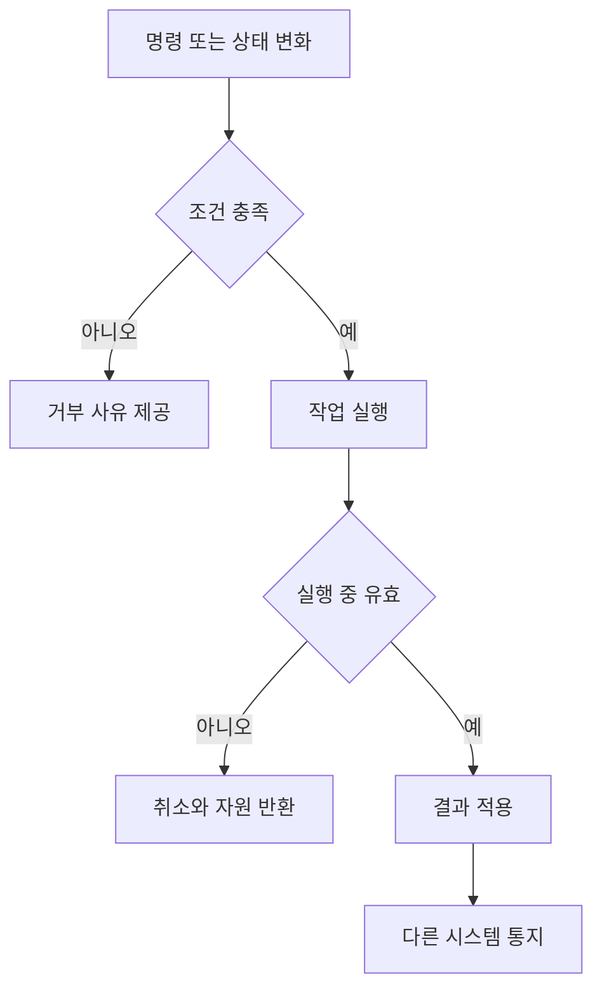

# 시스템 역기획 공통 Markdown 양식

[전체 목차](../README.md)

이 파일은 본 문서 묶음의 공통 작성 양식이다. 새 시스템을 추가할 때 아래 12절을 복사하고, 자리표시자를 실제 분석으로 바꾼다. 빈칸을 임의의 사실로 채우지 않고 확인하지 못한 항목은 `[미확인]`으로 남긴다.

## 작성 전 메타데이터

```yaml
doc_id: SYS-XX
title: 시스템 이름
layer: base
target_version: 분석할 게임·플랫폼·버전
research_date: YYYY-MM-DD
status: 공개자료 기반 역기획
```

`layer`는 `base`, `dlc`, `meta`를 사용한다. 실제 플레이 확인을 했다면 빌드·설정·관찰 조건을 추가하고 문헌 확인과 구분한다. 문서마다 출처 키는 다시 시작할 수 있다.

## 1. 시스템 목적과 플레이 경험

> `[해석]` 이 시스템이 플레이어에게 어떤 판단을 요구하는지 한 문장으로 쓴다.

기능의 정의만 적지 않고, 플레이어가 포기해야 하는 다른 선택과 보상을 설명한다. 확인 가능한 개발자 발언이 없다면 설계 의도를 개발자가 직접 말한 것처럼 서술하지 않는다.

## 2. 범위와 입출력

| 구분 | 작성할 내용 |
| --- | --- |
| 담당 | 이 시스템이 최종 결정하는 상태와 규칙 |
| 비담당 | 다른 시스템에 요청하는 기능 |
| 입력 | 사용자 명령, 외부 상태, 시간, 사건 |
| 상태 | 지속적으로 저장해야 할 값 |
| 출력 | 상태 변화, 결과 이벤트, UI 피드백 |

## 3. 플레이어 조작과 제공 정보

| 플레이어 질문 | 조작 위치·방법 | 제공 정보 | 조건 불충족 시 |
| --- | --- | --- | --- |
| 무엇을 결정하는가? | 탭·대상·명령 | 비용·예상 결과 | 구체적인 거부 사유 |

명령을 내렸다는 사실과 실제 작업이 시작됐다는 사실을 구분한다. UI의 위치·단축키를 직접 보지 않았다면 문헌 근거 또는 미확인을 표시한다.

## 4. 핵심 규칙

| ID | 조건 | 처리·결과 | 근거 |
| --- | --- | --- | --- |
| RXX-01 | 입력과 전제 | 관찰 가능한 결과 | `[확인][S1]` |
| RXX-02 | 예외·금지 조건 | 거부·중단·대체 처리 | `[확인][S2]` 또는 `[제안]` |

규칙은 테스트할 수 있을 만큼 구체적으로 쓴다. `효율적으로 처리한다` 대신 `예약된 수량은 다른 작업의 가용량에서 제외한다`처럼 작성한다. 원작에서 확인하지 못한 규칙은 제안임을 표시한다.

## 5. 상태와 처리 흐름



그림에 있는 상태와 예외를 본문으로도 설명한다. 이 예시는 일반적인 **재구현 제안**이며 원작의 실제 상태머신을 나타내지 않는다. Mermaid는 한 줄에 다섯 개보다 많은 노드를 배치하지 않는다.

## 6. 데이터 모델 및 인터페이스

| 필드 | 타입·단위 | 소유자 | 저장 여부 | 설명 |
| --- | --- | --- | --- | --- |
| `definition_id` | 문자열 | 정의 저장소 | 참조 | 정적 규칙 선택 |
| `entity_id` | 문자열 | 월드 상태 | 예 | 개체 정체성 |
| `state` | enum | 담당 시스템 | 예 | 실행 상태 |
| `progress` | 정규화 0..1 | 담당 시스템 | 정책 명시 | 작업 진행 예시 |

```yaml
# [제안] 예제 데이터이며 원작 포맷이 아님
entity_id: prototype_object_01
definition_id: prototype_definition
state: pending
progress: 0.0
```

필드 이름만 늘리지 말고 변경 책임과 불변조건을 설명한다. 원작 API를 확인하지 않았다면 `JobDriver`, `Hediff` 등 실제 내부 명칭과 독립 구현용 명칭을 무심코 혼합하지 않는다.

## 7. 수치와 밸런스

| 값 | 분류 | 단위 | 근거·검증 방법 |
| --- | --- | --- | --- |
| 확인된 상수 | 원작 문헌 수치 | 명시 | 출처·버전 |
| 확정되지 않은 계수 | 미확인 | 명시 | 실험 조건 |
| 예시 설정값 | 프로토타입 제안 | 명시 | 원작 수치가 아님 |

확률·가산·곱셈·최댓값·임계값을 서로 구분한다. `%`와 `%p`, 현실 초와 게임 시간, 전력과 에너지 단위에 주의한다.

## 8. 대표 플레이 사례와 예외

구체적인 인원·자원·계획이 있는 가상 상황을 하나 쓴다. 실제 플레이 기록이 아니면 `[제안 사례]`로 표시한다. 다음 조건 중 시스템에 해당하는 항목을 설명한다.

- 대상이 사라짐, 사망 또는 맵 이동.
- 자원 부족, 다른 작업의 예약, 목표 상태 변경.
- 사용자의 취소, 징집, 정책 변경.
- 저장·로드 직전후, 중복 결과 이벤트.

## 9. 다른 시스템과의 연결

| 연결 문서 | 받는 값 | 보내는 값 | 변경의 영향 |
| --- | --- | --- | --- |
| 상대경로 링크 | 입력 계약 | 출력 계약 | 어떤 선택이 달라지는가 |

연결이 있다는 사실만 적지 않고, 어느 쪽이 값을 소유하고 무엇이 변경되는지 설명한다.

## 10. 검증 시나리오

| ID | Given | When | Then |
| --- | --- | --- | --- |
| TXX-01 | 정상 입력과 충분한 자원 | 명령 수행 | 기대 결과와 자원 변화 |
| TXX-02 | 자원 부족 | 명령 수행 | 거부 사유와 상태 보존 |
| TXX-03 | 실행 중 대상 삭제 | 다음 갱신 | 취소·예약 반환 |
| TXX-04 | 결과 적용 직전 저장 | 로드·재평가 | 중복 적용 없음 |

표는 테스트 계획이다. 실제로 실행하지 않은 테스트를 통과 처리하지 않는다.

## 11. 설계 해석과 재구현 우선순위

`[해석]` 규칙이 만들어내는 선택의 의미를 설명한다. `[제안]` MVP와 후속 구현을 나누고, 왜 그 순서로 검증하는지 쓴다. 원작과 동일하게 구현하는 범위와 새로 설계하는 범위를 구분한다.

## 12. 출처와 확인 필요 사항

| 키 | 자료명·URL | 종류 | 확인일 | 지원하는 주장 |
| --- | --- | --- | --- | --- |
| S1 | 실제 열람하거나 검색 본문을 확인한 링크 | 공식·커뮤니티 | YYYY-MM-DD | 구체적인 규칙 |

접근 실패·요약만 확인·구버전·문헌 충돌을 기록한다. 페이지 전체를 복사하지 말고 필요한 사실만 독자적으로 요약한다.

## 문서 작성 체크리스트

- [ ] 게임 버전·플랫폼·DLC 범위를 명시했다.
- [ ] 사실, 해석, 제안, 미확인을 구분했다.
- [ ] 핵심 사실 옆에 해당 파일의 출처 키를 넣었다.
- [ ] 데이터 예시와 공식 수치를 구분했다.
- [ ] 정상 진행과 취소·중단·실패를 모두 설명했다.
- [ ] 상대 링크와 코드블록이 유효하다.
- [ ] Mermaid 없이도 본문으로 흐름을 이해할 수 있다.
- [ ] 테스트 계획을 실제 실행 결과처럼 표현하지 않았다.
