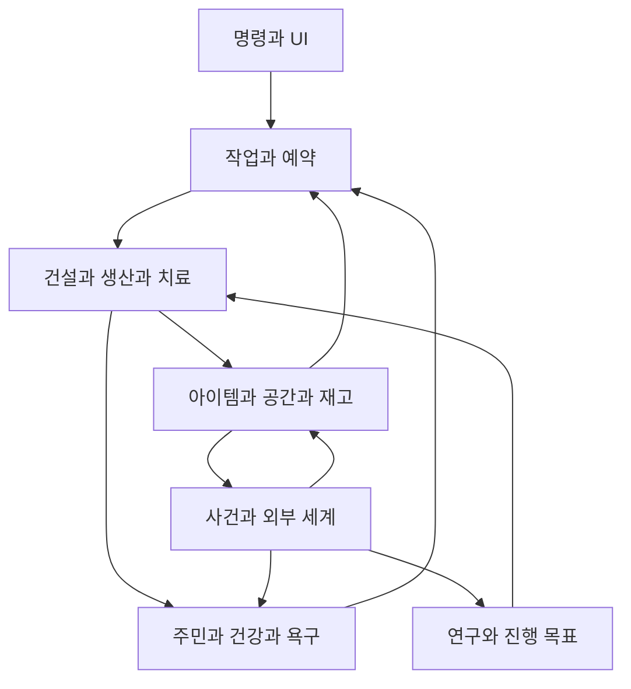

# 시스템 의존성과 공통 데이터 계약

[전체 목차](../README.md) · [전체 루프](../00_overview.md) · [통합 검증](05_acceptance_tests.md)

> 이 문서 전체는 **[제안]**이다. 개별 시스템에서 확인한 동작을 연결하기 위한 독립 구현 설계이며, 림월드 엔진의 실제 모듈·클래스·이벤트 버스를 복원한 자료가 아니다. 각 파일의 데이터 예시는 개념 설명용으로, 그대로 합쳐 컴파일할 수 있는 완성 스키마가 아니다.

## 1. 책임을 나누는 기준

하나의 값에는 최종 변경 책임자를 하나 둔다. 예를 들어 치료 명령은 작업 시스템이 실행해도 약품 수량은 아이템 소유자가, 부상 상태는 건강 소유자가 변경한다. 어느 모듈이든 다른 모듈의 값을 직접 수정할 수 있으면 중복 소비·죽은 주민의 작업·잘못된 저장 상태를 추적하기 어려워진다.

| 공통 개념 | 책임 | 다른 시스템의 접근 |
| --- | --- | --- |
| 정의 | 콘텐츠 규칙·기본값·태그 | ID로 조회 |
| 개체 | 정체성·현재 위치·단일 소유권 | 안정 ID 참조 |
| 작업 | 수행 상태·진행·취소 | 명령과 결과 이벤트 |
| 예약 | 특정 작업이 사용할 자원·대상 | 원자적 확보·해제 요청 |
| 정책 | 플레이어의 지속적인 의도 | 현재 정책 버전을 확인 |
| 파생 값 | 능력·가격·방 평가 등 | 원인 상태로부터 계산 |

## 2. 주요 의존 관계



이 그림은 정보·규칙 의존성이다. 전부 직접 함수 호출로 연결하라는 뜻이 아니며, 실행 순서도 아니다. 특히 자산 상태가 사건에 영향을 줄 수 있어도 사건의 종류와 시점을 모두 자산 하나로 결정하지 않는다.

## 3. 시스템별 소유 상태와 계약

| 시스템 | 소유하는 주요 상태 | 읽는 입력 | 내보내는 변화 |
| --- | --- | --- | --- |
| [01 월드](../systems/01_world_map_environment.md) | 타일·지형·환경 | 시드·계절·월드 설정 | 접근성·기후·장소 조건 |
| [02 주민](../systems/02_colonists_skills_relationships.md) | 정체성·기술·관계 | 경험·사회 사건 | 업무 자격·숙련·관계 변화 |
| [03 기분](../systems/03_needs_mood_mental_breaks.md) | 욕구·생각·정신 상태 | 생활·환경·기억 | 우선 행동·정신 상태 전환 |
| [04 작업](../systems/04_work_priorities_jobs.md) | 현재 일감·예약 소유 | 자격·정책·대상 | 작업 결과·취소·자원 반환 |
| [05 건설](../systems/05_building_rooms_zones.md) | 계획·건물·공간 구분 | 재료·노동·지형 | 공간 구조·시설 가용성 |
| [06 물류](../systems/06_items_storage_logistics.md) | 품목 개체·재고·저장 | 필터·소유권·예약 | 가용 수량·위치·훼손 |
| [07 생산](../systems/07_food_agriculture_production.md) | 작물·주문·생산 진행 | 재료·환경·노동 | 수확·소비·생산물 |
| [08 설비](../systems/08_power_temperature_fire.md) | 전력망·열·화재 | 시설·연료·날씨 | 가동 상태·온도·피해 |
| [09 건강](../systems/09_health_medical_body.md) | 부위·질환·치료 | 피해·환경·의료 행위 | 능력·치료 요구·사망 |
| [10 전투](../systems/10_combat_defense_equipment.md) | 전투 명령·공격 진행 | 장비·위치·능력 | 명중·피해 요청·전투 종료 |
| [11 동물](../systems/11_animals_taming_ranching.md) | 소속·훈련·번식 | 먹이·조련·공간 | 생산물·훈련 능력·개체 증가 |
| [12 사건](../systems/12_storyteller_incidents_difficulty.md) | 사건 일정·난도 맥락 | 정착지 상태·설정 | 방문·위협·환경 사건 |
| [13 연구](../systems/13_research_technology_progression.md) | 진행·해금 집합 | 노동·시설·특수 자격 | 새 기술 가용성 |
| [14 외교](../systems/14_factions_trade_prisoners.md) | 관계·거래·수용 방침 | 재고·교섭·포획 | 소유권·합류·관계 변화 |
| [15 이동](../systems/15_caravans_world_travel.md) | 구성원·경로·공동 짐 | 위치·보급·목적지 | 맵/월드 이관·도착 |
| [16 임무](../systems/16_quests_endings.md) | 약속·기한·보상 상태 | 장소·사건 결과 | 조건 완료·보상·종료 |
| [17 UI](../systems/17_ui_controls_feedback.md) | 선택·표시·필터 | 읽기 뷰·이벤트 | 사용자 명령 요청 |
| [18 기반](../systems/18_simulation_save_mods.md) | 시간·저장·참조 관리 | 명령·콘텐츠 구성 | 일관된 상태 경계 |

## 4. 공통 ID·단위·이벤트

`EntityId`, `MapId`, `FactionId`, `DefinitionId`, `PolicyId`, `QuestId`는 서로 다른 의미의 안정 식별자다. 사람 이름이나 화면 문자열을 키로 사용하지 않는다. 비활성 맵·상단·저장에서도 같은 인물은 같은 ID를 유지한다.

| 종류 | 공통 제안 |
| --- | --- |
| 시간 | 내부 계약은 `simulation_tick`; 표시 변환은 별도 |
| 비율 | 예제의 정규화 값은 0..1, UI 백분율과 명시적으로 변환 |
| 물량 | 개수·영양·kg를 혼합하지 않고 각각 단위 유지 |
| 전력 | 출력·소비 W와 저장 에너지 Wd를 분리 |
| 이벤트 | 발생 ID, 원인 ID, 대상 ID, 발생 tick, payload 버전 포함 |

```yaml
# [제안] 사건 전달 형식, 원작 API가 아님
event_id: event_00042
type: entity_incapacitated
occurred_tick: 120000
subject_id: pawn_003
cause_id: damage_021
payload_version: 1
payload:
  map_id: map_home
```

모든 수신자가 같은 이벤트를 받더라도 자신이 소유한 상태만 바꾼다. 예를 들어 작업은 예약을 해제하고, 의료는 구조 필요를 판단하며, UI는 경고를 표시한다. 이벤트 재전달을 중복 피해나 중복 보상으로 처리하지 않는다.

## 5. 자원·예약 불변조건

1. 동일 개체는 같은 시점에 하나의 실제 위치·소유자만 가진다.
2. 예약 수량 합계는 사용할 수 있는 수량을 넘지 않는다.
3. 작업 취소·죽음·소멸·맵 이관은 관련 예약의 해제 또는 이관으로 끝난다.
4. 재료 소비·생산물 생성은 정의한 단계에서 한 번만 확정한다.
5. 파괴·부패·섭취·제작 등 수량 변화에는 원인을 남긴다.
6. UI 집계와 실제 실행의 가용성 판정이 다른 필터를 쓰면 그 차이를 표시한다.

`시작 수량 + 생성 + 유입 - 소비 - 파괴 - 유출 = 종료 수량`을 물량 검증의 기본식으로 쓴다. 채굴·수확은 생성 출처가 있으며, 건축·제작은 정의에 따른 변환이므로 단순한 총 개수 보존만을 강요하지 않는다.

## 6. 맵 이관과 저장 경계

상단 출발, 현장 진입, 중력선 이동은 모두 인물·물품·건물의 위치를 바꾸지만 계약은 다르다. 한 종류의 일반 “텔레포트”로 합치기보다 공통 소유권 이관과 각 이동 수단의 조건 검증을 나눈다.

| 단계 | 실패 시 처리 |
| --- | --- |
| 이전 대상 목록 확정 | 정책·인원 변경이면 재계산 |
| 목적지 수용 조건 검증 | 이동 거부와 구체 사유 |
| 출발 위치에서 인계 표시 | 아직 새 개체를 복제하지 않음 |
| 목적지 상태 확정 | 동일 transfer ID는 재실행하지 않음 |
| 원래 위치 정리 | 외부 링크·예약·맵 보존 조건 확인 |

저장은 작업과 이벤트 적용이 중간에 섞이지 않는 상태 경계에서 수행한다는 것이 제안의 기본 원칙이다. 재로드 시 캐시·경로·예약을 어떤 정책으로 재구축할지 명시한다.

## 7. DLC 확장 지점

| 확장 | 공통 상태에 추가하는 축 | 분리해야 할 경계 |
| --- | --- | --- |
| [Royalty](../dlc/01_royalty.md) | 개인 지위·명예·초능력 자원 | 세력 우호도와 개인 자격 |
| [Ideology](../dlc/02_ideology.md) | 사건을 평가하는 신념과 규범 | 전역 규칙과 개인별 평가 |
| [Biotech](../dlc/03_biotech.md) | 성장·유전자·기계 통제·폐기물 | 인간 욕구와 기계 유지 비용 |
| [Anomaly](../dlc/04_anomaly.md) | 조사·수용·특수 연구·의식 | 일반 연구와 전용 진행 |
| [Odyssey](../dlc/05_odyssey.md) | 이동 구조물·행성/궤도 환경 | 지상 상단과 중력선·맵 보존 |

이는 구현용 책임 구분이다. 원작 내부가 동일한 확장 포인트를 제공한다는 뜻은 아니다. DLC를 끈 상태에서는 해당 정의를 참조하지 않으며, 관련 저장을 여는 경우 명확한 호환 정책을 적용한다.
