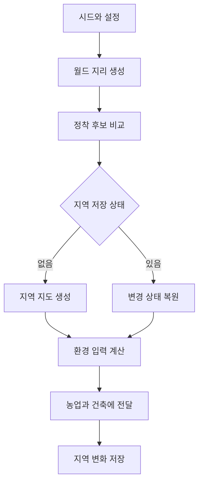

# 01. 월드 생성·정착지 지도·환경

[전체 목차](../README.md) · [시스템 연결](../meta/02_system_dependencies.md)

> **읽는 기준:** `[확인]`은 공개 문서로 간접 확인한 규칙, `[해석]`은 설계 분석, `[제안]`은 재구현 명세다. 실제 게임 실행이나 원본 코드 검증은 수행하지 않았다.

## 1. 시스템 목적과 플레이 경험

[확인] 행성의 정착 위치에 따라 기후·생물·자원·지형이 달라지고, 플레이어는 그 조건에서 정착지를 운영한다. [S1] **[해석] 핵심 역할은 매번 같은 생산 해법이 최선이 되지 않도록 초기 조건을 바꾸는 것**이다. 추운 지역의 식량 비축, 숲의 목재 활용, 산악 지형의 통로 계획이 서로 다른 운영 결정을 만든다.

설계 질문은 “무엇을 생성할 것인가?”에 그치지 않는다. **정착 전에 예측할 수 있는 위험과 정착 후 발견하는 기회를 어떻게 나눌 것인가?** 월드 정보는 장기 계획을, 지역 지도의 미세 지형은 구체적 배치를 담당한다고 해석한다.

## 2. 범위와 입출력

| 구분 | 내용 | 책임 경계 |
| --- | --- | --- |
| 입력 | 시드, 생성 설정, 선택한 월드 타일, 지도 크기 | 게임 시작 설정에서 전달 |
| 유지 상태 | 월드 지리, 지역 지형, 식생·광물 배치, 환경 조건 | 이 문서의 범위 |
| 출력 | 이동·건축 가능 조건, 농업 환경, 외부 기온, 자원 분포 | 작업·건축·농업·온도 시스템이 소비 |
| 비담당 | 실내 열 교환, 작물 성장 계산, 습격 규모 | 개별 하위 시스템에서 처리 |
| DLC 경계 | 오염·유전자 종족, 중력선·신규 생물군계 | [Biotech](../dlc/03_biotech.md), [Odyssey](../dlc/05_odyssey.md)로 분리 |

## 3. 플레이어 조작과 제공 정보

[확인] 월드 생성 단계에서 시드와 행성 환경을 설정하고, 월드 타일을 선택해 생물군계·지형·성장 기간 등의 정보를 확인한다. 지역 지도 크기도 별도 설정이다. [S2]

[제안] 역기획 UI의 정보 위계는 `생존 가능성 → 접근성과 교역 → 건축 부지 → 미세 자원` 순으로 둔다. 정착 후보 비교에는 기온 범위, 재배 가능 기간, 주변 세력까지의 이동 부담을 보여준다. 지역 화면에는 지형·지붕·비옥도와 같은 오버레이를 분리해, 숫자 하나로 정착지의 좋고 나쁨을 판단하지 않게 한다.

## 4. 핵심 규칙

| ID | 조건 | 처리·결과 | 근거 |
| --- | --- | --- | --- |
| MAP-01 | 새 월드 생성 | 시드와 설정을 이용해 지리를 생성 | [확인] [S2] |
| MAP-02 | 같은 시드 재사용 | 지리 재현에 활용되지만 세력 정착지까지 무조건 동일하다고 보장하지 않음 | [확인] [S2] |
| MAP-03 | 전역 강수·온도 변경 | 생성되는 지역 환경의 분포가 달라짐 | [확인] [S2] |
| MAP-04 | 세력 인구 밀도 변경 | 주변 정착지 접근성은 달라지지만 습격 빈도를 직접 설정하는 옵션은 아님 | [확인] [S2] |
| MAP-05 | 서로 다른 지면 이용 | 이동 부담·식물 생장 가능성·건축 가능 조건이 달라짐 | [확인] [S3] |
| MAP-06 | 조도·계절 조건 변경 | 작물·작업 환경·건강에 영향을 주는 입력값 제공 | [확인] [S3] |
| MAP-07 | 지역 지도 변경 | 영향받는 지형·연결성 정보를 갱신하도록 변경 이벤트 발행 | [제안] |
| MAP-08 | 저장한 지도 재진입 | 실제 변경 상태를 복원하고 최초 시드로 덮어쓰지 않음 | [제안] |

## 5. 상태와 처리 흐름

[제안] 원작의 생성 알고리즘을 재현한 도식이 아니라, 동등한 플레이 흐름을 구현하기 위한 책임 분리다. 최초 생성과 재진입을 구분해야 채굴·건축 결과가 사라지지 않는다.



## 6. 데이터 모델 및 인터페이스

[제안] 월드 타일과 지역 셀은 서로 다른 좌표계·식별자를 사용한다. 행성상의 이웃 관계를 지역 지도 좌표로 오인하지 않는다.

| 필드 | 타입·단위 | 역할 |
| --- | --- | --- |
| world_seed | string | 생성 입력 기록 |
| generation_profile | DefinitionId | 규칙 버전과 콘텐츠 집합 |
| world_tile_id | WorldTileId | 행성 내 위치 식별 |
| map_id | MapId | 로드된 지역 상태 식별 |
| terrain_def_id | DefinitionId | 지면의 이동·건축·농업 속성 |
| cells | cell array | 지형·지붕·점유 상태 |
| ambient_temperature | number, °C | 외부 기온 입력 |
| light_ratio | number, 0..1 | 지역 셀 조도 |
| environment_revision | integer | 변경된 환경 캐시 식별 |

```yaml
# 제안 예시이며 원작 저장 형식이 아니다.
map_id: map_colony_001
world_tile_id: tile_04821
generation_profile: base_temperate_prototype_v1
size_cells: [128, 128]  # 프로토타입 임의 크기
environment_revision: 17
outputs:
  - TerrainChanged
  - OutdoorTemperatureChanged
  - LightChanged
```

[제안] 초기 지형은 정적 정의, 채굴·바닥 설치·벽 파괴는 런타임 변경으로 구분한다. `TerrainChanged`에는 변경 셀 범위를 실어 경로·농업·건축이 필요한 범위만 재검사하게 한다.

## 7. 수치와 밸런스

| 항목 | 구분 | 취급 방법 |
| --- | --- | --- |
| 기본 지역 크기 예시 250×250셀 | [확인] 커뮤니티 문서의 선택지 [S2] | 모든 시나리오의 고정 크기라고 가정하지 않음 |
| 조도 표시 0~100% | [확인] [S3] | 제안 모델의 0..1과 변환 |
| 지리·강수 생성식 | [미확인] | 원작 알고리즘과 동일하다고 주장하지 않음 |
| 환경 갱신 주기 | [제안] | 시각 변화와 게임 규칙 갱신을 구분해 측정 후 결정 |

[해석] 지도 확대는 건설 공간을 늘리는 동시에 운반·구조 시간을 늘린다. 밸런스 평가는 면적뿐 아니라 **식량·의료·방어 거점 간 왕복 시간**으로 수행하는 편이 의사결정을 잘 설명한다.

## 8. 대표 플레이 사례와 예외

[제안 사례] 겨울이 있는 산림 지역을 선택한 정착지가 비옥한 땅을 창고로 덮었다고 가정한다. 당장은 동선이 짧아지지만 다음 파종 때 경작 공간을 잃는다. 지도는 단순한 배경이 아니라 생산 설비의 후보 공간이므로, 건설 미리보기에서 농업 가치가 사라지는 영역을 표시한다.

예외 처리에서는 세 가지를 분리한다. 물리적으로 통과할 수 없는 셀, 통과는 가능하나 이동 비용이 큰 셀, 정책상 작업 대상에서 제외된 셀이다. 문이 닫히거나 다리가 파괴되면 이동 가능성만 무효화하고 날씨 상태를 초기화하지 않는다. 지도 생성 실패 시에는 불완전한 저장본을 성공 상태로 기록하지 않는다.

## 9. 다른 시스템과의 연결

| 연결 문서 | 주고받는 정보 | 변화의 방향 |
| --- | --- | --- |
| [건축·방](05_building_rooms_zones.md) | 지면 지지 조건, 벽·지붕 변경 | 환경 → 배치 판정 → 공간 갱신 |
| [농업·생산](07_food_agriculture_production.md) | 조도, 기온, 경작 조건 | 환경 → 생산 가능성 |
| [전력·온도](08_power_temperature_fire.md) | 외부 기온, 노출 영역 | 환경 → 실내 유지 비용 |
| [월드 이동](15_caravans_world_travel.md) | 타일 이웃·지형 | 지리 → 경로와 보급 |
| [저장·시뮬레이션](18_simulation_save_mods.md) | 지도 상태와 생성 버전 | 영속화 ↔ 복원 |

## 10. 검증 시나리오

아래는 **[제안] 재구현 수용기준**이며 테스트 실행 결과가 아니다.

| Given | When | Then |
| --- | --- | --- |
| 동일 시드·설정·규칙 버전 | 새 지리 생성 반복 | 보장 범위의 지리 결과가 일치 |
| 채굴한 지도 저장 | 지도 이탈 후 복귀 | 광물이 원래 상태로 재생성되지 않음 |
| 건축 지지 조건이 부족한 지면 | 무거운 구조물 배치 요청 | 거절 원인과 가능한 대안을 표시 |
| 다리 제거로 통로 단절 | 기존 운반 작업 재개 | 경로를 갱신하고 막힌 이유를 반환 |
| 계절별 기온이 변하는 지역 | 환경 시간 진행 | 농업·실내 온도에 같은 환경 시각이 적용 |

## 11. 설계 해석과 재구현 우선순위

[해석] 지역 선택은 캠페인 전체에 영향을 미치는 첫 운영 선택이다. 무작위 지형은 발견의 재미를 제공하지만, 사전 정보가 지나치게 부족하면 실패 원인을 읽기 어렵다.

[제안] MVP는 단일 월드 타일, 두 지면 유형, 기온·조도 변화, 재진입 저장부터 구현한다. 이후 생물군계별 자원 배치, 월드 경로, 지도 생성 파라미터를 추가한다. 원작의 모든 생물군계를 먼저 복제하는 것보다 환경 변화가 실제 농업·건축 판단을 바꾸는지 확인하는 것이 우선이다.

## 12. 출처와 확인 필요 사항

| 키 | 출처·유형 | 확인한 내용 |
| --- | --- | --- |
| S1 | [RimWorld 공식 소개](https://rimworldgame.com/) · 공식 | 정착 지역에 따른 환경·자원 차이 |
| S2 | [World generation](https://rimworldwiki.com/wiki/World_generation) · 커뮤니티 | 생성 옵션, 월드·지역 구분, 시드 재현 한계 |
| S3 | [Environment](https://rimworldwiki.com/wiki/Environment) · 커뮤니티 | 지형·조도·기온의 영향 |

확인일: 2026-11-13. S3는 `Terrain` 경로를 통해 동일 문서로 연결되어 열람했다. 정확한 1.6 패치별 생성 알고리즘과 분포, 세력 배치 재현성은 미검증이다. 모드 및 Odyssey 지형을 기본게임 표에 합치지 않았다.
