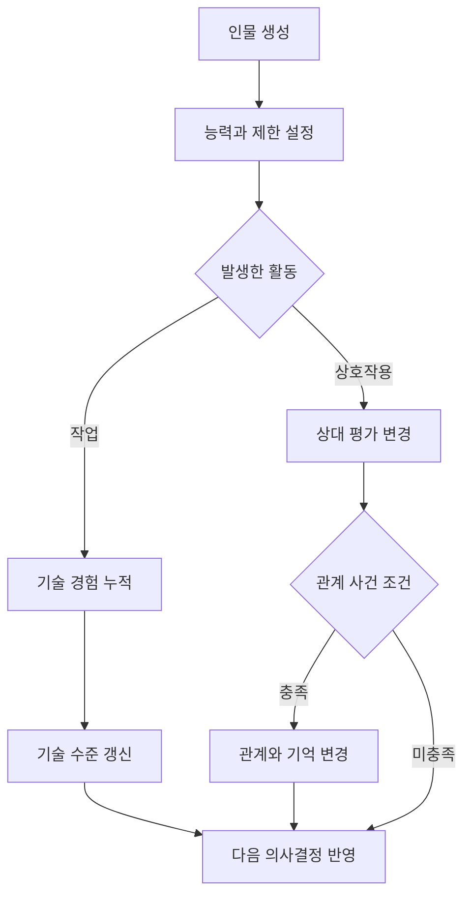

# 02. 정착민·능력·특성·사회관계

[전체 목차](../README.md) · [욕구와 무드](03_needs_mood_mental_breaks.md)

> `[확인]`은 공개자료의 설명이며 실행 검증을 뜻하지 않는다. `[해석]`은 설계 분석, `[제안]`은 원작과 구분되는 재구현 명세다.

## 1. 시스템 목적과 플레이 경험

[확인] 정착민의 배경은 능력과 할 수 없는 일에 영향을 주고, 인간관계도 정착 생활 중 변화한다. [S1] [해석] 이 구조의 목적은 인구수를 곧바로 노동력으로 환산할 수 없게 만드는 데 있다. 같은 인원이어도 숙련·열정·건강·관계의 조합에 따라 생산 안정성이 달라진다.

핵심 질문은 **“지금 유능한 사람”과 “앞으로 성장할 사람”, “집단에 맞는 사람” 중 누구를 선택할 것인가?** 개별 인물의 서사는 효율 계산을 방해하는 장식이 아니라, 채용·훈련·배치 결정에서 발생하는 장기 비용으로 해석한다.

## 2. 범위와 입출력

| 구분 | 내용 | 경계 |
| --- | --- | --- |
| 입력 | 생성 배경, 경험치 획득, 상호작용, 관계 사건 | 퀘스트·작업·사회 사건에서 전달 |
| 유지 상태 | 정체성, 기술, 열정, 특성, 대인관계 | 이 시스템의 소유 |
| 출력 | 작업 자격, 능력 보정, 관계 변화, 감정 사건 | 작업·무드·전투가 소비 |
| 비담당 | 신체 부위 손상, 현재 작업 선택, 무드 완화 속도 | 의료·작업·욕구 문서 참조 |
| DLC 경계 | 유전자, 아이 성장, 이념 역할, 작위 | 각각의 DLC 문서에서 확장 |

## 3. 플레이어 조작과 제공 정보

[확인] 인물 정보에서는 기술과 열정, 업무 불가능 항목을 확인할 수 있고, 사회관계 탭은 상대에 대한 평가와 관계를 보여준다. [S2][S3]

[제안] 비교 화면은 현재 기술만 정렬하지 말고 `현재 생산성 / 학습 잠재력 / 업무 가능 여부 / 사회적 부담`을 별도 열로 제공한다. 예컨대 의료 기술이 낮은 인물과 의료 업무 자체가 불가능한 인물은 다른 안내가 필요하다. 특성 설명은 수치 변화와 행동 제한을 분리하며, 현재 상태로 인해 일시적으로 불가능한 행동은 영구 제한과 구별한다.

## 4. 핵심 규칙

| ID | 조건 | 처리·결과 | 근거 |
| --- | --- | --- | --- |
| PAWN-01 | 관련 활동 수행 | 개별 기술 경험치 획득 | [확인] [S2] |
| PAWN-02 | 기술 수준 상승 | 관련 업무 속도·성공률·결과 품질 등에 영향 | [확인] [S2] |
| PAWN-03 | 열정이 있는 활동 | 학습 효율과 작업 중 만족에 영향 | [확인] [S2] |
| PAWN-04 | 기술을 유지하지 않음 | 경험치 감소가 존재하여 고숙련 유지에 연습 필요 | [확인] [S2] |
| PAWN-05 | 업무 불가능 조건 | 낮은 기술과 달리 해당 업무 자격이 제한됨 | [확인] [S2] |
| PAWN-06 | 특성 적용 | 상시 보정·선호·조건부 행동 등 차이를 생성 | [확인] [S4] |
| PAWN-07 | 근처 인물과 상호작용 | 상대 평가와 관계에 영향을 주며 갈등·연애로 연결 가능 | [확인] [S3] |
| PAWN-08 | 사회적 다툼 | 작업 이탈과 부상으로 이어질 수 있음 | [확인] [S3] |

## 5. 상태와 처리 흐름

[제안] `기술 성장`과 `사회관계`는 인물 ID를 공유하되 별도로 갱신한다. 다른 사람에 대한 감정은 방향이 있으므로 양쪽 값을 강제로 같게 만들지 않는다.



## 6. 데이터 모델 및 인터페이스

[제안] 아래 모델은 기능 분석용이며 원작 클래스·저장 형식이 아니다.

| 필드 | 타입·단위 | 역할 |
| --- | --- | --- |
| pawn_id | EntityId | 지도 이탈·재등장에도 유지하는 정체성 |
| background_ids | DefinitionId list | 생성 배경 참조 |
| skill_records | map | 기술별 수준·누적 경험·열정 |
| trait_ids | DefinitionId list | 특성 정의 참조 |
| incapability_tags | tag set | 업무 불가능 조건 |
| effective_stat_context | derived record | 건강·장비와 결합한 현재 효율 |
| directed_opinions | map of EntityId | 상대별 평가와 원인 목록 |
| relationship_edges | relation list | 친족·배우자 등 관계 의미 |

```yaml
# 제안 예시. 수치는 재구현 테스트용이다.
pawn_id: pawn_amy
skill_records:
  medical:
    level: 6
    experience: 120.0
    passion: major
incapability_tags: [artistic]
directed_opinions:
  pawn_jin:
    score: 18
    reasons: [rescued_me]
```

[제안] `SkillProgressed`는 능력 표시를, `RelationChanged`는 무드·침실 배정 검사를 갱신한다. 업무 자격은 단일 점수로 만들지 않고 `가능 여부 → 현재 수행 가능성 → 예상 효율`의 세 단계 질의로 제공한다. 인물 사망 후에도 친족·기억에서 참조하는 ID는 유지할 수 있어야 한다.

## 7. 수치와 밸런스

| 항목 | 구분 | 적용 판단 |
| --- | --- | --- |
| 기술 수준 0~20 | [확인] [S2] | 전체 인물 레벨과 구분 |
| 기술 종류 12개 | [확인] [S2] | 작업 분류와 일대일 대응 아님 |
| 열정 없음·1단계·2단계 | [확인] [S2] | 기술별 독립 상태 |
| 기술 감소·일일 학습 상한 세부 계수 | [미확인] | 패치와 조건을 고정해 검증 필요 |
| 사회 상호작용 확률 | [미확인] | 상대 평가 외 요인의 기여를 단정하지 않음 |

[제안] 프로토타입에서는 동일 작업량의 성과와 학습량을 따로 측정한다. 숙련자가 빨리 끝내는 경우, 완료 건수에만 비례해 학습시키면 이미 잘하는 인물만 더 빠르게 성장하는 의도치 않은 편중이 발생할 수 있다.

## 8. 대표 플레이 사례와 예외

[제안 사례] 의료 10의 무열정 인물과 의료 5의 강한 열정 인물이 있다고 가정한다. 긴급 수술은 전자에게 맡기고, 평시 치료는 후자에게 배정하는 운영을 지원한다. 단, 전자가 부상으로 조작 능력을 잃었다면 기술 숫자가 아니라 현재 수행 조건을 기준으로 판단해야 한다.

[제안] 사회적 사건은 직접 관련자와 목격자를 분리해 전달한다. 한 명의 죽음이 모든 인물에게 같은 감정을 생성하지 않도록 관계·특성 검사를 거친다. 다른 지도에 있는 배우자의 참조, 이미 사망한 인물에 대한 기억, 상대가 적 세력으로 전환된 경우에도 인물 정체성과 세력 소속을 혼동하지 않는다.

## 9. 다른 시스템과의 연결

| 연결 문서 | 주고받는 정보 | 연결 효과 |
| --- | --- | --- |
| [작업 선택](04_work_priorities_jobs.md) | 업무 자격·기술·열정 | 배치와 예상 생산성 |
| [욕구·무드](03_needs_mood_mental_breaks.md) | 특성, 관계 사건 | 같은 사건의 감정 차이 |
| [의료](09_health_medical_body.md) | 현재 능력·부상 | 숙련과 신체 상태 결합 |
| [세력·포로](14_factions_trade_prisoners.md) | 사회 능력·소속 전환 | 모집과 협상 |
| [Biotech](../dlc/03_biotech.md) | 성장·유전자 입력 | 기본 인물 모델 확장 |

## 10. 검증 시나리오

**[제안] 수용기준. 실행 미실시.**

| Given | When | Then |
| --- | --- | --- |
| 기술 0, 업무 가능 | 해당 업무 배정 | 낮은 효율로 후보가 될 수 있음 |
| 높은 기술, 영구 불가능 업무 | 해당 업무 배정 | 자격 거절과 원인 표시 |
| 동일 활동, 다른 열정 | 같은 시간 훈련 | 설정한 학습 차이가 발생 |
| A가 B를 좋아하나 B는 그렇지 않음 | 관계 UI 확인 | 두 방향 평가가 구분됨 |
| 지도 밖에 있는 가족 | 인물 재등장 | 기존 가족 ID와 연결 유지 |
| 사회적 사건 발생 | 무드 처리 | 관계·특성별로 적합한 반응만 생성 |

## 11. 설계 해석과 재구현 우선순위

[해석] 인물은 생산 설비이면서 감정과 역사도 가진 주체다. 교체 비용이 기술 손실에만 머무르지 않아, 플레이어가 비효율적인 인물을 계속 돌보는 선택에 이유가 생긴다.

[제안] MVP는 인물 ID, 세 가지 기술, 업무 불가능 태그, 열정, 방향성 상대 평가까지다. 후속 단계에서 기억 지속 시간, 친족·연애 관계, 특성 간 충돌 검사를 확장한다. 유전자와 성장 단계는 기본 인물 데이터가 안정된 이후 별도 기능 모듈로 연결한다.

## 12. 출처와 확인 필요 사항

| 키 | 출처·유형 | 확인한 내용 |
| --- | --- | --- |
| S1 | [RimWorld 공식 소개](https://rimworldgame.com/) · 공식 | 배경·능력·관계가 결합된 인물 구성 |
| S2 | [Skills](https://rimworldwiki.com/wiki/Skills) · 커뮤니티 | 기술, 열정, 학습, 업무 분류와의 차이 |
| S3 | [Social](https://rimworldwiki.com/wiki/Social) · 커뮤니티 | 평가·상호작용·관계 사건 |
| S4 | [Traits](https://rimworldwiki.com/wiki/Traits) · 커뮤니티 | 특성의 효과 범주 |

확인일: 2026-11-13. 기술 증가·감소 공식의 전 조건, 사회 상호작용 선택 가중치는 소스·실행 검증하지 않았다. 성인 특성 변화처럼 DLC 예외가 존재하는 사항은 “절대 변하지 않는다”로 일반화하지 않는다.
